# Herdr World

<p align="center">
  
</p>

A **visual control plane** for [Herdr](https://herdr.dev). Connect local and SSH
hosts, see their agents together in Town, Board or Desk, and chat with them,
start them from profiles, and use independently qualified terminals, files and
changes on desktop or mobile. **Requires a running Herdr server.**

## What's new in 0.3.0

- **Find or act.** One command box finds agents, terminals, rooms and buildings,
  switches views and runs actions. Use **Ctrl+K** (**Cmd+K** on Mac), or
  **Find or act** in the phone's corner view menu.
- **See who needs you.** The shared **Needs you** tab gathers questions, blocked
  agents and finished work. Answer with attachments or mark work reviewed;
  review marks follow you across views and browsers.
- **Follow progress and capacity.** Town bubbles and Board cards show current
  steps. Subscription fuel gauges, expense boards and context indicators help
  you decide what to delegate next.
- **Organize busy work.** Search across views, use lenses for spending, idle time,
  pull requests and quests, move and tidy Town rooms, and keep open pull requests
  visible at the post office after their agents leave.
- **Continue across devices.** Saved questions, answers, results and more settings
  survive restarts and follow the World service across browsers. Minimize windows
  on phones or dock Chat beside your work on desktop.
- **Upgrade in one run.** `herdr-world update` restarts the matching running managed
  World service on Linux/macOS and sets up World skills and Claude usage readings
  for configured agent tools. Set `HERDR_WORLD_SKIP_INTEGRATIONS=1` to keep that
  integration setup manual.

Read the [0.3.0 release notes](./docs/releases/v0.3.0.md) for backup and upgrade steps and
known limits.

## Choose your layout

- **Town** is the default: host buildings contain workspace rooms, team tables
  and terminal seats. Find waiting agents at reception, read their peek and reply.
- **Board** puts workspace and tab cards beside your notes. Arrange cards, string
  a note to an exact pane and explicitly send it when ready.
- **Desk** groups agents into Needs you, To review and In flight, with a reading
  pane for Chat, terminal, files and changes.
- **Spaces** focuses one workspace's terminal panes and repository tools.

Town, Board and Desk share the **Hosts** filter. Open terminals and Inspectors
retain their owning host when the filter changes. Use **Actions → New workspace**
or **New tab** and confirm the destination; Town's **+ Add room** doorways and
Board's **+** controls offer the same qualified creation flows.

Office, Tree and Graph have been retired: old `/office` addresses open Town, and
`/graph` and `/tree` open Board. Board and these redirects are included in
[0.2.6](./docs/releases/v0.2.6.md).

## Screenshots

The Town and Board captures show 0.3.0 with a synthetic crew on two hosts:
agents working, asking, blocked and finished, with their current steps,
expenses and subscription gauges. The Chat, Files, Changes and Spaces captures
show 0.2.7 with four disposable workspaces on a throwaway Herdr session, where
three real Claude Code agents ran small tasks: one added a first-run section to
the demo README, one waited on you and one finished. The notes and terminal
commands are synthetic. Click a screenshot to open it at full resolution.

### Desktop

| Town: buildings, receptions, expenses and fuel | Town desks: each agent's current step |
| --- | --- |
| [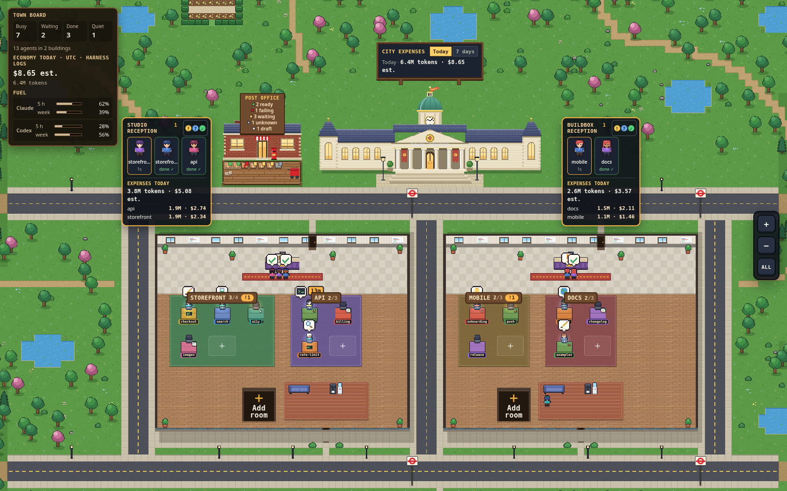](./docs/images/herdr-world-desktop-town.png) | [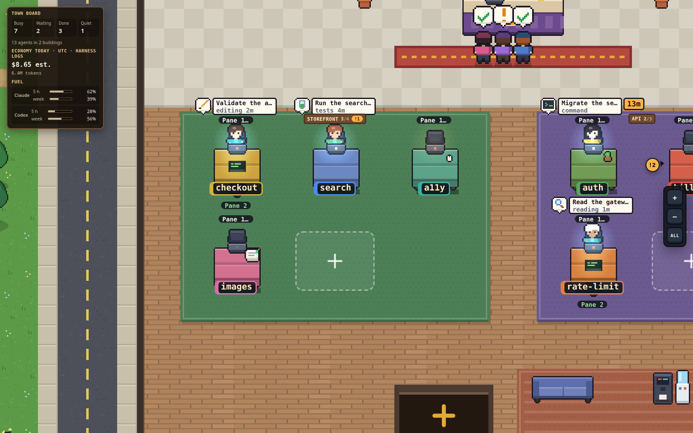](./docs/images/herdr-world-desktop-town-steps.png) |

[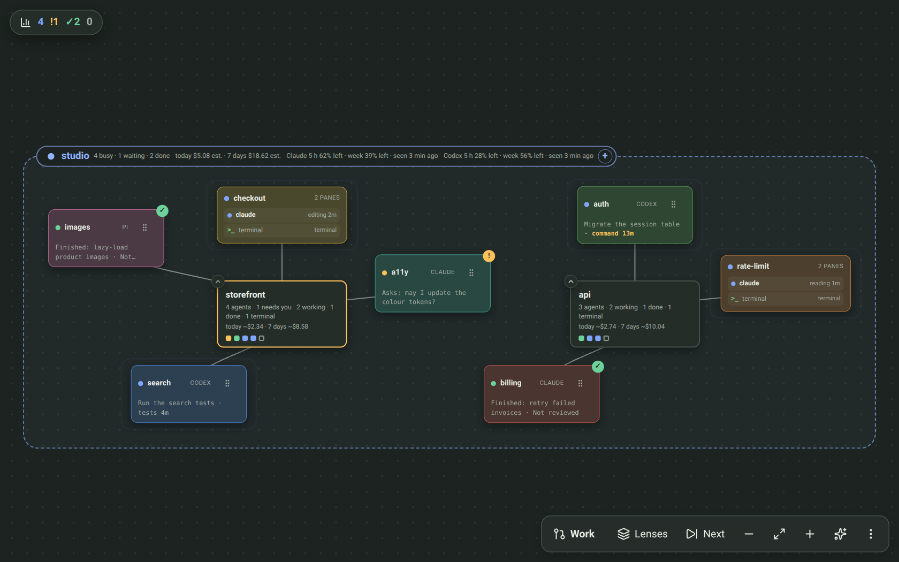](./docs/images/herdr-world-desktop-board.png)

[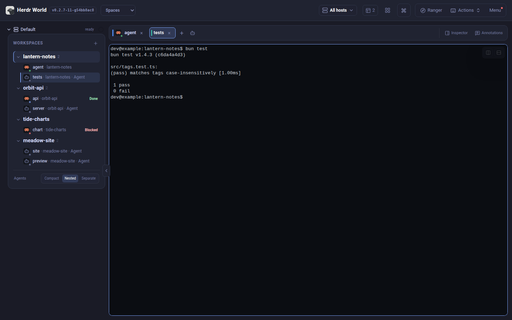](./docs/images/herdr-world-desktop-spaces.png)

Each agent has one window with Chat, Terminal, Files and Changes, whether
opened from Town, Board or Desk. When set to open Chat, it starts on Terminal
until Chat can show the conversation, including when a session exists but its
record cannot be read. It switches once Chat is available, unless you chose
a view yourself. See [Chat](./docs/CHAT.md) and the
[tutorial's review exercise](./docs/TUTORIAL.md#daily) for the complete flow.

| Chat | Files | Changes |
| --- | --- | --- |
| [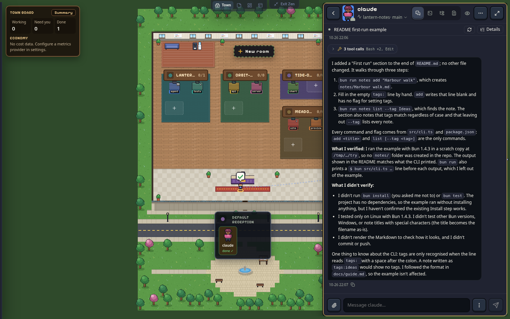](./docs/images/herdr-world-desktop-chat.png) | [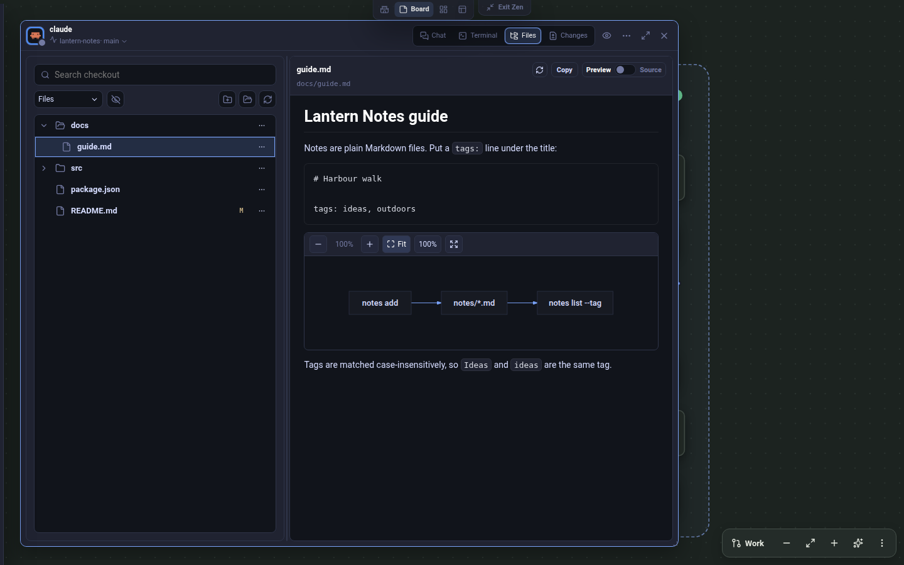](./docs/images/herdr-world-desktop-files.png) | [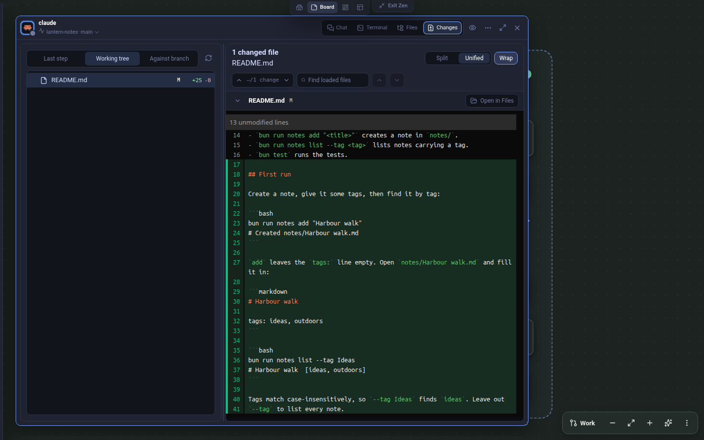](./docs/images/herdr-world-desktop-changes.png) |

### Mobile

| Town | Chat | Board | Spaces |
| --- | --- | --- | --- |
| [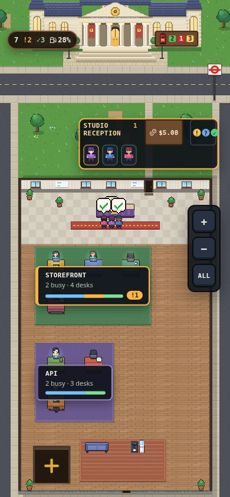](./docs/images/herdr-world-mobile-town.png) | [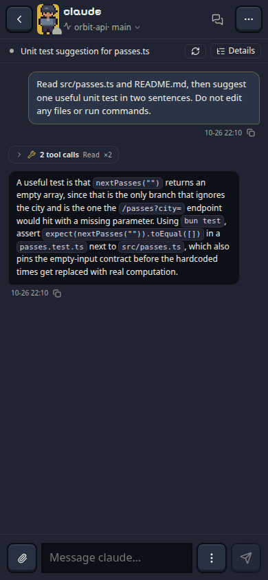](./docs/images/herdr-world-mobile-chat.png) | [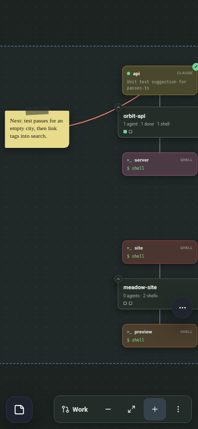](./docs/images/herdr-world-mobile-board.png) | [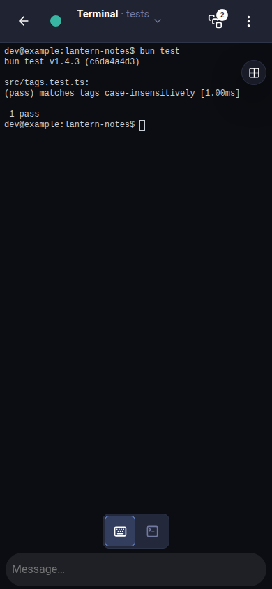](./docs/images/herdr-world-mobile-spaces.png) |

## Quick start

1. Herdr World runs on [Herdr](https://herdr.dev). A fresh standalone install
   reuses existing Herdr and installs it only if missing; Homebrew does the same
   on first World launch. Set `HERDR_WORLD_SKIP_HERDR=1` to skip this setup.
   With npm or a Windows archive, run `herdr-world herdr upgrade --install`
   once if needed.
   `herdr-world herdr setup` configures future startup as a user service and starts
   Herdr if down; an already-running server keeps running without a restart. If
   you open World before Herdr is installed or running, Town offers **Set up
   Herdr**, which installs or starts it only after you confirm.
2. On Linux or macOS, install Herdr World with the standalone installer:

   ```bash
   # Empty selects latest; use X.Y.Z (no v prefix) to pin a Herdr World version.
   curl -fsSL \
     https://github.com/IvoryHeart/herdr-world/releases/latest/download/install-herdr-world.sh \
     | HERDR_WORLD_VERSION= sh
   ```

   For 0.2.0 and newer releases, Homebrew (`brew install IvoryHeart/tap/herdr-world`)
   and npm (`npm install --global @ivoryheart/herdr-world`) are alternative channels.
   npm requires Node.js 22.14.0 or newer and downloads only the binary for the
   current platform. On Windows, use npm or download the matching x64 or ARM64
   archive from the [latest release](https://github.com/IvoryHeart/herdr-world/releases/latest).
   Rerun the installer to upgrade: it upgrades Herdr, refreshes its harness
   integrations and installed World plugin, then restarts the running World
   service using that executable (systemd on Linux, launchd on macOS). Output
   reports updated or current components and whether World restarted.
   Put `HERDR_WORLD_SKIP_HERDR=1` before `sh` to skip Herdr and its integration/plugin
   changes while still restarting World. `herdr-world rollback` restores the
   previous World binary; it leaves Herdr and integrations as they are.
   Every installer run and
   `herdr-world update` also discovers configured harnesses and installs or
   refreshes [World's skills and Claude limits tap](./docs/harness-integrations.md).
   Set `HERDR_WORLD_SKIP_INTEGRATIONS=1` to keep these manual, independently of
   the Herdr opt-out. `herdr-world integration uninstall <harness>` keeps that
   integration removed on later installs and updates; explicit install reenables it.
3. On Linux/macOS standalone installs, add `~/.local/bin` to `PATH`. Run
   `herdr-world` (or `herdr-world.exe` from an extracted Windows archive) and open
   the printed URL.

Use Manage connections to add local sockets or an SSH destination. One World
service owns every connection and the browser stays on that World origin. Hosts
filters Town, Board, Desk, the navigator, counts and search; it never
connects or disconnects a profile. Terminals and Inspectors on different ready hosts can
operate together. Global creation visibly confirms one destination host.

Your GitHub pull requests and Jira tickets appear beside the agents working on
them (Board's **Work** lens and Town desk badges). GitHub works once `gh auth
login` is done for the user running World; add Jira in **Settings → Sources**.

See [deployment](./docs/DEPLOYMENT.md) for checksums, profiles, authentication,
updates, and services.

## Install as a PWA

**PWA installation is recommended for daily use:** a separate app window without
browser tabs or the address bar. Open and authenticate with Herdr World, then install:

- **iPhone/iPad Safari:** Share -> Add to Home Screen.
- **macOS Safari 17+:** File -> Add to Dock.
- **Chrome/Edge:** browser menu -> Install app.

The process must stay running and reachable. **PWA mode is not offline access.**

## Documentation

- [Website](https://herdr.world/) and
  [hands-on tutorial](https://herdr.world/tutorial/)
  ([Markdown](./docs/TUTORIAL.md)): [Town](./docs/TUTORIAL.md#town),
  [Board](./docs/TUTORIAL.md#board), [Desk](./docs/TUTORIAL.md#desk), terminal/file review, mobile,
  and private remote access.
- [Chat](./docs/CHAT.md): reading and replying to agents, answering their
  prompts, and which harnesses Chat supports.
- [Features and shortcuts](./FEATURES.md), including the
  [agent CLI](./FEATURES.md#agent-cli-herdr-world---skill): run
  `herdr-world --skill` to teach an agent to change World.
- [Deployment](./docs/DEPLOYMENT.md): installation, configuration, services, builds.
- [Architecture](./docs/ARCHITECTURE.md): system contracts.
- [Repository knowledge map](./docs/knowledge-map.md) and
  [foundation source guide](./docs/foundation-guide.md): contracts, module owners,
  request paths, and focused tests for contributors and agents.
- [Development](./docs/development.md), [packaging](./docs/packaging.md), and
  [release process](./docs/release.md), and [screenshot capture](./docs/SCREENSHOTS.md).
- [Security](./SECURITY.md) and [contributing](./CONTRIBUTING.md).

## Development

Use Bun 1.4.4 or newer and a running Herdr server:

```bash
bun install --frozen-lockfile
# Run in separate terminals:
bun run dev:server
bun run dev:web
```

Open <http://localhost:5173>. See [CONTRIBUTING.md](./CONTRIBUTING.md) for checks
and pull requests.

## Security

Herdr World controls terminals and modifies real files. Keep the default loopback
binding. Every listener requires login with a 15–1024-character configured password
or a generated persistent token; read [SECURITY.md](./SECURITY.md) before allowing another device access.

## License

Code: [MIT](./LICENSE). Bundled dependencies, fonts and brand assets retain their
original terms; see [THIRD_PARTY_NOTICES.md](./THIRD_PARTY_NOTICES.md) and the
generated [dependency licence texts](./DEPENDENCY_LICENSES.md).
