# Herdr World

<p align="center">
  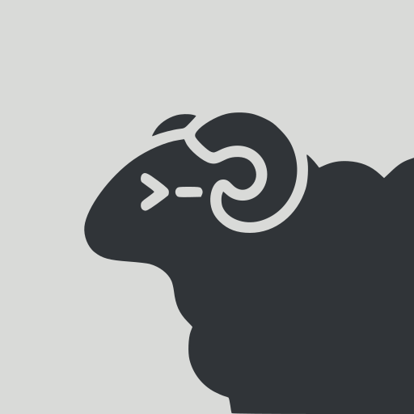
</p>

See your coding agents, answer their questions and review their work from a
browser or phone. World connects to local and SSH hosts and shows them together.

## Runtimes

World works with the **Herdr TUI**, **herdr-core**, or both on one computer.
**herdr-core is primary when installed and connected**: new agents use it unless
you choose a Herdr TUI room. World discovers both on each host; each runtime keeps
its own connection identity for safe operations.

- **herdr-core:** install it with the [official instructions](https://github.com/herdrdev/herdr-core)
  or World's setup below. With core already running and no Herdr TUI, World's
  first run connects to it automatically and makes it the default. With both
  installed, World finds both. Add another host with
  `herdr-world connections add you@host.example`, or use the existing runtime
  controls in **Hosts → Manage connections → Add herdr-core**. Choose **This computer**, **A Unix host over SSH** or
  **A Windows host over SSH** and connect. Keep session **default** unless you changed
  `HC_SESSION`. Windows core needs Windows x64 and PowerShell; over SSH, install
  and start it on Windows first and use SSH key login.
- **Herdr TUI:** [install Herdr](https://herdr.dev), then run
  `herdr-world herdr setup` to start it now and at login. World connects locally;
  use **Add Local** if needed. For another computer, install and start the Herdr
  TUI there, then add an **SSH** connection with its OpenSSH alias or
  `you@host.example`. Select **Windows** for a Windows SSH host.

World 0.3.5's verified current Herdr TUI range is **0.9.0–0.9.5**; its verified
core baseline is **herdr-core 0.1.21**. For older/newer versions, platform limits
and each capability, see the [runtime support table](openspec/specs/herdr-core-runtime/notes.md#runtime-support).
Connection and retry never install or start herdr-core.

## Quick start

1. Choose one World install channel:

   | Channel | Install |
   | --- | --- |
   | Standalone, Linux/macOS | Run the command below; add `~/.local/bin` to `PATH`. |
   | Homebrew, Linux/macOS | `brew install IvoryHeart/tap/herdr-world` |
   | npm, including Windows | `npm install --global @ivoryheart/herdr-world` (Node.js 22.14.0+). |
   | Windows archive | Extract the matching x64 or ARM64 [release](https://github.com/IvoryHeart/herdr-world/releases/latest); run `herdr-world.exe`. |

   ```bash
   curl -fsSL \
     https://github.com/IvoryHeart/herdr-world/releases/latest/download/install-herdr-world.sh \
     | HERDR_WORLD_VERSION= sh
   ```

2. Get a runtime ready:

   | Already installed | What to do |
   | --- | --- |
   | Only herdr-core | Run `hc server start`; World's first run finds it and makes it the default. No Herdr TUI is needed. |
   | Only Herdr TUI | Run `herdr-world herdr setup`. |
   | Both | Start both; World discovers and connects both on this computer. |
   | Neither | Standalone installs core; Homebrew does so on first launch. With npm or an archive, run `herdr-world herdr upgrade --install`. |

   Setup starts a new core now and at login, including Windows x64. Existing
   runtimes are kept. `HERDR_WORLD_SKIP_HERDR=1` skips automatic setup.
3. Run `herdr-world` and open its printed login URL. **Town** opens first.
   If no runtime is running, choose **Set up herdr-core**, or **Use the Herdr
   TUI instead**, and confirm. **Hosts → Manage connections** also offers
   **Install herdr-core…** locally and on saved Unix SSH hosts.
4. Choose **New agent**, select an installed harness you have signed in to,
   and start it. Tap its desk for Chat or Terminal. With core, the launcher
   says **Starts in herdr-core**.

Rerun your install channel to update World. Standalone replacements and
`herdr-world update` refresh Herdr TUI integrations and World's
[harness skills](./docs/harness-integrations.md); they leave an installed core
unchanged. See [deployment](./docs/DEPLOYMENT.md) for upgrades, services and SSH.

## Choose your layout

| View | Use it to |
| --- | --- |
| **Town** | See agents at desks and find waiting agents at reception. |
| **Board** | Arrange cards and notes, and follow pull requests in the Work lens. |
| **Desk** | Work through Needs you, To review and In flight. |
| **Spaces** | Focus one Herdr TUI workspace's terminals and repository tools. |

**Hosts** filters the overview. It never disconnects a host or redirects an
open terminal. **Ctrl+K** (**Cmd+K** on Mac) opens **Find or act**; on phones,
use the corner view menu. Town's sky button below **ALL** sets the time of day
and the weather. Amber light means someone needs you.

GitHub pull requests appear after `gh auth login` for the account running
World. Add Jira in **Settings → Integrations**.

## Screenshots

These captures use synthetic work. Town and Board show 0.3.0; Chat, Files,
Changes and Spaces show 0.2.7. Click an image for full resolution.

### Desktop

| Town: buildings, receptions, expenses and fuel | Town desks: each agent's current step |
| --- | --- |
| [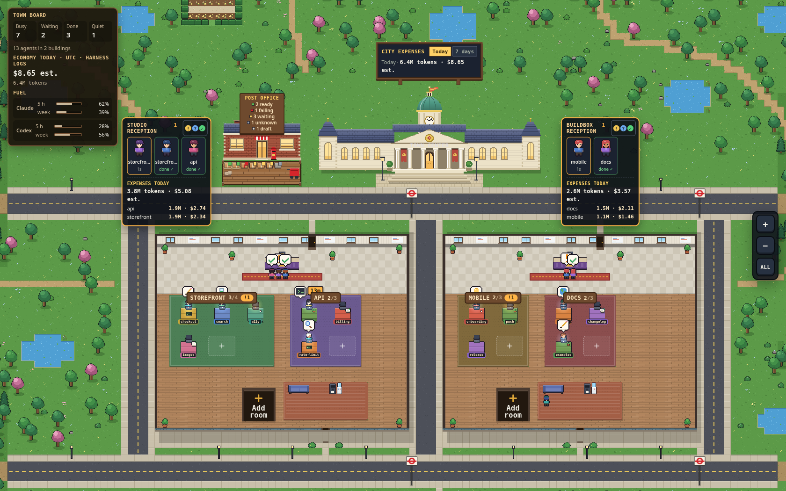](./docs/images/herdr-world-desktop-town.png) | [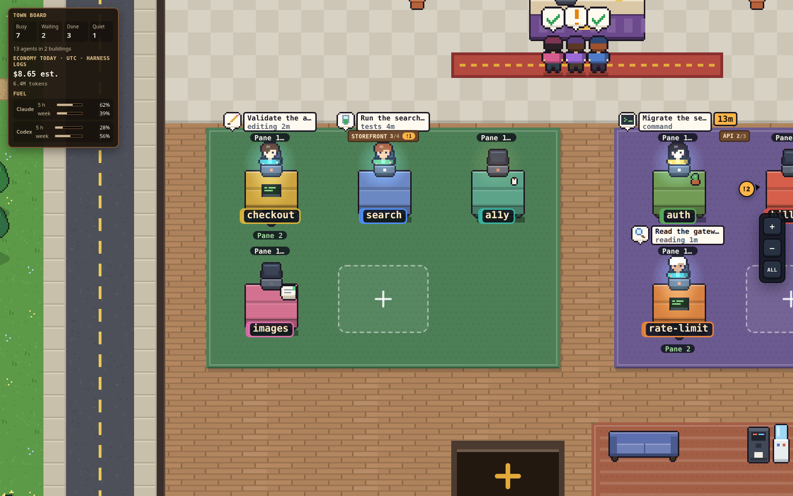](./docs/images/herdr-world-desktop-town-steps.png) |

[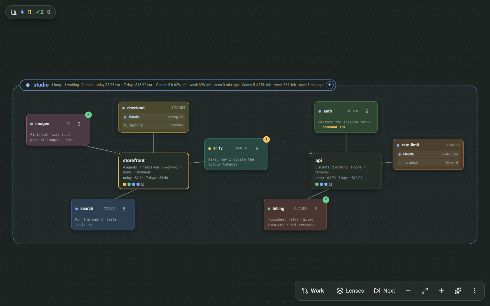](./docs/images/herdr-world-desktop-board.png)

[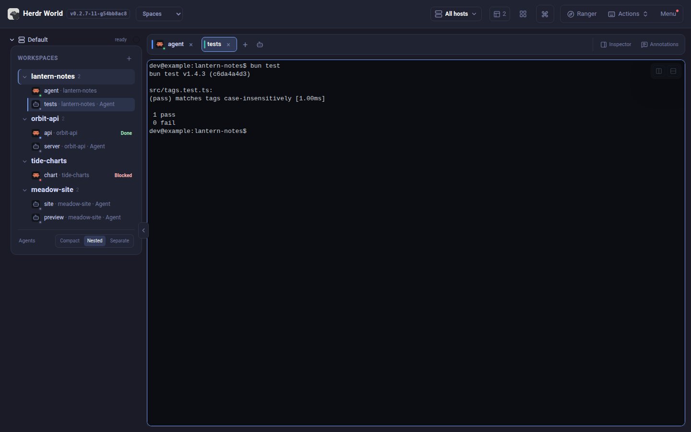](./docs/images/herdr-world-desktop-spaces.png)

Agents open in one window with Chat, Terminal, Files and Changes. See
[Chat](./docs/CHAT.md) or the [review exercise](./docs/TUTORIAL.md#daily).

| Chat | Files | Changes |
| --- | --- | --- |
| [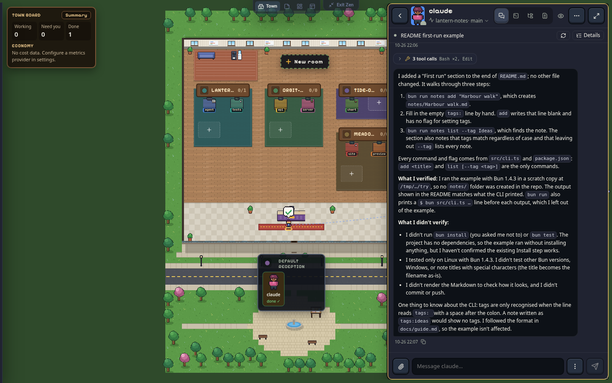](./docs/images/herdr-world-desktop-chat.png) | [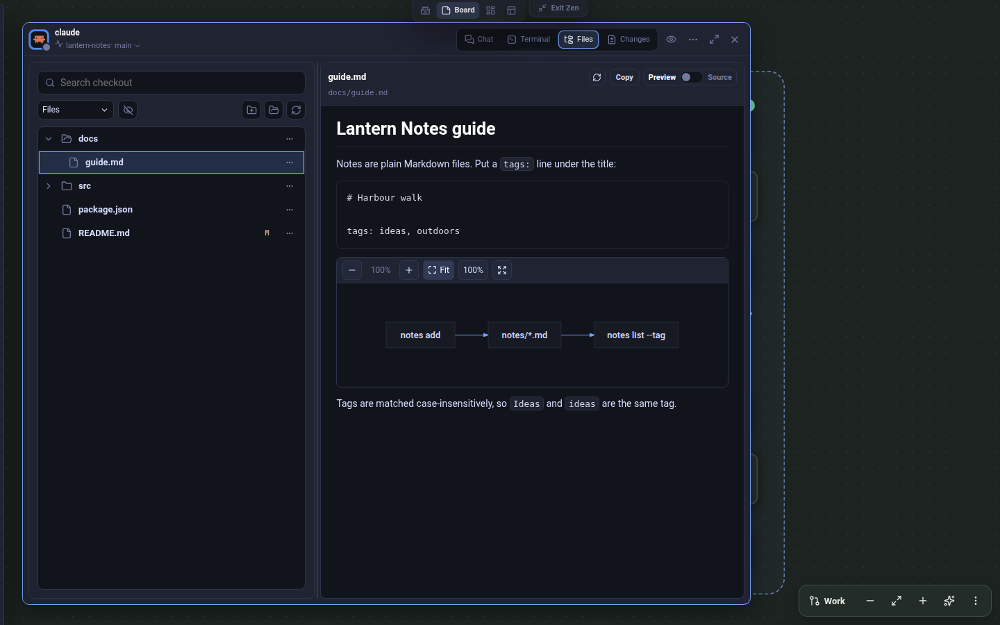](./docs/images/herdr-world-desktop-files.png) | [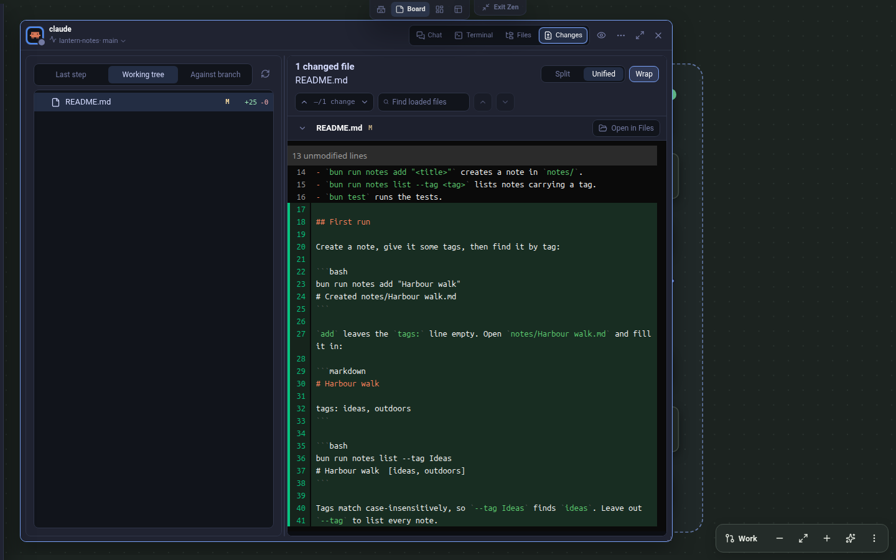](./docs/images/herdr-world-desktop-changes.png) |

### Mobile

| Town | Chat | Board | Spaces |
| --- | --- | --- | --- |
| [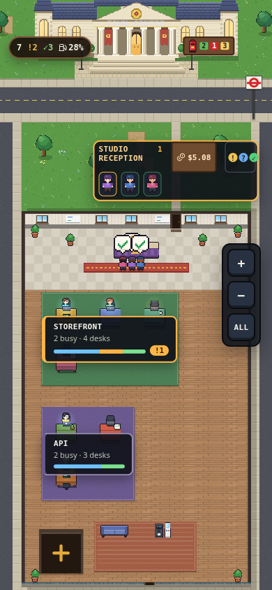](./docs/images/herdr-world-mobile-town.png) | [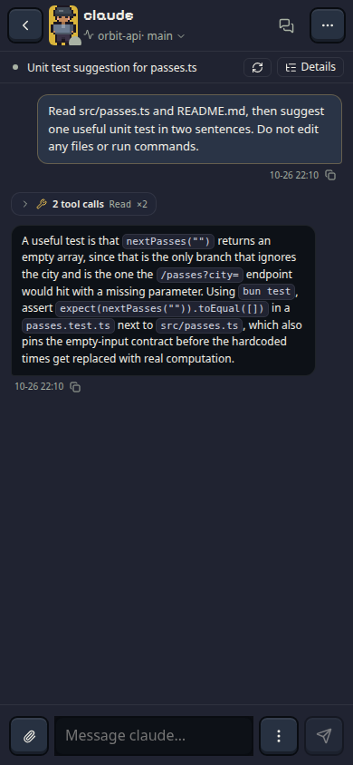](./docs/images/herdr-world-mobile-chat.png) | [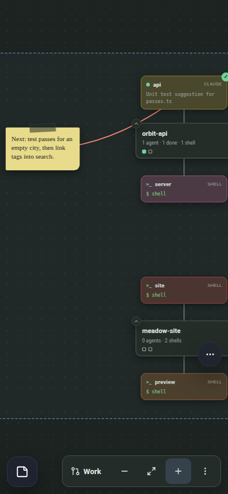](./docs/images/herdr-world-mobile-board.png) | [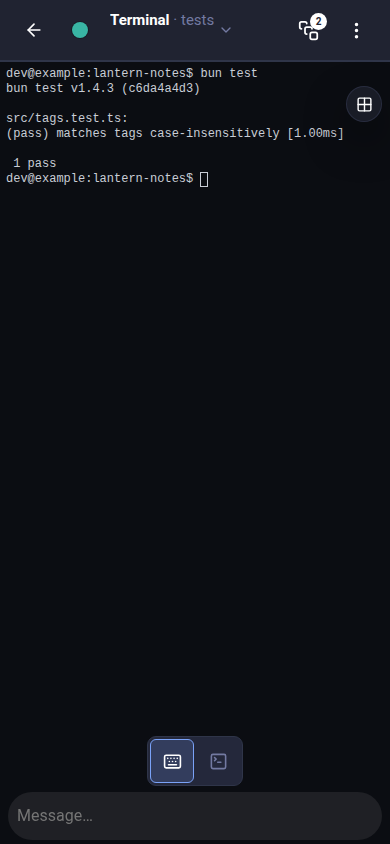](./docs/images/herdr-world-mobile-spaces.png) |

## Install as a PWA

**PWA installation is recommended for daily use:** a separate app window without
browser tabs or the address bar. Open and authenticate with Herdr World, then install:

- **iPhone/iPad Safari:** Share -> Add to Home Screen.
- **macOS Safari 17+:** File -> Add to Dock.
- **Chrome/Edge:** browser menu -> Install app.

The process must stay running and reachable. **PWA mode is not offline access.**

## Documentation

- [Website](https://herdr.world/) and
  [hands-on tutorial](https://herdr.world/tutorial/)
  ([Markdown](./docs/TUTORIAL.md)): [Town](./docs/TUTORIAL.md#town),
  [Board](./docs/TUTORIAL.md#board), [Desk](./docs/TUTORIAL.md#desk), terminal/file review, mobile,
  and private remote access.
- [Chat](./docs/CHAT.md): reading and replying to agents, answering their
  prompts, and which harnesses Chat supports.
- [Features and shortcuts](openspec/specs/world-surfaces/notes.md), including the
  [agent CLI](openspec/specs/world-surfaces/needs-you/notes.md#agent-cli-herdr-world---skill): run
  `herdr-world --skill` to teach an agent to change World.
- [Deployment](./docs/DEPLOYMENT.md): installation, configuration, services, builds.
- [Architecture](./docs/ARCHITECTURE.md): system contracts.
- [Repository knowledge map](docs/agent-development.md#find-a-feature) and
  [foundation source guide](./docs/foundation-guide.md): contracts, module owners,
  request paths, and focused tests for contributors and agents.
- [Development](./docs/development.md), [packaging](./docs/packaging.md), and
  [release process](./docs/release.md), and [screenshot capture](./docs/SCREENSHOTS.md).
- [Security](./SECURITY.md) and [contributing](./CONTRIBUTING.md).

## Development

Use Bun 1.4.4 or newer and a running Herdr TUI or herdr-core runtime:

```bash
bun install --frozen-lockfile
# Run in separate terminals:
bun run dev:server
bun run dev:web
```

Open <http://localhost:5173>. See [CONTRIBUTING.md](./CONTRIBUTING.md) for checks
and pull requests.

## Security

Herdr World controls terminals and modifies real files. Keep the default loopback
binding. Every listener requires login with a 8–1024-character configured password (15+ recommended)
or a generated persistent token; read [SECURITY.md](./SECURITY.md) before allowing another device access.

## License

Code: [MIT](./LICENSE). Bundled dependencies, fonts and brand assets retain their
original terms; see [THIRD_PARTY_NOTICES.md](./THIRD_PARTY_NOTICES.md) and the
generated [dependency licence texts](./DEPENDENCY_LICENSES.md).
