# Town agent moods (#704, PR #712): screenshots and video

Rendered from the PR head with a synthetic scene: one building, 24 agents, 16 blocked for a 10-spot reception queue, and one agent in the unknown state. The Town code is the real one; the clock is a test clock, so 90 s of overflow takes seconds.

Videos (with captions; click to download or play):

- Wide, 1512×982, 50 s: [town-moods-wide.mp4](https://raw.githubusercontent.com/IvoryHeart/herdr-world/pr-assets/crew-704/town-moods-wide.mp4)
- Phone, 390×844, 50 s: [town-moods-phone.mp4](https://raw.githubusercontent.com/IvoryHeart/herdr-world/pr-assets/crew-704/town-moods-phone.mp4)

## Crowd forms and grumbles

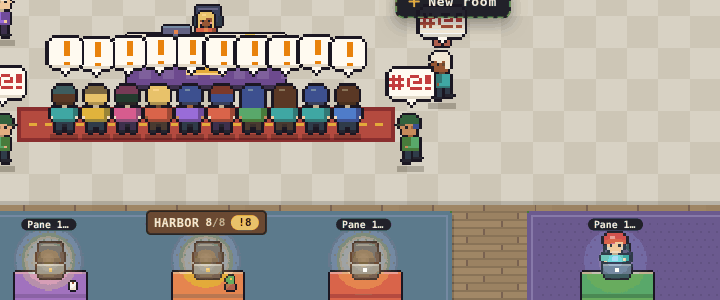

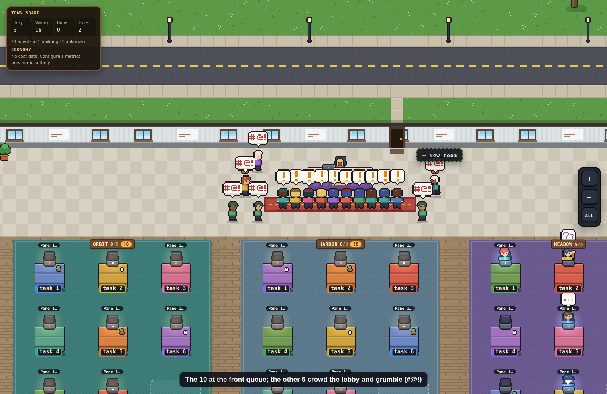

## After 90 s: naps on the floor; a freed spot is taken

At 60 s two more agents get blocked, so at 90 s the early six nap while the two latecomers still grumble. Then one queued agent is answered: the oldest crowd agent gets up and walks to the free spot.

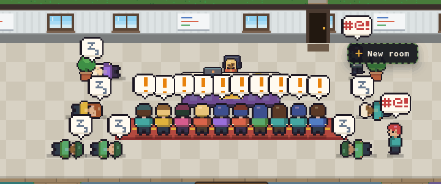

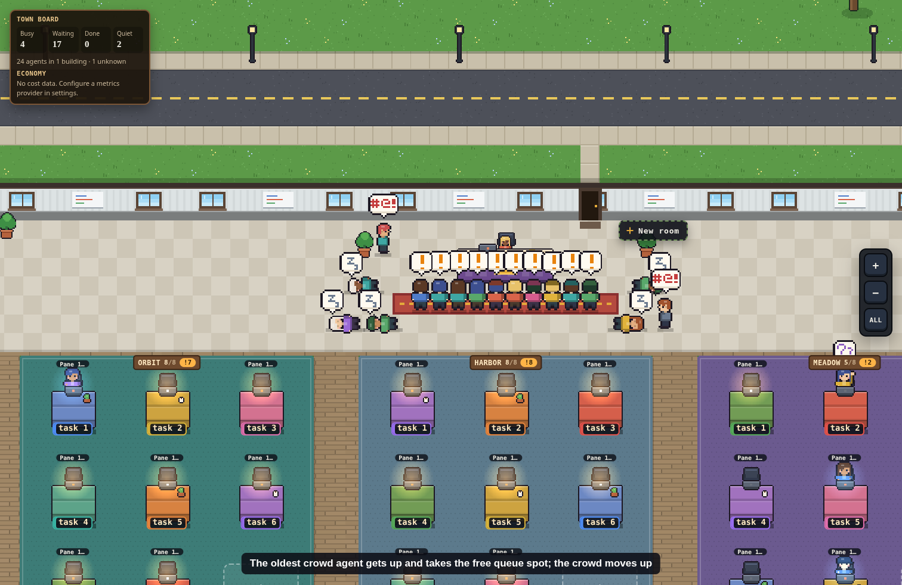

## Unknown state: confused at the desk

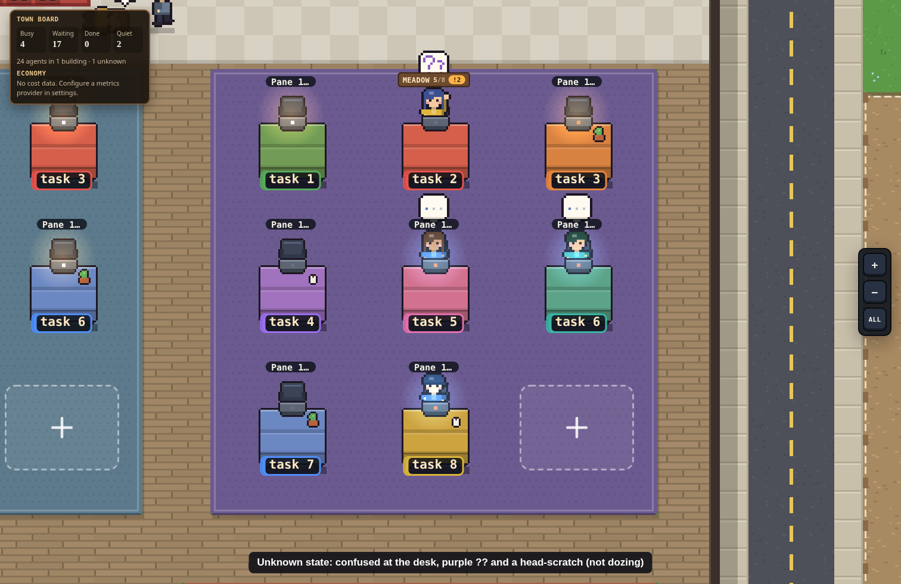

## Town calm motion

The crowd holds still; grumbling (fist up, #@!) and napping (lying, z) stay distinct.

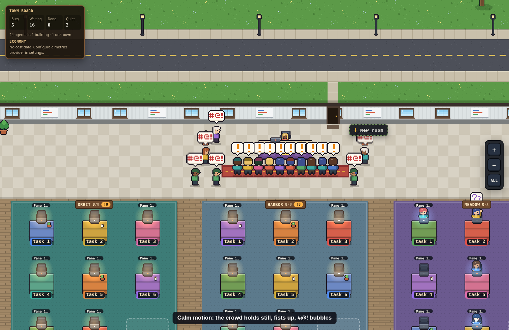
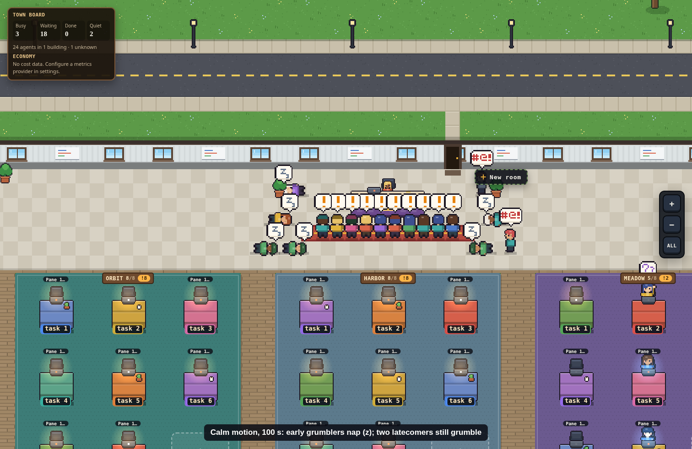

## Phone

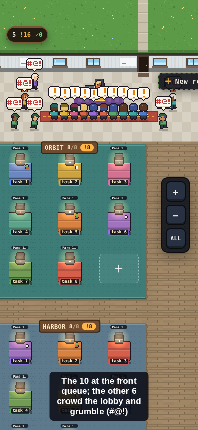
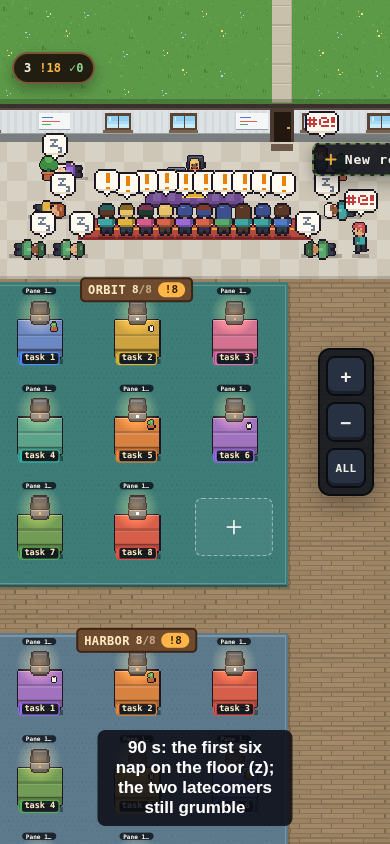
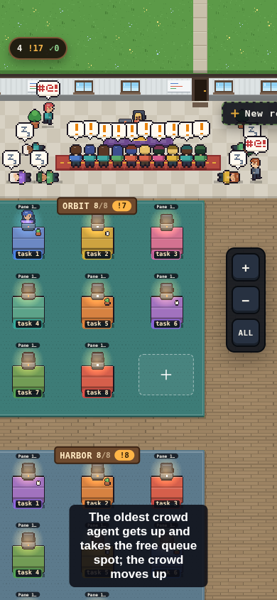
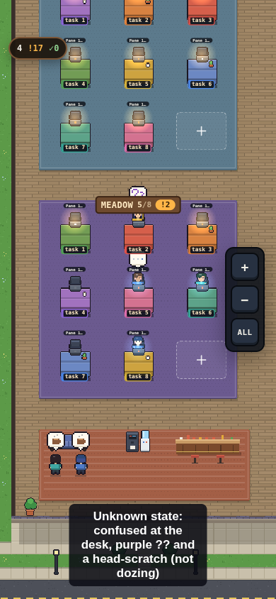
