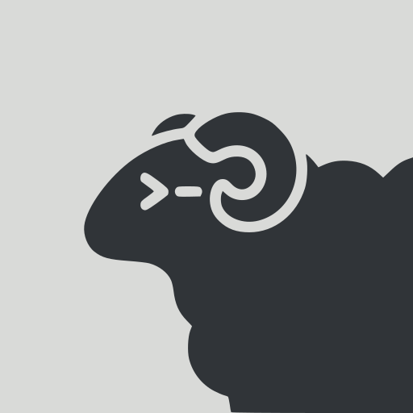
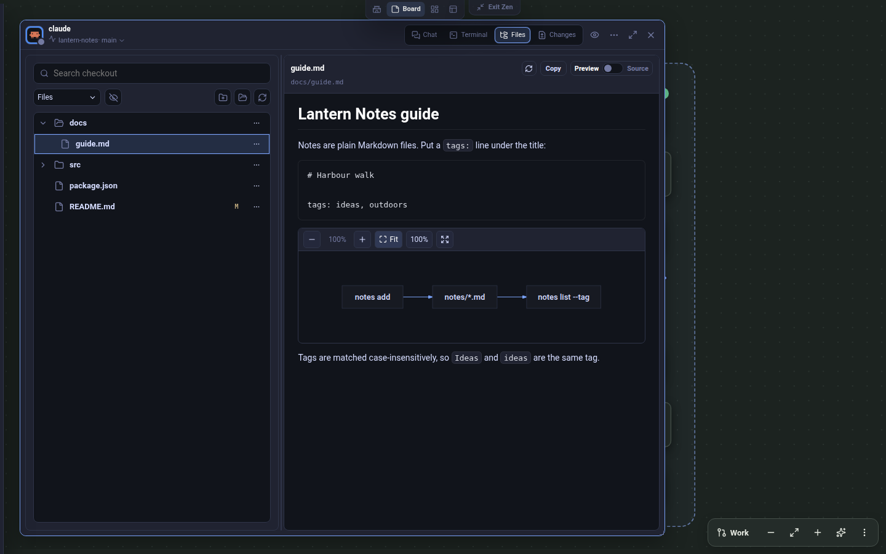
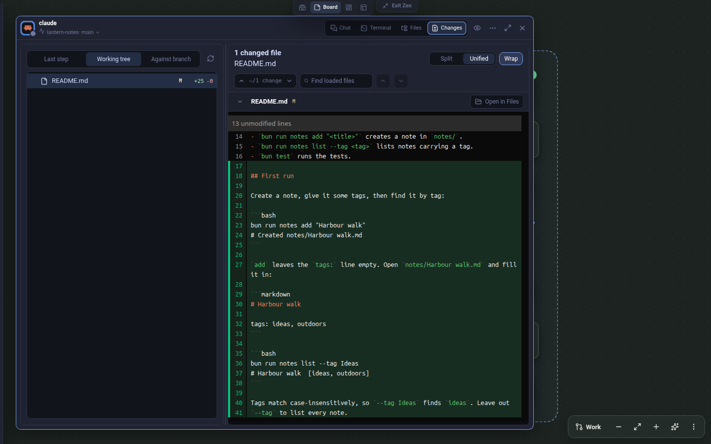
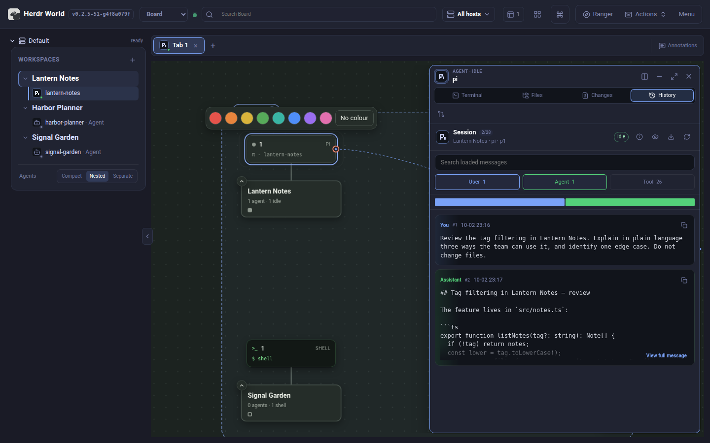

# Herdr World

<p align="center">
  
</p>

A **visual control plane** for [Herdr](https://herdr.dev). Connect local and SSH
hosts, see their agents together in Town, Board or Desk, and use independently
qualified terminals, files, changes and agent history on desktop or mobile.
**Requires a running Herdr server.**

## Choose your layout

- **Town** is the default: host buildings contain workspace rooms, team tables
  and terminal seats. Find waiting agents at reception, read their peek and reply.
- **Board** puts workspace and tab cards beside your notes. Arrange cards, string
  a note to an exact pane and explicitly send it when ready.
- **Desk** groups agents into Needs you, To review and In flight, with a reading
  pane for terminal, files, changes and history.
- **Spaces** focuses one workspace's terminal panes and repository tools.

Town, Board and Desk share the **Hosts** filter. Open terminals and Inspectors
retain their owning host when the filter changes. Use **Actions → New workspace**
or **New tab** and confirm the destination; Town's **New room** and Board's **+**
controls offer the same qualified creation flows.

Office, Tree and Graph have been retired: old `/office` addresses open Town, and
`/graph` and `/tree` open Board. Board and these redirects are included in
[0.2.6](./docs/releases/v0.2.6.md).

## Screenshots

The Town and desktop Board captures show the layouts introduced in 0.2.5–0.2.6
with four disposable workspaces. Mobile Board focuses on one workspace, two
terminal tabs and a strung
planning note. These scenes use real shell panes and synthetic notes. Empty
attention counts reflect those scenes; no agent activity is fabricated. Click a screenshot to open it at full resolution.

### Desktop

| Town: buildings, rooms and team tables | Board: workspace cards, tabs and notes |
| --- | --- |
| [](./docs/images/herdr-world-desktop-town.png) | [](./docs/images/herdr-world-desktop-board.png) |

[](./docs/images/herdr-world-desktop-spaces.png)

The shared Inspector keeps Terminal, Files, Changes and agent Chat alongside
its captured workspace, whether opened from Town, Board or Desk. See the
[tutorial's review exercise](./docs/TUTORIAL.md#daily) for the complete flow.
The Files, Changes and History captures below show the Inspector over Board;
the History view is now **Details** inside [Chat](./docs/CHAT.md).
They use a restored demo project, a sample working-tree diff and a genuine
recorded Pi review.

| Files | Changes | Agent History |
| --- | --- | --- |
| [](./docs/images/herdr-world-desktop-files.png) | [](./docs/images/herdr-world-desktop-changes.png) | [](./docs/images/herdr-world-desktop-history.png) |

### Mobile

[](./docs/images/herdr-world-mobile-board.png)

| Town | Spaces |
| --- | --- |
| [](./docs/images/herdr-world-mobile-town.png) | [](./docs/images/herdr-world-mobile-spaces.png) |

## Quick start

1. Herdr World runs on [Herdr](https://herdr.dev). The standalone installer and
   Homebrew install Herdr too, or upgrade an older one; with npm or a Windows
   archive, run `herdr-world herdr upgrade --install` once. `herdr-world herdr setup`
   starts Herdr as a user service.
2. On Linux or macOS, install Herdr World with the standalone installer:

   ```bash
   # Empty selects latest; use X.Y.Z (no v prefix) to pin a Herdr World version.
   curl -fsSL \
     https://github.com/IvoryHeart/herdr-world/releases/latest/download/install-herdr-world.sh \
     | HERDR_WORLD_VERSION= sh
   ```

   For 0.2.0 and newer releases, Homebrew (`brew install IvoryHeart/tap/herdr-world`)
   and npm (`npm install --global @ivoryheart/herdr-world`) are alternative channels.
   npm requires Node.js 22.14.0 or newer and downloads only the binary for the
   current platform. On Windows, use npm or download the matching x64 or ARM64
   archive from the [latest release](https://github.com/IvoryHeart/herdr-world/releases/latest).
3. On Linux/macOS standalone installs, add `~/.local/bin` to `PATH`. Run
   `herdr-world` (or `herdr-world.exe` from an extracted Windows archive) and open
   the printed URL.

Use Manage connections to add local sockets or an SSH destination. One World
service owns every connection and the browser stays on that World origin. Hosts
filters Town, Board, Desk, the navigator, counts and search; it never
connects or disconnects a profile. Terminals and Inspectors on different ready hosts can
operate together. Global creation visibly confirms one destination host.

See [deployment](./docs/DEPLOYMENT.md) for checksums, profiles, authentication,
updates, and services.

## Install as a PWA

**PWA installation is recommended for daily use:** a separate app window without
browser tabs or the address bar. Open and authenticate with Herdr World, then install:

- **iPhone/iPad Safari:** Share -> Add to Home Screen.
- **macOS Safari 17+:** File -> Add to Dock.
- **Chrome/Edge:** browser menu -> Install app.

The process must stay running and reachable. **PWA mode is not offline access.**

## Documentation

- [Website](https://herdr.world/) and
  [hands-on tutorial](https://herdr.world/tutorial/)
  ([Markdown](./docs/TUTORIAL.md)): [Town](./docs/TUTORIAL.md#town),
  [Board](./docs/TUTORIAL.md#board), [Desk](./docs/TUTORIAL.md#desk), terminal/file review, mobile,
  and private remote access.
- [Features and shortcuts](./FEATURES.md)
- [Deployment](./docs/DEPLOYMENT.md): installation, configuration, services, builds.
- [Architecture](./docs/ARCHITECTURE.md): system contracts.
- [Repository knowledge map](./docs/knowledge-map.md) and
  [foundation source guide](./docs/foundation-guide.md): contracts, module owners,
  request paths, and focused tests for contributors and agents.
- [Development](./docs/development.md), [packaging](./docs/packaging.md), and
  [release process](./docs/release.md), and [screenshot capture](./docs/SCREENSHOTS.md).
- [Security](./SECURITY.md) and [contributing](./CONTRIBUTING.md).

## Development

Use Bun 1.4.3 or newer and a running Herdr server:

```bash
bun install --frozen-lockfile
# Run in separate terminals:
bun run dev:server
bun run dev:web
```

Open <http://localhost:5173>. See [CONTRIBUTING.md](./CONTRIBUTING.md) for checks
and pull requests.

## Security

Herdr World controls terminals and modifies real files. Keep the default loopback
binding. Every listener requires login with a 15–1024-character configured password
or a generated persistent token; read [SECURITY.md](./SECURITY.md) before allowing another device access.

## License

Code: [MIT](./LICENSE). Bundled dependencies, fonts and brand assets retain their
original terms; see [THIRD_PARTY_NOTICES.md](./THIRD_PARTY_NOTICES.md) and the
generated [dependency licence texts](./DEPENDENCY_LICENSES.md).
