<!-- Generated by `bun run help:docs` from the help declarations (web/src/**/*.help.ts). Do not edit by hand. -->

# What you can do in Herdr World

Every World screen answers this too: press ? beside the views (on a phone, the views button), then **What can I do here?** Each entry there has a Try button that shows you the control.

## Start here

1. [Move around Town](#town-zoom): Town shows every agent at its desk. The camera buttons step between the whole town, one building, one room and one desk.
2. [Next agent needing you](#board-next): Board lays out every host, room and agent as cards. Next opens the next agent that needs you, shared questions too.
3. [Talk to an agent](#chat-composer): Chat shows an agent's conversation as messages. Write to it here instead of typing into its terminal.
4. [What can I do here?](#world-help): Every screen answers what you can do on it, with a picture and a Try button for each thing.

## New in 0.3.6

- [The town board as a chip](#town-board-chip)
- [What's new from the Town Master](#town-master)
- [The town center's ring](#town-center)
- [Focus for a while](#town-focus)
- [Apartments: finished agents](#town-apartments)
- [Quiet agents](#town-quiet)
- [Which runtime a room runs on](#town-runtimes)
- [Your VS Code in World](#code-project)
- [What can I do here?](#world-help)
- [Hosts on a phone](#world-phone-hosts)

## Town

### Move around Town

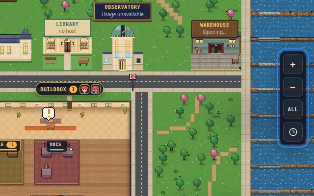

Town shows every agent at its desk. The camera buttons step between the whole town, one building, one room and one desk.

1. Press + to step closer to what is in the middle of the screen.
2. Press − to step back out.
3. Press ALL to see the whole town again.
4. Pinching or scrolling zooms too.

Where: Town, the buttons on the right edge. Since 0.2.5.

### Time of day

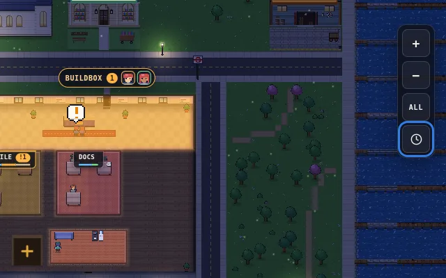

Town follows your clock: rooms with work are lit, idle rooms go dark, and a reception waiting on you glows amber.

1. Press the sky button under ALL to open the Sky panel.
2. Under Time of day, choose Your clock, Day, Dusk or Night.

Where: Town, under the zoom buttons on the right. Since 0.3.5.

### The town board as a chip

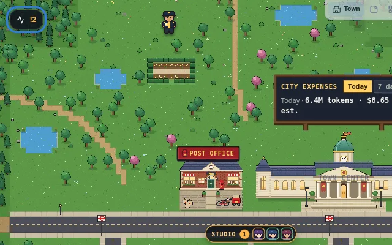

The town board folds into a small chip in the corner. It shows how many agents need you, and fuel when it runs low.

1. Point at the chip, or tap it on a phone, to open the board.
2. Press it again to keep the board open; Escape closes it.

Where: Town, top left corner. Since 0.3.6.

### What's new from the Town Master

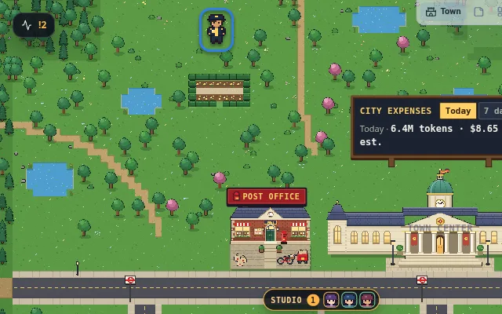

The Town Master greets you when you come back: what happened since you left, and what is new in World, each with a Try button.

1. Press the Town Master beside the town board.
2. Press Try on a new feature to see where it is.
3. Untick Show this on start to stop the greeting.

Where: Town, beside the town board at the top left. Since 0.3.6.

### The town center's ring

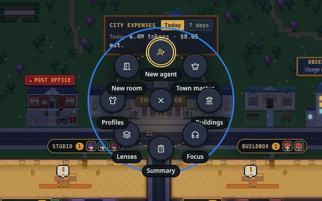

Tap the town center to open a ring of actions around its doors: start an agent, talk to the Town master, focus, and more. Buildings opens a second ring around itself with every place in Town.

1. Tap the town center, or Tab to its plaque and press Enter.
2. Choose an action, or Buildings to see Town's places.
3. In Buildings, choose a place to open it, as tapping its building does.
4. Press Back at the centre or Escape to go back; Escape again closes the ring.

Where: Town, the domed building at the top of the town. Since 0.3.6.

### Focus for a while

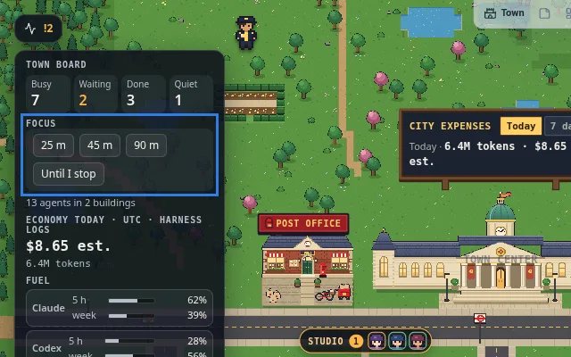

A focus session holds chimes, notifications and the tab count on every device while the crew keeps working. When it ends you hear one chime and get one recap.

1. Open the town board from the chip in the top left corner.
2. Under Focus, press 25 m, 45 m, 90 m or Until I stop.
3. The chip shows headphones and the time left; press End now to stop early.
4. When it ends, "While you focused" lists what arrived; each line opens Needs you.

Where: Town, the town board at the top left; also the town center ring and Menu. Since 0.3.6.

### Apartments: finished agents

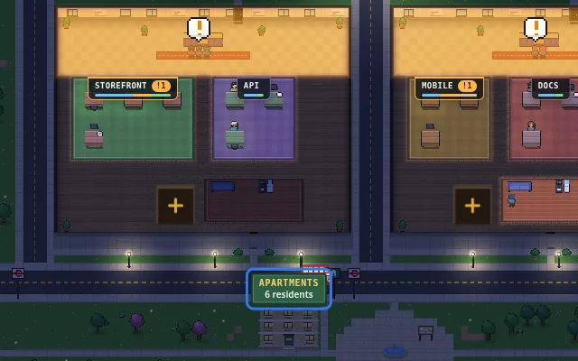

Agents that are not running live on in the apartment building beside the town center, asleep and resumable. Its sign says how many live there.

1. Find the building beside the town center; press ALL if it is out of view.
2. Press its green APARTMENTS sign.
3. Search residents by name, project, summary, pull request or date.
4. Open one to read its history; resume a Claude or Codex agent into a room, or evict it.

Where: Town, the building beside the town center; also Apartments in the town center ring, and Past sessions in Board's hub. Since 0.3.6.

### Quiet agents

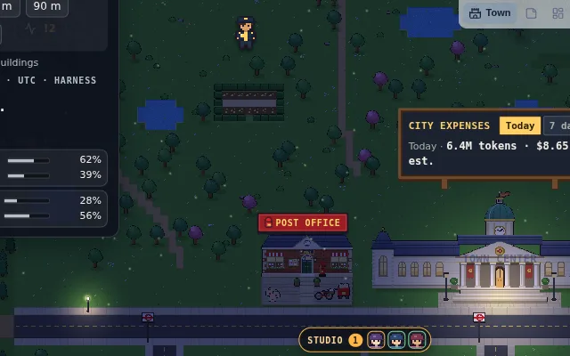

A working agent whose session has not moved for 10 minutes gets an hourglass with how long it has been quiet. The town board counts them under Busy.

1. Open the town board and press the line under Busy, such as 2 quiet 10 m+.
2. Town shows the first quiet agent; press Next to see the others.
3. The hourglass goes as soon as the agent moves again.
4. Change how long in Settings, Quiet working agents, or turn it off.

Where: Town board, under Busy, while an agent is quiet. Since 0.3.6.

### Which runtime a room runs on

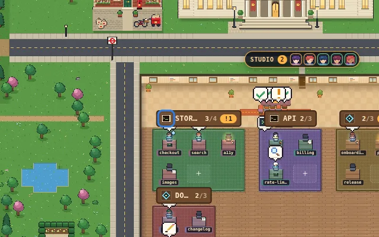

When one building holds rooms of both runtimes, a small icon before each room's name tells them apart: a terminal window for the Herdr TUI, a diamond for herdr-core.

1. Zoom into a building until the rooms' name plates show.
2. Point at the icon before a room's name, or tap it on a phone, to read its runtime.
3. Buildings with one runtime show no icon.

Where: Town, before a room's name on its plate and its card. Since 0.3.6.

## Board

### Next agent needing you

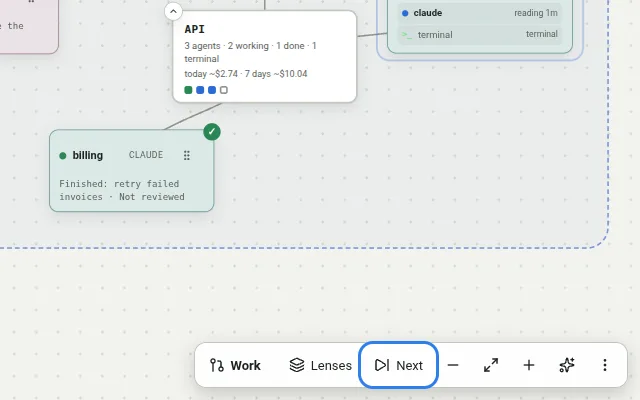

Board lays out every host, room and agent as cards. Next opens the next agent that needs you, shared questions too.

1. Press Next in Board's controls.
2. Answer or look, then press Next again for the one after.

Where: Board, the controls along the top. Since 0.3.0.

### Lenses

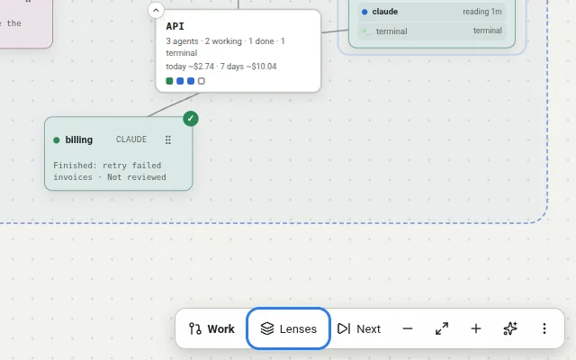

A lens colours every card by one question: idle time, spending, pull requests, quests or harness.

1. Press Lenses, or the L key.
2. Choose a lens; the legend explains its colours.
3. Press the lens's name again to leave it.

Where: Board, the controls along the top. Since 0.3.0.

### Find your way around Board

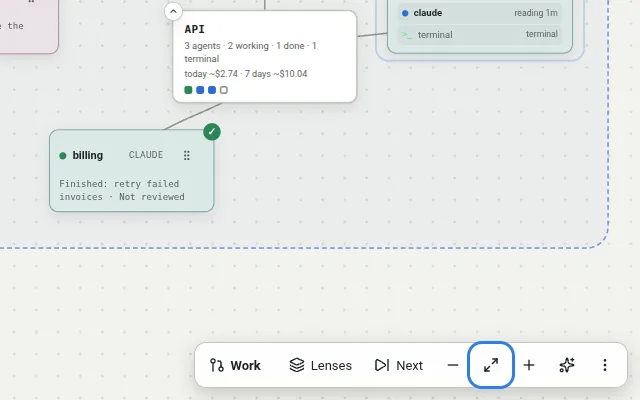

Board is a map of every host, workspace and tab. Pan, zoom and fit it like a map.

1. Drag the empty board to pan.
2. Pinch, scroll or use + and − to zoom.
3. Press Fit to see everything.

Where: Board, the zoom buttons in the controls along the top. Since 0.2.6.

### Arrange cards and move panes

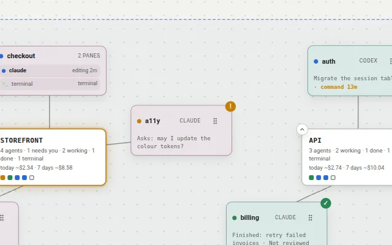

Cards stay where you put them. Dragging a pane row onto another tab moves only that pane, on the same host.

1. Drag a card to place it.
2. Drag a pane row onto another tab to move that pane.
3. On a phone, hold a card or pane row to lift it; a quick swipe pans.

Where: Board, any card. Since 0.3.0.

### Notes for agents

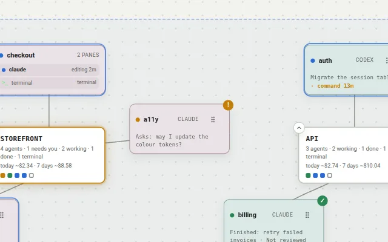

Write a note on the board, connect it to an agent, and send it when it is ready.

1. Double-click the empty board to start a note.
2. Drag the note's handle onto an agent to connect it.
3. Press Send when the note is ready.

Where: Board, anywhere on the empty board. Since 0.2.6.

## Code

### Your VS Code in World

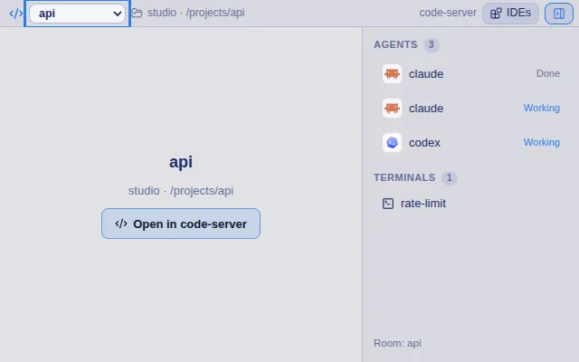

Code shows the VS Code installed on the computer a project is on, this one or an SSH host, inside World. The project's agents and terminals stay beside it.

1. Choose Code beside the views; on a phone, in the views menu.
2. Pick a project in the bar at the top.
3. Press Open; the first time, enable an IDE there first.
4. Use the button at the bar's right end to show or hide the project's agents and terminals.

Where: Code, the project picker at the left of its top bar. Since 0.3.6.

## Chat

### Talk to an agent

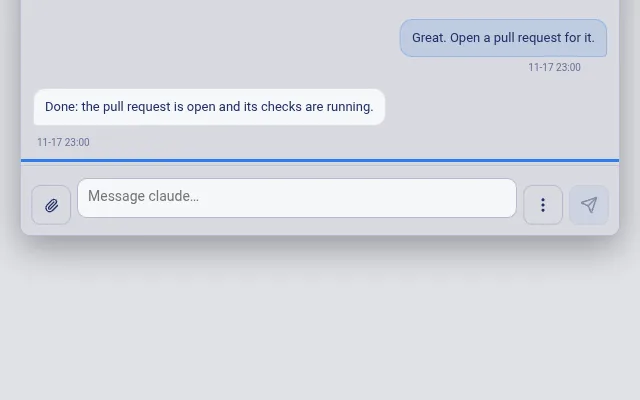

Chat shows an agent's conversation as messages. Write to it here instead of typing into its terminal.

1. Open an agent from Town or Board; Chat opens first.
2. Write in the box at the bottom and press Send.
3. Press ⋮ for the agent's commands and keys.

Where: Chat, the box at the bottom of an agent's window. Since 0.2.7.

### Hear a reply

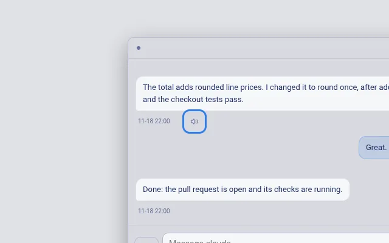

World reads an agent's reply aloud with your browser's voice.

1. Point at a reply from the agent.
2. Press the speaker beside Copy; press it again to stop.

Where: Chat, beside each reply's Copy button. Since 0.3.0.

## Everywhere

### What can I do here?

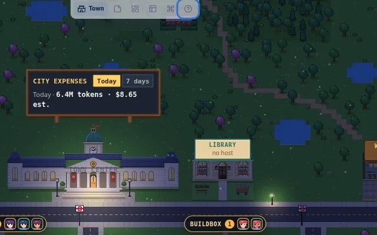

Every screen answers what you can do on it, with a picture and a Try button for each thing.

1. Press ? beside the views, or open the views menu on a phone.
2. Choose What can I do here?
3. Press Try to see the control on screen.

Where: Beside the views at the top; on a phone, the views button. Since 0.3.6.

### Find or act

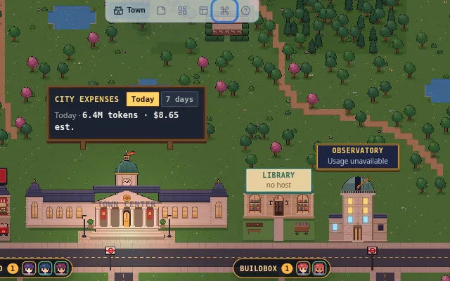

One box finds agents, rooms and actions anywhere in World.

1. Press Ctrl+K (Cmd+K on a Mac) or the ⌘ button beside the views; on a phone, open the views menu and choose Find or act.
2. Type a few letters of a name or an action.
3. Press Enter to go there or do it.

Where: Beside the views at the top; on a phone, in the views menu. Since 0.3.0.

### Hosts on a phone

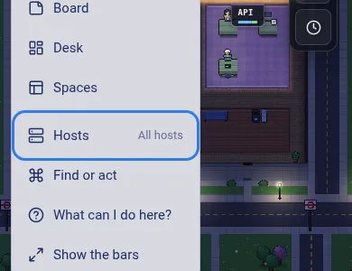

On a phone, the views button also offers Hosts: choose which hosts World shows, or manage connections.

1. Press the views button in the bottom corner.
2. Choose Hosts, then tick the hosts to show.

Where: On a phone, the views button in the bottom corner. Since 0.3.6.
