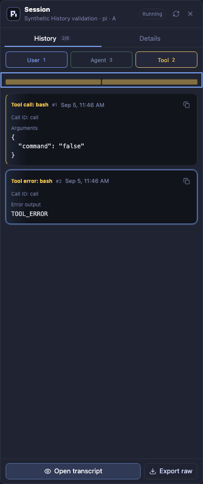

# History synchronization

`createAgentSessionHandlers` shares a per-connection projection cache across
History, summary, transcript preview, and ATIF export. Concurrent requests share
in-flight reads/projection; raw preview prefix reads/downloads stay separate.

## Cache and consistency

The cache retains at most 16 sessions, four recent History revisions per session,
and an estimated 32 MiB of values. Admission counts UTF-16 strings and structural
overhead without serialization, conservatively recounting shared values.
Oversized/deep projections are served but not retained; transient parsing memory
is not included in the estimate.

Refresh resolves/stats the session. Path, provider, session, file identity,
size/mtime, change metadata, and provider descriptors invalidate projections.
A post-read stat triggers up to three retries on change. Errors invalidate data;
incomplete JSONL records wait for later changes. This is not a filesystem
transaction: later writes appear on the next refresh, and coarse metadata may
miss same-size in-place rewrites.

## Version 2 protocol

Send `history_version: 2` to `agent_history.get`, optionally with the last accepted
`cursor: { epoch, revision }`. Legacy callers receive conversation-only `messages`.

| Mode | Response |
| --- | --- |
| `snapshot` | `entries` replaces the window. Missing files/sessions yield empty snapshots. Invalid/expired cursors, connection replacement, eviction, file replacement, or truncation reset this way. |
| `delta` | `base_revision`, `upserts`, `removed`, plus complete ID `order` only when membership/order changes. No `messages`, `entries`, or trajectory. No-change replies keep revision with empty changes. |

The window holds the latest **200 conversation entries**, including errors;
associated tools do not count toward the limit. Eviction emits removals; raw/ATIF
exports remain complete. IDs identify projected occurrences/tool calls, **not
durable source records or ATIF step numbers**. Full-window comparisons handle
provider representation changes; synthetic timestamps remain stable within a
cached file generation. Clients accept replies only against the request cursor
and current pane/connection lease.

History refreshes every four seconds only while open and visible, without
overlapping requests. Cards cap default DOM content at 4,000 characters; full
tool details open as escaped text. Names/call IDs associate results without
moving them from their transcript positions.

## Chat and Codex session binding

Codex title IDs remain the strongest evidence: add **Thread ID** with `/title`
to identify the conversation even when shared-daemon hooks report the wrong
pane. A title never falls back to an older report while its ID is unresolved.
Conflicting reports from multiple panes are withheld.

Without a title or reported session, World queries the selected runtime's
existing Codex app-server through `codex app-server proxy`. It never starts a
daemon, resumes a thread or changes a session. It reads active thread metadata
from `thread/list` with state-store-only lookup and complete bounded pagination.
The directory must match exactly, with just one Codex pane in that directory
and one loaded interactive thread. The thread's creation/update times must be
valid, its activity must be within ten minutes, and its runtime status must
agree with the pane. Changed pane evidence, another claimant, incomplete results,
unavailable daemons and ambiguous matches show no inferred conversation.
Unknown source or parent metadata makes discovery unavailable; only validated
noninteractive or child threads are excluded. Pagination completes only at a
null cursor, including when an opaque cursor is an empty string.
Recently updated unloaded interactive threads also count as competitors. An old
unloaded thread is excluded only when its timestamps are valid.

World sees panes in the selected Herdr connection. Other Herdr sessions or
terminals outside Herdr can share the daemon and its Codex home, so an unseen
client can still make a guess name the wrong conversation. Use **Thread ID** in
`/title` or an explicit session link when identity matters.

Each quest snapshot shares one bounded whole-runtime daemon listing and checks
the pane set again after that listing. Successful evidence lasts only for that
snapshot; concurrent identical reads may share a request. Unavailable discovery
backs off for 60 seconds within that connection and runtime generation, showing
no guess during the backoff. A new generation starts with empty discovery state.

This evidence is a **guess**, never proof of client identity. History records
`session.source: codex-daemon`; Chat records its confidence as
`session_binding: guessed`, with no session fingerprint, composer or answer
buttons. Every snapshot recomputes the inference, and World never persists it
as a link. To reply, use the Terminal, add the thread ID to the title, or make
an explicit link below. Local and Unix SSH discovery use only their captured
runtime; a failed remote lookup never searches this machine's daemon or files.
Older Codex versions without `proxy` retain title and explicit-link support.

Chat presents conversations with paired tool calls/results and the same minimap
as Ranger. Timeline retains individual records and filters. Both use the bounded
History window; the minimap does not fetch older records. Inspector navigation
closes before Composer panels and terminal screens, while transient menus close
before navigation.

**Link Codex session** accepts a full UUID, resolves its readable metadata on the
selected runtime, and previews directory, path and update time before confirmation.
Local and Unix SSH lookup searches active and archived Codex sessions using that
runtime's Codex home using shell/file utilities, without requiring Python 3;
remote lookup never falls back to a local transcript.
Windows SSH History remains unsupported. Preview tokens expire after five minutes,
are single-use, and bind the pane's terminal, foreground process/group, existing
session and transcript identity. Confirmation rechecks these witnesses and the
captured runtime before reporting the link, then verifies Herdr retained it.
The external runtime has no atomic process-and-link guard: a process change during
the final RPC cannot be excluded. Keep the intended Codex conversation open and
refresh/re-preview after a change; linking replaces the association for all viewers.

## Message filters

The Session header offers counts, details, transcript preview, raw export, and
refresh. Info toggles metadata/messages in wide and compact layouts, preserving
filters/selection; session changes return to messages.

User/Agent start enabled; Tool starts disabled. Agent includes assistant errors;
Tool includes calls, outputs, and errors. Button counts reflect the unfiltered
window; the header shows visible/total when filtered. Minimap/numbering follow
visible entries, but hidden entries still update and exports remain complete.
Type filters survive pane switches/reopening while mounted, not reloads;
**Show all types** restores all message types.

Search combines type filters with case-insensitive literal matching across full
loaded text, not just card previews. Redacted tools become searchable only after
explicit loading; search never fetches older messages or tool payloads. **Reset
filters** clears search and enables all types. Search resets on pane/connection changes.

Click a card's header/text/background for details; Copy stays separate. Timestamps
use local `MM-DD HH:mm`, prefixed with `YYYY-` outside the current year.

## Consistency and resource limits

Changed files still require **full JSONL reads and provider projection**: no
incremental parser, byte cursor, database, or new transport. Raw previews/full
ATIF exports can remain large; cache limits are not exact JavaScript heap bounds.
