<!-- markdownlint-disable MD033 -->
<!-- Explicit anchors keep section links usable in both GitHub and Pages. -->
<!--
  This is a learner's guide: short steps, what to do and what you will see.
  Change it only when a learner's steps change. Edge cases, limits, refusals and
  internals belong in FEATURES.md. `bun run build:site` fails when a step or
  paragraph grows past its limit or the page past its word budget.
-->

# From your first terminal to a workspace that travels

Herdr World puts your coding agents in one place you can open from any
browser: who is working, who needs you, and what they changed.

In this tutorial you give an agent one small task (improving a README),
follow it, check what it changed, and then pick it up from your phone.

> **You need:** a computer with a project you may change, and an agent CLI you
> are signed in to, such as Claude Code or Codex. No Git, SSH or networking
> knowledge is needed to start.
>
> **Time:** about 5 minutes to get started and 30 minutes for chapters 1 to 6.
> Remote access takes another 15 to 25 minutes.

This page is only reading material: World itself runs on your computer.

## 1. Get started

<a id="start"></a>

### How the pieces fit

```text
Your browser or phone
      |
Herdr World   (the app you see)
      |
Herdr         (runs your terminals)
      |
Your shells and agents
```

- **Herdr** runs the terminals. They keep running when you close the browser,
  but stop if the computer sleeps or shuts down.
- **World** shows them in your browser and lets you act on them.
- **Agents** stay ordinary command-line tools. World does not provide models
  or sign you in to them.

### Install and open World

1. Install World by following
   [Install a release](./DEPLOYMENT.md#install-a-release). The standalone
   installer also installs or upgrades [Herdr](https://herdr.dev).
2. Start World and leave it running:

   ```bash
   herdr-world
   ```

   Using the Herdr plugin instead? Start it with its
   [startup action](./DEPLOYMENT.md#herdr-plugin) and take the login URL from
   its log.

3. Open the URL it prints on the same computer. It looks like
   `http://127.0.0.1:8787` and carries a login token.
4. World opens on **Town**. If Herdr is missing or stopped, Town offers
   **Set up Herdr**; nothing is installed until you confirm.
5. Open **Spaces** from the view picker at the top, choose your project's
   workspace and a shell pane, and type `pwd` (`Get-Location` in PowerShell).

**You are done when:** the terminal shows your project's folder. Get this
working before you set up remote access.

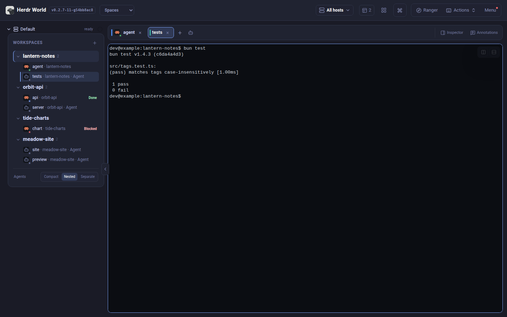

### Four views of the same work

| View | Use it to |
| --- | --- |
| Town | See each agent as a character in a small town, and who needs you. World opens here. |
| Board | Lay agents out as cards on a pin board, beside your own notes. |
| Desk | Work through a queue: who needs an answer, what finished, what is running. |
| Spaces | Work in one workspace's terminals, files and changes. |

Switch views with the view picker at the top edge (on a phone, the corner
button). Views open full-screen; choose **Exit Zen** to show the menu bars.

**Hosts** starts at **All hosts**. Choose fewer to narrow what you see; this
never disconnects anything. **Manage connections** adds a computer over SSH or
reconnects one. A disconnected host stays visible, marked
**Disconnected · Reconnect**.

### Keep World up to date

When a new release is out, World tells you once and puts a dot on **Menu**.
Install it when you are ready with **Menu → Help & updates → Upgrade to …**.
After an upgrade, open tabs offer **Reload**; your terminals keep running.

## 2. Find what needs you in Town

<a id="town"></a>

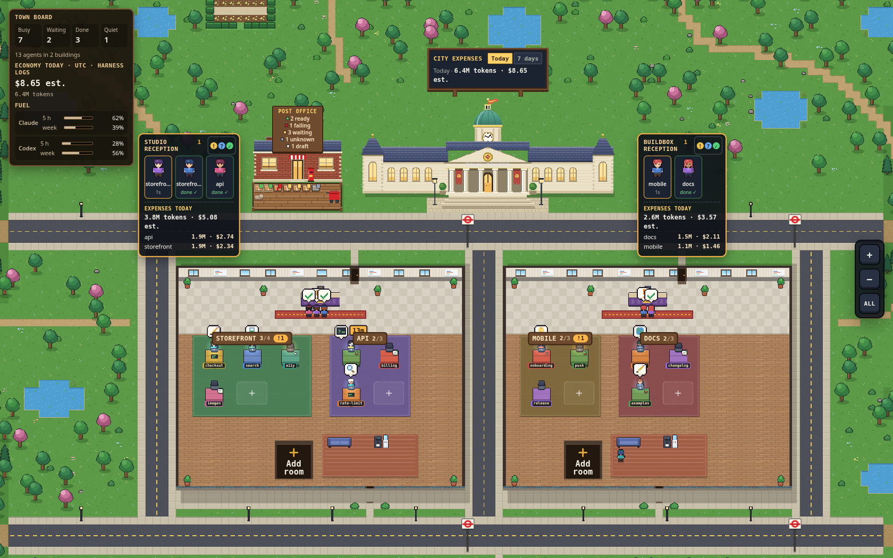

### Look around

Each computer is a **building**, each workspace a **room**, each tab a
**table**, and each agent a **character** at its seat. Plain shells show a
prompt instead of a character.

1. Drag the background to pan. Use **+** and **−** to zoom between town,
   building, room and desk; **ALL** shows the whole town.
2. Tap a room to zoom in. Hover its nameplate for its card: how many agents
   are working, waiting or done, and what the room cost today.
3. Look at the working agents. Each has a thought bubble showing what it is
   doing: editing, running tests, reading code, thinking.
4. Zoom to a desk to read the step in words, such as
   **Run the login tests · tests 3m**. A step that runs long turns amber.

On a phone the buildings stack vertically; tap wherever this guide says hover.

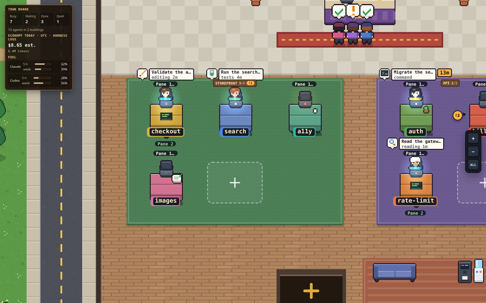

### See who needs you

Agents that need you walk to **reception** at the top of their building. The
same marks appear in every view:

| Mark | Meaning |
| --- | --- |
| **!** | Blocked: waiting for your input |
| **?** | Asked you a question |
| **✓** | Finished, not reviewed yet |
| **•** | Working |
| **–** | Idle, or reviewed |

1. Tap **Needs you** in the top bar. A list opens on the left with every
   question, blocked agent and finished task.
2. Answer a question with one of its buttons, or type a reply and press
   Enter. The paperclip attaches a screenshot or file.
3. Tap an agent's name for its Chat and the context behind the question.
4. On a desktop, press **N** to fly to the next thing that needs you;
   **Shift+N** goes back.

While anything needs you, the browser tab shows the count, such as
`(3) Herdr World`, so you notice it from another tab.

> **Finished is not verified.** A **✓** means the agent stopped, not that its
> work is right. [Chapter 5](#daily) shows how to check.

### Open an agent

Tap an agent or its table. Its window opens on **Chat**, with **Terminal**,
**Files** and **Changes** in the selector at the top. On a wide screen it docks
on the right; drag its edge to resize it. [Chat with an agent](#chat) covers
reading and replying.

Prefer the terminal? Set **Menu → Agents open** to **Terminal**.

### Find anything

- **Search:** click the search icon (or press **/**) and type part of a room,
  table or agent name, or words from an agent's task. Matches light up on the
  map; choose a result to fly there.
- **Command box:** press **Ctrl+K** (**Cmd+K** on a Mac) to find things, switch
  views, and create rooms, tabs and agents. Inside a terminal, press
  **Ctrl+Alt+K** (**Cmd+Option+K**) instead.

### The town center and its boards

Tap the domed **town center** at the top of the town for a ring of actions:
**New agent**, **Town master** (your coordinating agent's Chat), **Needs you**,
**Summary**, **Lenses**, **Profiles** and **New room**.

Around it you will find:

- **The Town board.** It counts every agent. Its **FUEL** gauges show how much
  of each Claude and Codex subscription window is left. **Summary** lists who
  needs you, unreviewed work, each host and spend.
- **The City expenses billboard.** Estimated cost for today and the last 7
  days. Each building's reception board shows its own share. Costs need a
  price table; see [harness usage](./usage.md).
- **The post office.** With GitHub connected, your open pull requests wait here
  as parcels. Tap one for its card and **Merge…**.

After 30 minutes or more away, the board starts with **Since you left**: what
is new for you, what finished and what merged.

### Rearrange Town

These moves change the real Herdr tabs and panes, and agents keep running.

- **Move a table to another room:** zoom in until you see tables, then drag
  one onto another room of the same building. On a phone, hold it first. From
  the keyboard, focus it and press **M**.
- **Move one agent:** drag it onto another table.
- **Reorder tables:** drag a table onto another table in the same room.
- **Group tables:** drag one onto another and rest a moment, until the label
  says **Group with …**.
- **Move a room:** drag it by its name or wall. **Tidy rooms** (the sparkles
  on a building's sign) puts a building back in order, with **Undo**.
- **Keep a table in place:** in its agent's window, choose
  **⋯ → Pin desk in Town**.
- **Rename or colour a tab:** click the icon beside a terminal's name for
  **Terminal appearance**: name, colour, a short status and an avatar.

Every building has a **+ Add room** doorway. The dashed **+** seat inside a
room starts a new tab or agent there.

### Clear away finished agents

1. Drag an agent you no longer need onto the **bin** at the bottom of the
   screen, or choose **⋯ → Put in bin** in its window.
2. The agent walks out to the nearest bus stop. Nothing is closed yet.
3. Every four minutes a red bus collects whoever is waiting. World closes
   those agents only once it has driven off.

Changed your mind? Open the tray from the bin and choose **Put back** before
the bus leaves. **Close now** skips the wait.

**You are done when:** you can find an agent, see what it is doing and open
its window.

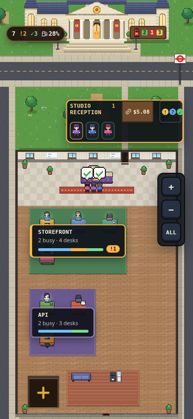

*These Town pictures show a synthetic crew on two hosts; every name, cost and
step in them is sample data.*

### See one fact across Town: lenses

<a id="town-lenses"></a>

A lens colours every room and desk by one fact.

1. Tap the town center and choose **Lenses**, or press **L**.
2. Press the lens's name, or **‹ ›**, to switch between:
   - **Idle time**: warm is fresh, cold is hours since the agent last worked.
     Who have you forgotten?
   - **Spend**: today's cost per room and desk.
   - **Pull requests**: failing, ready, waiting, draft or merged.
   - **Quests** and **Harness**.
3. Zoom in and hover or tap a desk. The legend says its value in words, such
   as "Idle 3 h 12 m" or "#123 CI failing".
4. Press **✕** or Escape, and Town is back as it was.

**You are done when:** you found the coldest room and the desk with a failing
pull request.

## 3. Work with your agents

### Chat with an agent

<a id="chat"></a>

Chat shows an agent's conversation, read from the agent's own record rather
than from terminal text.

1. **Read** from the bottom. Scroll up for older messages.
2. **See what it is doing now.** The bar at the top shows its status, its task
   and how long it has been at it. The tool call running now sits at the end,
   with a timer.
3. **Open a tool row** to see what it did: the edit's diff, a test run's
   result, or the end of a command's output.
4. **Reply** in the box at the bottom. Enter adds a line; the paper plane, or
   **Ctrl+Enter** (**Cmd+Enter**), sends. The paperclip attaches files. Type
   **/** for the agent's own commands.
5. **Check the receipt** under your message. It reads **Sent, not seen in the
   transcript** until the agent's record shows your words.
6. **Answer the agent's prompts.** When Claude Code or Codex asks for
   permission or asks a question, Chat shows a card with each option. Read it,
   then pick one. Anything Chat cannot answer safely, it sends you to the
   **Terminal** for.
7. **Stop**, or Esc pressed twice, interrupts the agent.

> Chat reads Claude Code, Codex, Pi and several other agents. When it cannot
> find a conversation it says why and offers a fix. See the
> [Chat guide](./CHAT.md).

**You are done when:** you sent an agent a message and its receipt shows the
message reached the transcript.

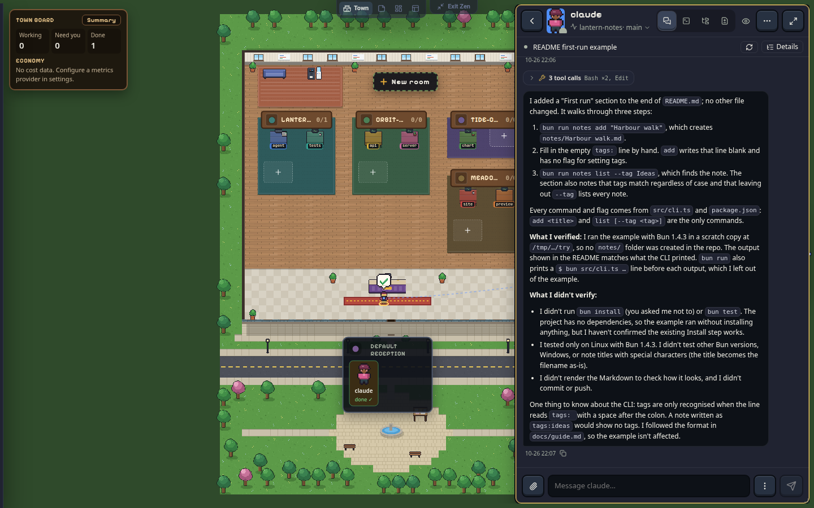

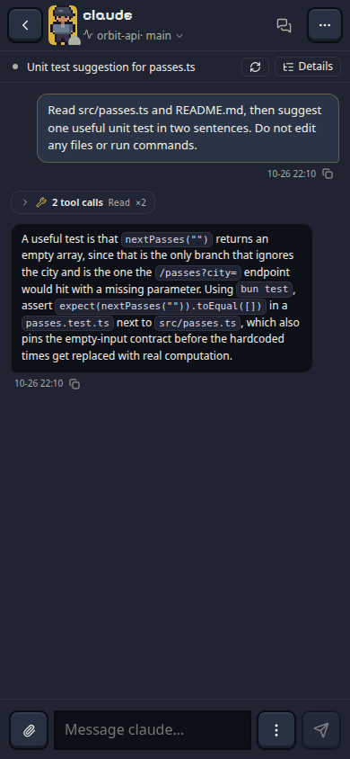

### Start a new agent from a profile

<a id="new-agent"></a>

A **profile** is a ready-made agent: a name, a harness and model, a role,
skills, a first brief and a look in Town.

1. Open **Menu → Agent profiles**. Pick a starter (Reviewer, Builder, Designer
   or FirstMate), or choose **New profile**.
2. Work through **Who**, **Brain**, **Skills & tools**, **Brief** and
   **Look & sound**, then **Save**. In the brief, `{{task}}` becomes the task
   you type at launch.
3. Open **New agent**: from the town center, with **Ctrl+K**, or with the
   dashed **+** seat in a room.
4. Type a task and tap your profile. To get a plain shell instead, choose
   **Terminal**.
5. World creates the tab, starts the agent and sends the brief. In Town, the
   new agent walks in and sits down at its desk.

If the agent's CLI is logged out on that computer, the launcher says so and
shows the login command, such as `claude auth login`. **Open its tab**, run
the command, then choose **Check again**.

**You are done when:** your new agent answers in its own tab, dressed the way
you chose.

### Hear who needs you

<a id="chimes"></a>

1. Open **Menu → Sounds** and tap **Needs you**, **For you** and **Finished**
   to hear each chime. On devices that should stay quiet, turn off
   **Play chimes on this device**.
2. Under **Town master**, choose your coordinating agent and tap
   **Make Town master**. Its chime is a sound of its own.
3. Tap anywhere in World once: browsers play sound only after a tap.

**You are done when:** an agent finishing in another tab chimes, and a toast
names it.

### Come back after a break

When your phone puts World in the background or the connection drops, your
windows and drafts stay where they were. Controls wait until the connection is
back, and nothing you typed is sent twice. If a terminal says
**Terminal is not receiving output**, choose **Retry terminal**.

### Let agents use World

<a id="agent-cli"></a>

Agents can work with World too: colour and pin their own cards, report
results, and ask you questions.

1. On the computer where the agent runs, install World's guide for it:

   ```bash
   herdr-world integration install claude
   ```

   Use `codex` or `pi` for those agents, or use
   **Menu → Configuration → Integrations**.

2. Start a new agent session. It can now ask you something:

   ```bash
   herdr-world ask "Ship it?" --options yes,no --wait
   ```

3. The question appears in **Needs you** and at reception with **?**. Answer
   it, and the agent carries on.

The complete command list, and crew groups such as Pods and Teams, are in
[the agent CLI reference](../FEATURES.md#agent-cli-herdr-world---skill) and
[Groups](../FEATURES.md#groups).

## 4. Board and Desk

### Board: cards and notes for your agents

<a id="board"></a>

Board shows the same hosts, workspaces and tabs as cards on a pin board,
beside your own notes. World saves the notes, so your phone and desktop show
the same board.

1. Choose **Board**. Each host is a dashed zone, each workspace a card, and
   each tab a smaller card around it. A working agent's card pulses.
2. Scroll or pinch to zoom; drag empty board to pan.
3. Drag a workspace card, and its tabs follow. The sparkle button tidies the
   board, with **Undo**.
4. Tap a tab to open its agent's window, as in Town. **Next** opens the next
   agent that needs you.
5. Double-click (on a phone, double-tap) empty board to pin a note and type.
6. Drag the note's red dot onto an agent's card to string them together.
7. Select the note and choose **Send to …**. World checks the same agent is
   still in that pane, then sends the note once.

Board shares Town's bin, **Needs you**, lenses (press **L**) and
**Since you left**. Dragging a tab onto another workspace moves it there for
real, so Board asks first.

**You are done when:** you pinned a note and strung it to an agent. Read the
target before you press **Send**.

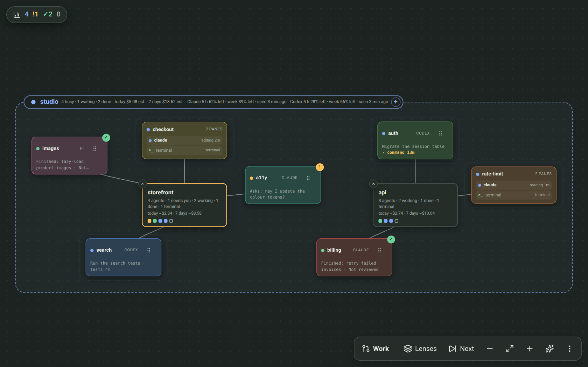

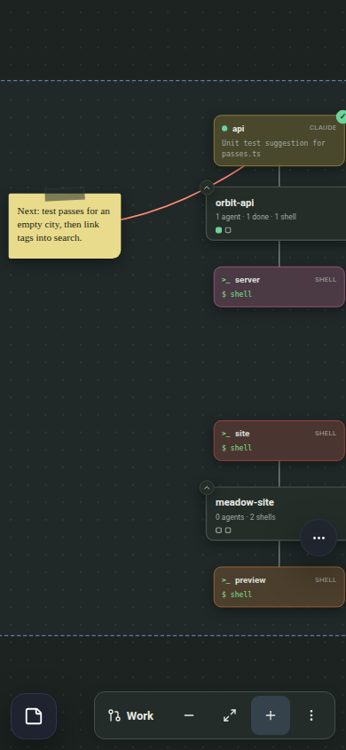

### Follow pull requests and tickets

1. Press **Work** in Board's bottom-right controls.
2. Your GitHub pull requests appear in columns: **In review**, **Fixing**,
   **Green**, **Ready to merge** and **Merged**. **Tickets** shows your Jira
   tickets and assigned issues.
3. Each card names the agents working on it. Tap one to jump to it.
4. Open a pull request for its checks and reviews. **Merge…**, **Close…** and
   **Mark ready…** ask first and say exactly what will happen.

Nothing shows? Open **Settings → Sources**. Sign in to GitHub with
`gh auth login` as the user that runs World, or add your Jira site and an API
token.

### Desk: a queue of what needs you

<a id="desk"></a>
<!-- Keep old Graph exercise links working after the Graph view was retired. -->
<a id="graph"></a>

Desk lists the same agents by what they need from you, not by where they are.

1. Open **Desk**. Start with **Needs you** (blocked agents), then
   **To review** (finished turns), then **In flight** (running work).
2. Open a card to read its Chat, or check its terminal, files and changes. On
   a wide screen it opens beside the list, and **J** and **K** move between
   agents.
3. Once you have checked the work, choose **Mark reviewed**. Every browser
   sees the mark; **Undo** takes it back.

> **Mark reviewed** records that you looked. It does not commit anything or
> prove the work is right.

**You are done when:** you can find the same agent in Town, Board and Desk.

### Arrange windows

- **− Minimize** hides a window. On a desktop, **Open windows** brings it back;
  on a phone, tap its chip at the bottom.
- **⋯ → Fit right** puts a window beside the view at full height.
- On a phone one window fills the screen, and **Back** returns to the view.
- Closing a window never stops the agent.

### Workspaces, tabs, panes and worktrees

| Name | What it is | In this tutorial |
| --- | --- | --- |
| Workspace | A working environment, usually one project folder | Your project |
| Tab | A layout inside a workspace | A documentation tab |
| Pane | One terminal inside a tab | The agent on the left, a shell on the right |
| Worktree | Another checkout of the same Git repository | A separate branch for a second task |

> **Panes share files.** Two panes in the same folder edit the same checkout.
> For parallel changes, use worktrees ([chapter 6](#workflow)).

## 5. Check what the agent changed

<a id="daily"></a>

### Give the agent a small task

1. In **Spaces**, open your practice project and create a tab.
2. Start your agent CLI in it.
3. Paste this prompt, read it, and send it. Model usage may cost money.

   ```text
   Read this project's README and add a short first-run example.
   Check the project's actual commands first; do not invent flags.
   Modify only the README. Do not install dependencies, commit, or push.
   When finished, explain what changed and what you have not actually verified.
   ```

4. Watch its status: working, then blocked (it needs you) or done.
5. Open the agent's **Chat** and read its explanation.

**You are done when:** you found the agent's explanation, not just the last
line of its terminal.

### Read the file, then the diff

1. Open **Files** and find `README.md`. Switch between **Preview** and
   **Source** to check both its formatting and its text.
2. Open **Changes** and read the README's added and removed lines.
3. Find the command the agent added, and check it really exists in the
   project.

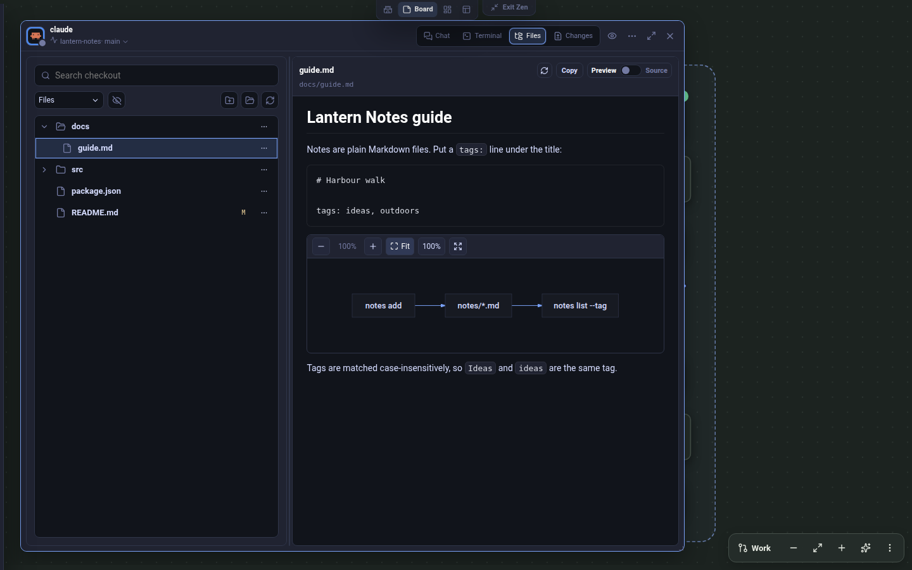

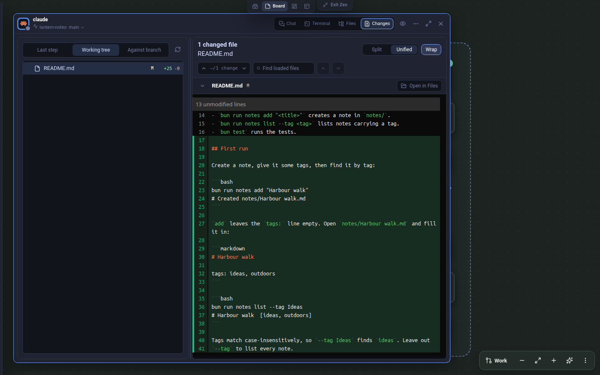

**You are done when:** you can point at the new lines and you have checked the
command.

### Send precise feedback

1. In **Changes**, click a line number (or drag across several) and write a
   comment, such as "Use the dev command in package.json."
2. Check your comments in the review panel.
3. Choose the agent's pane. World puts your feedback in its input box.
4. Read the message there and press Enter yourself.

**You are done when:** the agent received feedback that points at exact lines.

### Take care with Git actions

**Changes** separates staged, unstaged, untracked and conflicted files, and
**Against branch** compares with another branch. This exercise needs no
commit; to commit, follow your project's usual checks in a shell.

> **Discard Unstaged** loses changes and **Delete Untracked** deletes files.
> Confirming is not a backup: when unsure, cancel.

### Ask Ranger about your workspaces

<a id="ranger"></a>

Ranger is World's assistant for questions about your workspaces.

1. Open **Ranger**, choose a model (or **Claude Code**), and allow the
   workspaces it may read.
2. Ask a question. While it answers, press Enter or **Steer** to adjust the
   answer in progress, or Alt+Enter (**Option+Enter**) or **Queue** to send
   your message once it finishes.

See [Ranger](../FEATURES.md#ranger-and-workspace-tools) for scheduled tasks and
permissions.

## 6. Parallel work and your phone

<a id="workflow"></a>

### Give each parallel task its own worktree

Panes in the same folder edit the same files. For two tasks at once, give each
its own worktree: a separate checkout and branch of the same repository.

1. Right-click the workspace and choose **Worktree Lifecycle**, or search for
   `worktree lifecycle` with **Ctrl+K**.
2. Create and open a worktree. It starts from the latest `origin/main`, without
   your uncommitted changes.
3. In its terminal, run `pwd` and `git status` to confirm the folder and
   branch before you start an agent there.

> A repository's `paseo.json` hooks run its own code when worktrees are created
> or removed. If you do not trust them, turn them off under **Worktree hooks**
> first. See [worktree hooks](../FEATURES.md#paseo-worktree-hooks).

**You are done when:** each task has its own folder and its own changes to
review.

### Continue from your phone

First set up [Tailscale and Serve](#tailscale) in chapter 7. On a phone,
`127.0.0.1` means the phone itself, not your computer.

1. Open World's HTTPS address on your phone, log in, and choose your agent.
2. Read and reply in **Chat**. In a terminal, tap **Message** to type with the
   phone keyboard; the key rows give you arrows, Esc and Ctrl.
3. Open **Changes** to review the README diff.
4. Adjust the size in **Menu → Appearance → Text size**.
5. Install World as an app:

| Browser or device | Where to install |
| --- | --- |
| iPhone or iPad Safari | Share → Add to Home Screen |
| macOS Safari 17 or later | File → Add to Dock |
| Chrome or Edge | Browser menu → Install app |

**You are done when:** the home-screen icon opens World. Install your World
address, not this tutorial page.

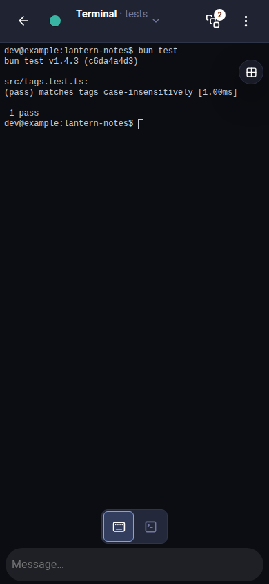

> The app does not work offline and does not keep your computer awake.
> Notifications help, but do not rely on them as alarms.

### Sharing World between browsers

Every browser connected to your World sees and controls the same terminals.
There is no read-only role, so give access only to people you would hand your
terminal to. Each browser keeps its own Hosts filter, drafts and shortcuts.

## 7. Reach World from another device

<a id="networking"></a>

Pick the route that matches what you want to do:

| Your goal | Route | What you need |
| --- | --- | --- |
| Use World on the computer running Herdr | Local World | Nothing extra |
| Reach World from your phone, anywhere | Tailscale + Serve | Both devices in one tailnet |
| Use your local World with Herdr on another computer | SSH profile | SSH access; World on Linux or macOS |
| Connect two computers you control, briefly | Tailcat | Tailcat on both computers |

None of these needs router port forwarding. Try your chosen route on your own
network before you rely on it.

### Before you connect anything

- **Anyone who can open World can run commands as you.** Admit only devices
  and people you fully trust.
- **World always asks for a login**, on every address. Set
  `HERDR_WORLD_PASSWORD` (15 characters or more), or use the generated token.
- **Use HTTPS or an encrypted tunnel**, and limit who can reach it.
- **Never share** passwords, token URLs or Tailcat addresses in screenshots,
  issues, chats or config files.

Read [SECURITY.md](../SECURITY.md) for the full model. Do not bind World to
`0.0.0.0` just to reach it from elsewhere: that exposes it to your whole
network.

<a id="tailscale"></a>

### Tailscale and Serve: the everyday choice

**Tailscale** joins your devices in a private network called a tailnet.
**Serve** gives World a private HTTPS address that only your tailnet can open.

```text
Phone (on Tailscale) --HTTPS--> Tailscale Serve --> 127.0.0.1:8787 --> World --> Herdr
```

#### Prepare your devices

1. Install [Tailscale](https://tailscale.com/download) on the computer and on
   your phone, and sign both in to the same tailnet.
2. On the computer, run `tailscale status` and check both devices are online.
3. [Limit access](https://tailscale.com/docs/features/access-control) to the
   people and devices that should reach World on port 443. Check existing
   broad rules before you go on.

#### Share World over Serve

1. Check for an existing Serve setup that you need to keep:

   ```bash
   tailscale serve status
   ```

2. If HTTPS port 443 is free, share World. Approve the certificate link it
   prints the first time:

   ```bash
   tailscale serve --bg --https=443 http://127.0.0.1:8787
   ```

3. Restart World with the HTTPS address Serve printed, without a trailing
   slash:

   ```bash
   HERDR_WORLD_PUBLIC_ORIGIN=https://machine-name.tailnet-name.ts.net \
     herdr-world --host 127.0.0.1 --port 8787
   ```

   Running World as a service? Add that line to its environment file and
   restart it; see [the user service](./DEPLOYMENT.md#user-service).

4. On your phone, with Tailscale on, open that HTTPS address and log in.
5. Run `pwd` in a shell pane to check the terminal answers.

**You are done when:** your phone reaches World over mobile data, and a device
your rules exclude cannot.

> **Use Serve, never Funnel.** Funnel puts World on the public internet.
> Machine names appear in public certificate logs, so avoid sensitive names.

To stop sharing, turn off just this address and check what remains:

```bash
tailscale serve --bg --https=443 off
tailscale serve status
```

`--bg` keeps Serve running, not World, and does not stop the computer
sleeping. For a lasting setup, run World as a
[user service](./DEPLOYMENT.md#user-service).

<a id="ssh"></a>

### SSH: reach Herdr on another computer

#### Option A: your local World, remote Herdr

World runs on your computer (Linux or macOS) and controls Herdr on another.

1. Check that plain `ssh workbox` works, where `workbox` is an alias in your
   `~/.ssh/config`. Keep ports, jump hosts and keys there.
2. Check that Herdr is already running on that computer.
3. In World, open **Manage connections**, add an SSH profile with Destination
   `workbox`, and connect.
4. Open the remote project and run `pwd` to confirm the folder.

**You are done when:** your browser controls the remote terminal and files.
Uploads, Git and file actions now happen on that remote computer.

World never stores SSH passwords or keys; OpenSSH handles them. See
[connections](./DEPLOYMENT.md#local-and-ssh-connections).

#### Option B: World already runs remotely

Forward its web port to your computer with SSH (this works on Windows too):

```bash
ssh -N -o ExitOnForwardFailure=yes -L 127.0.0.1:18787:127.0.0.1:8787 workbox
```

Open `http://127.0.0.1:18787` on that computer and log in. Press Ctrl+C in
the SSH terminal when you are finished.

<a id="tailcat"></a>

### Tailcat: a temporary link between your computers

[Tailcat](https://github.com/tailscale/tailcat#readme) is a separate,
experimental tool from the Tailscale team. It links two computers without a
tailnet or account. Use it only between computers you control, and use
Tailscale for your phone.

> Tailcat makes no stability promises, and this project has not tested this
> example end to end. Check `tailcat --help` on both computers before you
> start.

1. Install Tailcat on both computers from its
   [official instructions](https://github.com/tailscale/tailcat#install).
2. On the computer running World, share only World's port with a new address:

   ```bash
   tailcat serve --key=new 8787
   ```

3. Send the printed `tc…` address to the other computer over a private
   channel. **Treat it like a password.**
4. On the other computer, replace the placeholder and run this. It listens
   only on `127.0.0.1`; do not add `--bind=0.0.0.0`.

   ```bash
   tailcat forward tcREPLACE_WITH_PRIVATE_ADDRESS 18787:8787
   ```

5. Open `http://127.0.0.1:18787` there and log in.
6. When finished, press Ctrl+C in both Tailcat terminals, and check that the
   address no longer works.

**You are done when:** the other computer reaches World without a public
listener, and access stops when both Tailcat processes exit.

#### Tailscale or Tailcat?

| | Tailscale + Serve | Tailcat |
| --- | --- | --- |
| Best for | Everyday access from all your devices | A short-lived link between two computers |
| Who gets in | Your tailnet's rules, then World's login | Whoever has the address, then World's login |
| You look after | Device sign-ins and access rules | The address, versions and stopping it |

## 8. Troubleshoot

<a id="troubleshooting"></a>

### A page will not open

Check one hop at a time, starting closest to World.

1. On the computer running World, check the service answers:

   ```bash
   curl -fsS http://127.0.0.1:8787/healthz
   ```

   If the connection is refused, check World is running and on the expected
   port before you change anything else. (Windows: use `curl.exe`.)

2. Open World on that computer. If the page loads but terminals do not, check
   that Herdr is running and look at the connection error in
   **Manage connections**.
3. Once that works, check the route to your other device: `tailscale status`
   and `tailscale serve status`, the SSH terminal, or both Tailcat processes.
4. If the page loads but typing does nothing, check the right pane is
   selected and the connection is not paused. Try locally to tell a network
   problem from a Herdr one.

**You are done when:** you found which hop failed and fixed only that one.

### Common problems

| What you see | Check first |
| --- | --- |
| `127.0.0.1` on the phone does not open World | That address is the phone itself. Use Serve's HTTPS address. |
| World opens without asking for a login | This browser already has a session. Try a private window. |
| `Address already in use` | World may already run as a service or plugin on 8787. Do not start a second copy. |
| Chat or history is empty over SSH | See the [Chat guide](./CHAT.md) for the agent's transcript requirements. |
| Paste, clipboard or app install does not work | These need HTTPS away from the World computer. Use Serve's HTTPS address. |

For token recovery, restarts and logs, see [deployment](./DEPLOYMENT.md). When
you ask for help, share your World and OS versions, the failing step and
redacted logs.

### Your first round is complete

Check before finishing:

- [ ] I know which workspace, tab and pane receives what I type.
- [ ] I read the actual diff, and I know an agent's "done" is not verification.
- [ ] I know which computer receives file and Git operations.
- [ ] For remote access, I checked who can log in, which address World
  listens on, who the network admits, and how to stop sharing.

**Next time you open World, try one small thing:** find an agent waiting for
you and read one part of its diff.

### Where to go next

- [Features and shortcuts](../FEATURES.md): every control, limit and
  shortcut.
- [Installation and deployment](./DEPLOYMENT.md): installs, services,
  connections and settings.
- [Security model](../SECURITY.md): what access to World allows, and how login
  works.
- [Architecture](./ARCHITECTURE.md): how World, Herdr and connections fit
  together.
- [Tailscale Serve](https://tailscale.com/docs/features/tailscale-serve),
  [Tailscale access controls](https://tailscale.com/docs/features/access-control)
  and the [Tailcat security model](https://github.com/tailscale/tailcat/blob/main/SECURITY.md).
