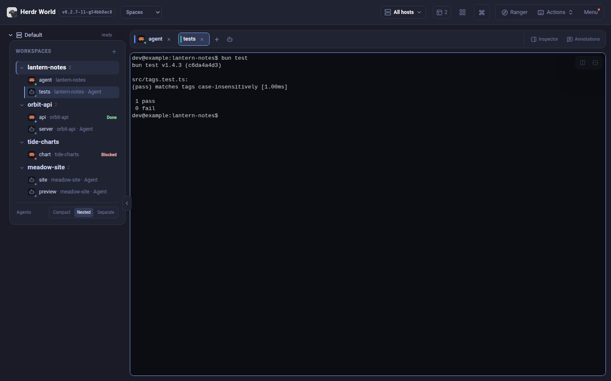
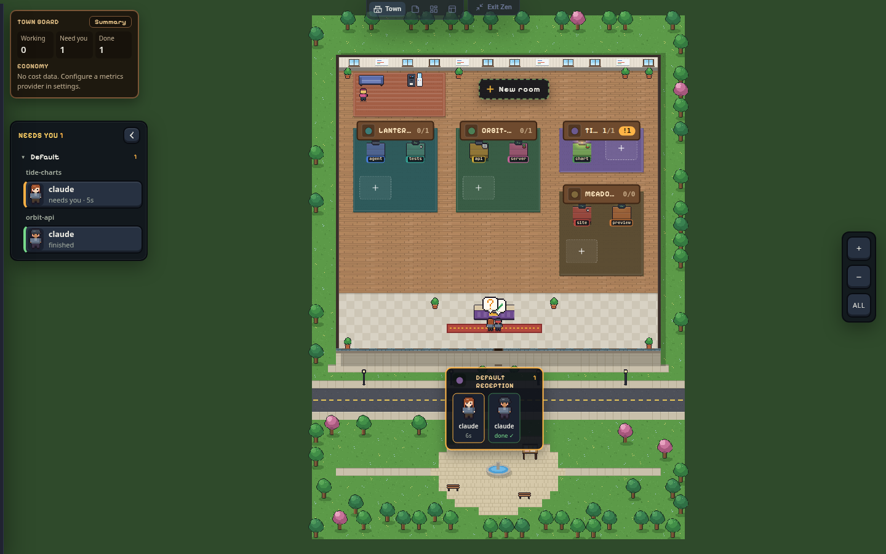
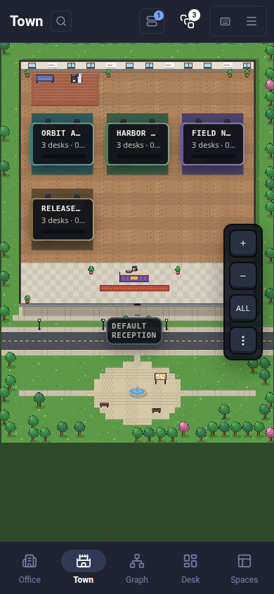
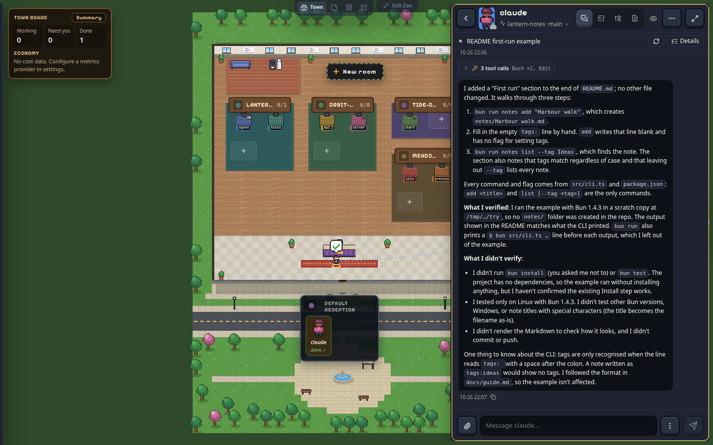
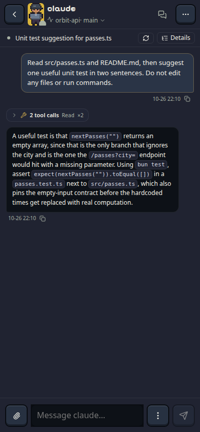
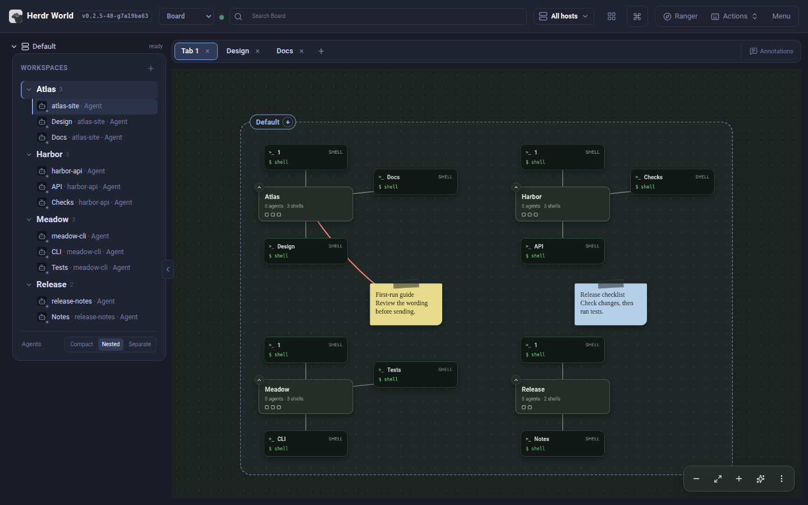
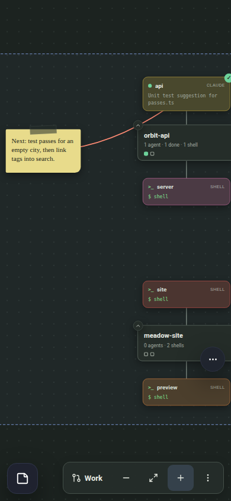
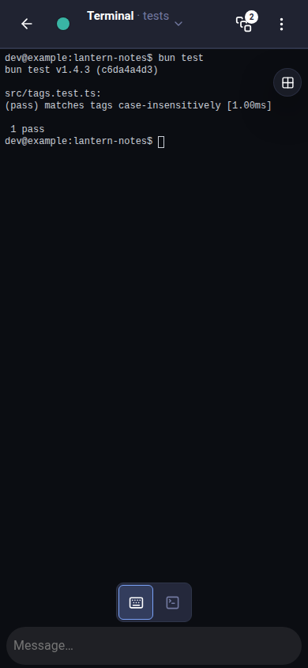

<!-- markdownlint-disable MD033 -->
<!-- Explicit anchors keep section links usable in both GitHub and Pages. -->

# From your first terminal to a workspace that travels

**Start Herdr World on the Herdr host and open its URL:** follow [chapter 1](#start).
Not installed? Use the [installation guide](./DEPLOYMENT.md#install-a-release).

Practice one task: **ask an agent to improve a README, review the changes, then
check from your phone.** No Git, SSH, or networking knowledge is needed to start.

> With both tools installed: chapter 1 takes about 5 minutes; chapters 1-3 about
> 25 minutes. Allow 15-25 more for remote access, excluding installation,
> approvals, and troubleshooting. Stop at any completion check.
>
> **This static Pages tutorial does not run Herdr or keep terminals alive.**
> You still need the Herdr World process.

> **New in 0.2.7:** [chat with an agent](#chat) in its one window,
> [start agents from profiles](#new-agent), [hear who needs you](#chimes),
> [let agents arrange World](#agent-cli), and follow pull requests in
> [Board's Work lens](#board). See the
> [0.2.7 release notes](./releases/v0.2.7.md).

## 1. Start here: see your own work locally

<a id="start"></a>

### Three names, three jobs

The browser reaches your agent through two services:

```text
Your browser / installed PWA
          |
          | HTTP + WebSocket
          v
Herdr World (command: herdr-world)
          |
          | Herdr control and terminal-render sockets
          v
Herdr server -> workspace -> tab -> pane -> shell / agent
```

**Herdr owns terminals; Herdr World supplies the browser UI; agents remain CLIs.**
Herdr World neither provides models nor installs/signs in to Codex, Claude, Pi, or
other tools. Closing the browser leaves terminals running, but host sleep,
shutdown, or process exit can stop work.

The current foundation uses only Herdr World service, plugin, storage, and browser
identities. It intentionally starts with fresh preferences rather than importing an
older World or Roamgate installation.

### Open your first workspace: about 5 minutes

1. If Herdr is already installed, start it with a trusted project open. See
   [herdr.dev](https://herdr.dev) for setup. If it is not installed, do step 2
   first: the published 0.2.7 standalone installer installs or upgrades Herdr to
   the verified release. Set `HERDR_WORLD_SKIP_HERDR=1` to leave your Herdr
   untouched. Homebrew reuses existing Herdr and installs a missing runtime on
   first normal World launch; npm and Windows archives leave setup to you.
   Run `herdr-world herdr setup` to install Herdr if needed and start its user
   service before step 3. Explicit World updates retain a separate Herdr upgrade
   step. See
   [Herdr installation and upgrades](./DEPLOYMENT.md#herdr-installation-and-upgrades).
2. [Install Herdr World](./DEPLOYMENT.md#install-a-release). Standalone needs no Bun;
   Windows supports npm (`npm install --global @ivoryheart/herdr-world`,
   Node.js 22.14.0 or newer) or the matching x64/ARM64 archive and
   `herdr-world.exe`. Alternatively,
   follow the [plugin setup](./DEPLOYMENT.md#herdr-plugin).
3. Start it on that computer:

   **Standalone:** leave this process running:

   ```bash
   herdr-world
   ```

   **Plugin:** use its [startup action](./DEPLOYMENT.md#herdr-plugin) and obtain
   the login URL from the panel/command log. The plugin does not add `herdr-world`
   to `PATH`; skip the standalone command.

4. Open the printed URL (including any token) on **the same computer**. Standalone
   defaults to `http://127.0.0.1:8787` and opens **Town**. Use the view
   switcher to open **Spaces**, select a workspace and idle shell pane, then
   run `pwd` (`Get-Location` in PowerShell).

**You are done when:** terminal input shows your project directory. Get this
working before configuring remote access.

> **Check the listener:** standalone defaults to loopback and requires login
> using a configured password or the generated persistent token. A new `herdr-world service install` uses
> `0.0.0.0:8787` with a token; the plugin uses this service too.



*Find the project and active pane. Screenshot menu positions can differ by release.*

### Find an available World upgrade

An available World release shows a notification once per version in this browser
profile at this World address. Repeated checks and page or service restarts keep
that history. Dismissing the notification leaves the red attention dot on **Menu**.
Open **Menu → Help & updates → Upgrade to <version>** when you are ready; a failed
installation keeps this action available for retry. The dot clears after a
successful upgrade or a check confirms no update remains. Existing installation
channel and restart checks still apply.

Notification history uses an atomic IndexedDB claim so concurrent windows cannot
both announce the same release. Existing browser notification markers remain
honored. If persistent storage is blocked, cross-window deduplication is unavailable
and only page-lifetime suppression is guaranteed; a slow claim fails closed rather
than racing another window.
Clearing site storage resets this history; other World origins and browser
profiles keep independent history. Disabling automatic checks stops future checks,
without hiding an already discovered upgrade. Manual **Check for updates**
answers with a brief completion message without repeating the release notification.
It remains available even if the Upgrade entry is disabled; the menu visibly
explains the installation-channel restriction on phones and desktops.

### Reload a tab after the service changes

An open tab keeps running the build it loaded, even after the service is
upgraded, rebuilt or rolled back. When the service serves a different build, a
notice names this tab's build and the served one. This is separate from the
release notification above: it compares this tab with the running service, not
the service with the latest release. Choose **Reload** when convenient; Herdr
sessions keep running and open terminals reconnect. **Later** hides the notice
until another build is served, and **Menu** keeps showing both builds. If a
part of the app fails to load because the service no longer has its files,
World shows a **Reload** notice rather than reloading by itself; reopening that
part after **Later** shows the notice again.

### Choose a view for the task

Use the view switcher to move between these views without restarting work:

| View | Use it for |
| --- | --- |
| Town | Explore host buildings, workspace rooms and team tables; the default landing view |
| Board | Pin notes beside hosts, workspaces and agents, string them together and send a note to an agent |
| Desk | Find agents needing input, review finished turns and follow work in flight |
| Spaces | Work in one workspace's terminal panes, files, changes and history |

Office, Tree and Graph have been retired; `/office` opens Town, and `/graph` and
`/tree` open Board. The exercises below use Town, Board, Desk and Spaces. Board
and these redirects are included in [0.2.6](./releases/v0.2.6.md).

**Hosts** starts at **All hosts**. Choose a host set to reduce the overview;
use **Manage connections** to add or reconnect a local or SSH profile. Filtering
changes what you see and does not disconnect hosts or retarget open terminals.
If a host disconnects, its cached building and agents remain visible as stale
history. Town's building and reception and Board's host label show
**Disconnected · Reconnect**; their old agents cannot open live Chat or terminals.
Transient SSH failures retry with backoff. Tap **Reconnect** to restart that
host's connection, or use **Manage connections** to inspect its error. Other
hosts stay usable.

### Explore Town: find work that needs you

<a id="town"></a>

1. Open **Town** from the view switcher, or return to the World root URL.
   Every view opens in Zen, full-bleed: use the view picker at the top edge (on
   a phone, the corner button) to switch views, or **Exit Zen** to show the
   bars. The choice is shared, so leaving Zen in one view leaves it in all.
   Each host is a building, each workspace a room, each tab a table and each pane a
   seat. Plain terminal panes show a prompt rather than an agent character.
2. Use **+** and **−** to move between town, building, room and desk detail;
   **ALL** shows the whole town. Drag the background to pan, or use arrow keys
   when the scene has focus. Tap a room to zoom in. Large towns may initially
   show roofs; zoom in to see room summaries and desks. Phones stack buildings
   vertically. Room nameplates fit their rooms: long names end in an ellipsis;
   hover the name for its full text. The colour, active/total agent count and
   blocked badge stay visible. Active means working or waiting on you; plain
   terminals are excluded from the total. Hover the count for the working/waiting
   breakdown. Hover or focus a plate to reveal Rename and Close below it;
   on a touch screen, tap the plate first. The dashed **+** seat inside a room
   opens its launcher with that room selected. Choose **Terminal** for a plain
   tab, a profile, or an agent kind. If the requested room is no longer
   available, choose a current room in the launcher before creating anything.
3. Look at reception for blocked agents waiting for input, oldest first. Finished
   agents also wait there until you open their terminal or mark that completion
   reviewed, then join idle agents in the lounge. These locations visualize
   status; they do not move the underlying pane or change its host. For the
   whole picture, press **Summary** on the Town board (on a phone, tap the
   counts chip under the search bar): the **Town summary** window lists who
   needs you (blocked agents and open questions), unreviewed finishes and when each was last active, each host's
   rooms with their counts, and spend. Answer a question from its offered
   options or type a reply. A blocked agent that also asked a question counts
   as two items needing you. Tap a room to show it in Town; on a phone, Summary
   closes first. Press **Summary** again to restore its minimized window or bring
   it to the front. Use **Back** to close the summary.
4. Tap an agent or its table to open its window on **Chat**: World's Inspector,
   with **Chat**, **Terminal**, **Changes** and **Files** in its top selector.
   On a phone, the anchored header dropdown switches between **Chat**, **Terminal**,
   **Files** and **Changes**; the **⋯** menu contains attention settings.
   In Town it docks on the right at a readable width; drag its left edge to
   resize it (Town remembers the width), or drag its title to undock it.
   [Chat with an agent](#chat) explains reading, replying and answering there.
   The **NEEDS YOU** list provides another route to waiting
   agents and becomes a bottom tray on phones; it hides when no agent is
   blocked. The Town master's chat (**Menu → Town master**, `firstmate` by
   default) opens docked once per visit on wide screens. Hover an agent for a
   small preview card: its latest message as **Chat** shows it, never terminal
   text; when the conversation cannot be read, it says why. It highlights a
   question when one can be identified, and refreshes when the conversation
   changes. Opening
   an agent brings it back to its desk from reception or the lounge until its
   status changes. To open terminals instead, set **Menu → Agents open** to
   **Terminal** (Board and Desk follow it too); that tap also brings the agent back and, like the chat, does
   not mark its work reviewed.
   Zoom into a room: an agent with a quest (its own todo list, plan, Codex goal
   or `/loop`) shows a swallowtail pennant beside its seat, with a progress
   bar when the quest has steps; tap the pennant to see **Quest** and its
   title.
5. Read the question before using an answer button: it sends the offered key to
   that live pane. When no supported choices appear, use **Open chat** to reply
   in the agent's window, or **Open terminal** in the card's header (or the
   window's **Terminal** view).
6. The window's **Files** and **Changes** use the same agent worktree,
   rather than its launch checkout. Open the location line for **Worktree**
   (a bottom sheet on phones):
   the source mark explains the evidence, and radio choices switch both views.
   If choices are ambiguous or stale, use **Choose a worktree** and **Refresh**;
   resource access waits for a current selection. **Open terminal** is for
   direct work.
   In Town, Board or Desk, click a local source reference in **Chat** to open
   **Files** in the same window at its line (for example, `src/example.ts:12`).
   Relative references
   start at the selected worktree. If the path is outside it or its binding is
   unavailable, use **Choose a worktree**, then click the reference again.
   For a root filename with spaces, use a path prefix, such as `./my file.ts:12`,
   or an explicit Markdown file link.
   If a retained file becomes unavailable, its preview shows a notice instead
   of closing the window. Choose a current worktree or another file, then
   **Retry preview** if needed; Chat and its draft remain open.
   The swatch beside a room's name colours that workspace (its carpet here,
   its card in Board and a dot in the Spaces sidebar), and the swatch on a
   building's reception board colours the host (its roof, Board zone and
   Spaces header). A workspace's colour shows on its tables that have no colour
   of their own; a host's does not.
   Click the icon beside the terminal's name to open **Terminal appearance**;
   In Spaces, use the same icon in the native tab strip or an arranged window's
   header. It edits the selected pane in that tab. On a phone, use the coloured
   appearance button in the terminal app bar.
   The header shows the native tab name. Edit **Tab name** and choose **Save
   name** to rename that Herdr tab in every view. Pick a colour, enter a short
   **Status message** (up to 160 characters) and choose **Save status**, or
   select a **Pane avatar**. Split panes share the tab name, colour and status,
   while each pane can have its own avatar. **Default colour**, **Clear status**
   and **Default avatar** reset only that choice; the avatar returns to its
   profile or identity default. An error stays in the editor and keeps an
   unsaved name/status draft, so it can be retried. If the pane moves to another
   tab, reopen the editor for that destination; the old draft is not transferred.
   Board shows the avatar and status on the card, Town uses the character and
   desk callout, Spaces shows the avatar and status in its tab tooltip, and
   Desk uses the same shared choices. These choices are saved by World for
   every browser; runtime status badges keep their normal meanings and colours.
   Appearance does not add workspace icon or workspace status controls.
   The settings still link to **Edit profile · <name>** when World launched the
   agent from a profile, otherwise **Profiles…**. The terminal window's menu
   has **Colour**, and the Spaces tab menu (right-click or long-press) offers
   the same palette and **Default colour**.
   In the agent's window, the button beside its name sets its interest (on a
   phone, use **⋯ → Attention**):
   **Muted** stops its chimes, **Focused** lets only focused agents chime, and
   **Watching** is the default. Its questions and results still arrive in
   reception.
   **Next** cycles waiting agents, then finished agents when no other agent is
   waiting.
7. To move a table to another room, zoom in until you see tables, then drag it
   with the mouse, or hold it for a moment on a phone and then drag. Drop it on
   another room of the same building; the plaque under your pointer says where
   it will land, or why it cannot. Hold it near the edge of the view to scroll
   the town toward rooms out of sight, as on a phone where rooms stack. The table lifts off and swings along behind
   your pointer with its agents aboard, then drops onto its new spot in a puff
   of dust; if the move is refused, it shakes and springs back. To move one
   agent, drag it onto another table instead: it dangles by the scruff on the
   way. With **Town calm motion** or reduced motion, the table just follows
   your pointer and fades into place. From the keyboard, focus a table or agent and press **M** to
   choose a destination. The live panes move, so agents keep running. If a move
   fails part-way, Town tries to move the panes back, and its notice says what
   happened: back in the original room (the table's pane layout may differ),
   only partly moved, or locations unknown. Unless the notice says the table is
   back, check both rooms before you carry on. Moving a room's last table
   closes that room, so Town asks first.
8. Tables sit in the order of their tabs, left to right and then row by row.
   To change the order, drag a table onto another table in the same room: it
   takes that table's place, and the tables in between shift along. Drop it on
   the room's free spot to put it last of the tables shown. A room grows as
   tabs open and ordinary rooms shrink to fit when tabs close. An expanded room
   keeps its capacity through closures until you use **« Fold**. Rooms grow up
   to eight tables wide on a wide screen, six on a portrait or half-width screen
   and four on a phone, then row by row. A folded room normally
   shows the first 24 tabs in the same order as Spaces. Use the room's bottom-right
   **» +N** tile beside the dashed **+** seat to reveal the next 20 tables per
   click until the whole room is shown. **+N** counts currently hidden tabs;
   agent activity and pins do not pull later tabs ahead of that boundary.
   A red **!** at the tile's top-left means hidden desks need you; a green **✓**
   at the top-right means hidden work is finished and not reviewed. Revealing
   those desks or resolving their attention clears the icons. After the first
   expansion, the adjacent **« Fold** action returns straight to the first 24,
   even while more desks remain hidden. The plaque counts all agents in the room.
   Rooms sit in columns that suit your screen
   (one on a phone), and a growing room pushes down only the rooms below it,
   once you let go of the town. Town moves the tab in Herdr, so Spaces
   shows the new order too, and moving a tab in Spaces moves its table. The
   tables move once Herdr reports the new order, and agents stay with their
   table.
9. To group tables, drag one onto another table and rest it there a moment:
   it snaps to that table and the plaque says **Group with …**; let go. The
   two get one wall, and Town brings the table to that room and beside the
   other in Herdr's tab order. An agent started by another agent is grouped
   automatically, with a solid connector to its parent and the parent's
   colour. To take a table you grouped out of its group, drag it onto its own
   room's bare floor, away from the free spot (**Leave the team**); a spawn
   link stays. Without a drag, focus a table and press **M**: **Group with…**
   lists the tables to join, and **Leave the team** takes it out. A table's
   name for screen readers says who its team is.
10. To keep a table where it is, open one of its agents (its window) and choose
   **Pin desk in Town** at the top of the phone window's **⋯** menu. On desktop,
   choose the same action from the window’s **⋯** menu.
   The table wears a pin, stays put
   when tabs are reordered or the room grows, and its agents stay at it rather
   than taking breaks in the lounge; they still go to reception when they need
   you or finish, and come straight back once seen. Choose **Unpin desk in
   Town** to let it follow the tab order again.

A table with more panes than drawn seats shows the count and offers a chooser
for every pane. When a table closes, the tables after it close up so the room
keeps no gap. **New room** creates a workspace; room actions also create tabs
and manage the room. Check the destination host before creation. Stale buildings
remain visible but cannot accept operations. Use search and the Hosts filter to
narrow the work you are following. The **Town calm motion** setting reduces
ambient animation.

A quiet **?** at reception means an agent has asked you a question with
`herdr-world ask`. It stays there until answered, dismissed or withdrawn;
tapping its reception entry opens that agent. Read the question first in
**Needs you** or **Summary**, where it names the asking agent, then choose an
option or type an answer. The waiting agent receives that answer. **Open agent**
opens the asker; **Dismiss** closes a stale or mistaken question without
answering it. A question marked unverified came from a process World could not
confirm runs in that pane. Board and Desk show the same question mark. **!** means urgent
blocking, while **✓** means a finish still needs checking.

**Mark reviewed** acknowledges that completion in this browser. Opening a finished
agent's terminal also clears its reception stop; neither action proves the result
is correct. A later completion can need review again. Read the explanation and
check the diff using chapter 2 before treating the work as complete.

**You are done when:** you can find an agent on the expected host, read its peek,
and open its terminal or Inspector without losing its workspace context.





### Chat with an agent

<a id="chat"></a>

Chat shows an agent's conversation from its own transcript, never terminal
text. It works for any agent you open from Town, Board or Desk.

1. Read from the bottom. Chat shows the latest 200 entries; scroll up (or press
   **Load earlier messages**) to load older pages while keeping your place.
   While you read back, **Jump to latest** counts new agent messages.
   **Menu → Configuration → Appearance → Chat text** sets the text size.
2. Check what the agent is doing now. The Now bar shows its status circle
   (hover for the word: blue working, yellow needs you, green done, grey
   idle), the task from its terminal title and how long it has been at it.
   The tool call running now sits at the end of the conversation with its
   own timer. **Stop**, or Esc pressed twice, interrupts Claude Code, Codex
   or Pi; Chat never stops an agent by itself.
   When the agent's tab has several panes (a review round, say), a small
   drawing of the tab's split comes first in the window title, with the
   agent that needs you in yellow. Tap it to open a map of the real layout,
   then tap a pane to show that agent's Chat or terminal in the same window.
   Switching changes only what World shows, not Herdr's focus.
3. Open a tool row to see what the call did: the edit's diff, a test run's
   pass or fail with its first failure, or the end of its output. An agent
   with a quest shows one slim title and progress row in the conversation;
   expand it to read each objective as pending, active, done or blocked.
4. Reply in the composer at the bottom; opening Chat focuses it for typing.
   Enter adds a line; the paper-plane
   button, **Ctrl+Enter** or **Cmd+Enter** sends with Herdr's agent prompt.
   The paperclip (**Add a file**) uploads files to the pane's host and adds
   their paths: each file shows a chip while it uploads, then done or failed
   with Retry and Remove, and Send waits for uploads. Review the message and
   attached paths before sending. Type **/**, or use
   **⋮ → Browse commands**, for the harness's commands. Drafts are kept per
   conversation.
5. Read the receipt under your message. It says **Sent, not seen in the
   transcript** (**Queued · sent to &lt;agent&gt;** while a busy agent holds it, or
   **sent, not checked** for a slash command) until the transcript has it.
   Then it says **Sent from Chat; matched by its words**, or **Sent from Chat;
   matched by order** (an inference when the harness rewrites the text, such as
   a paste or image placeholder). Chat never claims "delivered". A red notice names
   another session if there is evidence the message went there, and pauses
   Send. Claude Code's `!` and `#` modes still need the Terminal.
6. Answer the agent's own prompts. When Claude Code shows a permission box or
   a question form, or Codex an approval or question dialog, Chat shows the full request and
   each option on an ask card. Pick one (or press its number with the card
   focused): Chat checks the prompt, session and state have not changed,
   presses that key in the agent's pane and shows what it sent. It says **You
   answered** only once Herdr shows the agent moved on. A form of several
   questions lists every question's header, answered or not, and asks them
   one at a time; after the last, its review offers **Submit answers**. Herdr
   cannot hold a prompt between that check and the key, so read the card
   first. For **Type something.**, **Chat about this** or plan feedback, pick
   the option, type a single-line reply and choose **Send text answer**. Chat
   checks the native text editor before submitting. Already-open native text
   editors and unsupported menus stay in the Terminal.
   Commands such as `/model` and `/permissions` open the harness's own menu;
   Chat shows it on a menu card with the cursor marked. Pick a numbered
   option, or use the key buttons the menu names (**↑**/**↓**, **Enter**,
   **Esc**, **s**, **←**/**→**), or press those keys with the card focused.
   Each step, such as Codex's effort level or Claude Code's rule field and
   save location, replaces the card until the menu closes. A field takes one
   line with **Type**; press the menu's **Enter** after checking it. Options
   past 9, and lists with a search field, are reached with the arrows.
   **⋮** also holds the Terminal's key controls (**Esc**, **Tab**, arrows,
   **Ctrl** keys) for anything else; they go to the session Chat shows.
7. A known pull request named in an agent's **READY** or **opened**
   announcement, or its current work claim, gets a PR card. Open **Details**
   for CI and reviews. **Ask the author to fix** sends a `↳ #N` message when
   this conversation owns the PR's claim; your unsent draft is kept.

A Codex conversation inferred from its shared daemon is read-only: Chat offers
no composer or answer buttons. In Codex's Terminal, run `/title` and add
**Thread ID**, or use **Details → Link Codex session** to preview and confirm
the intended thread. Ambiguous panes or threads stay unbound. If Chat cannot
read a conversation, it says why and offers the matching action. The
[Chat guide](./CHAT.md) covers each harness.

**You are done when:** you sent an agent a message from Chat and its receipt
shows it in the transcript.





### Return after backgrounding

If a phone backgrounds World or the browser loses its connection, open
Inspectors, terminal output, split positions and unsent Message drafts stay in
this page. A disconnected indicator marks the last observation; controls wait
for a fresh connection to the same host and runtime. Input is never replayed.

If a terminal says **Terminal is not receiving output**, choose **Retry terminal**
to retry that terminal while keeping the page open. **Reload app** is a separate,
explicit action. World never reloads automatically because terminal frames stop.
A browser or OS that discards the whole page can still lose its in-memory state.

### Start a new agent from a profile

<a id="new-agent"></a>

A profile is a ready-made agent: a name, a harness and model, a role, skills,
a starting brief and a look in Town. World starts it in a new tab for you.

1. Open **Menu → Agent profiles** (or **Actions → Agent profiles**, or click an
   agent window's icon and choose **Edit profile** / **Profiles…**). The
   starters are Reviewer (Codex), Builder, Designer and FirstMate (Claude
   Code). Pick one, or press **New profile** or **Duplicate**.
2. On **Who**, set the name, home room, role and colour. On **Brain**, choose a
   harness the host supports, a model (empty keeps the harness's default) and
   a permission mode. On **Skills & tools**, tap the skills (found in the
   room's `.agents/skills` and `.claude/skills` and your harness folders) and,
   for Claude Code, the tools it may use. On **Brief**, write the first prompt;
   `{{task}}` is filled with what you type when you launch. On **Look & sound**,
   dress the character and watch it walk, turn and sit in the preview, and
   pick its **Chime** (or keep the class default). **What a
   launch runs** shows the exact Herdr command. Press **Save**.
3. Open **New agent**: **Actions → New agent**, the dashed **+** seat inside
   a Town room (zoom into the room first), or the robot beside **+** in Spaces'
   tab bar. The seat preselects its room. Choose **Terminal**, the first choice,
   for a plain shell tab; to start an agent, optionally type a task and tap a
   profile or a kind under **Quick start**.
4. If a harness is logged out on that host, the launcher says so: **Log in**
   opens a small tab and shows the harness's own login command
   (`claude auth login`, `codex login --device-auth`). **Copy** it, **Open its
   tab**, run it and finish the login there, then **Check again**.
   Failed, incomplete or unsupported checks show **unknown**, never “not
   installed” or “logged out”. You can still try a supported harness; use
   **Check again** to retry or **Edit profiles** to review its configuration.
   The check's source and completion time are shown separately from profile
   settings. Windows readiness checks are unsupported.
5. World creates the tab, starts the agent, waits until it is ready and sends
   the brief, then opens its terminal. The tab takes the profile's colour and
   the agent wears the profile's look in Town. If the agent stops on a question
   first (for example Claude asking whether to trust a new folder), the
   launcher says so and **Open its tab** lets you answer.

**You are done when:** an agent you started from a profile is answering in its
own tab, dressed as you chose in Town.

### Hear who needs you

<a id="chimes"></a>

1. Open **Menu → Sounds**. Under **This device**, leave **Play chimes on this
   device** on and tap **Needs you**, **For you** and **Finished** to hear the
   three patterns. Turn it off on devices that shouldn't chime; push stays
   silent too while World is open, including when notifications are first
   enabled. Open tabs share this device setting, and queued burst sounds
   follow your latest sound choices.
2. Under **Town master**, choose your coordinating agent (for example
   FirstMate) and tap **Make Town master**. Its chime is a sound of its own.
3. Tap anywhere in World once (browsers start sound only after a tap). When an
   agent finishes or needs you, World chimes and a toast says who and why.

**You are done when:** an agent finishing in another tab makes a chime and a
toast naming it.

### Use Board: notes and strings for your agents

<a id="board"></a>

Board shows the same hosts, workspaces and tabs as cards on a pin board, beside
your own notes. Notes are saved by the World service, so the same board appears
on your phone and desktop.

1. Choose **Board** from the view switcher (on a phone it is in the bottom bar).
   Each host is a dashed zone, each workspace a card, and each tab a card around
   its workspace. A tab with several panes lists them as rows; a tab of plain
   shells looks like a small terminal. A working agent's tab pulses (as does the
   selected tab); idle, finished and waiting tabs stay still, and the **⋯** menu
   turns the pulses off. Each workspace card counts its agents by status.
   An agent's card shows a ⚑ chip with its quest progress, such as 2/5; hover
   the chip for the quest and its current step.
   The round **+** on a workspace's right edge (shown on hover or selection)
   opens **New tab**: choose a Terminal, one of your profiles or an agent kind
   the host supports, optionally name the tab, and press **Create**; **+** beside a host's name creates a workspace. Select a workspace or
   tab to give it a colour of your own; status keeps its own colours. A tab's
   colour is its terminal colour, the same one Spaces and Town show: it starts
   as a stable default (the colour of the agent that spawned it, or its
   workspace's colour, if you gave the workspace one), and **Default colour**
   returns to it. A faint string joins tabs whose agents know each other.
   Drag a tab onto another tab to group them, or select a tab, press
   **Group…** and tap the other; a grouped tab's bar offers **Ungroup**.
2. Scroll or pinch to zoom, drag empty board to pan, or use the controls at the
   bottom right. Zoomed out, each workspace shows a square per pane (hollow for
   shells); tap a workspace there to zoom in on it.
3. Drag a workspace and its tabs follow; cards settle within about a second.
   On a phone, hold a card still before dragging; a quick swipe pans. Add a
   second finger to switch from dragging to pinch zoom without committing a move.
   Settling pauses while you type in an open terminal.
   The chevron on a workspace's top-left corner folds its tabs behind a count, and tapping the count opens
   them into free space. The sparkle button tidies the selected workspace, or
   the whole board, and offers **Undo**; notes strung to cards move with them,
   and notes left on a card move to free space. Select a card and press
   **Pin** in its bar to keep it where it is: a pinned card shows a pin, and
   placement, tidying and settling leave it until you **Unpin** it (you can
   still drag it). On a phone, tap the pin in the card's terminal header.
4. Tap a workspace, tab or pane row to open its Inspector with Terminal, Files,
   Changes and Chat; a line joins each Inspector window to its card. Tapping or
   double-clicking an agent's tab opens its Chat, as in Town; a plain shell, or an
   agent without Chat, opens its terminal.
5. Double-click (or double-tap) empty board to pin a note and type; double-click
   a note to edit it. Tap a note for its bar: colour, **Edit**, **String to…**, **Delete** (or press Delete).
6. Drag a card's red dot onto a pane row, a tab or a workspace to string a note
   to it; a tab with several panes asks which pane. Drop it on empty board for a
   new note strung to where you started. Click a string, then **Delete**, to
   remove it.
7. A note strung to an agent's pane offers **Send to <agent>**. World remembers
   which agent was in the pane when you made the string. Before sending, it checks
   the current runtime, the pane and terminal, and that the same agent is still
   there, then sends the note once. If another agent has taken over the pane,
   even in the same terminal, nothing is sent: World names the new agent and
   offers **Send to** it instead. If Herdr stops reporting the captured session,
   World asks again rather than assuming the same pane still holds that agent.
   A missing-session message means World cannot verify continuity, rather than
   knowing that a replacement occurred. If you choose **Send to B** and A returns
   before submission, World refuses; it does not send to A instead.
   The agent can change between the check and the prompt submission. If World
   detects that change afterwards, it reports uncertain delivery; inspect the
   pane before trying again. Nothing is sent without your action.
   **Start an agent…** opens the same dialog: choose the workspace
   and the agent or profile, optionally name the tab, and press **Start and
   send**; the note is sent once the agent is ready.
8. Drag a tab onto another workspace of the same host to move it there (on a
   phone, hold the tab still for a moment first; a quick swipe pans). Board
   asks first, with **Don't ask again**, and always asks before moving a
   workspace's last tab, which closes that workspace. Strings follow the move.

9. Press the labelled **Work** pill, first in Board's bottom-right controls:
   if an Inspector fills the phone screen, close it with **X** or **Back** first.
   Work opens your
   GitHub pull requests in columns from **In review** through **Fixing**,
   **Green** and **Ready to merge** to **Merged**, and on the **Tickets** tab
   your Jira tickets and assigned issues by status. A card names the agents
   working on it; tap one to close Work and jump to its card. **Merged**
   groups the week's pull requests you opened by the day they merged, with
   today open; tap a day to open
   it, and change how many days it covers in **Settings → Sources**. Escape or a
   press outside also closes Work. **Green** means checks pass while a
   required review is pending; **Ready to merge** means approved, or passing
   in a repository that requires no review. The same pull
   request appears as a badge on the agent's desk in Town, such as `#42 ✓`;
   for one of your open pull requests, tap the badge to open the same card.
   Your own open pull requests get a fuller card: CI dots, each rev agent's
   result and **Ready ✓** when your merge rules hold. **Details** shows each
   rule, the failing checks and the reviewers' formal reviews or comments.
   **Unknown reviewer** means the RESULT post has no clear reviewer claim;
   use **View RESULT source** to inspect it. It does not confirm readiness.
   The card also shows **GitHub details fresh**, **stale · cached evidence**
   or **unavailable**, with its own read time. A refreshed list does not renew
   cached detail. Choose **Refresh Sources** to retry; stale or unavailable
   findings/screenshots remain unknown and must be refreshed before Merge.
   **Merge…**,
   **Close…** and **Mark ready…** ask first and say exactly what happens;
   while GitHub still requires a review, use **Open on GitHub** or **Copy
   merge command** and merge it yourself.
   If Work shows **Set up Jira** or says no source is connected, open
   **Settings → Sources**: sign
   in to GitHub with `gh auth login` as the user that runs World, or add your
   Jira site, account email and an API token there.

After Herdr restarts, Board cannot prove that a workspace or agent is the one a
string was made with, so it draws those strings dashed and asks once per host:
**Keep** or **Detach**. A string whose target closed waits in **Needs a home**
(a separate **Needs a home · n** control), where you can re-attach its note or discard
the string; notes always stay. At zero or when space is tight, the action remains
in **⋮ → Needs a home (n)**. On phones, **Tidy** is in **⋮**, and Fit then the zoom
buttons move there as needed; **Work** keeps its text and the controls stay on one
row. If Board misbehaves, describe the steps that led
there in a bug report.

**You are done when:** you can find your workspace card, pin a note and string it
to the intended workspace or pane. Read the target before using **Send**.





The Town and Board screenshots show disposable projects where real Claude Code
agents ran small tasks: one is waiting on you and one has finished. The note
strung to an agent is sample planning text, not a report of completed agent
work.

### Let agents arrange World

<a id="agent-cli"></a>

Agents can use World too. Tell an agent to run `herdr-world --skill`: it learns
to colour and pin its card, group with the agent that started it, report a
task result, or ask you a question (`herdr-world ask "Ship it?" --options
yes,no --wait`). A question shows first in Town's **Needs you** list with the
agent's name and waits at reception with **?**; pick an option or type an answer,
and the waiting agent carries on. An asker can withdraw a cleared question with
`herdr-world ask withdraw <question-id>`, which clears its markers. If its
creation reply was lost, `herdr-world ask withdraw --key <cause-key>` withdraws
that asking occupant's retained question without creating another one.
`herdr-world history` shows who changed what, and `herdr-world undo` takes
back a World-side change. A change marked **unverified** came from a process
World could not place in the pane it named, or from a terminal that named no
pane.

### Use Desk: answer, review and follow work

<a id="desk"></a>
<!-- Keep old Graph exercise links working after the Graph view was retired. -->
<a id="graph"></a>

Use Town for a spatial view and Board for your arrangement of cards and notes.
Desk offers the same agent work as a queue organized by attention rather than
location. Use **Actions > New workspace** or **New tab** from a visual view;
confirm the destination host. Creation needs a ready host and prepares the source
terminal before opening the result in the current view.

In **Desk**, start with **Needs you** for blocked agents, **To review** for
finished turns and **In flight** for running work. Open a card to read its Chat or
inspect the terminal, files or changes. Read the result and verify the diff before
using **Mark reviewed**; the mark is shared by every browser connected to this
World service and does not commit files or certify success. **Undo** restores
that exact stop across those browsers. **Agents** lists all agents in your Hosts
filter, with recently opened agents shared too. **Reviewed** shows each agent's
latest marked stop while it remains idle or done; older stops are not retained.

Desk marks, observed stop times and recent opens live in bounded service memory.
They survive browser reloads and changes to the Hosts filter, but clear when the
World service restarts. A replacement runtime or agent session starts fresh.
Existing browser-local Desk marks are not imported. A mark stays shared even
when another browser has not read that agent's receipt; later observed stops or
native activity return the agent to review. The stop's 12-hour display time can
expire without removing its review mark. Native state progress also reveals work
that finished while World was closed or between snapshots, even when no browser
saw the agent working. **Mark reviewed** waits while the new stop's report
refreshes; an older report cannot enable the mark. An unavailable report can
settle without blocking review.

On wide screens, selecting a Desk card opens a reading pane on the right and
folds the lanes into one queue. Use **J** / **K** to preview neighboring agents,
**Enter** to enter the terminal and **Esc** to close the pane. Phones open the
Inspector full screen. Search with **/** across names, workspaces, requests and
reports. **Mark reviewed** acknowledges a turn only after you have inspected it;
it does not verify the work for you.

**You are done when:** you can find the same agent in Town, Board or Desk and
open its terminal on the expected host.

On desktop, **Arrange windows** can tile or cascade open Inspectors; use **Open
windows** to restore minimized ones. On mobile, one Inspector fills the screen:
use the on-screen **Back** to return straight to the visual view, including
when Composer is open. The phone's own Back closes Composer first, then the
terminal on the next press. Tapping the terminal's name opens the workspace
list; Back (on-screen or the phone's) or tapping the name again closes it and
shows the terminal. Any open menu or picker closes the same way, one at a time;
tapping the terminal closes them all. Use the ellipsis controls for additional navigation.
Closing an Inspector leaves the terminal session running.

### Learn this one hierarchy

| Object | What it is | Example in this exercise |
| --- | --- | --- |
| Workspace | A working environment, usually associated with a project directory | Your project repository |
| Tab | A layout within a workspace | A documentation tab |
| Pane | One terminal region within a tab | An agent on the left, tests on the right |
| Worktree | Another real checkout directory of the same Git repository | An isolated documentation branch |

**Splitting panes does not isolate files.** Terminals in the same directory
modify the same checkout; use chapter 3 for parallel changes.

## 2. Everyday work: verify what the agent changed

<a id="daily"></a>

### 2.1 Find the terminal you want to control

Open the command menu to search workspaces, files, tabs, panes, and agents;
enter `README.md` to open a project-relative path. Defaults differ by platform:
use [Keyboard Shortcuts](../FEATURES.md#keyboard-shortcuts) or interface menus.

1. Select your practice project and create a tab from its menu.
2. Split right from the pane actions menu (`Cmd+D` on macOS).
3. Start an installed, signed-in agent CLI on the left; keep a shell on the right.
4. Open the recent pane switcher (`Ctrl+Tab` on macOS). Release its opening
   modifier to switch or press `Esc` to cancel.

**You are done when:** you can switch panes and know where typing will go.

Paste into the focused terminal with `Ctrl+V` (`⌘V` on macOS), including when
World is opened at a plain-HTTP LAN address. On plain-HTTP addresses,
`Ctrl+Shift+V` on Windows/Linux also uses native plain-text paste when the
browser supports it; use `Ctrl+V` or drag and drop for images. Over HTTPS or
localhost it keeps async clipboard reads, including images. Other custom paste
shortcuts need clipboard access over HTTPS or localhost. If World shows paste
guidance, use the native gesture, drag and drop files, or open the HTTPS address;
changing site permissions cannot enable a missing Clipboard API.

> Browsers may reserve `Cmd+T`, `Cmd+W`, or `Cmd+D`; use menus or the shortcut
> editor. PWAs are often more reliable. Do not substitute Ctrl for every Cmd.

### 2.2 Give the agent a small, reviewable task

Use a repository you may modify. Paste, review, and manually submit this prompt;
model usage may incur charges.

```text
Read this project's README and add a short first-run example.
Check the project's actual commands first; do not invent flags.
Modify only the README. Do not install dependencies, commit, or push.
When finished, explain what changed and what you have not actually verified.
```

Watch Herdr's recognized status: `working` suggests activity, `blocked` needs
attention, and `done`/`idle` suggest when to return. **Status is not verification:**
`done` does not mean tests passed. Available states depend on agent integration.

Open **Chat** in the Inspector to read the conversation and reply. Chat shows
user and agent messages, with one line for each run of tool calls, and updates
while the agent works. If Chat cannot read the conversation it says why and
offers the fix it names, or **Open Terminal**. A message you send shows as
not yet seen until the transcript has the same words; if it went to another session, a red
notice names it. Slash commands such as `/compact` work from Chat too (see
[Chat with an agent](#chat)). Choose **Details** for the Session Inspector:
Chat and Timeline, ATIF (a normalized trajectory), and raw transcript; original
export preserves the source record. Use the [shortcut reference](../FEATURES.md#keyboard-shortcuts)
for Chat, Files, and Changes on your platform. In Details, switch **Chat / Timeline**
to read the conversation or inspect individual records. The conversation minimap
jumps between loaded messages; it does not load older transcript pages.

If Chat cannot find a Codex conversation, open **Details**, expand **Link Codex session**, enter the full
conversation UUID currently open in that pane and choose **Check session**.
Review the directory, timestamp and transcript path, then **Confirm session link**.
Keep Codex in the foreground and repeat the preview if the pane or session changes.
The link replaces the pane's existing session association for all viewers.

**You are done when:** you found the explanation, not just the last terminal line.

> Chat and inspection read Codex, Claude, Kimi, Grok Build, Pi, Muse Code and Antigravity CLI
> transcripts; Codex, Claude and Pi are checked against real ones. See the
> [harness matrix](./CHAT.md#harness-matrix).
> Follow missing-metadata integration hints. For Codex 0.157 and later, run
> `/title` in Codex and add Thread ID so Chat knows which conversation a pane
> shows. SSH reads Herdr-reported paths and
> Claude, Codex and Pi ID lookups remotely. Claude requires its Herdr-reported UUID
> to match one transcript in that host's `~/.claude/projects/`;
> other local ID/directory fallbacks may miss remote
> transcripts. See [session inspection](../FEATURES.md#agent-awareness-and-session-inspection).

### 2.3 Read the file, then the diff

1. Open **File Explorer** from the interface menu and find `README.md`.
2. Switch between **Raw / Rendered** to check both the source and formatting.
   Previews also support images, Mermaid diagrams in Markdown, and standalone
   Mermaid files.
3. Open **Diff Viewer** from the interface menu. Select the working-tree scope and
   inspect the README's added and removed lines.
4. Use `Cmd/Ctrl+F` in the diff to find the command the agent added. Confirm
   that it actually exists in the project's configuration.

**You are done when:** you can identify the new lines and verify the run command.

*File-tree search covers loaded files, not repository-wide full-text search.*

Right-click/long-press for file actions, drag to upload, or download a file or
`.tar.gz` directory. `Cmd/Ctrl+Click` on terminal paths opens previews.
**Uploads, deletions, and SSH file operations affect real target-host files.**

### 2.4 Send precise feedback back to the agent

1. Click/drag diff line numbers and comment, for example: "Use the dev command
   in package.json." Source annotation gutters and rendered Markdown selections
   also accept comments.
2. Check files, ranges, and quotes in the review panel; reorder as needed.
3. Choose the agent pane and pre-fill its input with compiled feedback.
4. Review the full message in that pane and press Enter yourself.

**You are done when:** the agent receives located, contextual feedback.
**Pre-filling does not submit.**

Drafts stay in this browser/checkout, not GitHub PRs or other devices. Failed
re-anchoring marks a comment stale but retains its original quote.

### 2.5 Do not rush into bulk actions

Diff Viewer separates staged, unstaged, untracked, and conflicted files.
Choose **Against branch** to compare with the repository default or select another
local or remote-tracking branch. World uses existing refs without fetching; the
choice stays with this repository on this host.
Context actions stage/unstage matching changes; **More Git actions** affects
multiple files.

**This exercise needs no commit.** To commit, first run `git status` in the
shell and follow the project's checks/commit process. Staging is not committing;
committing is not pushing.

> **Discard Unstaged loses unstaged changes; Delete Untracked deletes files.**
> Confirmation is not a backup. When uncertain, cancel and preserve files.

To move a split pane to another tab in the same workspace, drag its handle onto
that tab. Hover to reveal the destination panes, then drop on a pane edge. Drop
on **+** to break the pane into a new tab.

### Ranger: steer or queue a message

1. Open **Ranger**, configure a model and explicitly allow the workspaces it may read.
2. Ask a question. While it answers, press Enter or **Steer** to adjust the current
   turn after its next step. Use Alt+Enter (**Option+Enter** on macOS) or **Queue**
   to wait until that answer finishes.
3. Edit or remove waiting messages above the editor. Up to eight may wait. A
   message that needs a different workspace scope waits for its own turn.
4. After **Stop**, a failure, restart or chat switch, choose **Send next** when
   ready to continue. If a selected runtime was replaced, remove the stale queued
   message and resend it with a refreshed workspace selection. A changed model or
   thinking effort also holds the message; restore the original selection or resend.
5. Expand **Thinking** above a reply when the model provides reasoning. Selecting
   text there or in the answer stays intact while terminal output updates.

Workspace reads and actions still use explicit permissions and captured ownership;
steering does not enable high-permission mode or send a prompt to another agent.

## 3. Parallel work and mobile access

<a id="workflow"></a>

### 3.1 When do you need a worktree?

For simultaneous tasks that edit files, use separate worktrees: each has its
own checkout directory and branch.

1. Confirm that the repository has a fetchable `origin/main`, and inspect
   `paseo.json` if it exists. If you do not trust its commands, disable hooks
   for this repository through **Worktree hooks** before proceeding.
2. Open **Worktree Lifecycle** from the workspace context menu, or search for
   `worktree lifecycle` in the command menu.
3. Create and open a documentation worktree. Herdr World starts it from the latest
   fetched `origin/main`, without carrying over the source workspace's
   uncommitted changes.
4. In the new worktree's terminal, run `pwd` and `git status`. Confirm the
   directory and branch before starting the agent.

**You are done when:** tasks have separate checkouts and independently reviewable
changes. Group/collapse/pin preferences stay in this browser.

> `paseo.json` setup/opened/teardown/removed hooks are enabled by default and run
> repository code, remotely in SSH mode. Before removal, save/commit wanted
> results, end tasks, and read the confirmation. Hook failure can block removal;
> see [hook boundaries](../FEATURES.md#paseo-worktree-hooks).

Leave **Automatic branch updates** off for this exercise. When enabled, they
fetch/merge `origin/main` every 10 minutes by default, never push, skip dirty or
detached checkouts, and abort conflicts. They run only while the workspace is open
in this connection. See [update controls](../FEATURES.md#automatic-branch-updates).

### 3.2 Continue from your phone

On a computer, click inside terminal output to send physical arrow keys and
Ctrl combinations directly to that terminal. Opening Message does not disable
desktop terminal input; unsent Message drafts remain separate.

To check a host, open **Manage connections** and use **Check version again** on
its card. The running Herdr version and protocol are specific to that host;
after one minute, check again before relying on compatibility. A failed check
stays unknown: reconnect the host and retry. The installed binary is not inferred
from its server. The connection card explains why upgrade is unavailable and
does not run an update command.

First complete chapter 4's [Tailscale + Serve](#tailscale) setup and access checks.
Use its HTTPS URL: `127.0.0.1` on a phone means the phone, not the work computer.

1. Open Herdr World in the mobile browser and select your practice project and
   agent pane. Authenticate first if your deployment requires login.
2. Tap **Message** below the terminal to raise the keyboard and compose; use
   the side-by-side **keyboard (Composer) / terminal (Direct)** icons to choose
   draft editing or typing straight into the terminal. Direct saves and hides the draft; Composer
   restores it. Both modes stay available while a long draft is expanded.
   **/ Commands** opens command suggestions for the draft;
   it does not turn on Direct. The input stays below the output.
   The toolbar places attachment and Commands on the left, input-mode icons in
   the middle, and Insert, Send and Close on the right.
   Tabs and More live in the shared top app bar. Special-key rows stay visible
   in both modes for arrows, Ctrl and other actions awkward on a touch keyboard.
3. Open Changes to review the README diff. Mobile uses a unified diff layout;
   long-press a file to open its actions menu. To open a link printed in a
   terminal, long-press it and choose **Open link** (on a computer,
   `Cmd`/`Ctrl`-click it). This works in Town and Board Inspectors too,
   including with Composer open. The URL stays available while its own displayed
   rows are unchanged; an adjacent progress line does not withdraw it.
4. Adjust **Menu > Appearance > Text size** (80%-150%), then use the relevant
   platform entry below to install the PWA.

| Browser / device | Installation entry |
| --- | --- |
| iPhone / iPad Safari | Share > Add to Home Screen |
| macOS Safari 17+ | File > Add to Dock |
| Chrome / Edge | Browser menu > Install app |

**You are done when:** the home-screen icon opens your project. Install the stable
Herdr World service URL, not this tutorial's Pages URL.



**PWA is not offline access or background keep-alive.** Host sleep, stopped
Herdr World, or a disconnected VPN interrupts access. A completion notification's
**Open agent** follows **Agents open**: Chat by default when supported, or
Terminal when selected or when Chat is unavailable, after checking its original
runtime and agent session. In Spaces it opens the notified agent's owning host;
a refused notification leaves the current Inspector open. Browser permissions and OS restrictions make notifications unsuitable
as reliable alerts.

### 3.3 Multiple browsers are not separate permission roles

Browsers share Herdr events, visual pane pins and Desk review state; fonts,
drafts, workspace pins and shortcuts can remain browser-local.
Connection controls can pause your browser or others.

**Profiles are shared; each browser saves its own Hosts filter.** Town, Board, Desk,
their counts, and search initially show all hosts and follow that filter.
Changing the filter preserves open Inspectors and the owners of pending operations.
Manage connections controls lifecycle separately; global creation confirms one
destination. Editing a profile affects others' connection lists. There is no
per-person read-only role: do not share a workspace URL like a document link.

## 4. Remote access: choose the right connection

<a id="networking"></a>

**Choose Tailscale + Serve for everyday phone/computer access.** Use SSH if you
already have SSH access and only need another computer. Reserve Tailcat for
temporary experiments between computers you control.

| Your goal | Recommended route | What you need |
| --- | --- | --- |
| Use Herdr World on the computer running Herdr | Local Herdr World | No extra networking tool |
| Reach the workspace from your phone away from home | Tailscale + Serve | Host and phone in the same tailnet |
| Manage remote Herdr through local Herdr World | SSH profile / `--ssh-host` | Local Linux/macOS, Herdr already running remotely |
| Connect two computers temporarily without a tailnet | Tailcat port forwarding | Tailcat on both ends and a securely exchanged address |

These external tools are **not built-in integrations**. No router forwarding,
exit node, or subnet routing is needed. Verify the chosen route on your own
network before relying on it.

### 4.1 Separate the two network hops

```text
Hop A: Browser -> Herdr World
       Tailscale Serve / SSH TCP forwarding / Tailcat port forwarding

Hop B: Herdr World -> Herdr
       Local sockets / a Herdr World SSH profile
```

Tailscale/Tailcat solve **hop A** (browser to Herdr World); `--ssh-host` solves
**hop B** (Herdr World to Herdr). Start with the hop you need.

#### Safety checks before connecting

1. Admit only fully trusted devices/people: UI access is terminal/file authority
   as the Herdr World user.
2. **Every listener requires login, including loopback.** Set
   `HERDR_WORLD_PASSWORD` to 15–1024 characters or use the generated token.
3. Use HTTPS or a trusted encrypted tunnel; restrict listeners and access policy.
   Login throttling applies to failed attempts; passwords provide no TLS,
   multi-user authorization or sandbox.
4. Never publish passwords, token URLs, or Tailcat addresses in screenshots,
   issues, chats, or configs.

Read [SECURITY.md](../SECURITY.md). These are private-access examples. Use an independently authenticated proxy if you need additional access policy.
Do not bind `0.0.0.0` just to force login: that expands network exposure.

<a id="tailscale"></a>

### 4.2 Tailscale + Serve: the recommended everyday option

**Tailscale** links authorized devices in a private **tailnet**, using WireGuard
with direct connections or relays. **Serve** gives local HTTP a tailnet-only HTTPS
address.

```text
Phone browser (connected to Tailscale)
          |
          | HTTPS, restricted by tailnet access policy
          v
Tailscale Serve on the work computer
          |
          | HTTP, local loopback only
          v
127.0.0.1:8787 -> Herdr World -> local Herdr
```

#### Prepare both devices: about 5-10 minutes

1. Install [Tailscale](https://tailscale.com/download) on the host and visiting
   device. Sign into the same tailnet; confirm both are online in its admin console.
2. Run `tailscale status` on the host. For a missing macOS CLI, follow the
   [macOS instructions](https://tailscale.com/docs/install/mac), not a second
   client installation to fix PATH.
3. [Restrict access](https://tailscale.com/docs/features/access-control) to intended
   users/devices on the Herdr World node's HTTPS port 443. Check broad existing rules.
   Tailnet membership is not least privilege: **verify scope before enabling Serve**.

#### Start Herdr World with a local-only listener

On **the Herdr host**, ensure port 8787 is free. If a plugin/user service already
runs Herdr World, follow the existing-service instructions below; do not duplicate it.

```bash
herdr-world --host 127.0.0.1 --port 8787
```

On Windows, use `herdr-world.exe` (`./herdr-world.exe` from its PowerShell directory).
Leave the process running.

> **No Herdr World login page:** Tailscale identity/access rules admit remote devices
> directly. HTTPS protects transport. Local processes can also access loopback.
> Continue only if you accept this boundary.

**Existing service:** edit `~/.config/herdr-world/herdr-world.env` (Unix) or
`%APPDATA%\herdr-world\herdr-world.env` (Windows). Preserve other settings; set
`HOST=127.0.0.1` and `PORT=8787`. **This removes the token/password gate:** Tailscale
policy must replace it. Protect this potentially secret file; never commit it.
Restart for your installation:

**Standalone installation:**

```bash
herdr-world service restart
```

**Plugin installation:**

```bash
herdr plugin action invoke herdr-world.restart
```

Plugin actions are asynchronous: confirm restart in its panel/log.
See [service configuration and logs](./DEPLOYMENT.md#user-service).

#### Connect from another terminal on the same work computer

1. Check for existing Serve configuration you need to preserve:

   ```bash
   tailscale serve status
   ```

2. Confirm HTTPS port 443 at `/` is free. If occupied, use official documentation
   to plan another port/node; do not overwrite another service.

   ```bash
   tailscale serve --bg --https=443 http://127.0.0.1:8787
   ```

   Approve the first-run HTTPS certificate consent link as an authorized admin.
   Hostnames appear in public certificate transparency logs: avoid sensitive names.

3. Configure the printed HTTPS address as World's one proxy origin and restart World.
   For a foreground process, stop it with <kbd>Ctrl</kbd>+<kbd>C</kbd> and restart it:

   ```bash
   HERDR_WORLD_PUBLIC_ORIGIN=https://machine-name.tailnet-name.ts.net \
     herdr-world --host 127.0.0.1 --port 8787
   ```

   For an existing service, add the same `HERDR_WORLD_PUBLIC_ORIGIN=...` line to
   its environment file and repeat the standalone or plugin restart command above.
   Use the exact origin printed by Tailscale, without a path or trailing slash.

4. On your Tailscale-connected phone, open the printed address, shaped like
   `https://machine-name.tailnet-name.ts.net`. **Use the printed HTTPS hostname,
   not a bare IP address or localhost on your phone.**
5. Run `pwd` in an idle shell pane to verify terminal interaction. Test that a
   tailnet device excluded by your access rules cannot connect; if you have
   no suitable test device, at least verify the denial using policy tests.
   With Tailscale disconnected and no other access path, the HTTPS endpoint
   should also be unreachable.

**You are done when:** cellular access works with Tailscale, and excluded devices
cannot connect. Incognito is not an admission test; device identity stays the same.

> **Serve is private; Funnel is public. Do not substitute `funnel`.** Serve identity
> headers add no Herdr World per-person/read-only roles. Use domain root `/`; arbitrary
> subpaths such as `/studio/` are not assured.

#### Stop sharing, or make it a regular setup

Before closing this endpoint, check that other mounts will not be affected:

```bash
tailscale serve --bg --https=443 off
tailscale serve status
```

`tailscale serve reset` clears the device's entire Serve configuration, including
other services. **`--bg` persists Serve, not Herdr World, and does not prevent sleep.**
After verification, configure a [Herdr World user service](./DEPLOYMENT.md#user-service)
if needed, keeping loopback and strict Tailscale policy.

<a id="ssh"></a>

### 4.3 SSH: connect to Herdr, or forward the web interface

#### Option A: local Herdr World, remote Herdr

Use local Herdr World with remote code/agents. **Herdr World must run on Linux/macOS**
for SSH socket forwarding; Windows supports native local profiles only.

1. Verify connectivity with system SSH, confirm the host fingerprint, and check
   authentication and the already-running remote Herdr server. Put custom
   ports, jump hosts, and keys in local `~/.ssh/config`; for example, configure
   the destination as the alias `workbox`.
2. In local Herdr World, add an SSH profile through the connection selector beside
   the title. Set Destination to `workbox`, leaving the control and render
   socket paths empty for automatic resolution.
3. Test and connect using the selector. Open the remote project and run `pwd`
   in its terminal to confirm the directory.

Or start a local bridge on a free port:

```bash
herdr-world --ssh-host workbox --host 127.0.0.1
```

**You are done when:** the local browser controls the remote terminal/files.
Image uploads, Git, file operations, and hooks run on that remote host.

Explicit `--socket-path` / `--client-socket-path` or environment equivalents
override tunnel paths; stale settings can select the wrong target. Profiles
store no passwords/keys; OpenSSH owns host verification/authentication. See
[connections](./DEPLOYMENT.md#local-and-ssh-connections).

#### Option B: Herdr World already runs remotely; forward its web port

Both services stay remote; system SSH forwards the web port (not `--ssh-host`).
Remote Herdr World must use loopback: login is bypassed, so SSH authentication controls
remote admission. Visiting-computer processes can also use the forwarded port.
This option works with Windows OpenSSH too.

On the visiting computer, replace `workbox` with your SSH alias:

```bash
ssh -N -o ExitOnForwardFailure=yes -L 127.0.0.1:18787:127.0.0.1:8787 workbox
```

Open `http://127.0.0.1:18787` there, not on your phone. HTTP stays on loopback at
each end; SSH encrypts the link. `-N` runs no remote command; `18787` is local,
`8787` remote. **Press Ctrl+C in this terminal when finished.**

<a id="tailcat"></a>

### 4.4 Tailcat: a temporary link between trusted computers

**Tailcat is a separate Tailscale-team tool**, not Tailscale. It uses WireGuard,
NAT traversal, and DERP without a tailnet/account, but offers no long-term device
directory or access-policy management. Its client maps remote ports to localhost;
privately exchange the server's address.

> **Experimental:** no upstream CLI/API/wire stability promises or relay
> availability/throughput SLA. Its threat model primarily covers your own devices.
> This project has not verified this example end-to-end on two machines. Check
> both versions and `tailcat --help`, `tailcat serve --help`, and
> `tailcat forward --help` for `serve`, `forward`, and `--key=new` support.
> Update through official instructions; do not guess flags.

#### Prepare both ends

Install supported versions on both computers from the
[official repository](https://github.com/tailscale/tailcat#install): macOS supports
`brew install tailcat`; other systems need the matching release architecture.
The experimental web demo is not a general Herdr World proxy, and phones are not
assumed to support these CLIs. Use Tailscale for regular mobile access.

#### Connect only the Herdr World port

1. Run Herdr World on the work computer at `127.0.0.1:8787` and verify its local
   page. **This listener has no Herdr World login gate. The experiment relies
   entirely on Tailcat admission; leaking the address leaks access to the
   workspace.** Use only two computers you control, not a demo for other people.
2. In another terminal on the work computer, start a temporary single-port
   service:

   ```bash
   tailcat serve --key=new 8787
   ```

   `--key=new` forces an ephemeral key, avoiding reuse of a previously shared
   address when a saved key named `default` already exists. Confirm that the
   output says it is using a new address.

3. Send the complete printed `tc...` address through a trusted private channel
   to the visiting computer. Run this there, **replacing
   `tcREPLACE_WITH_PRIVATE_ADDRESS` first**:

   ```bash
   tailcat forward tcREPLACE_WITH_PRIVATE_ADDRESS 18787:8787
   ```

   Upstream's `forward` binds to `127.0.0.1` by default. Verify that in its
   output; do not add `--bind=0.0.0.0`.

4. On the visiting computer, open `http://127.0.0.1:18787` and run `pwd` in an
   idle shell pane to verify interaction.
5. When finished, press Ctrl+C in both Tailcat terminals. Confirm the visiting
   computer's address no longer works. Once the ephemeral server exits, the
   old address no longer corresponds to a running service.

```text
Visiting browser -> 127.0.0.1:18787 -> tailcat forward
                                          |
                                 WireGuard encryption
                                 (direct or via DERP)
                                          |
Work host: Herdr <- Herdr World :8787 <- tailcat serve
```

**You are done when:** the trusted computer has access without a public listener,
and access stops when both forwarding processes exit.

**Protect the Tailcat address as a credential:** default addresses include a
pre-shared key, not just a hostname. Keep default protections; avoid weakening
compatibility options. Do not expand to `serve all`, exit-node mode,
authentication-free SSH, or writable-directory sharing.

#### Which one should you choose?

| Consideration | Tailscale + Serve | Tailcat |
| --- | --- | --- |
| Best fit | Regular private access across your devices | A short-lived connection between your computers |
| Who gets access | Tailnet identity and policy; no Herdr World login gate in this example | The connection address and optional client restrictions; no Herdr World login gate in this example |
| Browser entry | A private HTTPS hostname | Localhost exposed by the client CLI |
| Ongoing responsibility | Maintain device sign-ins, policies, and services | Protect the temporary address, check versions, and stop processes |

Neither tool guarantees a direct connection on every network. A DERP relay
does not mean encryption is disabled, but performance may differ from your LAN.

## 5. Troubleshoot the hop that failed

<a id="troubleshooting"></a>

### A page will not open: check in order, about 3 minutes

1. On the **Herdr World host**, probe its HTTP service:

   ```bash
   curl -fsS http://127.0.0.1:8787/healthz
   ```

   Use `curl.exe` in Windows PowerShell. This is a service probe, not proof
   that every Herdr feature works. For a refused connection, check the Herdr World
   process, port, and service status before changing the VPN.

2. Open Herdr World locally on its host, authenticating first for a non-loopback
   deployment. If the page appears but the terminal does not, check that
   Herdr is running, the selected profile, control and render socket paths,
   and connection errors in the logs.
3. Once local access works, check hop A. For Tailscale, use `tailscale status`
   and `tailscale serve status`. For SSH, confirm the forwarding terminal is
   still running. For Tailcat, check both processes and that the address
   belongs to this server run.
4. If the page loads but typing produces no output, check that the browser
   connection is not paused, the right pane is selected, and the proxy
   supports WebSocket upgrades and long-lived connections. Retry locally to
   distinguish proxy trouble from Herdr rendering trouble.

**You are done when:** you identified the failing service, Herdr connection, or
access path and changed only that part.

### Five common symptoms

| Symptom | Check this first |
| --- | --- |
| Localhost on the phone does not open the computer's workspace | Localhost points to the phone. Use Serve's printed HTTPS URL. |
| Herdr World opens directly despite a configured password | Loopback listeners skip built-in authentication. For non-loopback listeners, use a fresh incognito window to rule out an existing cookie. |
| `Address already in use` | A plugin or user service may already occupy 8787. Do not start a duplicate bridge. |
| SSH connects, but session history is empty | Check remote transcript readability and the metadata/fallback limitations in chapter 2. |
| Image paste, clipboard access, or PWA installation is restricted | Check the HTTPS secure context, browser permissions, and platform support. Prefer the Serve HTTPS address. |

See [deployment](./DEPLOYMENT.md) for token recovery, restarts, and debug logs.
Do not disable authentication permanently or open the entire firewall. For help,
share redacted logs, OS/Herdr World versions, and the failing step.

### Your first round is complete

Check before finishing:

- [ ] I know which workspace, tab, and pane will receive my input.
- [ ] I reviewed the actual diff and know that an agent's "done" is not verification.
- [ ] I know which host receives file and Git operations.
- [ ] For remote access, I checked the effective authentication boundary, listener address, allowed users, and how to stop sharing.

**Next time you open Herdr World, take one small action: find an agent waiting for
you and inspect one part of its diff.**

### References and maintenance

Third-party commands follow official sources. For fast-changing Tailcat, check
your installed version's help.

#### Product references

- [Features and shortcuts](../FEATURES.md): complete capabilities, limitations,
  and action reference.
- [Installation and deployment](./DEPLOYMENT.md): the canonical reference for
  binaries, plugins, profiles, services, and configuration.
- [Security model](../SECURITY.md): permissions, authentication, and trust
  boundaries.
- [Architecture](./ARCHITECTURE.md): read this when you want to understand the
  bridge, events, and connection isolation.

#### Official networking references

- [Tailscale Serve concepts and requirements](https://tailscale.com/docs/features/tailscale-serve)
  and [CLI configuration and shutdown](https://tailscale.com/docs/reference/tailscale-cli/serve).
- [Tailscale access controls](https://tailscale.com/docs/features/access-control)
  and [HTTPS certificates and public names](https://tailscale.com/docs/how-to/set-up-https-certificates).
- [Tailscale Funnel](https://tailscale.com/docs/features/tailscale-funnel): why
  this is not the private endpoint recommended here.
- [Tailcat README](https://github.com/tailscale/tailcat#readme): installation,
  port forwarding, keys, and stability.
- [Tailcat security model](https://github.com/tailscale/tailcat/blob/main/SECURITY.md):
  read the current limitations before experimenting.

The Pages build renders this canonical Markdown; do not duplicate its body in HTML.
Review affected chapters when installation flags, feature limits, or upstream
networking commands change.
