# World style guide

**Status: proposed, awaiting owner approval.** All rules below are proposals
unless explicitly described as shipping facts. Mockups may explore these rules
now; adopting the proposed rules in shipping changes waits for the owner
decision coordinated by steward-main. Phase 1 is ready for mockups, not
owner-approved. After approval, apply the approved rules to new UI and code
you touch. Token and component
changes come in separate PRs. This guide doesn't change product code.

## What this guide is for

This is the visual rulebook for all of Herdr World: the shell around the views
(the view picker, Needs you, Hosts, menus and bars), the four views (Town,
Board, Desk and Spaces), the windows and trays that float over them, and
dialogs and settings, on desktop and on phones. Use it to review a mockup or a
UI change, and to find the existing look before inventing a new one.

World is one Bun service with a React web app. Its look comes from
[Roamgate](../../UPSTREAM.md): colour tokens in
[`web/src/styles/tokens.css`](../../web/src/styles/tokens.css) and primitives in
[`web/src/styles/base.css`](../../web/src/styles/base.css). World adds three
views, Town, Board and Desk, beside Spaces, its terminal workspace, plus
floating windows and trays. This guide says how they all look like one product.

- [Scope](#scope-every-surface) lists every surface, how it looks today and the
  rules that matter most there.
- [World today](#world-today) shows captured Town, Board and Desk components,
  with their source revision recorded below.
- [Icons](#icons) explains the view, shell and agent-state icons.
- The sections from [Principles](#principles) on are the rules. Each says
  whether it describes shipping World or a proposal.

The guide has two kinds of images. **Captures** show shipping production
components rendered with synthetic data. **Specimens** illustrate the
proposals: they load the real `tokens.css`, `base.css` and agent-mark styles
and the product's own Lucide icons, add local styles for the proposed rules,
and use synthetic names. Specimens are not product screenshots or evidence of
reusable shipping APIs.

## Contents

- [Scope: every surface](#scope-every-surface)
- [World today](#world-today)
- [Icons](#icons)
- [Principles](#principles)
- [Skins](#skins)
- [Tokens](#tokens)
- [Components](#components)
- [Layout and phone rules](#layout-and-phone-rules)
- [Motion](#motion)
- [Accessibility](#accessibility)
- [Dos and don'ts](#dos-and-donts)
- [Checklist for a UI change](#checklist-for-a-ui-change)

## Scope: every surface

| Surface | Today (shipping) | Rules that matter most |
| --- | --- | --- |
| **Shell on desktop** | Every view opens in Zen: a floating dock at the top holds Needs you, the view picker and Exit Zen, and Needs you also waits as a tab on the left edge. Outside Zen, a top bar holds the view, Needs you, Hosts, Actions, the shortcut cheat sheet, Ranger, window controls, Menu and a status dot. | [Colour roles](#colour-roles), [Button](#button), [Badges](#badges-and-counters), [Icons](#icons) |
| **Shell on phones** | Root screens open in Zen: a floating view button and a Needs you pill sit at the bottom. Detail screens, such as an agent window or Spaces, keep a top bar with Back. Outside Zen, the bar holds the title, Needs you, Hosts, Actions and Menu, and a bottom nav switches views. | [Phone header](#phone-header), [Hit areas](#hit-areas), [Badges](#badges-and-counters) |
| **Town** | A pixel-art scene with DOM overlays: the Town board, receptions, room plaques, zoom and New room. | [Skins](#skins), [State colours](#state-colours), [Motion](#motion) |
| **Board** | A canvas of host spaces and workspace cards, with a dock for Work, zoom, fit, tidy and settings. | [State colours](#state-colours), [Card](#card), [Badges](#badges-and-counters) |
| **Desk** | Count tiles; Now, Agents and Reviewed tabs with counts; Find; and three lanes of cards with action buttons and key hints. | [Card](#card), [Button](#button), [Badges](#badges-and-counters), [State colours](#state-colours) |
| **Spaces** | The terminal workspace: workspaces, tabs and terminal windows, much of it Roamgate-derived (`web/src/components/`). | [Principle 6](#principles), [Panel and tray](#panel-and-tray) |
| **Windows** | Agent and Inspector windows with Chat, Terminal, Files and Changes views and More, Maximize and Close controls. Over Town they wear the Town skin. | [Skins](#skins), [Panel and tray](#panel-and-tray) |
| **Needs you** | A side tray, or a sheet on phones, of questions, blocked agents and finished work. Cards have a Chat icon in the header; an X dismisses a question or marks finished work reviewed. Blocked agents have no dismiss action. Questions offer quick replies or an answer field. An Outbox lists answers to check. | [Card](#card), [Inline input](#inline-input-with-action), [Panel and tray](#panel-and-tray) |
| **Menus, dialogs and settings** | The Actions menu, the Hosts list and Menu; `.modal` dialogs; the shared close button. | [Dialogs](#dialogs), [Button](#button), [Radius](#radius-and-control-heights) |

Principles, tokens, motion and accessibility apply on every surface. Rules are
proposals unless they say they describe shipping World.

## World today

These captures record production components at guide revision `6847c781`,
before the later Needs you card refresh, with synthetic data: two hosts, atlas
and nova; four rooms; and agents claude, codex and pi. Desktop is the
1512 × 982 laptop viewport and the phone is 390 × 844. Every view opens in Zen,
World's default. They show where each rule lands; they are not mockups of the
proposals.

### Town

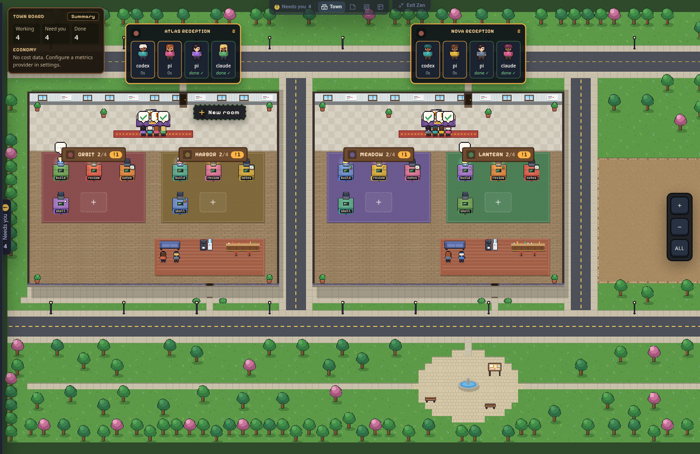 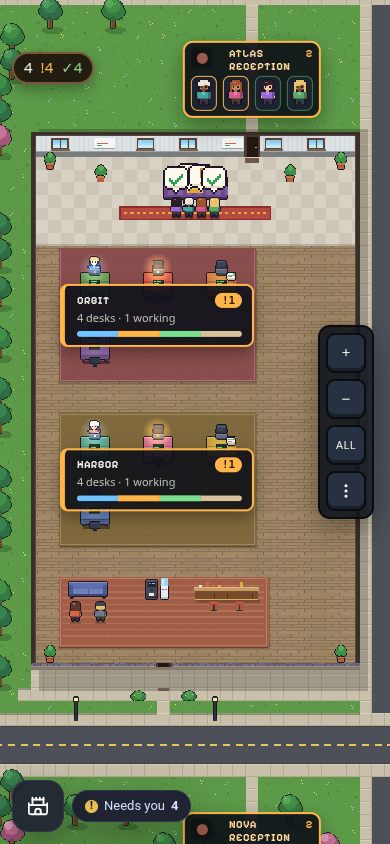

- **What is there:** the Town board (Working, Need you, Done), a reception per
  host, room plaques with their `!` counts, desks and agents, zoom (`+`, `−`,
  `ALL`) and New room.
- **Rules:** surfaces over Town wear the [Town skin](#skins). State uses the
  [state map](#state-colours) through Town's `--town-*` values. The scene
  follows the Town renderer's own [frame rules](#motion).
- **Proposed here:** the fuller [Town skin](#skins) for windows and trays over
  Town, and its title font policy.

### Board

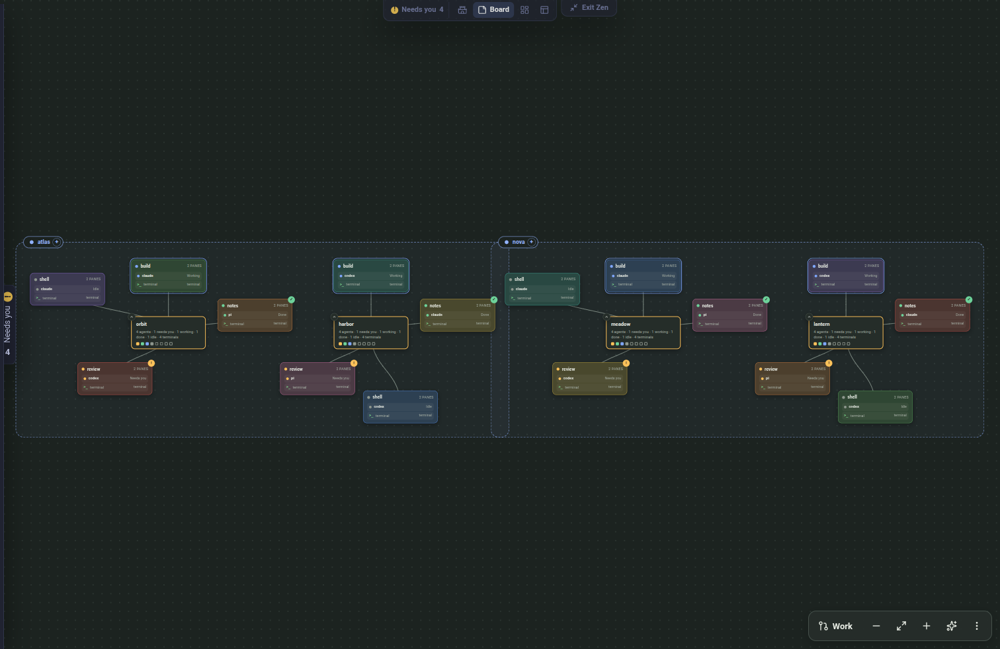 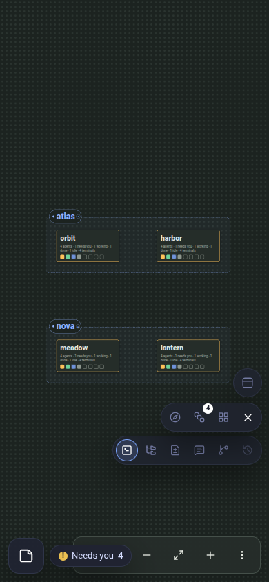

- **What is there:** a space for each host with workspace hubs and tab cards,
  the links between them, and a dock: Work, zoom out, fit, zoom in, tidy and
  settings.
- **Rules:** cards follow the [state map](#state-colours) through Board's
  `--s-*` values. Board's card badges draw `!`, `✓` and `~` in CSS rather than
  using [agent marks](#icons).
- **Proposed here:** the shared state map and the
  [one count badge](#badges-and-counters).

### Desk

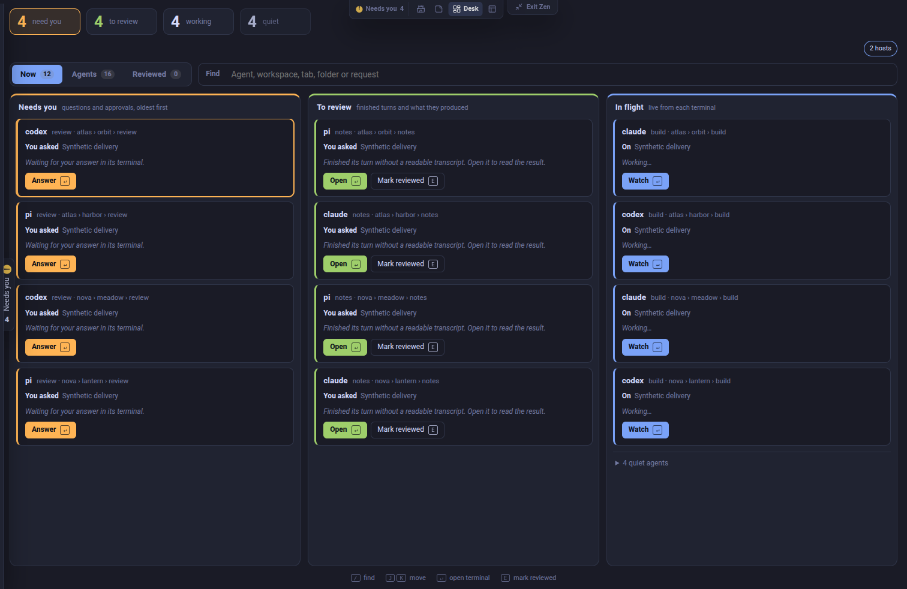 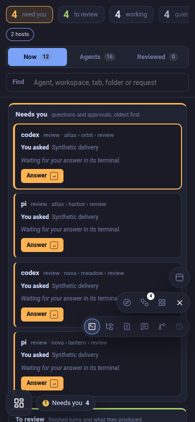

- **What is there:** count tiles for need you, to review, working and quiet;
  Now, Agents and Reviewed tabs with counts; Find; and lanes for Needs you, To
  review and In flight. Each card shows the agent, its place, what it asked or
  is doing, an action button and a key hint (`↵` or `E`).
- **Rules:** [cards](#card), [buttons](#button), the
  [inline count](#badges-and-counters) and the [state map](#state-colours).
- **Today and the proposal:** the lane actions (Answer, Open and Watch) are
  solid, state-coloured buttons. The proposed [button set](#button) has no such
  variant, so how Desk's actions look depends on the pending primary-button
  decision. The tab counts already resemble the proposed inline count.

On phones, Board and Desk also show the shell's floating controls for the
selected terminal: Ranger, Tabs, window arrangement and the workspace views
(Files, Changes, Annotations, Commits and agent message History), plus the
Workspaces toggle. The floating X hides these mobile controls; it does not close
an agent window. Today they can cover lane content. No rule here covers floating
controls yet.

## Icons

World draws its icons from one set, [Lucide](https://lucide.dev/icons/), through
`lucide-react` ([`web/package.json`](../../web/package.json)). Icons use stroke
2, usually 13–16 px in bars, menus and toolbars and 22 px in phone navigation,
beside a visible label or an `aria-label`. Agent state uses agent marks: one
glyph in a coloured circle per state, defined in
[`agentMarks.ts`](../../web/src/world/agentMarks.ts) and styled by
[`AgentMark.css`](../../web/src/components/AgentMark.css). A few controls are
plain text glyphs.

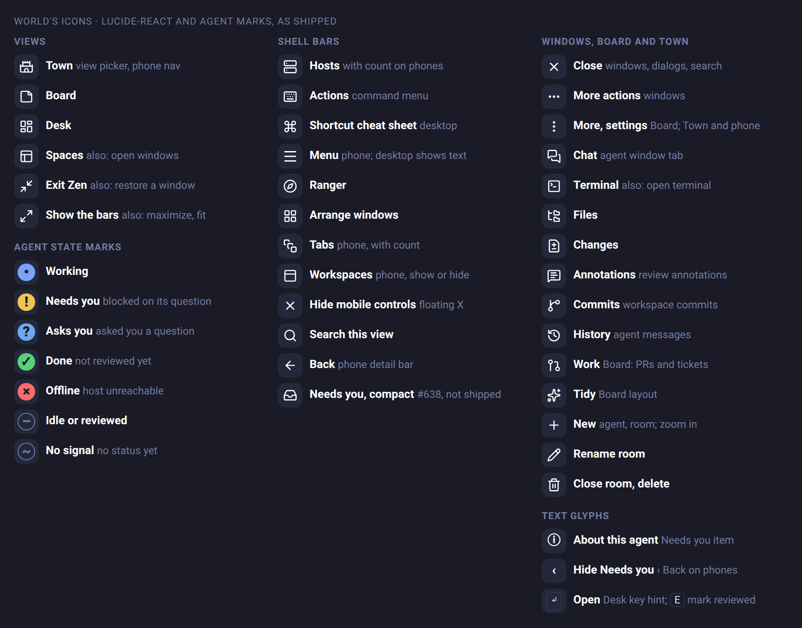

The legend image records guide revision `6847c781`, before the Needs you card
refresh. Its `ⓘ` agent-information control has since been replaced: hovering
the agent name shows that card, and clicking the name opens Chat. The table
below describes current controls, including the current Needs you Back and
hide icons. The card specimens retain `ⓘ` as a proposed optional action, not
a shipping Needs you control.

| Icon | Means | Where today |
| --- | --- | --- |
| `Castle`, `StickyNote`, `LayoutDashboard`, `PanelsTopLeft` | Town, Board, Desk, Spaces | Zen view picker, phone view button and nav |
| `Minimize2`; `Maximize2` | Exit Zen or restore; show the bars, maximize or fit | Zen dock, windows, Board |
| `Server` | Hosts | top bar; with a count badge on phones |
| `Inbox` with the Hosts count badge | Needs you | phone top bar outside Zen, immediately after the view name |
| `Keyboard` | Actions, the command menu | top bar |
| `Command` | Shortcut cheat sheet | desktop top bar |
| `Menu` | Menu | phone top bar; desktop shows the word |
| `Compass` | Ranger | top bar, phone floating controls |
| `LayoutGrid`; `PanelsTopLeft` with a count | Arrange windows; open windows | top bar; Arrange also on phones |
| `SquareStack` with a count | Tabs | phone bars and floating controls |
| `PanelTop` | Show or hide Workspaces | phone workspace shortcut |
| `Search` | Search this view | view toolbar |
| `ArrowLeft`; `ChevronLeft` | Back | phone detail bars and the Needs you sheet; a window opened from another surface |
| `X` | Close a window, dialog or search; hide mobile controls or the desktop Needs you tray; dismiss a question or mark finished work reviewed | windows, dialogs, search; phone floating controls; desktop Needs you header; Needs you card headers |
| `MoreHorizontal`; `EllipsisVertical` | More actions; more or settings | windows; Board, Town and phones |
| `MessagesSquare`, `SquareTerminal`, `FolderTree`, `FileDiff` | Chat, Terminal, Files, Changes | agent window views |
| `MessageSquare`; `SendHorizontal` | Open Chat; send an answer | Needs you card headers; answer fields |
| `MessageSquareText` | Review Annotations | phone workspace views |
| `GitBranch` | Workspace Commits | phone workspace views |
| `History` | Agent message History | phone workspace views |
| `GitPullRequest`, `Sparkles`, `Minus`, `Plus` | Work, tidy, zoom out, zoom in or new | Board dock, Town |
| `Pencil`; `Trash2` | Rename room; close room or delete | Town room plaques, Board |
| Agent marks `•` `!` `?` `✓` `×` `–` `~` | Working, Needs you, Asks you, Done, Offline, Idle or Reviewed, No signal | Needs you (including the closed desktop handle), agent hover cards and Town's peek; Desk shows the `?` mark |
| Text `↵`, `E` | Open; mark reviewed | Desk key hints |

The same meaning still has more than one form today. Back is `ArrowLeft` on
phone bars and the Needs you sheet, and `ChevronLeft` in windows. Close is
`X` in windows, dialogs and the desktop Needs you tray, and the text `×` in
Board's trays and Town's peek. The closed desktop Needs you handle shows an
AgentMark followed by `Needs you` and its count. Board's card badges are CSS
glyphs, not agent marks. Reuse an icon for its existing meaning before adding one.

The specimens below use these icons. Their `Inbox` with the Hosts badge
(`.world-hosts-count`) is the shipping compact phone Needs you counter,
introduced in #638.

## Principles

1. **One anatomy, several skins.** A component has one structure, spacing,
   type and set of control sizes. A skin changes token values, never structure.
2. **Town is a place, and Board and Desk are tools.** Town is skeuomorphic:
   pixel art, framed boards, gold accents. Board and Desk are utility surfaces
   for scanning and acting quickly. They meet in the floating surfaces (agent
   windows, Needs you, trays, peeks), which take the skin of the view they
   float over.
3. **Tokens, not values.** Colours come only from tokens. No new hex values,
   and no `var(--x, #hex)` fallbacks. Every token is always defined.
4. **Reuse before adding.** Use an existing button, card, badge or tray before
   inventing one. Add no new bar or header button when an existing control can
   carry the action.
5. **Phones are first-class.** Every tappable control has a hit area of at
   least 44 px. Back is always at the top left. No action is reachable only by
   a swipe.
6. **Roamgate-derived files change only when touched.** Most off-scale values
   live in Roamgate-derived `web/src/components/`. Mass-editing them makes
   upstream sync harder. Apply this guide to World-owned files
   (`web/src/world/`) and new code first.

## Skins

**Shipping precedent:** `.world-managed-window.is-town-skin` in
[`windows.css`](../../web/src/world/windows/windows.css) remaps text, accent
and viewer tokens, sets the window background directly and adds the Town edge
ring. It does **not** remap `--panel` or `--panel-2`. Town window controls use
dedicated `--town-button` rules, so shell panel/control tokens alone do not
produce the pictured Town appearance today. Window UI uses Rubik; window titles
use Pixelify Sans, bundled in
[`worldFonts.css`](../../web/src/world/worldFonts.css).

**Proposed skin contract:** extend that precedent to shared panel and control
roles so components can use shell tokens in both skins. This is future work,
not an existing component guarantee.

| Skin | Where | How |
| --- | --- | --- |
| **Shell** (default) | Board, Desk, Spaces, Chat, dialogs, settings | `tokens.css` as is; accent colours from the user's accent setting |
| **Town** | the Town view and every surface floating over it | a proposed fuller shell-token remap, extending the existing window scope, plus a 2 px edge ring |

- The proposed scope remaps `--panel`, `--text`, `--text-strong`, `--muted`,
  `--accent`, `--accent-soft` and `--panel-2`, including shared control roles.
- The proposed font policy keeps Rubik for UI text and uses Silkscreen for
  plaques and window titles. Changing window titles from Pixelify Sans requires
  approval and a later implementation. Silkscreen is never for body text, names
  or buttons.
- Under the proposed contract, components use shell tokens rather than reading
  `--town-*` tokens or hard-coding Town colours. The specimen illustrates this
  fuller remap with local styles; today's window scope does not supply it.

| Shell | Town |
| --- | --- |
| 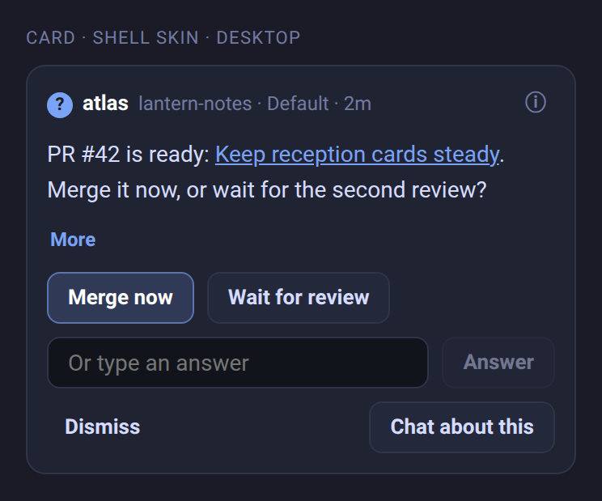 | 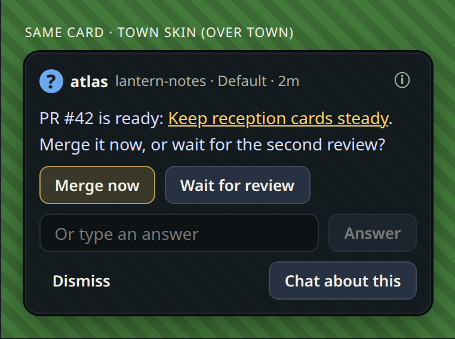 |

## Tokens

### Colour roles

Use the role, not the colour.

| Role | Token |
| --- | --- |
| App background | `--shell-bg` |
| Card, panel, tray | `--panel` (`--shell-panel` where the shell takes the accent tint) |
| Raised control, hover | `--panel-2` |
| Field, well, code, terminal preview | `--input-bg` (`--viewer-content-bg` in viewers) |
| Title, name, primary label | `--text-strong` |
| Body text | `--text` |
| Meta, secondary, placeholder | `--muted` |
| Card and control edge | `--border` |
| Divider inside a card | `--border-soft` |
| Focus, link, selected edge, count-badge fill | `--accent` |
| Primary and selected fills | `--accent-soft`, `--accent-hover`, `--accent-active` |
| Shadows | `--shadow-lg` (trays), `--shadow-tooltip` (hover cards), `--shadow-modal` |

A **solid `--accent` fill is for indicators only**: count badges, the switch-on
state, progress and drop markers. It is never a button fill.

### State colours

One map for every view:

| Meaning | Edge or icon | Fill | Strong text |
| --- | --- | --- | --- |
| Needs you, waiting on a person | `--yellow` | `--warning-soft` | `--warning-text` |
| Working | `--blue` | `--accent-soft` | `--info-text` |
| Done, to review | `--green` | `--success-soft` | `--success-text` |
| Error, failed, disconnected | `--red`, `--danger-border` | `--danger-soft` | `--danger-text` |
| Idle, quiet, settled | `--muted` | none | `--muted` |

Town's `--town-wait`, `--town-work` and `--town-done`, Desk's lanes and Board's
`--s-*` are those views' values for the same meanings. Never show state by colour
alone: pair it with an icon shape or a word.

### Spacing

Use **2, 4, 6, 8, 10, 12, 16 or 24 px**.

| Use | px |
| --- | --- |
| Icon to label | 6 |
| Between controls in a row | 8 |
| Between zones in a card | 8 |
| Card padding | 12 |
| Between cards in a list | 8 |
| Tray or list body padding | 12 |
| Between sections | 16 |

### Type

Use **11, 12, 13, 14, 16 or 20+ px.** Weights are **400** for body text,
**600** for labels and buttons, and **700** for names and titles.

| px | Use | Line height |
| --- | --- | --- |
| 11 | caption, meta, timestamps, pill text, inline counts | 1.3 |
| 12 | secondary text, compact button labels, helper and error text | 1.4 |
| 13 | buttons, menu items, list rows, card names (700), dense card body | 1.3 for controls, 1.45 for text |
| 14 | reading text in cards, inputs, tray titles (700), phone button labels | 1.55 |
| 16 | dialog and sheet titles (700) | 1.3 |
| 20+ | display numbers only (Desk counters, Town board stats) | 1.1 |

- Text never goes below 11 px. The one exception is count-badge digits, which
  always sit on an icon that carries the meaning.
- Code, paths, IDs and run facts use `var(--mono-font)`.

### Radius and control heights

| Radius | Use |
| --- | --- |
| 4 | keycaps, tiny chips |
| 8 | buttons, inputs, inner blocks (code, previews) |
| 12 | cards, panels, windows |
| 16 | dialogs, sheets |
| 999 | pills and badges |

Never nest a radius equal to or larger than its container's.

| Height | Use |
| --- | --- |
| 28 | compact: desktop toolbars, dense rows, tray headers |
| 32 | default desktop control |
| 44 | every content control in the phone layout (`html[data-layout="mobile"]`) |

## Components

### Button

**Shipping selectors:** [`base.css`](../../web/src/styles/base.css) supplies
`button`, `button.ghost` and `button.danger`. Its soft primary is positional:
`.modal-actions > button:last-child:not(.ghost):not(.danger)`. An ordinary button
outside that context remains secondary. Modal actions currently have a 34 px
minimum height.

**Proposed reusable APIs:** a primary variant, a link-button variant and shared
28/32/44 px size variants. These are local specimen styles today, not reusable
variants exported by `base.css`. The table and sizes below describe the proposal;
this PR does not implement them.

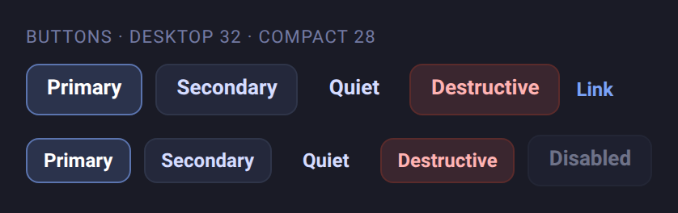

| Variant | Look | Use |
| --- | --- | --- |
| Primary | `--accent-soft` fill; border `color-mix(in srgb, var(--accent) 58%, var(--border))`; `--text-strong`, 600 | the single recommended action |
| Secondary (`button`) | `--panel-2` fill, `--border`, `--accent` border on hover | other actions |
| Quiet (`.ghost`) | transparent, `--panel-2` on hover | low-stakes actions: Dismiss, Less, ⓘ, close |
| Destructive (`.danger`) | `--danger-soft`, `--danger-border`, `--danger-text` | irreversible actions only |
| Link | `--accent` text, underline on hover | More, Read all, inline navigation |

- At most **one primary per card or dialog**. In a row of answer choices, the
  first choice is the agent's recommended one and is the primary.
- In a footer, quiet or destructive actions go at the start and the primary
  goes last.
- Focus: an accent border plus a `0 0 0 3px var(--accent-soft)` ring. In
  `forced-colors` mode, a 2 px Highlight outline.
- Disabled: opacity 0.45. Keep a briefly unavailable button visible.
- Sizes:
  - **Compact:** 28 px, padding 0 10, 12 px label.
  - **Default:** 32 px, padding 0 12, 13 px label.
  - **Touch:** 44 px, padding 0 14, 14 px label.
- Icon-only buttons are square at the same heights.

### Inline input with action

- One row holds the field and only its own submit button:
  - **Field:** flexible width, `--input-bg`, radius 8, 14 px text, padding 0 12.
  - **Submit button:** the same height as the field, 8 px gap. It keeps its
    label and never wraps below the field.
- Submit is disabled while the field is empty. Enter submits, and on phones the
  button stays visible.
- Errors go under the row, 12 px `--danger-text`, announced with `aria-live`.
- Other actions (Dismiss, Chat) go in the card footer, never in the input row.

### Card

| Desktop | Phone |
| --- | --- |
|  | 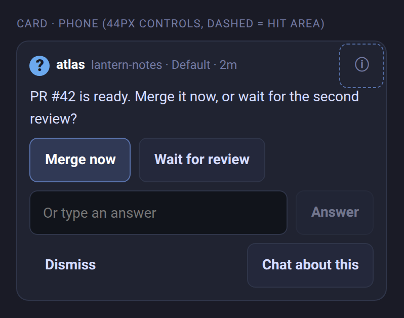 |

A card has up to four zones, 8 px apart, inside 12 px padding, with radius 12 and
a 1 px `--border` on `--panel`:

1. **Header**, one line: the agent mark for its state (16 px; see
   [Icons](#icons)), name (13/700 `--text-strong`, may be a link), meta (12
   `--muted`, ellipsis) and an optional quiet icon button at the end.
2. **Body:** reading text clamped to three lines with More/Less. Inner blocks
   use `--input-bg`, radius 8 and padding 8 10.
3. **Answer zone** (optional): answer choices (wrapping, 8 apart), then the
   inline input row.
4. **Footer** (optional): quiet or destructive actions at the start, then the
   main action last. Leave it out when it would be empty. Spacing separates the
   zones, not dividers.

States:

- **Focused or selected:** `--accent` border.
- **Needs attention** in a mixed list: a 3 px start bar,
  `inset 3px 0 0 var(--yellow)`.
- **Settled:** `--muted` text, collapsed to the header plus one line.

In the Town skin the 1 px border becomes the 2 px Town edge ring with a 1 px
inner highlight.

### Badges and counters

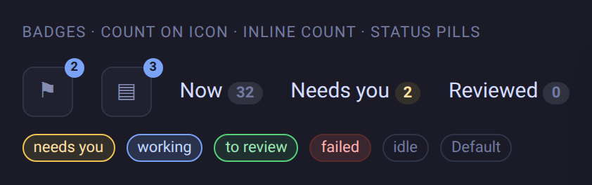

1. **Count badge on an icon** (header, dock, view picker). Use one look: the
   Hosts badge (`.world-hosts-count` in
   [`world-shell.css`](../../web/src/world/world-shell.css)), which today shows
   only on phones. Today World has four count looks; see
   [Dos and don'ts](#dos-and-donts).
   - Size and position: 14 px tall, minimum 14 px wide, padding 0 2, radius 7,
     offset `-7px` top and `-9px` right.
   - Colour and text: `--accent` fill, `--bg` text, 9 px/700.
     This inherited pair has a known neutral light-theme contrast gap:
     `#e1e2e7` on `#2e7de9` is 3.1062:1, below 4.5:1 for these small digits.
     The proposed unification needs an accessible foreground/fill pairing,
     pending owner approval; this is not an approved colour prescription.
   - Hidden at 0 and capped at 99+. Its parent must not clip it.
2. **Inline count in a label** ("Now 32"): 11/600, padding 0 6, 16 px tall,
   radius 999, `color-mix(in srgb, var(--text) 12%, transparent)` fill and
   `--muted` text. Work waiting on the owner uses `--warning-soft` and
   `--warning-text`.
3. **Status pill or tag** (`.badge`): 11 px, padding 1 7, radius 999, 1 px
   border, tinted by the state map. A neutral tag uses `--border` and `--muted`.

### Panel and tray

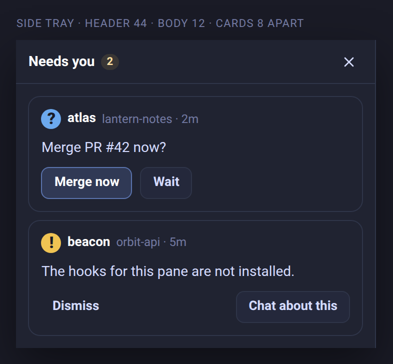

A tray is a surface on a screen edge, such as Needs you, an agent or Chat
window, or the hosts list.

- **Header:** at least 44 px high, padding 0 12, 1 px `--border` underneath.
  From the left:
  1. `‹ Back`, on phones;
  2. the title, 14/700, with an optional inline count;
  3. compact quiet actions;
  4. close (×), on desktop.
- **Body:** scrolls, with padding 12 and cards 8 apart.
- **Footer** (optional, sticky): a `--border-soft` top edge, padding 8 12, and
  actions at the end.
- **Surface:** `--panel`, with a border on the inner edge only.
  - Over the view: `--shadow-lg`.
  - Docked beside the view: no shadow.
- **Side tray width:** `clamp(320px, 24vw, 360px)`.
- **Skin:** a tray takes the skin of its host view.
- **Closing:** Esc closes it on desktop.
- **Phone:** a tray is a full-screen sheet with `‹ Back` at the top left.
  Windows opened from it sit above it, and Back closes them first.

### Dialogs

Use `.modal` and `.modal-actions` from `base.css`:

- radius 16;
- 16 px title at 700;
- actions end-aligned and 8 apart, with the primary last.

On phones, dialog buttons are 44 px.

## Layout and phone rules

### Phone header

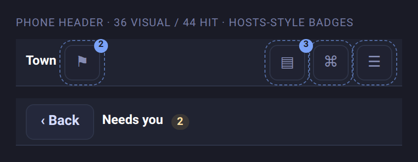

**Today:** phone root screens open in Zen without this bar; a floating view
button and a Needs you pill sit at the bottom (see [World today](#world-today)).
The bar shows on detail screens, such as an agent window or Spaces, with Back,
and outside Zen, where it holds the title, Needs you, Hosts with its count,
Actions and Menu. These rules are for that bar.

- **Bar (proposed):** 48 px excluding the safe-area top. Total border-box height is
  `calc(48px + env(safe-area-inset-top, 0px))`, including the bottom divider.
  Use the safe-area inset as top padding, no other vertical padding, 10 px
  horizontal padding and an 8 px gap. Centre a row of 44 px targets in the
  remaining bar space. Sticky and opaque. The specimen draws this geometry and
  dashes each 44 px slot.
- **No second bar under the header.** Notices go to Needs you or a toast.
- **Left:** the view name, then the Needs you icon with its count badge
  (`Inbox` with the shipping Hosts badge). On a detail screen, `‹ Back` and
  the title instead.
- **Right:** icon buttons only: Hosts (`Server`), Actions (`Keyboard`) and Menu
  (`Menu`). At most four icon buttons in the whole bar at 360 px.
- **Icon buttons:** 36 px drawn, 44 px hit area, radius 8, the
  `--topbar-control-*` tokens. When pressed or open: an `--accent` border and
  `--topbar-control-active-bg`. Reserve a separate 44 px-wide layout slot for
  each target; centre the 36 px visual inside it. Targets stay within the bar
  below the safe area and never overlap adjacent targets.
- `‹ Back` is the only text button in the phone header.
- The header collapses while the keyboard is up for terminal input.

### Hit areas

On phones, every tappable thing has a 44 × 44 px hit area. That includes link
buttons, ⓘ, dock icons and header icons. A control drawn smaller extends its hit
area with a transparent pseudo-element (`::before { inset: -4px }` or more)
while reserving enough layout space to avoid overlap with neighbours. In the
header, use the 44 px slots above rather than overlapping hit extensions.

### Viewports

Check UI changes at the five
[screenshot viewports](../SCREENSHOTS.md#pr-screenshot-viewports): phone 390 × 844,
laptop 1512 × 982, half 1280 × 1440, wide 2560 × 1440 and portrait 1440 × 2560.

## Motion

- **Micro feedback** (hover, press, focus): 120–140 ms ease.
- **Entering surfaces** (tray, dialog, toast): 160–190 ms ease-out, with a
  small rise or slide.
- Nothing moves under `prefers-reduced-motion: reduce`.
- Town's sprites and scene animation follow the Town renderer's own frame rules.

## Accessibility

- Text contrast meets WCAG AA (4.5:1) against its surface in both themes and in
  the Town skin. `--muted` is for secondary text only.
  - Known gap: today `--muted` reaches only 3.7:1 on `--panel` in the dark
    theme and 3.4:1 in the light theme.
  - Light-theme `--accent` links on `--panel` reach 2.9:1.
  - Neutral light-theme count digits (`--bg` on `--accent`, `#e1e2e7` on
    `#2e7de9`) reach 3.1062:1. This is a separate gap from accent links on
    `--panel`. An accessible label does not fix the visible digits' contrast.
  - Token fixes and an accessible badge foreground/fill pairing wait for the
    owner's decision. Until then, don't use `--muted` for text a person must
    read to act, or treat the inherited badge pair as contrast-compliant.
- Every control has a visible `:focus-visible` style. Never set
  `outline: none` without a replacement ring.
- Icon-only buttons have an `aria-label`. Counts are part of the label
  ("Needs you, 2 waiting").
- State is never shown by colour alone.
- Hit areas are 44 px on phones, and live errors use `aria-live`.

## Dos and don'ts

| Don't | Do |
| --- | --- |
| Fill a button with solid `--accent` | Use the soft primary |
| Draw a new count-badge style | Use the one count badge |
| Put Dismiss or Chat in the input row | Keep only the submit button there |
| Hard-code Town colours in a component | Write it in shell tokens and let the skin re-map them |
| Use `var(--border, #343942)` | Use `var(--border)` |
| Use 10, 7 or 9 px text | Use 11 px or larger |
| Use a 28 px phone button | Use 44 px, or a 36 px button with a 44 px hit area |
| Add a bar under the header | Use Needs you or a toast |

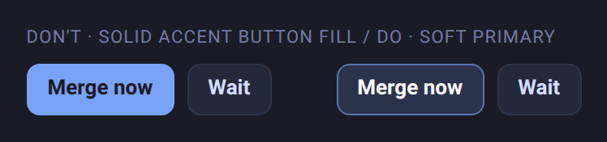

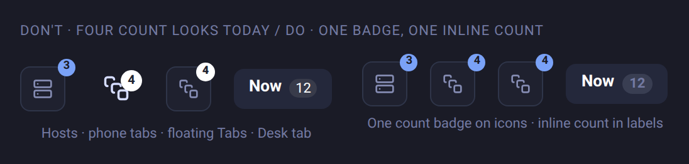

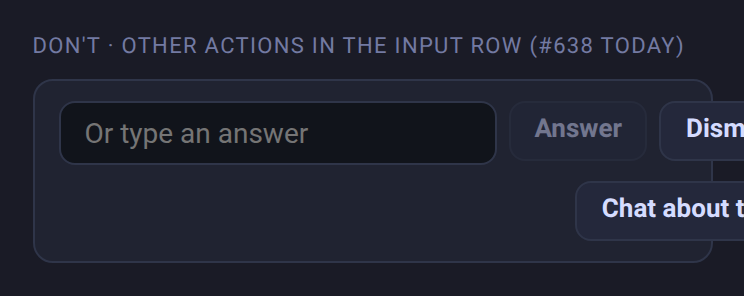

## Checklist for a UI change

For mockup review now, and shipping UI review after owner approval:

- [ ] For shipping changes, the applicable owner decisions are approved;
      proposed rules alone do not authorize implementation.
- [ ] Colours come from the role tokens. No new hex values and no hex
      fallbacks.
- [ ] Spacing is from 2, 4, 6, 8, 10, 12, 16 or 24, and type is from 11, 12,
      13, 14, 16 or 20+, with weights 400, 600 or 700.
- [ ] Radii are 8 for controls, 12 for cards and 16 for dialogs, plus pills.
- [ ] Buttons use the five variants, with at most one primary, placed last.
- [ ] Cards follow header, body, answer zone, footer.
- [ ] Counts use the one count badge, and status uses the state map plus an
      icon or word.
- [ ] Verify visible text contrast, including count digits, against the actual
      surface in both themes and the Town skin (4.5:1 for small text). Record
      gaps and pending colour decisions; labels do not replace this check.
- [ ] A surface over Town wears the Town skin.
- [ ] Phone: 44 px hit areas, Back at the top left, no new header bar.
- [ ] Focus is visible, icon buttons have labels, and the change honours
      reduced motion.
- [ ] Screenshots of what changed at the five viewports, synthetic data only.
