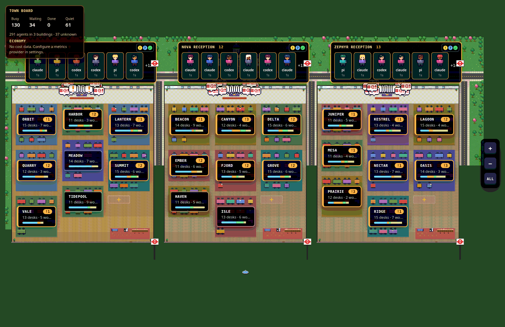
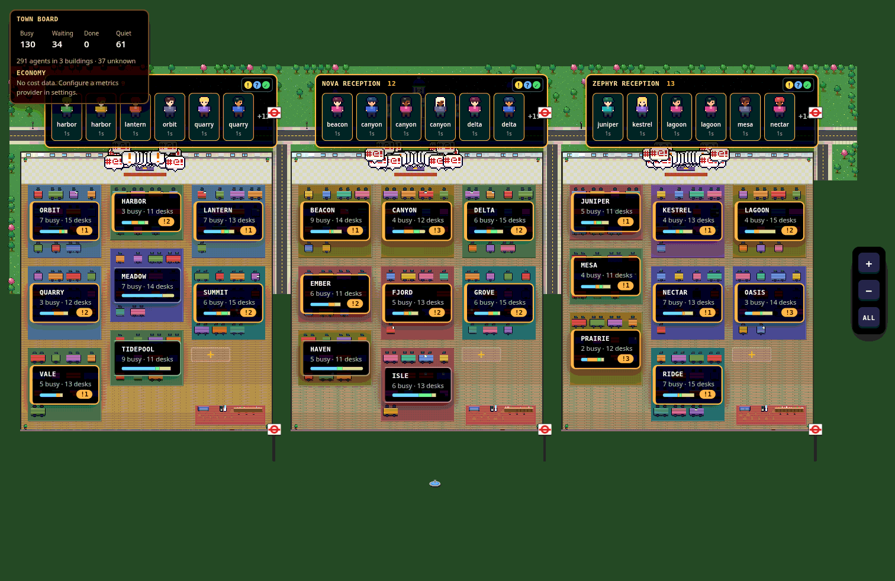
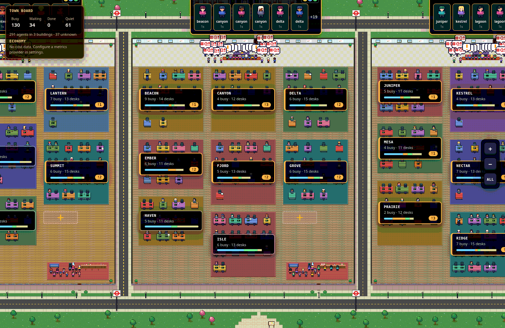
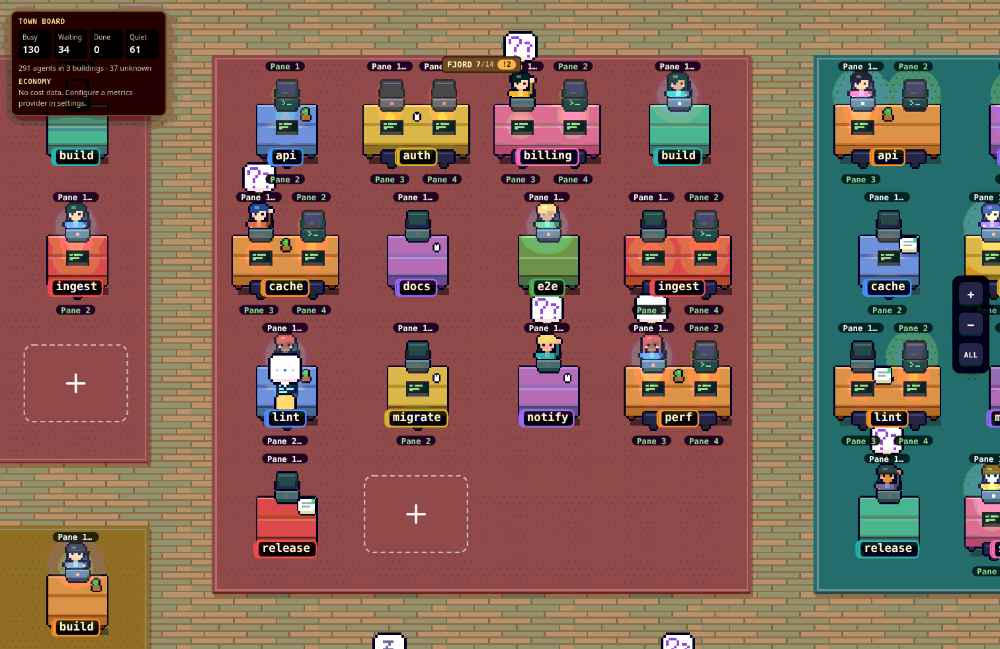
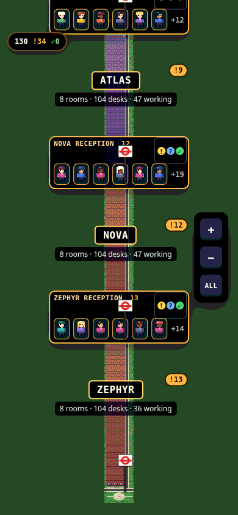
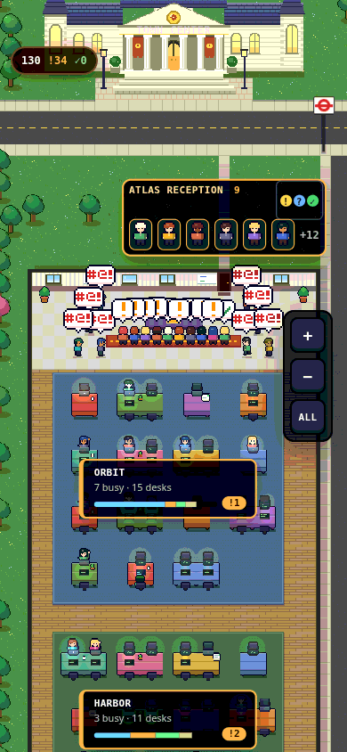
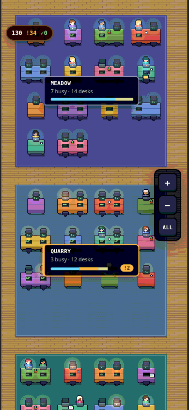
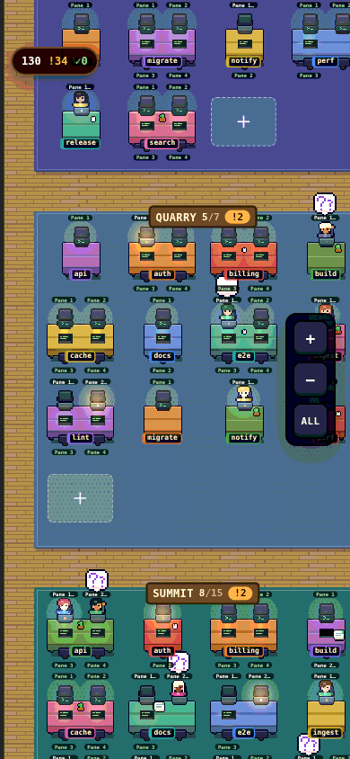

# Town at scale

Town is judged at the owner's maximum scale: 3 hosts, 8 rooms per host, 11–15
desks per room and several panes per desk. This report records how that scale
looks and reads at each zoom on a laptop and a phone, how long it takes to find
who needs you and where, and the frame time while panning. It ends with a ranked
list of fixes. This change makes the first two.

## The scale scene

[`townScaleScene.ts`](../../web/src/world/town/townScaleScene.ts) builds a
deterministic synthetic World. Every name and path in it is synthetic.

| | Count |
| --- | --- |
| Hosts (buildings) | 3: atlas, nova, zephyr |
| Rooms | 24 (8 per host) |
| Desks | 312 (11–15 per room) |
| Panes | 777 (1–4 per desk) |
| Agents | 291 (Claude, Codex and Pi) |
| Shells | 486 |

The agents' states:

| State | Agents | Herdr status |
| --- | --- | --- |
| Working | 130 | `working` |
| Asking (a question or permission) | 17 | `blocked`; task summary "Asks: …" |
| Blocked (for example, failing CI) | 17 | `blocked` |
| Finished | 29 | `done` |
| Idle | 61 | `idle` |
| Unknown | 37 | `unknown` |

Thirty-four agents need you. That is about what a full crew produces in a busy
hour.

### Load it

- **On a running World or a preview:** open Town with `?scene=town-scale`, for
  example `http://127.0.0.1:8789/?scene=town-scale`. The scene replaces every
  host in that tab until you reload without the parameter, and the Hosts filter
  is ignored while it is shown. The hosts are synthetic, so opening a terminal,
  a chat or a move fails with an unknown-connection error. Nothing reaches your
  Herdr. Answers to `herdr-world ask` questions come from the service, so the
  scene has none; its asking agents use Herdr's `blocked` status.
- **Captures and frame time:** the opt-in report harness mounts the production
  `TownCanvas` with the scene in headless Chrome. It starts no World or Herdr,
  saves PNGs at each zoom step for a laptop (1512 × 982) and a phone (390 × 844),
  and measures frame time while panning:

  ```bash
  TOWN_SCALE=1 bun run test scripts/town-scale.browser.test.ts
  HERDR_WORLD_TEST_GPU=1 TOWN_SCALE=1 TOWN_SCALE_OUTPUT=.agents/town-scale-gpu \
    bun run test scripts/town-scale.browser.test.ts
  ```

  The outputs go to `.agents/town-scale/` (PNGs and `report.json`). The harness
  is [`scripts/town-scale.ts`](../../scripts/town-scale.ts), and its page is
  [`TownScale.browser.tsx`](../../web/src/world/testing/town-scale/TownScale.browser.tsx).
  Ordinary gates skip it.

The harness shows the canvas without World's shell: there is no Needs you tab,
rail or Inspector. The shell adds Needs you on top of what is described here. The
harness also leaves out Town's finished-agent tracking, so the Town board's Done
column reads 0 in these captures. In World it counts agents that finish while
Town is open.

## What each zoom shows

The zoom buttons step through the whole town (ALL), home, the nearest building,
its room and a desk. On the laptop, the scene opens at the overview level
(z 0.38), where every room is a status card. A building step stays at that level
(z 0.59). The next step goes straight to the desk level (z 2.47), because a room
of 11–15 desks only fits at a zoom past the desk threshold. Wheel and pinch zoom
still pass through the room level on the way.

### Town (laptop, before and after this change)

Before: each room card's second line was cut before its activity
(`15 desks · 7 wo…`). In a narrower view, the name was cut too. Before the town
center moved to the top, the home zoom was z 0.32, and 11 of the 24 names read
`HARB…`, `LANT…` or `QUAR…`. Every reception chip read `claude`, `codex` or `pi`.



After: each room card shows the room's full name, then its busy count, then the
waiting badge beside its status bar. Each reception chip names the room the agent
waits from.



Readable at this zoom:
- the Town board totals;
- each building's reception count;
- each room's name, busy count and waiting badge (after this change);
- the room of the first six waiting agents per building (after this change).

Unreadable or overlapping:
1. **The Town board covers the first building's reception header**
   (`ATLAS RECEPTION`) and the top of its first chips.
2. **The bus-stop sign covers the reception's overflow count:** `+12` reads as
   `+1`, and `+19` as `+1`.
3. **The lobby crowd's bubbles pile up.** When a reception's queue is full,
   the rest crowd the lobby with a `#@!` grumble bubble each. At this scale,
   about a dozen of them overlap above the front door into an unreadable block.
4. **The reception strip holds six chips, while a building has up to 19
   visitors.** Finished agents share the strip with agents that need you, so the
   overflow count mixes the two.
5. The three buildings fit the width, so the lower third of the laptop view is
   empty grass.

### Building (laptop)



The room cards are readable. Behind each card, the tables show a room's density.
The lobby bubbles (item 3) are larger here, and still unreadable.

### Desk (laptop)



6. **Seat labels are noise:** `Pane 1…`, `Pane 2`, `Pane 3` appear under and over
   every desk. They are truncated, and they collide with the desk name plates
   (`billing`, `ingest`) and with the room plaque (`FJORD 7/14 !2`).
7. **Thought bubbles cover the seat labels** of the desk behind them.
8. The Town board stays over the scene at every zoom.

### Phone

| Town (ALL) | Building (home) | Room | Desk |
| --- | --- | --- | --- |
|  |  |  |  |

- **Town (ALL):** this zoom answers "how many need me, and on which host" best:
  each building shows its reception strip, a `!9`/`!12`/`!13` badge and
  `8 rooms · 104 desks · 47 working`. The badge floats to the right of the sign
  rather than on it.
- **Building:** the reception chips are portraits only on the phone (no names),
  so the phone still cannot say where an agent waits without a tap. The lobby
  bubble pile-up (item 3) covers the lobby.
- **Room:** each room card sits over its middle desks.
- **Desk:** the seat labels are 6–7 px and unreadable (item 6).

## Who needs me, and where?

Clicks are counted from the default Town view, on the laptop, with the
canvas alone. Seconds are a reading estimate: about 0.3 s per labelled item
scanned and about 1.5 s per click including the camera flight. They are not a
user study.

| Question | Before | After |
| --- | --- | --- |
| How many need me? | 0 clicks, about 1 s (Town board: Waiting 34) | same |
| Which host? | 0 clicks, about 2 s (the reception counts 9, 12 and 13) | same |
| Which room, for a chip in the strip (18 of 34)? | 1 hover or tap per agent (the chip said only `claude`), about 2 s each | **0 clicks**: the chip names the room, about 0.3 s each |
| Which rooms have waiting agents, and how busy are they? | 0 clicks, about 7 s to scan 24 cards; the busy count was cut on every card, and names were cut when the cards were narrow | 0 clicks, about 7 s; the name and the busy count are readable |
| Which desk, for all 34? | 20 rooms have a badge: tap each card, scan about 13 desks for `?`/`!` bubbles, zoom out; about 40 clicks and 100 s | same: this is the largest remaining cost |

The fixes answer "which room" for the 18 waiting agents shown at reception
without a click. They do not fix "which desk for everyone". Needs you in World's
shell lists every waiting agent, so that remains the fastest complete answer.
Town's job at this scale is the spatial overview, and items 2–4 limit it.

## Frame time while panning

The harness presses an arrow key once per frame for 180 frames (right, then
left), then records the intervals between animation frames and the CPU time of
each Pixi render call. The scene has 312 desks and 291 actors.

| Renderer | Viewport · zoom | Frame P50 | Frame P95 | Frames > 33 ms | Pixi render P95 |
| --- | --- | --- | --- | --- | --- |
| GPU (AMD RX 6700 XT, ANGLE Vulkan) | laptop · overview | 16.7 ms | 16.8 ms | 0 / 240 | 2.0 ms |
| GPU | laptop · desk | 16.7 ms | 16.8 ms | 0 / 240 | 2.1 ms |
| GPU | phone · overview | 16.7 ms | 16.7 ms | 0 / 240 | 0.7 ms |
| GPU | phone · desk | 16.7 ms | 16.7 ms | 0 / 240 | 1.0 ms |
| SwiftShader (software) | laptop · overview | 16.7 ms | 16.7–16.8 ms | 0 / 240 | 1.7–4.1 ms |
| SwiftShader | laptop · desk | 16.7–33.4 ms | 33.4–66.7 ms | 20–119 / 240 | 1.7–3.5 ms |
| SwiftShader | phone · overview | 16.7 ms | 16.8 ms | 0 / 240 | 0.7–1.1 ms |
| SwiftShader | phone · desk | 16.7 ms | 16.7–16.8 ms | 0–1 / 240 | 1.4 ms |

Town renders on every other frame (about 120 renders in 240 frames) and stays
at 60 Hz on a GPU at full scale. With software rendering, only desk zoom on the
laptop drops frames. That view draws the most characters, labels and bubbles at
once. The SwiftShader rows give the range over four runs. They differ because
other work was running on the machine at the same time. The GPU rows come from
one run, made before the town center moved to the top. Integrated laptop GPUs and phones were not measured.

## Ranked fixes

Ranked by legibility gained per line changed:

1. **Done in this change: room cards keep the room's name.** The name and the
   busy count each get their own row. The waiting badge sits beside the status
   bar, and "busy" (the Town board's word) comes before the desk count.
   CSS and one string.
2. **Done in this change: reception chips name the room.** An agent with no
   Herdr name shows its room instead of its harness. Its tooltip and accessible
   name say `claude in harbor › api`. A named agent keeps its name.
3. **Move the reception overflow count clear of the bus-stop sign** (item 2).
   CSS: put `+N` inside the strip's last cell, or move the sign.
4. **Keep the Town board off the first reception** (item 1): count its footprint
   in the camera's top inset at home zoom, or fold it to a single line of totals
   (`130 · !34 · ✓0`, as on the phone) until it is hovered.
5. **One grumble per lobby crowd below desk zoom** (item 3): replace about a
   dozen overlapping `#@!` bubbles with one bubble and a count (`#@! ×12`). The
   reception strip already counts the crowd. Renderer change, small.
6. **Hide seat labels below the selected desk, or show them only on hover**
   (item 6). Most seats are shells. Their `Pane N` labels carry no information
   at a glance and collide with desk plates.
7. **Split the reception strip into needs-you and finished** (item 4), so the
   overflow count says how many still need you. The reception filter is in
   flight, so this is a proposal for that work.
8. **Phone chips:** a two-letter room tag under each portrait, so the phone can
   say where without a tap.
9. **Proposal (rendering architecture): cull off-screen actors, labels and
   bubbles at desk zoom.** This is the only view that drops frames with software
   rendering. Measure on an integrated GPU first.
10. **Proposal (layout):** let the laptop home view use the empty lower third,
    for example by fitting the height when the buildings fit the width with room
    to spare. This does not change the owner's layout rules (reception at the
    top, the bar at the bottom, roads).
