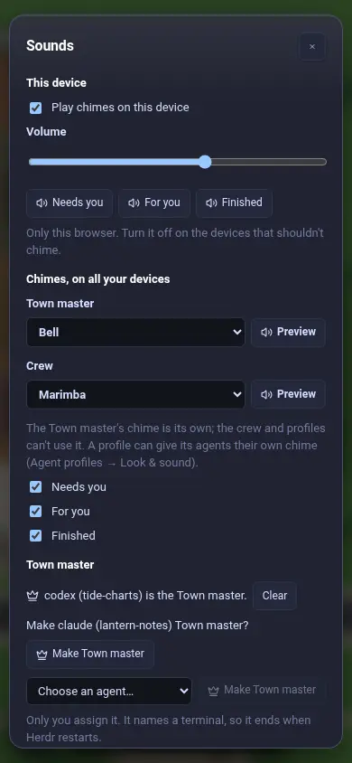
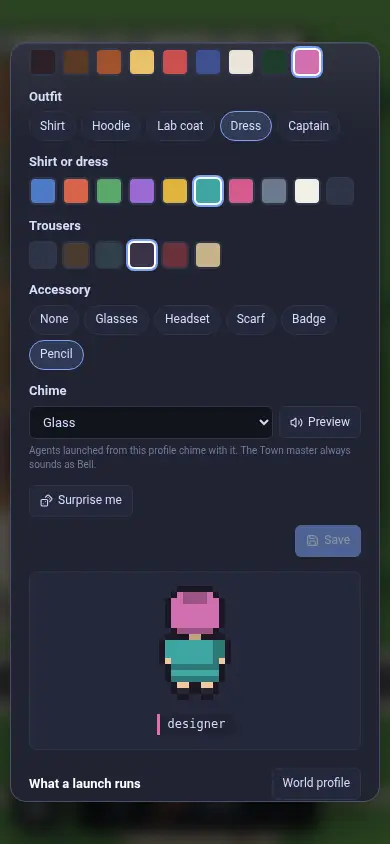
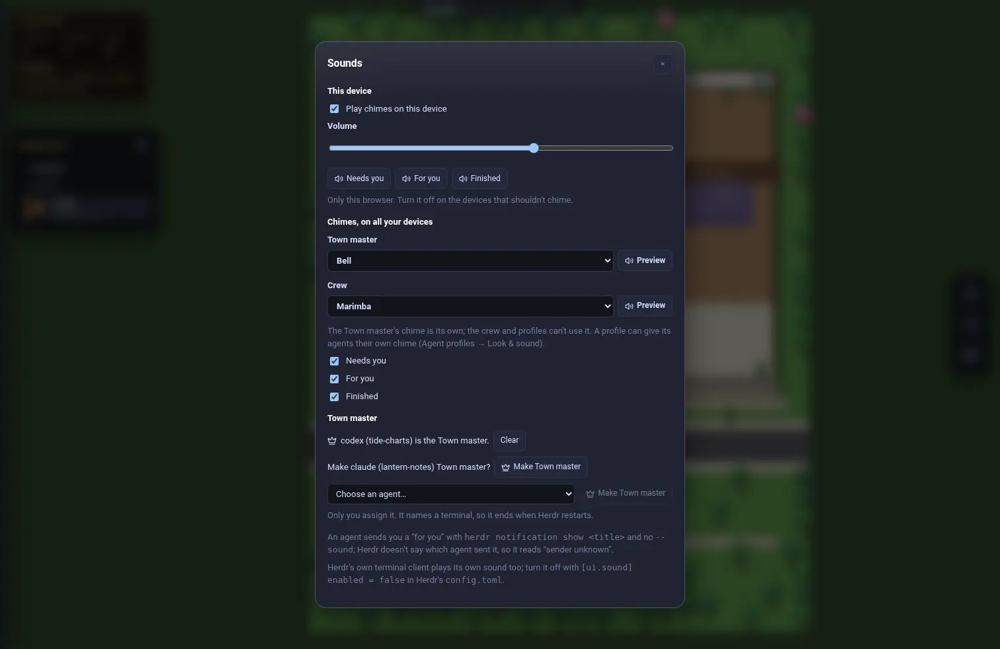
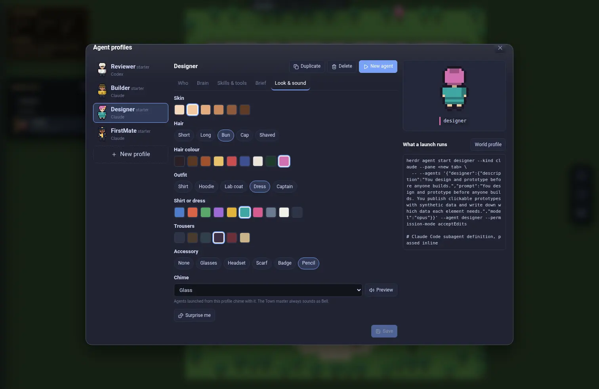
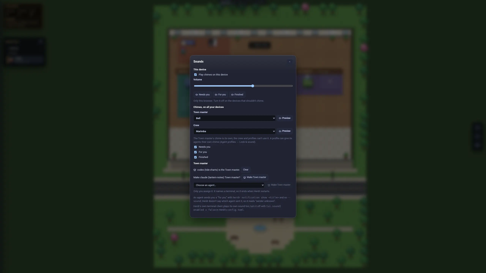
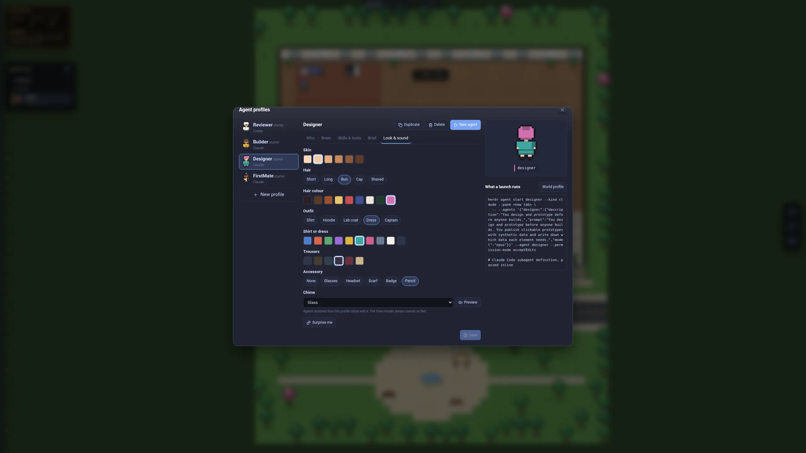
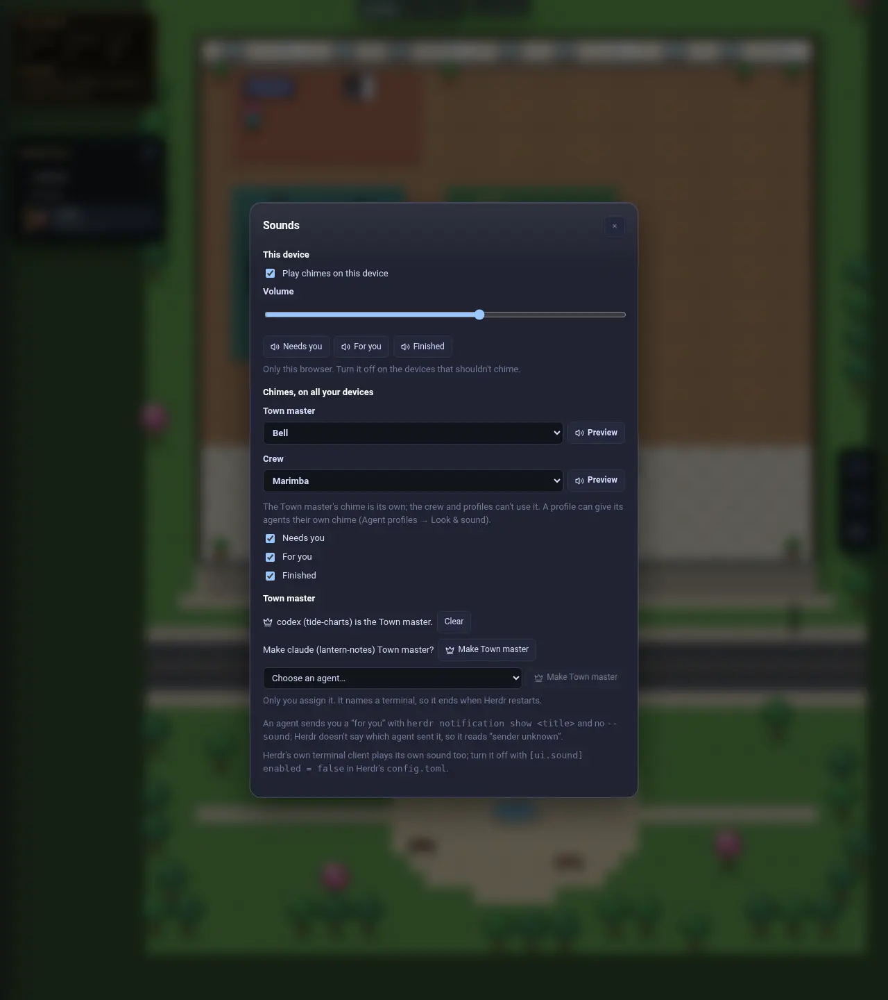
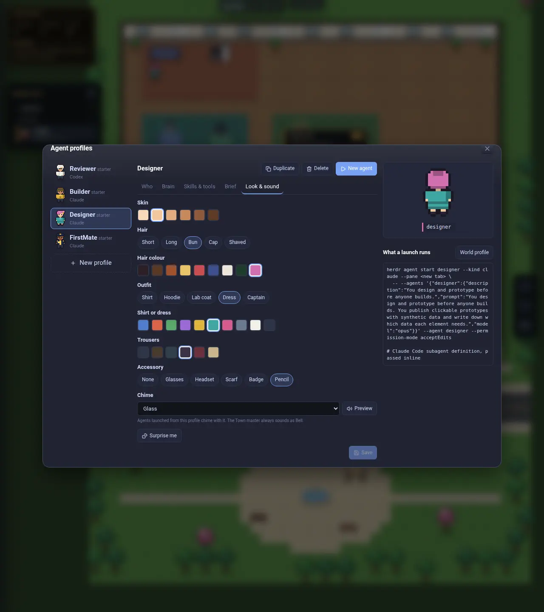
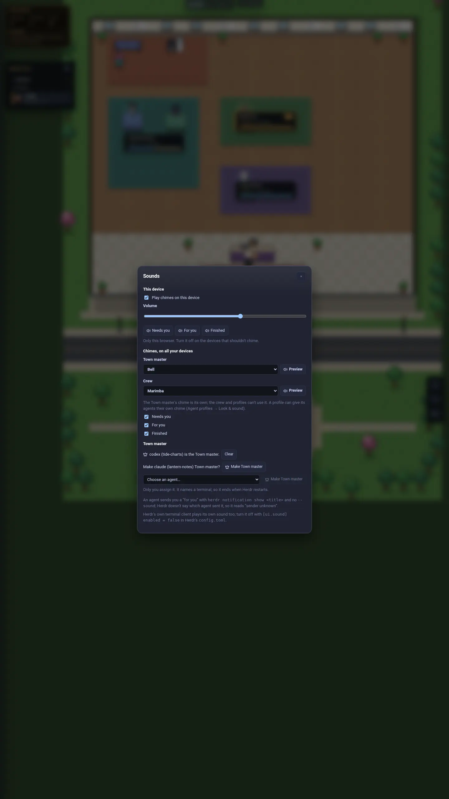
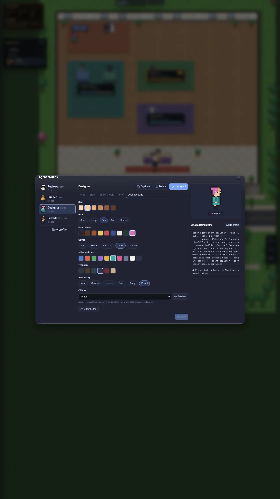

# Chimes: Settings → Sounds and a profile's Look & sound

Captured from a scratch World with a throwaway Herdr session, synthetic repos
(lantern-notes, orbit-api, tide-charts) and a synthetic profiles file: the
Reviewer's terminal holds the Town master role, FirstMate's launched terminal
is suggested, and Designer has its own chime (Glass). Every shot passed the
privacy scan.

| Viewport | Sounds | Look & sound |
|---|---|---|
| Phone 390×844 |  |  |
| Laptop 1512×982 |  |  |
| Wide 2560×1440 |  |  |
| Half 1280×1440 |  |  |
| Portrait 1440×2560 |  |  |

Sound itself can't be captured here; the chime center's tests cover what
plays when.
