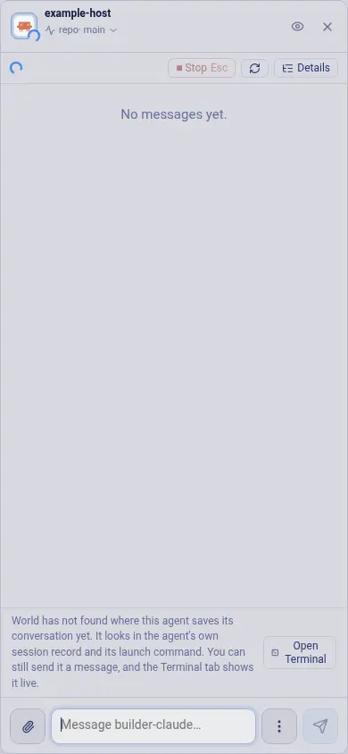
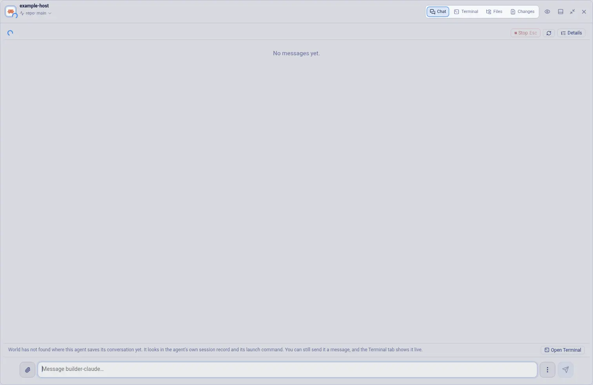
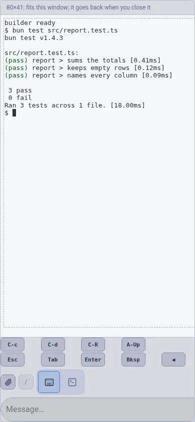
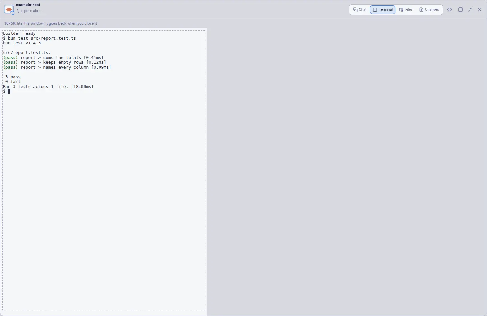
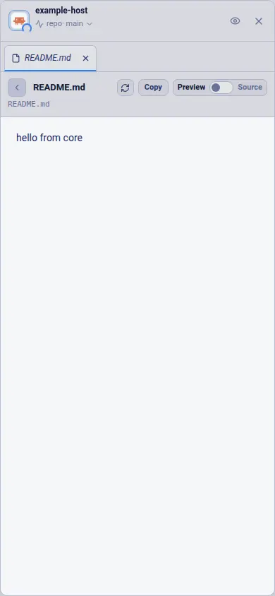
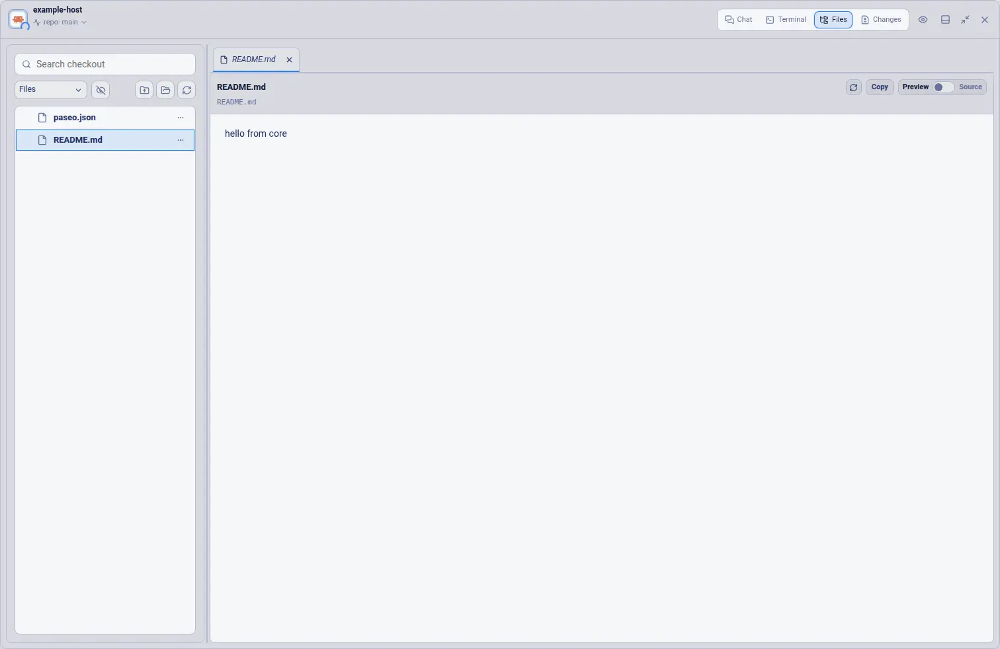

# Core agent in the shared Inspector (#915)

Captured by `server/src/herdr-core/files.browser.test.ts` with
`HERDR_WORLD_CORE_CAPTURES` set: a synthetic core Claude agent on an
in-process fake core, light theme.

| Tab | Phone (390×844) | Laptop (1512×982) |
| --- | --- | --- |
| Chat |  |  |
| Terminal |  |  |
| Files |  |  |

Chat is the shared `AgentChat`: the same header, Details, composer and ⋮
keys as a Herdr agent's, with Stop shown but off and core's own wording
when no conversation has been found yet. Files is the shared Inspector
file view. The Terminal tab is core's watch inside the shared window, with
the shared terminal composer on a phone.
