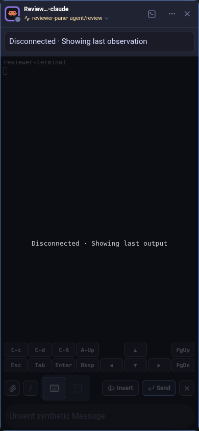
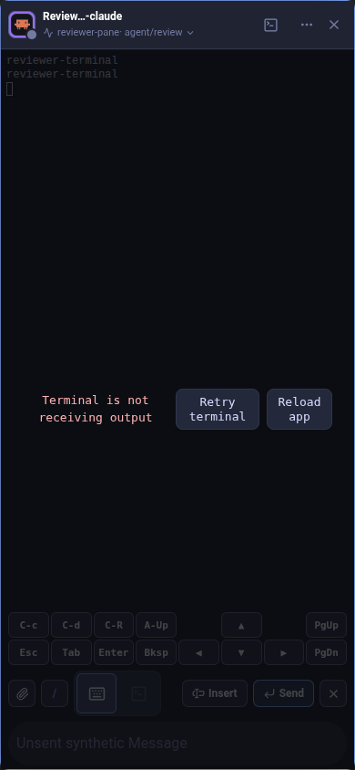
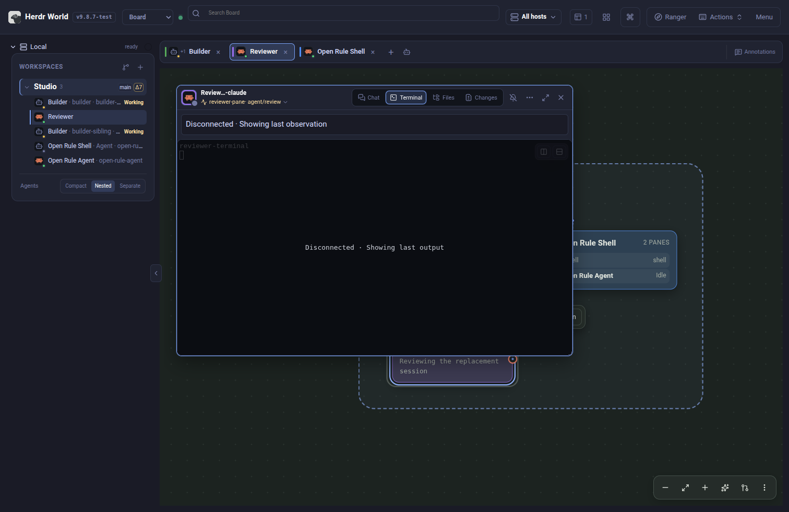
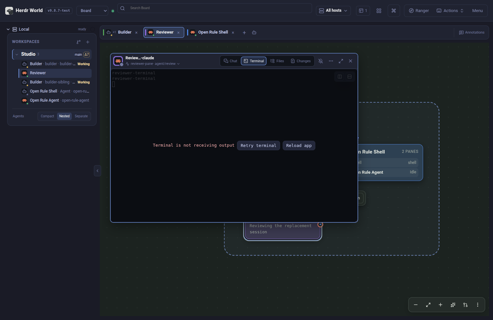
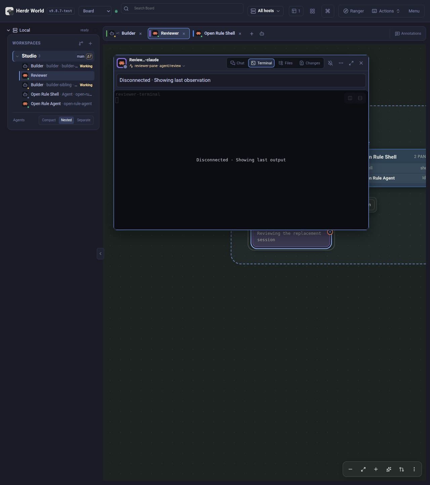
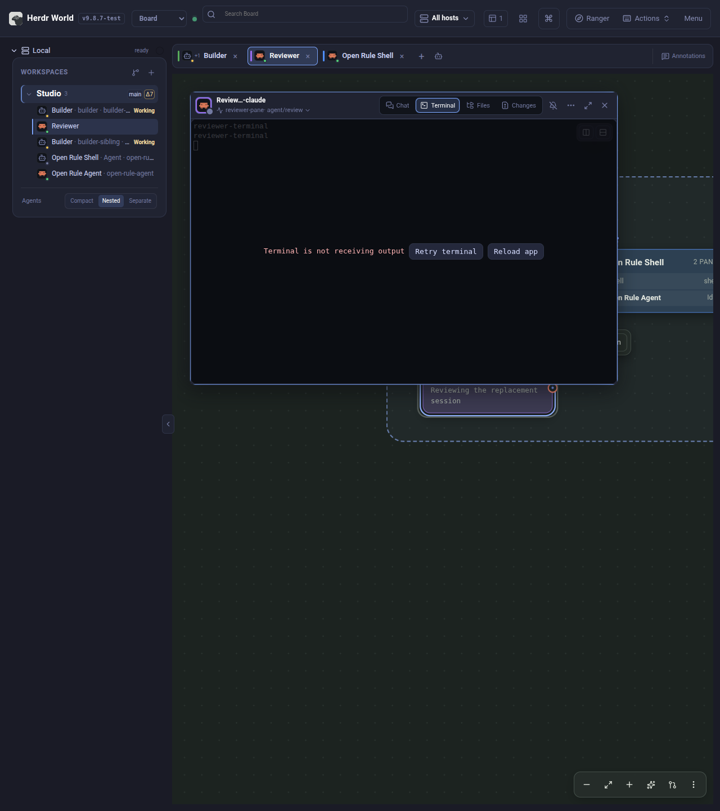
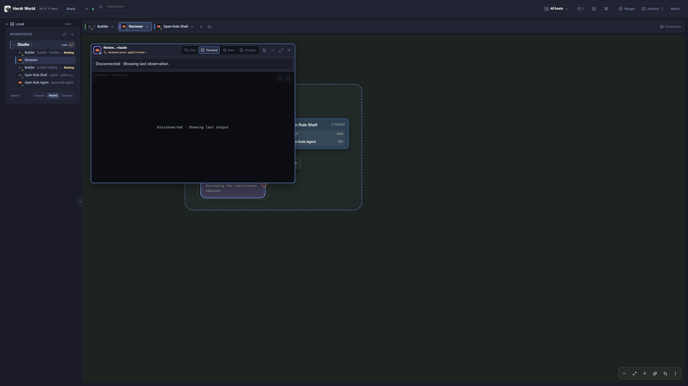
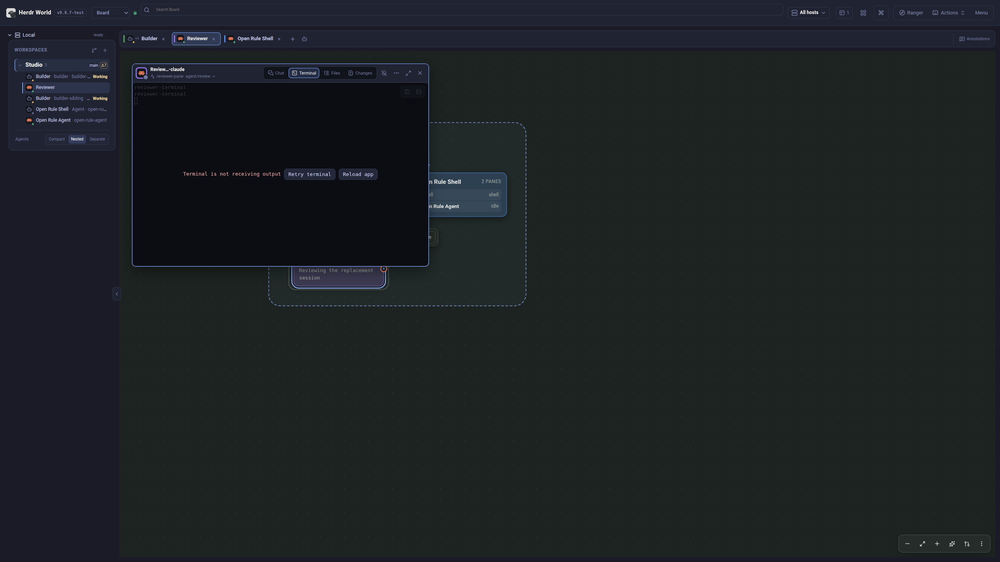
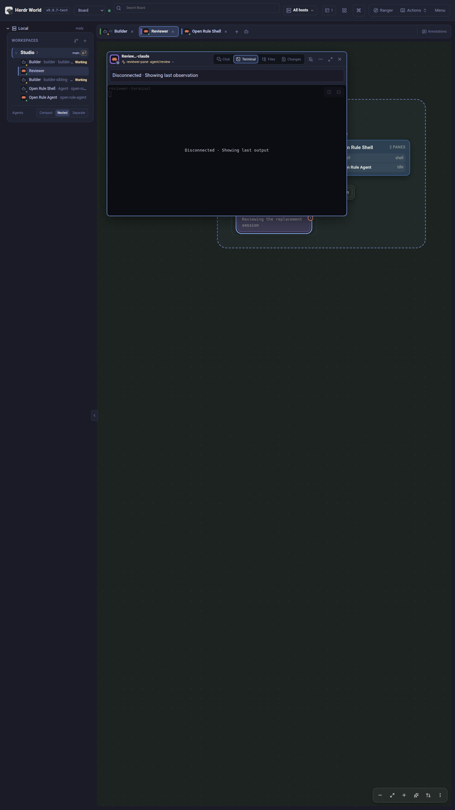
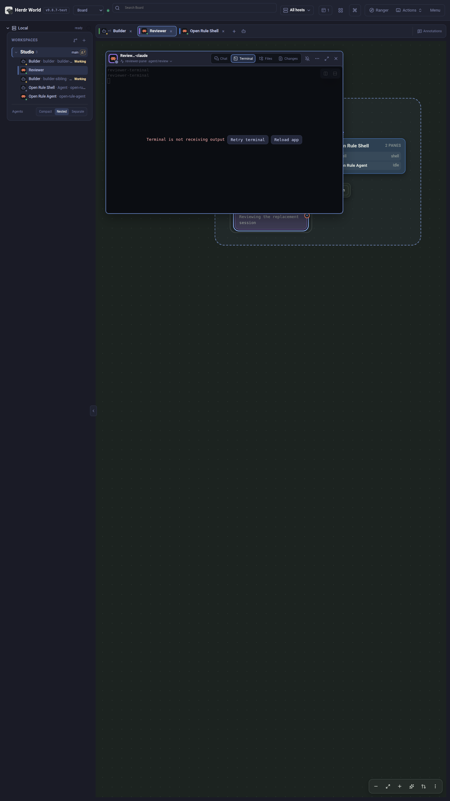

# Mobile resume: stale and local-recovery UI

Synthetic production-tree captures for PR #405, recorded on 25 October 2026
with Chrome 153.0.8010.52 at device scale factor 1. The Mac/Linux names below
identify viewport contexts; all captures use the same isolated Chromium
fixture. They are not native macOS, phone, or OS background/discard evidence.

The real World shell and Inspector show the fixture's synthetic Studio workspace
and Reviewer terminal. Phone captures also show the retained draft text,
"Unsent synthetic Message", in the mobile Message editor; wider contexts show
the terminal in desktop layout. The disconnected state retains last output,
disables operations and shows both stale indicators. The recovery
state follows three acknowledged attaches without frames and shows **Retry
terminal** and explicit **Reload app**. No real hosts, credentials, sessions or
repository content are used. Screenshots are unedited viewport captures.

## Phone — 390 × 844

Disconnected synthetic Reviewer Inspector, retained terminal and visible unsent
Message draft — **390 × 844**. The Inspector stale notice sits above the editor.



Synthetic Reviewer terminal after its no-frame budget is exhausted, with the
unsent Message draft visible below — **390 × 844**. Retry terminal and Reload
app remain distinct actions.



## Mac laptop — 1512 × 982

Disconnected synthetic Reviewer Inspector and retained terminal — **1512 × 982**.



Synthetic Reviewer terminal after its no-frame budget is exhausted — **1512 × 982**.
Retry terminal and Reload app remain distinct actions.



## Half-width Linux window — 1280 × 1440

Disconnected synthetic Reviewer Inspector and retained terminal — **1280 × 1440**.



Synthetic Reviewer terminal after its no-frame budget is exhausted — **1280 × 1440**.
Retry terminal and Reload app remain distinct actions.



## Wide Linux monitor — 2560 × 1440

Disconnected synthetic Reviewer Inspector and retained terminal — **2560 × 1440**.



Synthetic Reviewer terminal after its no-frame budget is exhausted — **2560 × 1440**.
Retry terminal and Reload app remain distinct actions.



## Portrait monitor — 1440 × 2560

Disconnected synthetic Reviewer Inspector and retained terminal — **1440 × 2560**.



Synthetic Reviewer terminal after its no-frame budget is exhausted — **1440 × 2560**.
Retry terminal and Reload app remain distinct actions.



## Reproduce and inspect

The [production-tree fixture](../../web/src/world/WorldTerminalHandoff.browser.tsx)
creates this additional scene after its functional assertions. The
[capture helper](../../web/src/world/testing/resumeVisualCapture.ts) sets each
viewport, verifies `innerWidth`/`innerHeight`, and captures the actual page.
[Capture receipts](mobile-resume/receipts.json) record dimensions and PNG hashes.
Raw browser receipts remain under the ignored capture directory.

```bash
WORLD_RESUME_CAPTURE_DIR="$PWD/.agents/mobile-resume-visuals" \
  bun run test web/src/world/WorldTerminalHandoff.test.ts
```

Functional assertions cover ownership, draft retention, no input replay and
local retry. These images provide visual evidence for the displayed indicators
and controls; they do not establish native-device lifecycle behavior.
