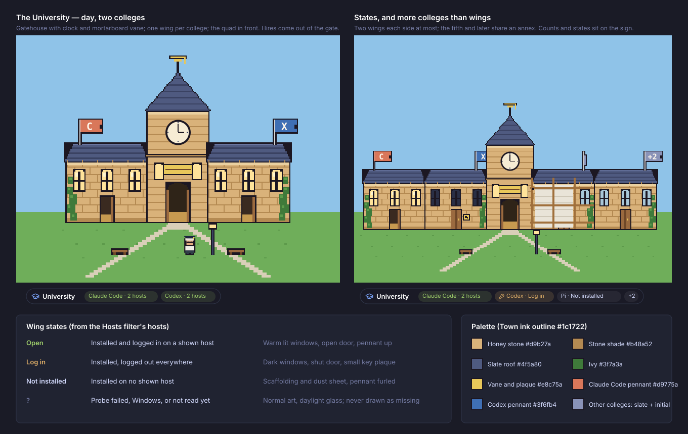
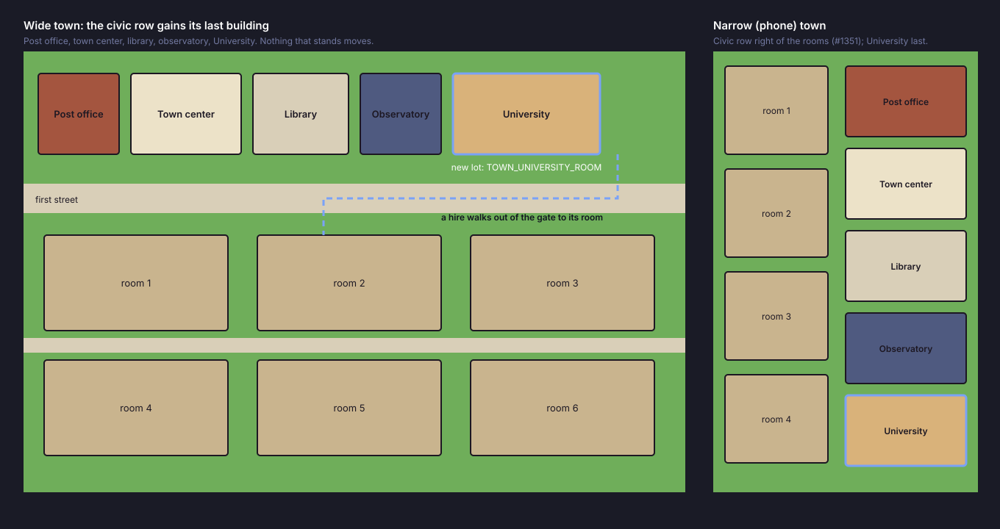
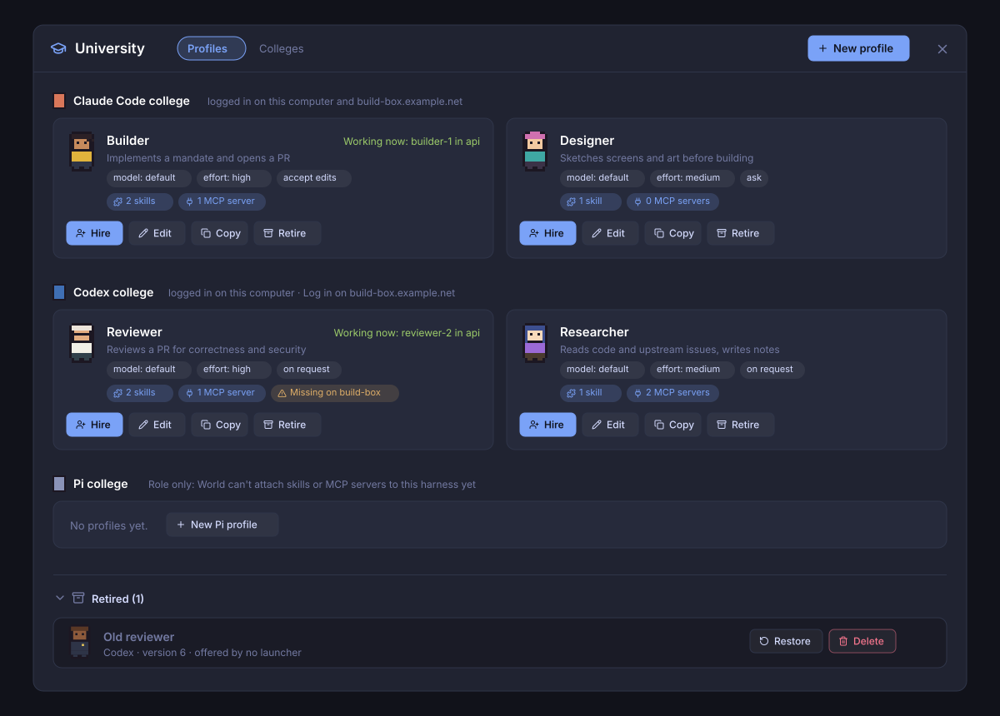
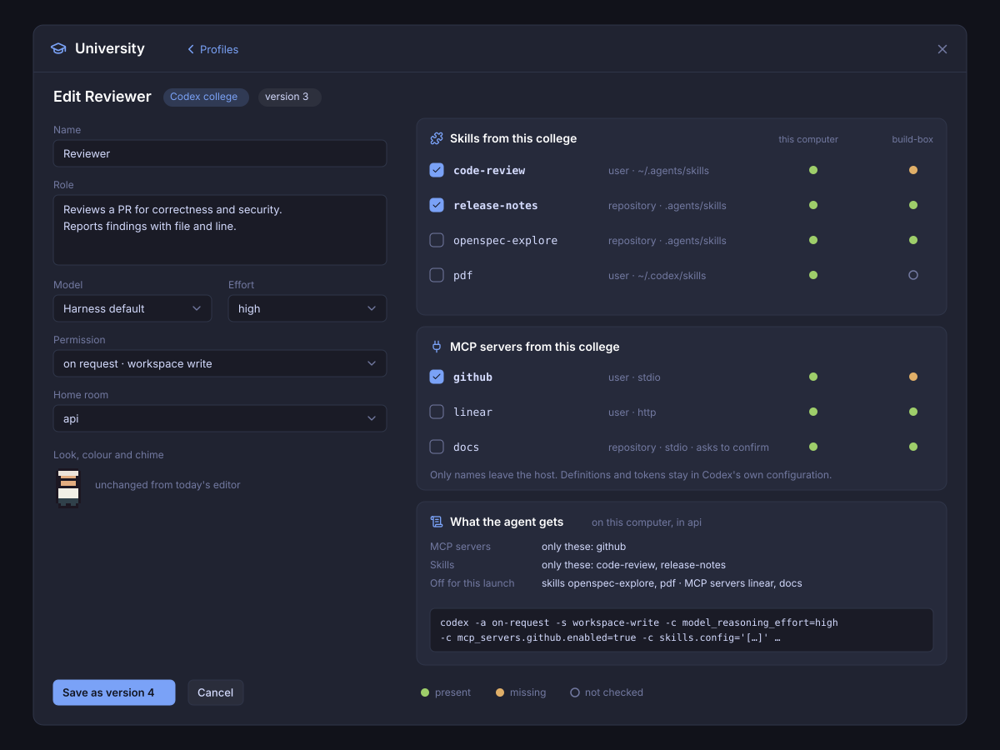
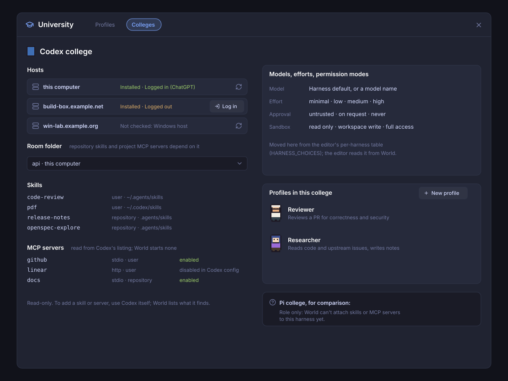
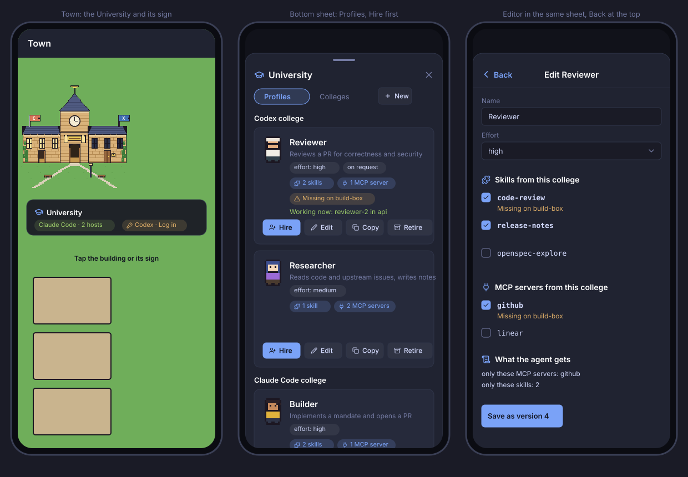
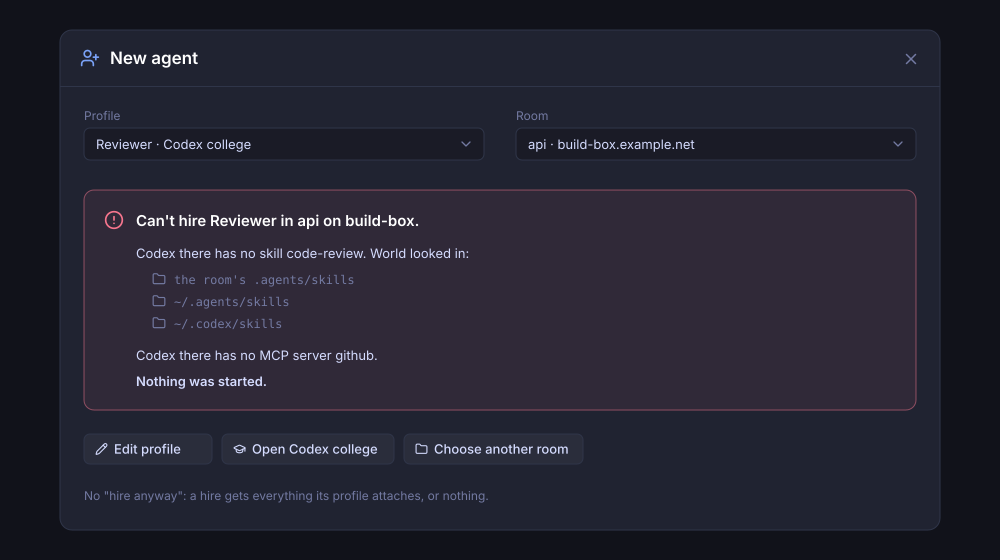
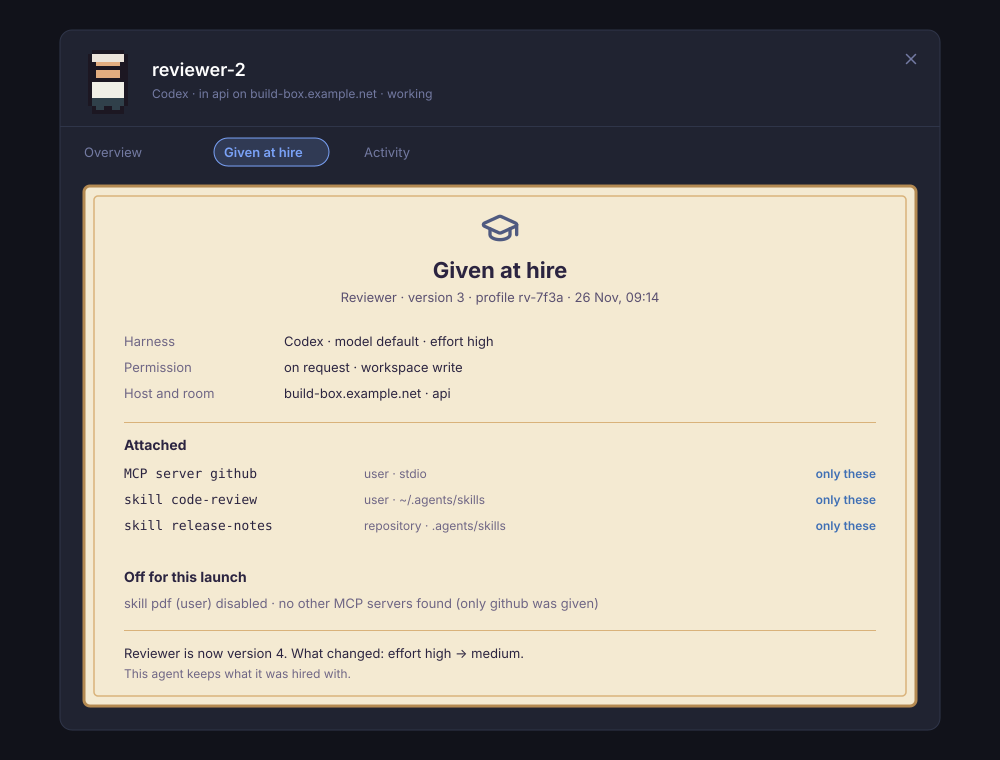

## Context

Today a profile (`shared/agentProfile.ts`) already holds a harness, model,
effort, permission, role, `skills`, `tools`, brief, colour, look and chime. It
is stored as one JSON body per row in `agent_profiles` (`world.sqlite`,
`server/src/storage/world-profiles.ts`). One dialog, `ProfileEditor`, edits it;
it opens from the town center's ring (Profiles), Settings → Agent profiles,
Actions → Agent profiles, the launcher's Edit profiles and Board's hub and New
tab dialog, all through `openProfileEditor()` in `web/src/world/agentProfiles.ts`.
Every hire goes through `launcher.start` (`server/src/rpc/launcher.ts`), which
maps the profile with `launchPlan()`.

Gaps this design closes:

- **Skills are not per harness.** `server/src/agent/skills.ts` lists `SKILL.md`
  folders in the repository (`.agents/skills`, `.claude/skills`) and in the
  user's `~/.agents`, `~/.claude` and `~/.codex` skill folders, merged. A Claude
  profile can attach a skill only Codex can see.
- **Skills reach most harnesses as a sentence.** `launchPlan()` gives Claude
  Code the subagent definition's `skills` field, but Codex only gets "Use these
  skills when they apply" in its developer instructions, and every other
  harness gets it in the first prompt. Naming a skill is not attaching it.
- **No MCP servers.** Profiles cannot attach any.
- **No record of what an agent was given.** A terminal keeps only its profile ID
  and name (Herdr pane tokens `world_profile`, `world_profile_name`); a later
  edit changes what the editor shows for an agent that never got it.
- **No home.** Editing lives in a dialog from six places; the town center's ring
  is the closest thing to a home, and it is crowded.

Facts were checked on 2026-11-26 from each harness's own documentation, its
`--help` on a development host (Claude Code 2.1.332, Codex 0.172.0, Pi 0.87.1,
Antigravity 1.5.3; no session was started) and, for Codex, its 0.172.0
source. § 3 lists every source. Items marked **Verify (gate)** must pass an
isolated check (scratch configuration folder, named Herdr session) in step 2
before the code relies on them; a failure turns that capability to planned.

## Goals and non-goals

Goals: a place in Town that is the home of profiles; colleges that show what
each harness can be given on each host; skills and MCP servers attached through
each harness's own launch options; refusal instead of a silent partial hire;
one hiring path; a visible record of what each agent got.

Non-goals: building any of it in this step; a skills or MCP marketplace;
installing skills or MCP servers; new harnesses; World-defined MCP servers that
need a secret (see § 6); changing any table, column or data file.

## 1. The building and its colleges

### Art

The University is a collegiate hall of honey-coloured stone (`#d9b27a`, shade
`#b48a52`) under slate roofs (`#4f5a80`), with ivy (`#3f7a3a`) climbing its
corners, in Town's 16-pixel tile style and outlined in Town's ink (`#1c1722`)
like the town center, library and post office. It is deliberately different
from its neighbours: the town center is pale stone with a copper dome, the
library sand with verdigris, the post office brick.

- **The gatehouse** in the middle: a square tower with a clock face, a slate
  spire and a gold mortarboard weather vane, an arched gate and a stone plaque
  above it. The gate is where hires come out (§ 4).
- **Wings, one per college,** either side of the gatehouse, each four tiles wide
  with three tall lit windows, a door and a pennant in the college's colour
  with its crest. Claude Code's college is terracotta (`#d9775a`), Codex's ink
  blue (`#3f6fb4`), others take a neutral slate pennant with the harness's
  initial. Order: Claude Code, Codex, then other kinds alphabetically.
- **The quad** in front: a lawn crossed by two gravel paths meeting at the gate,
  with two benches and a lamp. Freshly hired agents cross it.
- Four wings are drawn at most, two each side. A fifth or later college shares
  an annex wing whose pennant reads `+N`; the window lists every college.

Counts and states that change are on the University's DOM sign (as the library
and warehouse do), not in the paint. The paint has only three variants per
wing, chosen from the college's state across the hosts the Hosts filter shows:

| College state (over shown hosts) | Wing art | Sign chip |
| --- | --- | --- |
| Installed and logged in on at least one host | Warm lit windows, open door, pennant up | `Claude Code · 2 hosts` |
| Installed everywhere it is found, logged out everywhere | Dark windows, shut door with a small key plaque | `Codex · Log in` |
| Not installed on any shown host | Scaffolding and a dust sheet over the wing, pennant furled | `Pi · Not installed` |
| Unknown (probe failed, Windows, not yet read) | Normal art, no lights change | `Kimi · ?` |

Unknown is never drawn as missing (the same honesty rule as harness readiness).

### Placement

The University stands right of the observatory, on the same lawn above the
first street, at the end of the civic row: post office, town center, library,
observatory, University. `townPlaceLots` already grows a town to hold the
library and observatory without moving anything that stands; the University
lot extends that rule (`TOWN_UNIVERSITY_ROOM`), so adding it, and a wing
appearing when a new harness is found, moves no room and no other building. On
a narrow (phone) town the civic row already runs right of the stacked column
(#1351); the University is its last building there too.

It is a `TownPlaceKey` (`"university"`) with the usual parts: a lot file
(`townUniversityLot.ts`), a paint file (`townUniversityPaint.ts`), a sprite in
the renderer scene, a DOM sign with `useTownPlace("university", …)`, and an
entry in `TOWN_CENTER_BUILDINGS`. The building opens what its sign opens; the
sign stays the keyboard target.

### The University window

One window, the Town place window frame (`PlaceWindow`), reachable from every
view: in Town from the building, its sign and the town center's Buildings
ring; elsewhere from Settings, Actions, the launcher and Board. It has two
tabs:

- **Profiles** (default): every profile, grouped by college, each a card with
  its look, name, the first line of its role, model, effort and permission,
  and counts of attached skills and MCP servers. A card shows a warning chip
  when an attached item is missing on some shown host. Each card has **Hire**,
  **Edit**, **Copy** and **Retire**. **New profile** sits in the header. A
  **Retired** shelf at the bottom (collapsed, with a count) lists retired
  profiles with **Restore** and **Delete**. Each card also shows **Working
  now** (agents running from it), each opening that agent's character sheet.
- **Colleges:** one row per college with its readiness chip and its skills
  and MCP states (supported, planned or not built, § 3); a row opens the
  college page.

The editor (Edit, New profile) replaces the window's body with the existing
editor's fields plus two new sections, with **Back** at the top on phones.

- **Skills from this college** and **MCP servers from this college**: a
  checklist of what the college offers, each item with where it comes from
  (repository, user, plugin) and a dot per shown host (present, missing, not
  checked). Items the profile already attaches but no shown host has stay
  listed, marked missing, so nothing silently disappears.
- **What the agent gets:** the diploma it would get on the chosen host (§ 4)
  and the exact launch command (already in the editor today).

### College page

- **Hosts:** one row per connected host: installed, logged in and method, or
  unknown with its reason, with **Log in** and **Check again** from the existing
  readiness flow (`HarnessReadinessSummary`, `readinessNote`).
- **Room folder:** repository skills and project MCP servers depend on a
  folder, so the page reads them for one room's folder, chosen with a room
  picker (default: the room of the last hire on that host).
- **Skills**, **MCP servers**: what the harness can see on the chosen host,
  with where each comes from and, for MCP servers, transport and whether the
  harness's own configuration has it enabled. Read-only.
- **What World can attach:** the college's skills, MCP and registry states
  from the table in § 3, each with its reason and source, for example Kimi
  Code: "Skills: supported (only these). MCP servers: not built — Kimi Code
  has no per-launch MCP option; World would have to replace its home folder,
  which also replaces its login."
- **Models, efforts, permission modes:** the choices `HARNESS_CHOICES` offers,
  moved per college. A college without a launch mapping for them says so.
- **Profiles in this college**, with **New profile** preset to it.

### Phone

The window is the place window's bottom sheet. Profile cards stack in one
column with Hire as the first button; the tabs stay one tap away at the top;
the editor and college page open in the same sheet with **Back** at its top
(the top Back closes the inner page first, then the sheet, as the layer stack
does). No swipes. Host dots become a short "Missing on build-box" line.

## 2. Profile lifecycle

| Action | What happens |
| --- | --- |
| **New profile** | Opens the editor with the chosen college's defaults (empty model, effort and permission = harness default), a generated look and a free name. Saved as version 1. |
| **Edit** | Saves a new version of the same profile (same ID). Every browser and the CLI see it at once through World. |
| **Copy** | A new profile with a new ID and name "<name> copy", version 1, never a starter, same college. **Copy to another college** changes the harness: before saving it lists exactly which skills and MCP servers the target college does not have and which model, effort and permission reset to that harness's defaults. |
| **Change college** in Edit | The same list and confirmation as Copy to another college, in place. |
| **Retire** | The profile leaves every hiring list (launcher, town center, Board, Actions, Spaces, CLI `hire`) and moves to the Retired shelf. Nothing else changes. Retiring a starter keeps it retired; starters are seeded once, as today. |
| **Restore** | Back in the hiring lists, same ID and version. |
| **Delete** | Only from the Retired shelf, with a confirmation naming the agents still working from it. Running agents then show their recorded name and the default look (today's rule for a missing profile). |

**Agents already running keep what they were launched with.** A launch turns
the profile into native harness options once; no later edit reaches a running
harness. Each agent's diploma (§ 4) records the version it got, so its
character sheet says "Hired from Reviewer version 3; the profile is now
version 5" with **What changed**, a field-by-field difference between the
diploma and the current profile. Its look and colour follow its diploma too,
so an edit does not repaint agents that never got it. Retire and Delete never
stop or change a running agent; stopping is the user's own action.

## 3. Skills and MCP servers per harness

### Which harnesses have a college

Every harness World supports today has a college: the eight with conversation
readers (`SESSION_AGENTS` in `server/src/agent/chat-harnesses.ts`: `claude`,
`codex`, `kimi`, `grok`, `pi`, `omp`, `muse`, `agy`), and the other harnesses
in World's integration list (`herdr-world integration status`: `copilot`,
`cursor`, `devin`, `droid`, `hermes`, `kilo`, `letta`, `mastracode`,
`opencode`, `qodercli`, `qwen`), plus `kiro`, which World probes for
readiness. A kind that a host's Herdr or herdr-core reports but World does not
integrate (for example `amp`, `cline`, `gemini`) gets a college marked **not
built** with the reason "World has no integration for this harness yet";
adding a harness is out of scope.

### States

Skills, MCP servers and the registry each have one of three states per
college, defined once in shared data beside `HARNESS_SPECS` and shown on the
college page with its reason:

- **Supported:** the harness's own documentation or source gives a per-launch
  option that attaches the profile's set, without editing the user's or the
  repository's configuration and without replacing the harness's home folder
  (which would also replace its login). Step 2 builds a supported row only
  after task 2.1 has checked it with that harness in isolation. **The check is
  a gate:** a row that fails it, or whose harness cannot be run in isolation,
  becomes planned with the failure as its reason, and its college offers
  nothing for that capability.
- **Planned:** a documented mechanism exists, but it cannot attach an exact or
  preloaded set, rests on undocumented behaviour, or World has no launch
  mapping for that harness yet. The college shows it greyed with the reason.
- **Not built:** the harness documents no per-launch mechanism; the only
  routes edit configuration files or replace its home. The college shows the
  reason.

A profile in a college can attach only what that college supports. A planned
or not built capability is never half-attached: World never writes a skill or
server name into a first prompt or developer instructions as a substitute,
and the editor hides that section and shows the reason. A profile that still
holds skills or MCP servers its college cannot attach (an older profile, or
one moved to another college) is refused at hire with that reason and
**Edit profile**; nothing is dropped silently. Today's sentence "Use these
skills when they apply" in `launchPlan()` is removed for every harness.

**Registry:** no college browses or installs from a registry; a marketplace
is out of scope (#1418). Every registry cell is therefore **not built**; the
college shows the harness's own browse command as text, where it has one, so
the user knows where to look.

### The table

Attach mechanisms are per launch. "Only these" means the agent can use
exactly the attached set; "loaded at start" means the attached set is put in
the agent's context and the harness can still find the user's other items,
which the diploma lists. World's own `herdr-world` skill, installed by World's
integration, is always kept in an exact set and listed as World's own.

| Harness | Skills | MCP servers | Registry (harness's own) |
| --- | --- | --- | --- |
| `claude` | **Supported**, loaded at start: the inline subagent definition's `skills` [C1] | **Supported**, only these: `--mcp-config <file> --strict-mcp-config` [C2] | Plugin marketplaces (`claude plugin`) [C3] |
| `codex` | **Supported**, only these: `-c skills.config=[{name=…,enabled=false},…]` for every other catalogued skill [X1] | **Supported**, only these: `-c mcp_servers.<name>.enabled=true/false` [X2] | Plugin marketplaces (`codex plugin marketplace`) [X3] |
| `kimi` | **Supported**, only these: `--skills-dir <per-launch folder>` replaces the user and project folders [K1] | **Not built:** no per-launch option; only `KIMI_CODE_HOME` (a whole new home and login) [K2] | Plugin marketplace (`/plugins`) [K3] |
| `pi` | **Supported**, only these: `--no-skills --skill <path>…` [P1] | **Planned:** none in Pi 0.87; Pi 1.x has built-in MCP, attachable per launch only through an extension World would ship (`-e`, `registerMcpServer`) [P2] | Packages gallery (`pi install npm:…`, pi.dev/packages) [P3] |
| `omp` | **Supported**, only these: `--skills <name,…>` [O1] | **Planned:** a `--config` overlay with `enabledServers` may give an exact set, but omp imports servers from other harnesses and the combination is undocumented [O2] | Plugin marketplaces and skills.omp.sh (`omp plugin`, `omp skill search`) [O3] |
| `grok` | **Planned:** per-launch `--plugin-dir` only adds; `[skills] disabled` has no per-launch override [G1] | **Not built:** no per-launch option; only `GROK_HOME` (new home and login) [G2] | Plugin marketplace (`grok plugin marketplace`) [G1] |
| `muse` | **Not built:** no flag; `--agents` definitions have no skills field [M1] | **Not built:** `settings.json` only; `-c` is documented for one unrelated key [M2] | None documented [M1] |
| `agy` | **Not built:** skills run only as `/<name>` in a session [A1] | **Not built:** global or workspace `mcp_config.json` only; `--settings` has no MCP keys [A2] | Plugin marketplace (`/plugin`, needs sign-in) [A3] |
| `copilot` | **Planned:** `COPILOT_SKILLS_DIRS` adds, nothing restricts per launch [CP1] | **Planned:** `--disable-mcp-server <name>` for every other server and `--disable-builtin-mcps` give an exact set; no World launch mapping for Copilot yet [CP1] | Plugin marketplace (`copilot plugin marketplace`) [CP2] |
| `cursor` | **Not built:** the CLI's skill loading is undocumented [CU1] | **Not built:** only stored approvals (`agent mcp enable/disable`) [CU2] | Cursor Marketplace, cursor.directory [CU1] |
| `devin` | **Not built:** no per-launch option [D1] | **Not built:** `--config` is not documented to carry MCP servers [D2] | `devin plugins install` (no browsing) [D3] |
| `droid` | **Planned:** `--settings` with `disabledSkills` is undocumented for that key [DR1] | **Planned:** `--remove-tools MCP:<server>` for every other server; no World launch mapping yet [DR2] | Built-in MCP registry in `/mcp`, `droid plugin marketplace` [DR2] |
| `hermes` | **Planned:** `hermes chat -s <name>` preloads; no World launch mapping yet [H1] | **Not built:** only a separate profile (`-p`, its own home) or all off [H2] | Skills Hub (`hermes skills browse`), `hermes mcp catalog` [H1] |
| `kilo` | **Not built:** no per-launch option [KI1] | **Not built:** no per-launch option [KI2] | Kilo Marketplace repository (no browsing UI) [KI2] |
| `kiro` | **Planned:** a World-written agent's `resources` (`skill://…`) with `--agent`; no World launch mapping yet [KR1] | **Planned:** the same agent's `mcpServers` with `includeMcpJson` off [KR1] | kiro.dev registry [KR2] |
| `letta` | **Planned:** `--skills <path> --skill-sources …` gives an exact set; no World launch mapping yet [L1] | **Not built:** Letta Code has no MCP client [L2] | `letta install` (no browsing) [L1] |
| `mastracode` | **Not built:** no per-launch option [MA1] | **Not built:** only `MASTRACODE_DISABLE_MCP` (all off) [MA1] | None documented [MA1] |
| `opencode` | **Planned:** per-agent `skill` permission rules through `OPENCODE_CONFIG_CONTENT`, documented only for OpenCode v1 [OC1] | **Planned:** the same overlay denying other servers' tools; v2 documentation is silent [OC2] | None documented [OC1] |
| `qodercli` | **Planned:** `skillOverrides` through `--settings`; no World launch mapping yet [Q1] | **Planned:** `--mcp-config --strict-mcp-config` (Claude's shape); no World launch mapping yet [Q2] | Plugin marketplaces (`qoder plugins marketplace`) [Q3] |
| `qwen` | **Not built:** skills settings have no per-launch option [QW1] | **Planned:** `--allowed-mcp-server-names` gives an exact set; no World launch mapping yet [QW2] | None documented [QW1] |

"No World launch mapping yet" means World has no model, effort and
permission mapping for that harness in `launchPlan()`; each such college is
its own follow-up after this change, verified with its binary like the
supported rows. Kimi, Pi and omp gain a launch mapping in step 2 for skills
only, because they are among the eight harnesses World reads conversations
from and each needs one documented flag.

Sources, read on 2026-11-26 (documentation pages, or the harness's
`--help` on a development host; Codex also from its 0.172.0 source tag):

- C1 https://code.claude.com/docs/en/sub-agents (`skills`), https://code.claude.com/docs/en/skills (where skills live)
- C2 https://code.claude.com/docs/en/mcp (scopes, `.mcp.json`), `claude --help` 2.1.332 (`--mcp-config`, `--strict-mcp-config`)
- C3 https://code.claude.com/docs/en/plugin-marketplaces, `claude plugin --help`
- X1 https://learn.chatgpt.com/docs/build-skills; `codex-rs/config/src/skills_config.rs` (`[[skills.config]]` `name` or `path` with `enabled`, read from user and `-c` layers only) and `codex-rs/ext/skills/src/host_roots.rs` (folders)
- X2 https://learn.chatgpt.com/docs/extend/mcp?surface=cli; `codex-rs/config/src/mcp_types.rs` (`enabled`, `enabled_tools`); `codex-rs/cli/src/mcp_cmd.rs` (`mcp list --json` reads configuration and starts no stdio server)
- X3 `codex plugin --help`, `codex plugin marketplace --help` (0.172.0)
- K1 https://moonshotai.github.io/kimi-code/en/customization/skills.html, https://moonshotai.github.io/kimi-code/en/reference/kimi-command.html (`--skills-dir`)
- K2 https://moonshotai.github.io/kimi-code/en/customization/mcp.html, https://moonshotai.github.io/kimi-code/en/configuration/overrides.html
- K3 https://moonshotai.github.io/kimi-code/en/customization/plugins.html
- P1 `pi --help` 0.87.1 (`--skill`, `--no-skills`); Pi's bundled `docs/skills.md`
- P2 https://github.com/earendil-works/pi `packages/coding-agent/docs/mcp.md` and `cli.md` (Pi 1.x)
- P3 `pi install --help`; https://pi.dev/packages
- O1 https://github.com/can1357/oh-my-pi `docs/skills.md`, `docs/cli-reference.md`
- O2 the same repository's `docs/mcp-config.md`, `docs/cli-reference.md`
- O3 the same repository's `docs/marketplace.md`
- G1 https://docs.x.ai/build/features/skills-plugins-marketplaces, https://docs.x.ai/build/cli/reference
- G2 https://docs.x.ai/build/features/mcp-servers, https://docs.x.ai/build/settings/reference
- M1 https://dev.meta.ai/docs/muse-code/extending, https://dev.meta.ai/docs/muse-code/agents
- M2 https://dev.meta.ai/docs/muse-code/configuration
- A1 https://antigravity.google/docs/skills, `agy --help` 1.5.3
- A2 https://antigravity.google/docs/mcp?tab=cli, https://antigravity.google/docs/settings?tab=cli, `agy mcp --help`
- A3 https://antigravity.google/docs/plugins?tab=cli
- CP1 https://docs.github.com/en/copilot/reference/cli-command-reference
- CP2 https://docs.github.com/en/copilot/reference/copilot-cli-reference/cli-plugin-reference
- CU1 https://cursor.com/docs/context/skills, https://cursor.com/docs/cli/reference/parameters
- CU2 https://cursor.com/docs/cli/mcp
- D1 https://docs.devin.ai/cli/extensibility/skills/overview.md
- D2 https://docs.devin.ai/cli/extensibility/mcp/overview.md, https://docs.devin.ai/cli/reference/commands.md
- D3 https://docs.devin.ai/cli/extensibility/index.md
- DR1 https://docs.factory.com/cli/configuration/skills, https://docs.factory.com/reference/cli-reference
- DR2 https://docs.factory.com/cli/configuration/mcp
- H1 https://hermes-agent.nousresearch.com/docs/user-guide/features/skills, https://hermes-agent.nousresearch.com/docs/reference/cli-commands
- H2 https://hermes-agent.nousresearch.com/docs/user-guide/features/mcp
- KI1 https://kilo.ai/docs/customize/skills
- KI2 https://kilo.ai/docs/automate/mcp/using-in-kilo-code, https://kilo.ai/docs/code-with-ai/platforms/cli-reference
- KR1 https://kiro.dev/docs/custom-agents/configuration-reference/, https://kiro.dev/docs/cli/reference/cli-commands
- KR2 https://kiro.dev/docs/cli/mcp/registry/
- L1 https://docs.letta.com/letta-code/skills, https://docs.letta.com/letta-code/cli-reference
- L2 https://docs.letta.com/platform/hosted-mcp
- MA1 https://code.mastra.ai/configuration
- OC1 https://opencode.ai/docs/skills/, https://opencode.ai/v1/docs/config.md
- OC2 https://opencode.ai/docs/mcp-servers/, https://opencode.ai/v1/docs/mcp-servers.md
- Q1 https://docs.qoder.com/cli/Skills
- Q2 https://docs.qoder.com/cli/mcp-servers, https://docs.qoder.com/cli/cli-reference
- Q3 https://docs.qoder.com/cli/plugins
- QW1 https://qwenlm.github.io/qwen-code-docs/en/users/features/skills/
- QW2 https://qwenlm.github.io/qwen-code-docs/en/users/features/mcp/, https://qwenlm.github.io/qwen-code-docs/en/users/configuration/settings/

Harnesses change quickly. The table is data in step 2, and a harness release
that adds a per-launch mechanism moves its row to supported only through the
same isolated check.

### Where World finds them on a host

Discovery runs on the room's host, locally or over the connection's OpenSSH
destination, exactly as readiness does: bounded (10 seconds, 200 items per
kind), read-only, on the room's own connection and runtime generation, never
falling back to another connection. A failed host shows its last result as
stale and non-actionable; nothing is stored (§ 5). The folders and files are
data per harness, beside `HARNESS_SPECS`, and reuse the harness folder table
that World's integration uses (`docs/harness-integrations.md`), so a harness's
folders are named once. Discovery runs only for supported capabilities.

| | Skills | MCP servers |
| --- | --- | --- |
| Claude Code | `<room folder>/.claude/skills`, `$CLAUDE_CONFIG_DIR` or `~/.claude/skills`, installed plugins' skills (as `plugin:skill`) | Claude's own files: user and local scopes in `~/.claude.json` (`mcpServers`, `projects[<room folder>].mcpServers`) and the project's `<room folder>/.mcp.json`; plugin servers listed as not attachable yet. Never `claude mcp list`: it health-checks servers by starting them. |
| Codex | `.agents/skills` from the room folder up to the repository root, `<repository>/.codex/skills`, `~/.agents/skills`, `$CODEX_HOME/skills` (bundled `.system` skills listed as built in) [X1] | `codex mcp list --json` [X2]. It starts no stdio server; for remote servers it may make a request to work out sign-in status, so World runs it with the same bound. |
| Kimi Code | `.kimi-code/skills` and `.agents/skills` at the repository root, `$KIMI_CODE_HOME/skills` (default `~/.kimi-code/skills`), `~/.agents/skills` [K1] | none (not built) |
| Pi | `.pi/skills` and `.agents/skills` up to the repository root, `$PI_CODING_AGENT_DIR/skills` (default `~/.pi/agent/skills`), `~/.agents/skills` [P1] | none (planned) |
| omp | `omp skill list --json` [O3], which covers its own and imported folders | none (planned) |

Only these fields leave the host: a skill's folder name and where it came from
(repository, user, plugin, built in); an MCP server's name, transport
(`stdio`, `http`, `sse`), scope (user, local, project, plugin) and whether it
is enabled. Never a command line, argument, environment value, header, URL or
a skill's contents. The reader runs on the host and prints only those fields,
as the readiness probe does, so `~/.claude.json`'s other contents never leave
it.

Windows hosts are not probed (as readiness): their colleges say "not checked".

### How a hire attaches them

The launch plan gains the host's catalog. Everything is per launch; the user's
global harness configuration is never edited. Paths that World passes are
built from the folder table and the item's name (for example
`"$HOME"/.agents/skills/<name>`), so no host path passes through the service.

**Claude Code**

- **Skills: loaded at start.** The inline subagent definition's `skills` field
  (already passed with `--agents` and `--agent`) loads each attached skill into
  the agent's context at start [C1]. Claude still finds the other skills in its
  own folders; World cannot hide those without dropping the user's own settings
  (`--setting-sources`) or every skill (`--disable-slash-commands`), so the
  diploma lists them as "also on this host".
- **MCP servers: only these.** World writes a per-launch MCP file on the host
  and starts Claude with `--mcp-config <file> --strict-mcp-config` [C2], so the
  agent has exactly the attached servers. The file is built on the host by a
  small script (the same runtime and pattern as `claudeLaunchTapArgs` in
  `server/src/usage/claude-launch-settings.ts`): it copies the attached servers'
  definitions from Claude's own files into
  `~/.cache/herdr-world/launch/mcp-<random>.json`, owner-only (0600), and
  prints only the path. Definitions never pass through the World service or a
  browser. World deletes the file when its terminal ends, and at service start
  deletes its own files whose terminal no longer exists. A file is used because
  Herdr TUI types the argv into a shell, whose line limit inline JSON exceeds.
- **Verify (gate):** both flags with a throwaway stdio server; and whether
  `--agent` honours a definition's `mcpServers` list of already-configured
  server names together with `--strict-mcp-config`. If it does, World passes
  names and no copy is made; otherwise the file is used.

**Codex**

- **MCP servers: only these.** Per-launch overrides, no file:
  `-c mcp_servers.<name>.enabled=true` for each attached server and
  `-c mcp_servers.<name>.enabled=false` for every other server the catalog
  found [X2], plus `-c mcp_servers.<name>.required=true` for each attached
  server so Codex stops rather than starts without it. Server names are limited to `[A-Za-z0-9][A-Za-z0-9_-]{0,63}` so
  they are safe TOML keys; a server with another name is listed but cannot be
  attached.
- **Skills: only these.** Codex reads `[[skills.config]]` entries (a `name` or
  `path` selector with `enabled`) from the user layer and from `-c` overrides,
  the last match winning [X1]. World passes one
  `-c 'skills.config=[{name="pdf",enabled=false},…]'` naming every catalogued
  skill that is not attached and is not World's own, so Codex offers the agent
  exactly the attached skills. Skill names in the list are limited like MCP
  names. The skill is not mentioned in `developer_instructions`.
- **Verify (gate):** `-c mcp_servers.<name>.enabled=false` hides that server
  and `required=true` stops Codex when an attached server cannot start;
  a `-c skills.config` array disables exactly the named skills on 0.172 and
  does not discard a user's own `[[skills.config]]` entries in a way that
  re-enables a skill the user disabled (if it does, World appends the user's
  disabled entries, which the catalog already reports as disabled); and
  `codex mcp list --json` starts no stdio server. If any part fails, that Codex
  row becomes planned.
- If the overrides make the command too long for a terminal line, World uses a
  per-launch `-p` layer file in Codex's folder instead, World-named
  (`herdr-world-launch-<random>.config.toml`) with the integration's marker
  lines, removed with its terminal like the Claude file. A `-p` file is a user
  layer, so it carries the same `skills.config` entries.

**Kimi Code**

- **Skills: only these.** World builds a per-launch folder on the host,
  `~/.cache/herdr-world/launch/skills-<random>/`, holding one symbolic link per
  attached skill folder plus World's own skill, and starts
  `kimi --skills-dir <folder>`, which replaces the user and project skill
  folders for that launch [K1]. Kimi's built-in skills and `extra_skill_dirs`
  from its configuration still load; the diploma lists them as "also on this
  host". The folder is removed with its terminal.
- **Verify (gate):** `--skills-dir` replaces rather than adds on the Kimi Code
  release found, and links are followed.

**Pi**

- **Skills: only these.** `pi --no-skills --skill <path>` for each attached
  skill and World's own [P1]; paths built from the folder table.
- **Verify (gate):** `--skill` paths load under `--no-skills` on 0.87.1 and
  the current 1.x.

**omp**

- **Skills: only these.** `omp --skills <name>,…` with the attached skills and
  World's own [O1]. Names are limited like MCP names so no name is read as a
  glob.
- **Verify (gate):** `--skills` with exact names excludes every other skill,
  including skills omp imports from other harnesses.

**Other colleges** attach nothing. Their profiles hold a role, brief, look and
chime; the role reaches the agent in its first prompt as today, and the
college page and editor say "Skills: planned — <reason>" or "not built —
<reason>" from the table, never "role only" without a reason.

**herdr-core hosts** use the same plan: the core launch path
(`core-harness-start-ready`) receives the same argv and the same per-launch
files, written on the core's host.

### A host that lacks one

Right before starting, `launcher.start` reads the destination's catalog again
(the editor's dots can be stale). If any attached skill or MCP server is
missing on that host, the host cannot be checked (Windows, probe failed,
timeout), or the profile holds an item its college cannot attach, it refuses
before creating a tab:

> Can't hire Reviewer in *api* on build-box. Codex there has no skill
> `code-review` (looked in the room's `.agents/skills`, `~/.agents/skills`,
> `~/.codex/skills`) and no MCP server `github`. Nothing was started.
> [Edit profile] [Open Codex college] [Choose another room]

There is no "hire anyway". A profile with nothing attached is unaffected and
hires on Windows hosts as today. Between the check and the harness starting
(well under a second), a skill or server could still vanish. Claude then
fails on the missing definition (the per-launch file is a copy), and Codex
fails because World also passes `-c mcp_servers.<name>.required=true` for each
attached server, which makes Codex stop when a required server cannot start
[X2]; the launcher reports the exit as it already does ("the agent exited as
it started"). A skill removed in that window is the one case World cannot
catch; the risk is listed below.

## 4. Hiring: one path, and the diploma

Every hire from a profile goes through `launcher.start` with `profile_id`:

- **University:** Hire on a card opens the existing New agent launcher with that
  profile chosen; the user picks the room.
- **Town center:** New agent stays first in its ring and opens the same
  launcher. The ring's Profiles entry goes; its Buildings ring gains University.
- **Board** (hub and New tab dialog), **Actions → New agent**, **Spaces** and
  each Town room's **+** seat: unchanged entry points, same launcher.
- **CLI:** `herdr-world profile list`, `profile show <id>` and
  `profile hire <id> --room <room>` (the `agent-profiles` change's open task
  3.1, folded in here) read and hire through the same World RPCs.
- The launcher's and Board's **Edit profiles** open the University window.

Retired profiles are offered by none of them. The launcher's profile list and
the University's cards are one list from `world.profiles.get`; no view filters
or sorts its own copy.

**Fresh out of the University.** A confirmed profile hire's arrival in Town
starts at the University's gate: the agent crosses the quad and walks the
streets to its room, with today's timing bounds (3 s outdoors, 2.5 s in) and
reduced-motion rule. A kind-only hire (no profile) keeps today's start (the
town center or the nearest bus stop).

**The diploma.** At a confirmed start the launcher records what the agent was
given:

- profile ID, name and version;
- harness, model, effort, permission and tools as passed;
- each attached skill and MCP server, with where it came from and how firmly it
  was attached (**only these** or **loaded at start**);
- the other skills and MCP servers the harness could still find on that host
  ("also on this host");
- the host, room and time.

It is shown on the agent's character sheet (#775) and Inspector as **Given at
hire**, in the University under the profile's **Working now**, and by
`herdr-world profile show`. It ends with its terminal, as the profile
assignment does.

## 5. Storage: what the profile record needs

**Nothing changes in this step.** This section lists what the storage design
(World as one object, `openspec/changes/world-one-object/`) is asked to take in.

### Fields the profile gains

| Field | Type and limit | Why |
| --- | --- | --- |
| `mcp_servers` | list of names, at most 32, each `[A-Za-z0-9][A-Za-z0-9_-]{0,63}` | The MCP servers attached from its college, by name. Never a definition, command or secret. |
| `retired` | boolean, default false | Retire without deleting: the shelf, restore, and hiring lists that skip it. |
| `version` | integer ≥ 1, set by the service, +1 on each save that changes the body | The diploma's "hired from version N" and "What changed". The store's existing revision is per document, not per profile. |

`skills` keeps its shape (a list of names, at most 32); its meaning narrows to
names as the profile's college lists them, `plugin:skill` included (the
existing item rule already allows `:`). `harness` is the college. Nothing
else changes.

**Why `agent_profiles` can hold them without a schema change:** each row's
`body` is the whole profile as JSON, checked only for valid JSON and a matching
`id`; `parseProfile()` is the real schema. Old bodies parse with the defaults
above (`[]`, `false`, `1`), and the body stays bounded by `PROFILE_LIMITS` (64
profiles; 32 extra names of 64 characters add at most about 2 KB). The catalog
row (`world.sqlite|agent_profiles|…|64`) keeps its owner, identity and limit.

### Not in the profile

Secrets, MCP definitions, skill contents and the colleges' catalogs. Catalogs
are observations: memory only, per connection, generation and room folder,
replaced on each read and dropped with the connection.

### Records outside the profile

1. **The diploma, one per hired terminal.** Keyed by connection ID and terminal
   ID with the runtime generation; ends with the terminal; at most one per live
   terminal; bounded (32 skills, 32 MCP servers, 32 "also" names each). Herdr
   pane tokens cannot hold it (32 keys, values cut at 80 characters), so it is
   World-owned. It belongs with the agent records the one-object design already
   plans (#1315) rather than a new table; if it needs its own table, that needs
   approval in a mandate. The pane token `world_profile` stays the link.
2. **Per-launch files on the host** (§ 3): the Claude MCP file and the Kimi
   skills folder of links in `~/.cache/herdr-world/launch/` (beside the
   limits tap's `~/.cache/herdr-world/` files) and, only if needed, the Codex
   `-p` layer file. World-generated, owner-only, one per live terminal,
   deleted with it. They need a catalog entry as host files World writes.

## 6. Security

MCP servers and skills run code with the agent's permissions, so:

- **Who may attach.** Only the operator, through the University editor (or
  Settings, which opens it). Creating a profile, or changing its harness,
  `skills`, `mcp_servers`, `tools` or `permission`, is an operator-only write;
  admission refuses it from agent-originated calls (an agent's `herdr-world`,
  or any caller with only the `world` capability) before the store is touched,
  as World integration install already is. Agents may still read profiles and,
  where allowed today, hire from existing ones; they cannot widen one.
- **Only what the user already has.** World attaches skills and MCP servers the
  harness already has on that host; it installs and downloads nothing.
  Repository skills and project MCP servers come from the room's repository, so
  the editor labels them "from this repository" and the college shows which
  repository; attaching one is the operator's explicit choice. Attaching a
  project MCP server in Claude's strict mode skips Claude's own project-server
  approval prompt, so the editor asks once more for each such server.
- **No secrets in profiles.** A profile holds names only; text that looks like a
  credential is refused, as today. MCP definitions and their secrets stay in the
  harness's own configuration on the host; the Claude per-launch copy is written
  on the host, owner-only, never leaves it and is deleted with its terminal. If
  World ever supplies a secret itself (a World-defined MCP server), it comes from
  the integration vault (`server/src/integrations/vault.ts`) by name, delivered
  only as the launched process's environment, never in a file, argv or profile.
  Launches have no environment channel today (`server/src/agent/launch.ts`), so
  World-defined servers with secrets are out of scope until one exists.
- **Discovery is read-only and narrow.** It forwards only the fields in § 3 and
  never starts a server.
- **The user sees what each agent was given:** the diploma on its character
  sheet, Inspector and in the University, plus the exact launch command in the
  editor. A profile that combines a never-ask permission
  (`bypassPermissions`, Codex `never`) with any attached MCP server shows a
  warning chip on its card and in the launcher.

## 7. Reconciling Settings (#1063) and the character sheet (#775)

- #1063's planned Settings page for Agent profiles is replaced by the
  University: Settings → Agents → **Agent profiles** stays a searchable row (and
  `?setting=agents.profiles` link) that opens the University window over the
  current view. Settings keeps the agent settings that are not profiles (speech,
  worktree command). There is one editor and one list.
- `openProfileEditor(id?)` keeps its callers and opens the University window at
  that profile's editor, so Actions, the launcher, Board and the profile link on
  an agent all land in the same place.
- The character sheet (#775) stays the agent's own card wherever the agent is
  shown; it gains **Given at hire** (the diploma) and a link to its profile in
  the University. The University links each working agent to its sheet.

## 8. One World object

Profiles, colleges and diplomas are World state, given to every view.

- Profiles come from `world.profiles.*`.
- Colleges come from World's per-host harness observation (readiness plus
  catalog), with the college's state, pennant colour, crest letter and order
  defined once in shared data beside `HARNESS_SPECS`.
- Diplomas come from World's agent records.

Town paints and signs what World gives. Board, Desk, Settings and the CLI read
the same objects. No view keeps its own list, state or colour for a college or
profile, and every change goes through World to its store.

## Risks and trade-offs

- **Skills are not exclusive on Claude Code** (nor fully on Kimi Code, whose
  built-in skills stay) without dropping user settings. We accept "loaded at
  start" plus an honest "also on this host" list rather than isolating the
  harness's configuration folder, which would lose its login.
- **Most colleges attach nothing in this change.** Of 20 harnesses, Claude
  Code and Codex get skills and MCP servers, Kimi Code, Pi and omp get skills,
  and the rest are planned or not built with their reasons. That is the
  honest state of the harnesses' own launch options on 2026-11-26; each
  planned row is its own follow-up.
- **A skill removed between the check and the start** is not caught; the
  window is under a second and the next hire's check refuses.
- **Copying MCP definitions** (Claude fallback) puts a second copy of any inline
  secret on the host for the terminal's life. It never leaves the host and is
  owner-only; the verify item may remove the copy entirely.
- **Stale catalogs:** the editor's dots can lag; the pre-launch check is the
  authority, and a vanish after it fails as an ordinary harness exit.
- **More wings than room:** capped at four plus an annex; the window is the
  complete list.

## Verification plan (step 2)

- Unit: per-harness discovery parsing (fixtures of `~/.claude.json`, `.mcp.json`,
  `codex mcp list --json`, skill folders) keeps only the allowed fields;
  `launchPlan` with a catalog produces the exact argv per harness; missing items
  refuse with the named folders; retire, copy and change-college rules in
  `parseProfile` and the store; operator-only admission for profile writes.
- Isolated harness checks (scratch `CLAUDE_CONFIG_DIR`, `CODEX_HOME`,
  `KIMI_CODE_HOME`, `PI_CODING_AGENT_DIR` and omp home, named Herdr session,
  throwaway MCP stdio server and skills): every **Verify (gate)** item in § 3.
  These are support gates, not follow-ups: a row ships as supported only when
  its check passes, and otherwise ships as planned with the failure as its
  reason.
- Browser: University window, editor sections and phone sheet; Town lot keeps
  every existing building's position (golden lot tests); arrival starts at the
  gate.
- Ordering: check-then-launch is a single request on one connection and
  generation; a vanish after the check becomes a reported harness exit, never a
  relaunch. No new durable ordering beyond the diploma's record-at-confirmed
  start, which follows the profile assignment's existing path; step 2 assesses
  whether that needs the verification gate when the storage design fixes where
  the diploma lives.
