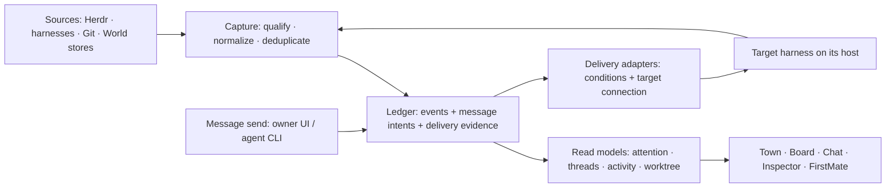

## Context

World is one service and same-origin browser application observing external
runtimes. Its existing CLI change/ask/result ledger is not a general message
transport. Checkout observation already checks a pane's session-bound report
before and after reading Git, while Inspector's file/diff scope needs a shared
working-tree binding. See the [proposal](proposal.md) for the intended outcome
and the [proposed requirements](specs/event-stream-message-log/spec.md).

The design builds on the ledger-plus-native-adapters approach: sources own
their facts; World owns the messages and intents it accepts. A thing has an
identity, a link relates things, and a claim records author, channel, time,
basis and evidence. Reported and inferred claims remain distinguishable;
missing evidence is unknown. Threads are explicit message membership, and
an intent is a requested action with conditions.

## Goals / Non-Goals

**Goals:** consistent evidence across views, honest delivery states, qualified
working-tree observations and incremental adoption through existing sources.

**Non-goals:** a replacement runtime, authentication between processes owned
by the same service user, a permanent copy of every transcript/file, or an
implementation in this PR. Viewer seen/reviewed state is not an agent read
receipt. A working-tree observation is not branch or PR ownership.

## Decisions

### One capture path and two uses of the ledger

Use a bounded durable log, with SQLite as the proposed storage choice. Capture
source events where available and qualified snapshot differences otherwise.
Retain source event identity/incarnation, cursor or observation revision,
affected thing/link, author, channel, basis, source time when known, capture
time and evidence reference. Runtime observations carry connection ID,
generation and occupant/session when relevant.

A World cursor orders capture, not causality across machines. Consumers
tolerate duplicate delivery. Retention has a visible floor: an expired cursor
requires a consistent snapshot/cursor reset. Current source snapshots plus
retained World-owned records rebuild read models. Disconnection marks data
stale; it does not remove facts. Positive deletion needs sufficiently complete
evidence. Preserve unresolved intents and receipt evidence through compaction.

This avoids separate polling and interpretation in each view without turning
World into the authority for external facts. Existing stores remain owners;
capture their accepted changes rather than migrating them together.

### Durable messages and conditional delivery

Commit message ID/idempotency key, explicit thread, sender claim, recipients
and body with the outbox intent before acknowledging Sent. One delivery record
per recipient captures the exact connection, generation and occupant. A stable
seat address can locate that occupant, but a shift does not silently retarget
an already-bound delivery. Hold during handover and reconcile uncertain
cutovers. FirstMate is a recipient and read-model consumer, not the transport.

The adapter executes on the target host through its captured runtime. Owner
messages require user standing; peer messages prefer peer standing. Where a
peer path is unavailable, a user-standing fallback is visibly labelled and
must not answer an open ask. Idle/composer checks sampled before a write are
not atomic guarantees. If required conditions cannot be established, keep a
visible hold; do not claim safe admission. Guarded keystrokes remain a labelled
non-atomic fallback, not the default justification for shipping a native path.

Do not automatically resend after an uncertain side effect. Reconnection
resumes evidence reconciliation. Ask answers retain their own action and
authority boundary. Waiting messages have no expiry timer; typing/busy holds
show their reason without raising an owner alert. Intent creation is
idempotent, not a promise of exactly-once external delivery.

### Receipts and read models

| State | Evidence |
| --- | --- |
| Sent | World committed the message and its delivery intent |
| Delivered | Documented acceptance by the target adapter; queue acceptance explicitly says queued |
| Read | Message ID, or an unambiguous exact-text match, in the bound occupant's recorded turn |
| Delivery unknown | The side effect might have happened but its outcome was lost |
| Not sent | Confirmed refusal or failed target condition |

Receipt evidence is monotonic; later execution failure is a separate outcome.
Read is recorded consumption, not comprehension. A working status is not a
receipt. Ambiguous text matches do not advance it. Keep the envelope count to
World-held/unknown messages; confirmed harness-queued messages are delivered.
Failures and unknown delivery can enter Reception. Missing receipt capability
is unknown unless positively established, and never earns a read mark.

Attention, threads, activity and worktree read models carry provenance,
freshness and revision to every view. Interest and seen/reviewed remain viewer
claims: another agent reading a log cannot mark an item seen for the owner.
FirstMate can resume an inbox cursor and emit a digest referencing messages
instead of receiving every crew update as terminal keystrokes. Retain bounded
necessary content and keep private evidence and credentials out of unrelated
views and exports.

### Worktree read model and Inspector binding

| Field | Meaning |
| --- | --- |
| Subject | Connection ID, generation, pane/terminal and session fingerprint |
| Observation | Revision, time and resolved / ambiguous / unavailable / stale state |
| Candidates | Candidate ID, canonical target-host root, Git identity when known, nullable branch, source/reference/time and reported/inferred basis |
| Selected target | Candidate ID, subject and observation revision; viewer intent distinct from observation |
| Event seam | Accepted worktree-observed and binding-changed claims, separate from branch/PR ownership |

Evidence preference is live foreground cwd, then that occupant's own bound
session/transcript/rollout cwd, then an actual own-branch match in an explicitly
scoped Git worktree list. Session-bound agent checkout reports remain attributed
evidence. Branch matches are inferred. A non-Git cwd or conflicting candidates
is visible rather than permission to guess. Detached HEAD is a valid checkout
with no branch. Confirm and canonicalize on the owning runtime, including SSH;
do not interpret a remote root using the service host's filesystem.

Other entries in the same known repository's worktree list can be explicit
viewer choices (`worktree_list` evidence), never automatic working-tree or
ownership claims. For example, selecting synthetic `candidate-beta` instead
of observed `candidate-alpha` changes Inspector's read target, not the agent's
reported work. A shared branch name alone does not prove ownership.

Files and Changes use the same selected binding. The client sends candidate
identity and revision; the service resolves and revalidates the root, session
and generation at request boundaries and before an operation. Workspace launch
cwd is not an implicit substitute. A changed binding requires refresh or an
explicit choice; stale evidence remains visible but non-actionable. Preserve
the checkout resolver's before/after guards in the shared implementation.

The event-log adapter later captures accepted observations from that resolver.
It does not independently choose Inspector's root. The separately authorized
Chat integration need not wait for event-log implementation.

### Alternatives considered

- Keystrokes only retain input-ownership and occupant races, even with sampled
  guards. Native adapters are preferred where their standing and outcomes fit.
- An ACP-first runtime does not reach existing attached TUI sessions and would
  replace more of the runtime foundation than this change requires.
- Waiting for one universal upstream send verb has no verified delivery path.
  An eventual native verb can become another adapter without replacing the log.
- A full event-sourced replacement for source stores would duplicate authority
  and data. Current snapshots plus bounded evidence are sufficient here.

## Relay spike results and limits

Research on 2026-10-23 used a newly created, explicitly targeted disposable
Herdr session. Versions were Herdr 0.9.3, Claude Code 2.1.309 and Codex 0.164.0.
Synthetic messages and an ordinary one-line composer draft were used. The
session and private temporary configuration/authentication copies were cleaned
up. No live crew pane was targeted. These observations are version-specific.

| Spike | Established | Still unverified |
| --- | --- | --- |
| Claude inbox from a non-child | Installed receiver source suggests peer-origin handling; no runtime send was attempted | Socket acquisition, supported external protocol, hold/delivery/refusal, draft survival and transcript representation |
| Codex queue with attached TUI | CLI accepted; idle TUI consumed automatically; consumed text appeared in history; draft survived; transcript recorded user standing | Pending queue-row display, busy/open-ask admission, interrupt/restart behavior and end-to-end receipt-ID correlation |
| Sender identity inside harness tools | No usable tool-process identity was obtained | Correct pane/thread binding and the suspected shared-daemon inheritance mismatch |

Claude's automatic tool review rejected the allowlisted environment capture
as Credential Exploration. No socket was guessed and no rejection was
bypassed. Codex's shell tool failed at sandbox startup before capturing its
environment; permissions were not escalated. Launch-process inheritance is
not proof of tool-process identity. The sender remains a claim, not
authentication, even if a later probe validates the binding.

Installed Codex experimental schema already exposes `clientUserMessageId` on
queue add and queued submissions, plus a client ID on user-message items.
This supersedes the historical suggestion to request such a field upstream.
The CLI's submission ID differed from the transcript client ID; the experiment
did not correlate them end to end. Do not conflate submission, client, item or
turn IDs. Native queue acceptance is not atomic idle/no-open-ask admission, and
a peer prefix did not reduce the queued message's user standing.

## Risks / Trade-offs

- Unsupported or preview delivery contracts → enable only capabilities backed
  by adapter-specific evidence; otherwise expose the hold/unavailability.
- Cursor expiry or capture failure → explicit gap/reset and source snapshots,
  never an apparently complete history with missing observations.
- Misbound sender, occupant or worktree → retain provenance and reject stale
  bindings; do not use aliases, prefixes or branch names as authentication.
- Message privacy and log growth → bound retention/content, preserve pending
  intents, and keep source credentials outside events and UI payloads.
- UI refresh cost → reuse prepared semantic observations and incremental read
  models; existing latency budgets remain unchanged.

## Migration Plan

Owner approval of this architecture precedes implementation. Future work uses
one pod batch branch, quick checks per item and a complete gate/review per
batch, as detailed in [tasks](tasks.md). First deliver or reconcile the shared
worktree binding, then capture/replay, message intent persistence, qualified
adapters and view consumers. Current Chat and ask behavior remains until its
specific migration is accepted; do not run two send paths for one action.

Rollback disables new sends/consumers while retaining unresolved outbox and
receipt evidence for reconciliation. It must not switch an uncertain message
to another adapter or replay it as a new message. Existing source stores remain
authoritative throughout.

Before the storage batch, review numeric retention and payload limits against
representative synthetic workloads. Before each delivery adapter ships,
establish its supported version, receipt mapping and admission conditions;
unsupported cases stay unavailable. These are explicit batch prerequisites,
not assumed findings from the three bounded spikes.
