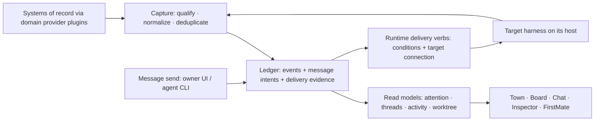

## Context

World is one service and same-origin browser application observing external
runtimes. Its existing CLI change/ask/result ledger is not a general message
transport. Checkout observation checks a pane's session-bound report before
and after reading Git. Inspector's shared qualified worktree binding has shipped
(#338, implementation 55e0b81f) and is governed by the current
[Agent worktree source-control context](../../specs/world-surfaces/spec.md#requirement-agent-worktree-source-control-context).
This revision reconciles against main bba20a2c; the new work is event capture
around that resolver. See the [proposal](proposal.md) for the intended outcome
and the [proposed requirements](specs/event-stream-message-log/spec.md).

The design builds on the ledger-plus-native-adapters approach: sources own
their facts; World owns the messages and intents it accepts. A thing has an
identity, a link relates things, and a claim records author, channel, time,
basis and evidence. Reported and inferred claims remain distinguishable;
missing evidence is unknown. Threads are explicit message membership, and
an intent is a requested action with conditions.

## Goals / Non-Goals

**Goals:** consistent evidence across views, honest delivery states, qualified
working-tree observations and incremental adoption through existing sources.

**Non-goals:** a replacement runtime, authentication between processes owned
by the same service user, a permanent copy of every transcript/file, or an
implementation in this PR. Viewer seen/reviewed state is not an agent read
receipt. A working-tree observation is not branch or PR ownership.

## Decisions

### Systems of record, served by provider plugins

**Domain** is the owner-confirmed grouping: Code, Work, Runtime, Observability,
Docs, and Agents & skills. It does not overload a Thing or Group kind. A
**provider** implements a domain contract; a **provider instance** is its
configured account, site, host or repository scope. Users see **Connector**
and **Connection** respectively. One provider can implement several contracts.

| Domain | Example providers and facts |
| --- | --- |
| Code | Git: checkout, branch, commit and worktree; GitHub: PRs, reviews and checks |
| Work | GitHub Issues and Jira: issues, tickets and work status |
| Runtime | Herdr and harnesses: connections, panes/terminals, occupants, sessions and transcript/delivery evidence |
| Observability | OTel, logs and metrics providers: traces, usage and measurements |
| Docs | Repository documents and wiki providers: documents, specs and revisions |
| Agents & skills | World profiles, skill registries and harness plugins: profile/staffing definitions, skill content and eval claims |

These are domain mappings, not a claim that every adapter already exists.
GitHub can implement both Code and Work; Jira implements Work. Herdr and
harnesses contribute Runtime facts at different resolutions. An instance is
authoritative only for the datasets and facts it owns, not its entire domain.
For example, a Git checkout and a GitHub PR have different authorities even
when they refer to the same commit. A telemetry inference does not override
either. Overlapping providers preserve distinct provenance; neither becomes
the preferred system of record merely by loading last. The owner chooses the system of record per domain/dataset scope and configures
where and how it is used. Adoption or migration requires that explicit owner
choice and preserves earlier claims; installation never assigns authority.

Each domain has one versioned provider contract with the same common surface:

- **Capabilities:** supported reads/snapshots/subscriptions, freshness and
  declared version/platform support. Unsupported, unknown and temporarily
  unavailable are distinguishable; none is a silent successful no-op.
- **Claims:** provider/instance/incarnation, source identity/revision, subject,
  author/channel, basis, timestamps and evidence reference. Domain-specific
  facts flow through the event capture envelope below.
- **Verbs:** typed inputs/outcomes, target/revision conditions, risk,
  confirmation and supported exposure. Existing PR actions stay browser-only;
  explicitly supported CLI runtime/message actions remain possible. Outcome
  claims and provider capabilities never grant policy bypasses.
- **Auth/scopes:** declared required scopes, configured account/resource scope
  and credential readiness. Credentials stay in service-owned storage or the
  upstream tool's login; never in World payloads, logs or plugin manifests.
  This does not isolate other processes sharing the service user's OS account.
- **Health:** readiness/degradation and last observation with a reason. Health
  is not proof that every verb is authorized or every claim is current.

Common fields avoid one bespoke integration shape per product; domain-specific
contracts avoid a universal untyped plugin API. Views depend on domain
capabilities and claims rather than naming individual vendors. Runtime message
delivery adapters implement suitable Runtime verbs without moving ledger
ownership into the harness. Worktree observation joins qualified Runtime cwd
evidence with Code checkout evidence; it does not collapse their authorities.

World itself supplies the records it owns, including messages, groups, viewer
Interest and profiles. The agents/skills/seats model retains one profile with
persona and named staffing variants, an immutable World-owned seat, and a
separate observed occupant. Herdr's pane is not that seat. Harness readiness
is a Runtime health observation; a skill registry supplies content/provenance,
and an eval runner supplies eval claims.

### Connector lifecycle and scope

Pre-installed built-ins and later user-installed connectors have the same
contract: **install → configure → enable → health**. Installation records the
connector identity/version and declared domains/capabilities; configuration
creates scoped connections with credential references; enablement permits only
configured capabilities and verb exposures. Health reports readiness, stale or
last successful observations, unavailable dependencies and actionable failures.
Installed, configured, enabled and healthy are distinct; enabling is not proof
of health. Disablement stops new work and marks observations unavailable/stale
without deleting provenance or blindly replaying uncertain side effects.
Herdr host connections become the Herdr connector's connections without changing
immutable connection IDs or runtime generation boundaries.

The immediate priority is doing the current systems well: Herdr runtime,
Claude/Codex transcripts/status/skills, and GitHub PRs/issues/checks/reviews via
`gh`. Built-ins are pre-installed connectors, not a separate API shape. Existing
Jira REST and OTel support stay unchanged and first-class in Connections; no
legacy label, replacement requirement or forced migration is introduced here.
For **new** connectors, eligibility is a CLI or a standard protocol (such as
OTel); no new bespoke API connectors. Exact CLI command/output contracts and
protocol versions are adapter-specific and must be verified before enablement.
MCP and marketplace integration are later considerations, outside this phase.
World does not operate its own skill marketplace.

### Harness-specific skill requirements and bindings

A persona or seat requests a harness-neutral **skill requirement**. Each named
staffing variant resolves it to an explicit **binding**: harness, binding mode
(`native`, `plugin`, or `injected`), source-scoped native artifact and effective
revision. Mode is part of binding identity, not a display alias. The source
scope includes target connection and repository/user/native-registry origin;
the artifact identity includes harness, source, native identifier and effective
content digest. Referenced resources and the injection recipe contribute to
the binding digest. Equal names on two harnesses do not establish equivalence.
A plugin's tools are not silently flattened into portable skill text.

Use each harness's own skill registry/market where it has one, and supported
repo/user sources where appropriate. World stores requirements, selections,
bindings and provenance; the harness owns distribution and installation.
Discovery is bounded and read-only. An adapter declares the installed-version
support for discovery, install, binding modes and activation verification;
unsupported, unavailable and unknown are distinct. No registry is not an empty
successful registry, and folder-name discovery does not prove activation.
Native installation uses the harness's declared operation with explicit owner
confirmation. Preview its scope and known side effects first: an install/link
operation can also enable resources. Include affected configuration/sessions,
tools and permission effects; do not promise separate native verbs where they
do not exist. Unknown effects remain unknown and cannot be advertised as a
safe install-only operation. A missing installer verb never authorizes silent
file copying or a permission bypass.

Resolve every requested requirement against the selected staffing before start
or shift. Ambiguous sources, missing bindings or unavailable artifacts block
that configuration; never pick by name, omit a requested requirement or switch
binding mode silently. Seat removals explicitly exclude inherited requirements.
Show desired selections separately from the occupant's immutable launch
snapshot and subsequent observed applied revisions. The adapter declares its
version-qualified activation boundary: next session, supported reload or
verified live update. Selection changes do not automatically reload or mutate
a live occupant. Any explicit apply operation must respect approved scope,
permissions and critical-seat evals, and record the binding revision and bound
session/generation it actually affected. When reload/live application is not
established, keep the change pending for the next supported boundary. Disablement
cannot retract instructions already present in a running model context.

Record **installed, enabled, advertised, used and eval-passed** as independent
claims, not a linear state machine. Each can be unknown and carries source,
observation time, harness/version, binding revision and applicable config/session
scope. A package inventory proves neither session advertisement nor invocation;
a command catalog is not evidence that the skill body was used. Used requires
actual invocation evidence. An eval pass belongs to the full binding/test tuple
and may precede use by this occupant. Disablement does not erase historical use
or a still-matching eval result. None of these observations alone proves overall
readiness or grants permissions.

Evals apply per binding: effective binding/skill digest, suite digest,
harness/version, **binding mode**, model, adapter/runner revisions and relevant
tool/permission configuration, with run/outcome evidence. Changing any relevant
part invalidates matching evidence. Critical seats and shipped defaults require
passing evidence for their declared support matrix; other seats can explicitly
use Experimental bindings, but missing bindings are not an eval exemption.
Readiness respects the staffing's approved permission policy, without escalation.

Agent-config UI remains held until the owner reviews this contract and each
supported harness's capability/mode mapping has version-qualified evidence.
Installed-version research used isolated synthetic repositories/configuration,
management operations and session initialization, with no model task. It found
native skill loaders in Claude Code 2.1.309, Codex 0.164.0, Gemini CLI 0.57.0 and
pi 0.87.1. Observations are labelled separately from CLI help/schema, installed
source and external documentation; one does not silently promote another.

In that tested baseline, shared repository `.agents/skills` was discovered
by Codex/Gemini/pi but not by Claude; the conventional repository location is
not a universal cross-harness source. Claude plugin install and Gemini extension
link also enabled their fixtures. These are version/scenario-bounded findings,
not universal absence or installation guarantees. Package inventory and some
session catalogs were observed; full skill-body use, live reload and behavioral
equivalence across harnesses were not established. Those boundaries still need
isolated evidence, including missing registry, ambiguous artifacts, changed
digests, mode changes, unavailable install and cross-harness shifts. This PR authorizes neither those UI builds nor connector
implementation. See the [provider requirements](specs/provider-systems/spec.md).

### One capture path and two uses of the ledger

Use a bounded durable log, with SQLite as the proposed storage choice. Capture
source events where available and qualified snapshot differences otherwise.
Retain source event identity/incarnation, cursor or observation revision,
affected thing/link, author, channel, basis, source time when known, capture
time and evidence reference. Runtime observations carry connection ID,
generation and occupant/session when relevant.

A World cursor orders capture, not causality across machines. Consumers
tolerate duplicate delivery. Retention has a visible floor: an expired cursor
requires a consistent snapshot/cursor reset. Current source snapshots plus
retained World-owned records rebuild read models. Disconnection marks data
stale; it does not remove facts. Positive deletion needs sufficiently complete
evidence. Preserve unresolved intents and receipt evidence through compaction.

This avoids separate polling and interpretation in each view without turning
World into the authority for external facts. Existing stores remain owners;
capture their accepted changes rather than migrating them together.

### Durable messages and conditional delivery

Commit the message and all recipient intents atomically before acknowledging
Sent. Namespace idempotency by `(World ledger incarnation, service-issued
producer ID, client key)`; a sender label is not a producer identity or an
authentication guarantee. The producer namespace survives reconnect/restart.
Compare a canonical request fingerprint covering explicit thread, sender claim,
exact body, normalized recipient set and requested target/delivery conditions.
The namespace/key itself and server-assigned IDs/times are not payload fields.
Within a namespace, an identical retry returns the original message and current
status without re-resolving recipients. Different content or targets return
`idempotency_conflict`, with no mutation or dispatch; corrections need a new
key. Concurrent submissions serialize on the namespace/key uniqueness rule.

Keep accepted key/fingerprint/message mappings through message compaction,
including after delivery. Deduplication records have a separate finite storage
budget: exhaustion refuses new keys, not old retries. To reclaim a producer
namespace, explicitly retire it; stale submissions to that namespace are
rejected as retired, never admitted as new messages. Namespace retirement does
not discard unresolved intents. Unknown producer IDs are never auto-created by
send, and IDs are never reused. An explicit new registration is a new namespace,
not a safe automatic retry of an uncertain send.

**Producer registration and persistence.** World owns an explicit registration
operation and durable producer records. Registration is idempotent under a
client bootstrap ID durably written before registration; a lost registration
response must recover the same producer, not allocate another namespace.
Registration and request journals have finite quotas; failure to persist them
prevents a send. A producer ID identifies retry continuity, not authenticated
sender, seat authority or permission to act.

- Owner UI: each same-origin browser installation stores its bootstrap/producer
  IDs, World ledger incarnation and pending request journal in IndexedDB. Tabs
  share that transactional journal; reload/restart reuses it. Another browser
  installation is another producer and cannot silently resume the first one's
  requests without their original handles.
- Agent CLI: an explicit registration creates a named producer profile for one
  World service/ledger. The CLI atomically persists the bootstrap/producer IDs
  and request journal in its per-user client state on the invoking host, outside
  the repository. New CLI processes reopen that same selected profile. Managed
  launches may supply an existing profile handle for a seat/occupant; association
  with a seat requires the service's explicit assignment record and revision.
  Tool-process identity remains unproven until task 5.3; an inherited handle or
  sender text is not verified caller identity and grants no seat authority.
  Unbound clients stay explicitly reported/unknown rather than guessing a pane.

For every send, persist the client request ID and exact request before transport.
The CLI exposes that ID before sending and accepts it on retry (for example,
`send --request-id request-alpha`). A re-run with the same profile, request ID
and payload reuses the producer/key; an explicit retry can load the stored
payload. Same text without a request ID is not reliable retry identity. An
unresolved local request is surfaced before a default new send; retry uses its
handle, while an intentional additional message requires an explicit new ID.
Concurrent processes serialize journal changes and cannot overwrite a pending
request. A missing journal/profile, changed ledger incarnation or retired
namespace reports recovery required and never auto-registers or substitutes a
new key for an uncertain request. Old handles remain usable for status lookup
where retained. Registration/retirement never silently migrate a pending
request to a replacement occupant or imply that identical text is a retry.

Nonexpiring pending messages require **bounded admission**, not eviction.
Before acceptance, transactionally check finite limits for body/metadata bytes,
recipient fan-out, global and per-recipient unresolved records/bytes, plus
storage headroom and deduplication budget. Held and delivery-unknown records
count; multi-recipient admission is all-or-nothing. Existing identical retries
are looked up before quota admission, so a full outbox still returns the accepted
message. Reject new excess requests with `outbox_full` and the limiting scope
(or `message_too_large` for payload/fan-out limits), no Sent acknowledgement,
partial outbox or hidden overflow queue. UI/CLI preserves the unsent request
and shows capacity pressure; no automatic send loop. Capture-history retention
must not consume capacity reserved for accepted intents and receipt updates.

Accepted pending records survive compaction, quota reductions and restart.
Never silently drop or expire them to free space. Confirmed terminal outcomes
release pending capacity; explicit cancellation is safe only before dispatch
or after a confirmed no-side-effect outcome. Unknown delivery requires
reconciliation and cannot be cancelled into a blind resend. Numeric defaults,
maximum settings and storage reserve are required measured batch prerequisites;
there is no unbounded default. Capacity pressure is service health, distinct
from an ordinary typing/busy hold.

One delivery record per recipient captures the exact connection, generation
and occupant. A stable seat address can locate that occupant, but a shift does
not silently retarget an already-bound delivery. Hold during handover and
reconcile uncertain cutovers. FirstMate consumes messages; it is not transport.

The adapter executes on the target host through its captured runtime. Owner
messages require user standing; peer messages prefer peer standing. Where a
peer path is unavailable, a user-standing fallback is visibly labelled and
must not answer an open ask. Idle/composer checks sampled before a write are
not atomic guarantees. If required conditions cannot be established, keep a
visible hold; do not claim safe admission. Adapter capability distinguishes an
expected-session guard from the existing non-atomic prompt path. A mismatch
observed before dispatch refuses the send; an expected-session adapter can also
reject a turnover at dispatch. The existing owner-initiated prompt fallback can
be explicitly admitted under its disclosed non-atomic contract and fresh checks,
but it cannot promise delivery to the expected occupant after those checks.
Reconcile a late turnover as wrong-target when evidence identifies another
recipient, or unknown/unconfirmed when it does not. This does not relax the
peer-as-user no-open-ask requirement: that path remains held without sufficient
admission guarantees, and owner fallback admission does not authorize automatic
or peer sends through it.

Do not automatically resend after an uncertain side effect. Reconnection
resumes evidence reconciliation. Ask answers retain their own action and
authority boundary. Waiting messages have no expiry timer; typing/busy holds
show their reason without raising an owner alert. Intent creation is
idempotent, not a promise of exactly-once external delivery.

### Receipts and read models

| State | Evidence |
| --- | --- |
| Sent | World committed the message and its delivery intent |
| Delivered | Documented acceptance for the intended bound recipient; queue acceptance explicitly says queued, while generic prompt success alone is insufficient |
| Read | Correlated message ID, or causally bounded unambiguous exact-text match, in the bound occupant's recorded turn |
| Delivery unknown / unconfirmed | The side effect might have happened or been accepted, but outcome or recipient evidence is missing; retain the specific reason |
| Wrong target (misdelivered) | Evidence names another recipient; preserve intended and observed target plus source/basis |
| Not sent | Confirmed refusal before a side effect or confirmed no-side-effect failure |

Receipt evidence is retained; wrong-target is a delivery outcome, not another
step on the Sent/Delivered/Read ladder. Positive evidence of misdelivery must
remain visible in Reception and must not be reduced to generic unknown, a
success tick for the intended target, or Not sent. If later evidence contradicts
an earlier claim, retain both with a visible conflict instead of silently
rewriting history. Stop attempts for that delivery and never resend it
automatically, including after acknowledgement/dismissal. Any deliberate new
send is a separate owner action and request ID; delivery outside World cannot
be undone. Read is recorded consumption, not comprehension. Prefer an adapter-validated
message-ID correlation. Text fallback requires a source incarnation/session and
transcript position or equivalent send-specific boundary established before
dispatch, plus evidence that the matching occurrence is causally eligible for
this delivery. It must be unique among eligible outstanding sends/turns; a
position alone cannot distinguish simultaneous identical inputs. Pre-existing
and replayed older turns never qualify, even if World ingests them later. World
capture time and unsynchronized host clocks cannot establish the boundary.
If source reset, concurrent input or missing correlation prevents proving it,
Read remains unconfirmed. A working status is not a receipt. Ambiguous text
matches do not advance it. Keep the envelope count to
World-held/unknown messages; confirmed harness-queued messages are delivered.
Failures and unknown delivery can enter Reception. Missing receipt capability
is unknown unless positively established, and never earns a read mark.

Attention, threads, activity and worktree read models carry provenance,
freshness and revision to every view. Interest and seen/reviewed remain viewer
claims: another agent reading a log cannot mark an item seen for the owner.
FirstMate can resume an inbox cursor and emit a digest referencing messages
instead of receiving every crew update as terminal keystrokes. Retain bounded
necessary content and keep private evidence and credentials out of unrelated
views and exports.

### Capture from the delivered worktree resolver

The current [world-surfaces worktree contract](../../specs/world-surfaces/spec.md#requirement-agent-worktree-source-control-context)
owns evidence ranking, target-runtime canonicalization, outside-Git evidence,
viewer selection and resource revalidation. The delivered resolver and shared
Files/Changes target remain the authority; this proposal adds no second ranking
or selection algorithm. #338 is closed; this is reconciliation with delivered
behavior, not another implementation of it.

Capture two kinds of accepted changes from that resolver:

| Event | Meaning |
| --- | --- |
| worktree-observed | The qualified subject's accepted observation/revision, including provenance and resolved, ambiguous, unavailable or stale state |
| binding-changed | The Inspector/view context's accepted selected-target revision and candidate reference; viewer intent, not an observed agent work claim |

Both carry the source incarnation, immutable connection/generation,
pane/terminal/session subject, observation revision and evidence reference.
Binding changes also identify the view context and selection revision, so two
Inspectors choosing different candidates do not overwrite one another. Capture
accepted revisions only; refused or retired operations cannot publish a binding
change. Deduplicate by source/event kind/context/revision and preserve the
existing observation-vs-selection distinction when replaying. A disconnected
source follows the common gap/reset and stale rules; a replay never reselects a
root or authorizes file/Git work. For synthetic candidate-alpha to candidate-beta
selection, only the viewer-binding event changes unless new source evidence is
independently accepted.

### Alternatives considered

- Keystrokes only retain input-ownership and occupant races, even with sampled
  guards. Native adapters are preferred where their standing and outcomes fit.
- An ACP-first runtime does not reach existing attached TUI sessions and would
  replace more of the runtime foundation than this change requires.
- Waiting for one universal upstream send verb has no verified delivery path.
  An eventual native verb can become another adapter without replacing the log.
- A full event-sourced replacement for source stores would duplicate authority
  and data. Current snapshots plus bounded evidence are sufficient here.

## Relay spike results and limits

Research on 2026-10-23 used a newly created, explicitly targeted disposable
Herdr session. Versions were Herdr 0.9.3, Claude Code 2.1.309 and Codex 0.164.0.
Synthetic messages and an ordinary one-line composer draft were used. The
session and private temporary configuration/authentication copies were cleaned
up. No live crew pane was targeted. These observations are version-specific.

| Spike | Established | Still unverified |
| --- | --- | --- |
| Claude inbox from a non-child | Installed receiver source suggests peer-origin handling; no runtime send was attempted | Socket acquisition, supported external protocol, hold/delivery/refusal, draft survival and transcript representation |
| Codex queue with attached TUI | CLI accepted; idle TUI consumed automatically; consumed text appeared in history; draft survived; transcript recorded user standing | Pending queue-row display, busy/open-ask admission, interrupt/restart behavior and end-to-end receipt-ID correlation |
| Sender identity inside harness tools | No usable tool-process identity was obtained | Correct pane/thread binding and the suspected shared-daemon inheritance mismatch |

Claude's automatic tool review rejected the allowlisted environment capture
as Credential Exploration. No socket was guessed and no rejection was
bypassed. Codex's shell tool failed at sandbox startup before capturing its
environment; permissions were not escalated. Launch-process inheritance is
not proof of tool-process identity. The sender remains a claim, not
authentication, even if a later probe validates the binding.

Installed Codex experimental schema already exposes `clientUserMessageId` on
queue add and queued submissions, plus a client ID on user-message items.
This supersedes the historical suggestion to request such a field upstream.
The CLI's submission ID differed from the transcript client ID; the experiment
did not correlate them end to end. Do not conflate submission, client, item or
turn IDs. Native queue acceptance is not atomic idle/no-open-ask admission, and
a peer prefix did not reduce the queued message's user standing.

## Risks / Trade-offs

- Unsupported or preview delivery contracts → enable only capabilities backed
  by adapter-specific evidence; otherwise expose the hold/unavailability.
- Cursor expiry or capture failure → explicit gap/reset and source snapshots,
  never an apparently complete history with missing observations.
- Misbound sender, occupant or worktree → retain provenance and reject stale
  bindings; do not use aliases, prefixes or branch names as authentication.
- Message privacy and log growth → bound retention/content, preserve pending
  intents, and keep source credentials outside events and UI payloads.
- UI refresh cost → reuse prepared semantic observations and incremental read
  models; existing latency budgets remain unchanged.

## Migration Plan

Owner approval of this architecture precedes implementation. Future work uses
one pod batch branch, quick checks per item and a complete gate/review per
batch, as detailed in [tasks](tasks.md). First reconcile the delivered worktree
resolver with its capture interface, then capture/replay, message intent persistence, qualified
adapters and view consumers. Current Chat and ask behavior remains until its
specific migration is accepted; do not run two send paths for one action.

Chat migration preserves the shipped evidence without promoting heuristic
matches. Import an existing send with a stable legacy delivery ID as observation
only; never enqueue it again. Original delivery IDs deduplicate repeated imports.
The mapping is:

| Current Chat state | Message-log outcome/evidence |
| --- | --- |
| pending | Pending/unconfirmed attempt; Sent only once its World record is committed; no new dispatch |
| matched | Retained words/order match evidence; below Read and not proof of Delivered, unless separate evidence meets the new causal/recipient rules |
| uncertain | Delivery unknown, retaining ambiguity and candidate evidence |
| unverified | Delivery unconfirmed with the original missing-transcript/check-window reason; preserve any stronger independently proven receipt |
| misdelivered | Wrong target, retaining intended/observed recipient, evidence and its reported/inferred basis |

A queued flag remains queue evidence, not proof of consumption or intended-target
acceptance. Legacy commands that intentionally switch sessions keep their
command outcome semantics; they are not silently reinterpreted as peer messages.
Expose imported uncertainty and wrong-target notices through Reception and keep
read/seen, acknowledgement and retry authority separate. The current prompt
race tracked in #284 is not solved by moving records into a ledger.

Rollback disables new sends/consumers while retaining unresolved outbox and
receipt evidence for reconciliation. It must not switch an uncertain message
to another adapter or replay it as a new message. Existing source stores remain
authoritative throughout.

Before the storage batch, review finite retention, pending/deduplication admission and payload limits against
representative synthetic workloads. Before each delivery adapter ships,
establish its supported version, receipt mapping and admission conditions;
unsupported cases stay unavailable. These are explicit batch prerequisites,
not assumed findings from the three bounded spikes.
