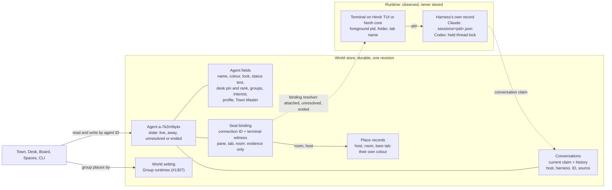

## Context

Today a Town desk, a Desk record and a Board card each name an agent their own way,
from runtime addresses (`deskKey`, `cardKey`, `interestKey` and others). A colour
is saved once, in `board_colors` by card key (`shared/terminalColor.ts`). Status
text and avatar live in `board_appearance` by connection, kind and native ID
(`shared/appearance.ts`), which reaches colour only through a `color_key` alias
into that same map. So one agent's appearance hangs off two address keys, and
Town and Board each derive the look they draw. A tab rename, which the runtime
owns, reaches every view; appearance depends on those keys and on each view's own
derivation, so a move or a rename can leave it behind. Only
`world_bindings` is a real identity layer. The #1184 postmortem traced its failed
moves to two gaps: no stable agent (T3, T6) and no conversation for most agents
(T2). [Evidence](evidence.md) shows that both harnesses already record, per
process, which conversation they run.

## The agent record

## 1. The agent

An agent is one Claude Code or Codex worker as the user sees it: "reviewer-3".
Its ID is store-issued (`a-` and eight symbols), immutable and never reused. Its
name, folder and harness are observed labels and claims, never identity.

| State | Meaning |
| --- | --- |
| live | Its seat binding is attached and the seat runs its harness. |
| away | No terminal runs it now: its terminal closed, its harness exited or another harness took the seat. It keeps its facts and its last conversation. |
| unresolved | World cannot tell now: host offline, partial or stale listing, not yet observed since World started, or ambiguous evidence. Nothing changes. |
| ended | The user ended it (End or a committed Bin close), or it is away with no seat and nothing to resume. Final; the record is kept. |

| Event | Result |
| --- | --- |
| Rename | Same agent. |
| Move between rooms or desks, in Herdr or by World | Same agent: its terminal is witnessed under the new pane or tab ID. |
| World restart | Unresolved, then the same agent once its terminal is observed again. |
| Runtime restart (Herdr TUI or herdr-core) | Away. World offers to resume away agents; a resume World performs binds the same agent. |
| Move between runtimes | Same agent when World performs it: its result names the new terminal. |
| New conversation in place (`/clear`, `/new`, `/resume`, or the same harness restarted in its terminal) | Same agent; the old conversation goes to history. If World saw the terminal empty in between, the restart is offered as the same agent. |
| Another harness starts in its terminal | It goes away; the newcomer is a new agent. |
| Its terminal closes | Away when its conversation is known, else ended. |

## 2. Same agent or not

The agent kind declares its binding under the existing
[verified source bindings](../../specs/world-identity/spec.md) rules. Its
evidence is the connection ID, the witnessed terminal and the harness kind. It
uses only the three continuity paths that rule already allows: the witnessed
terminal in a current, complete listing of the same runtime; World's own move or
resume result; and the user's choice.

**A conversation resumed outside World is not merged.** When a terminal that World
did not start runs the conversation of an away agent, it becomes a new
agent, and World offers "Same agent as reviewer-3?". One click binds it, and
several can be confirmed together after a runtime restart. This keeps the
existing contract that harness IDs are claims, never identity. It also allows for
Claude, which takes no lock and will run one conversation in two processes.
Automatic attachment can be proposed later, with sandbox evidence.

**Never merge on ambiguous evidence:**
- If one observation shows a terminal or a conversation twice, everything involved
  stays unresolved, and no binding attaches, moves or ends.
- Two agents never hold one terminal; a newcomer in a held seat is a new agent.
- Names, folders, harness kinds, reused pane IDs and runtime generations never
  prove continuity.
- An ended agent never returns by itself.

## 3. The conversation

The agent's conversation is a declared field with its own claims (see the
[per-field claims](../../specs/world-identity/spec.md) rule). Only sources that
name the process's own conversation may set it:

| Source | Herdr TUI | herdr-core |
| --- | --- | --- |
| Foreground process | `herdr pane process-info` (new read) | terminal `foreground.pid` (today) |
| Claude process record `<config>/sessions/<pid>.json` | new | today |
| Codex held lock `<codex>/thread-writer-locks/<id>.lock`, excluding sub-agent threads | new | new |
| Herdr's harness report (`herdr:claude`, `herdr:codex`) | today | — |
| Launch argument (`--resume`, `codex resume`) | until the process record is read | same |
| The user's link in Chat | fallback | fallback |

Each process read is fenced by the process start time, as today. Codex's home
comes from the lock's own path. Claude's comes from the process's
`CLAUDE_CONFIG_DIR`, filtered on the host so that no other variable leaves it.
Terminal titles, transcript inference and directory recency stay display claims;
they never set the agent's conversation.

| Conversation state | When | What it allows |
| --- | --- | --- |
| known | A verified source names it, and its transcript exists. | Resume and conversation-dependent actions. |
| empty | A verified source names it, but the harness has saved no turn yet. | A fresh start loses nothing. |
| unknown, with a reason | No process, a harness without records, an unreadable host, a process change during the read, or several main thread locks | Nothing that needs the conversation. The UI says why. |
| conflict | Verified sources disagree, or two live agents claim it. | Nothing until they agree. |

**Staying current.** World re-reads when the runtime reports a change for the
terminal (status, session report or foreground process), and otherwise at most
every 5 s per observed process, batched per host. If the same process names a new
conversation, or a new process of the same harness starts in the seat, the agent
gets a new current conversation and the old one stays in its history. History is
never trimmed automatically.

## 4. Storage and migration

The agent is the first kind in the single-model plan's `entities` table, and its
fields use that plan's `facts` table. Hosts, rooms and tabs that carry their own
colour, spot or status become `place` entities in the same tables, so one store
holds every colour. One new table, `agent_conversations`, holds
`(agent_id, host_id, harness, conversation_id, first_seen, last_seen, source)`.
Seat bindings stay in `world_bindings`. All of these go into
`server/src/storage/catalog.ts`.

Migration copies and never guesses:
1. The schema step only adds tables, after the usual pre-upgrade snapshot.
2. On each connection's first complete, unambiguous observation after the upgrade,
   each harness occupant gets an agent, and each fact whose key resolves to exactly
   one agent is copied onto it:

| Fact | Store and key today | Copied to | When |
| --- | --- | --- | --- |
| Tab colour | `board_colors`, tab card key | agent colour | the tab holds exactly one agent |
| Tab colour, no agent or several | same | the tab's place record | always: a place colour, shown as today |
| Room and host colour | `board_colors`, workspace key and `@host:` key | room or host place record | always |
| Status text | `board_appearance`, tab target | agent status text | the tab holds exactly one agent |
| Avatar (look) | `board_appearance`, pane target | agent look | the witness is the agent's terminal |
| Town desk pin and rank | `board_desk_pins`, tab card key | agent Town placement | the tab holds exactly one agent |
| Board card anchor, pin, fold | `board_anchors`, `board_pinned`, `board_folded`, card key | agent Board placement | the card is the agent's terminal |
| Room spot | `board_room_pins`, workspace key | room place record | always |
| Interest (mute, focus) | connection + terminal | agent interest | the terminal is the agent's |
| Group membership | terminal or session reference | agent groups | it resolves to the agent |
| Profile assignment, Town Master | runtime terminal token | agent profile, Town Master | the terminal is the agent's |
| Desk marks, watchlist | their own binding | gain `agent_id`, keep their lifetime | the terminal is the agent's |
| Apartment residents | harness + session | gain `agent_id` | the session is in the agent's history |

A spawned tab's inherited colour (`~` key) is computed from relations and never
saved, so nothing is copied for it.

3. A key that matches no agent or several agents stays where it is and keeps working
   as today. It is copied later, once it is unique. Facts for offline hosts wait.
4. Old rows stay, and each old table keeps its reader while any of its rows is
   pending. A table is retired only when a check shows every one of its rows
   copied and none pending. A pending row (an offline host, a tab with two agents)
   therefore keeps displaying and stays available to copy later, for as long as it
   takes. A retired table is renamed `retired_*`, kept for one release and never
   deleted automatically. Rollback means restoring the named snapshot.
5. From the schema step on, `appearance.prune` stops deleting colours and
   appearance rows when a terminal disappears; it only hides them, as the
   continuity check already does. Otherwise a colour could be deleted before it
   is copied. An away agent keeps its colour and look like its other fields.

## 5. One record for every view

Every surface (Town, Desk, Board, Spaces, the `herdr-world` CLI and Apartments)
reads and writes the same agent record. No view keeps its own copy or its own key.

| Field | Today | In the agent record | Written by |
| --- | --- | --- | --- |
| Name | the runtime's tab or pane name, read by each view | `name`; the runtime's name is evidence | a rename anywhere: World writes the record, then the runtime's name; a rename seen in Herdr or herdr-core updates the record |
| Colour | `board_colors` by card key, reached from `board_appearance` through its `color_key` alias; Town and Board each resolve it | `colour`, or none | the colour picker in any view, `herdr-world colour` and `board card colour` |
| Look | `board_appearance` avatar by pane; profile look by terminal; Town resolves it in `townAppearance` | `look` (avatar) and `profile` | the look picker, launch from a profile |
| Status text | `board_appearance` by tab | `status_text` | any view, CLI |
| Room and host | the seat's workspace and connection | read from the seat, never stored | moves only (later work, #1184) |
| Placement | Town desk pin and rank by tab key; Board anchor, pin and fold by card key | `placement.town`, `placement.board` | each view for its own geometry |
| Groups, interest | by terminal or session reference | `groups`, `interest` | group and interest operations |

**One appearance store.** `board_colors` and `board_appearance` are replaced by
colour, look and status fields on agent records and on place records (host, room,
and a tab that holds no single agent). One shared resolver, used by every surface
and by the service, gives the colour shown: the agent's own colour, else its tab's
place colour, else the colour inherited from the agent that spawned it, else its
room's chosen colour, else the room's default. A chosen colour always beats an
inherited one, as today: a tab's own colour wins over inheritance in
`resolveTerminalColorByKeys` and `withInheritedColors`. So when a red tab holds
two agents and one was spawned by a green agent, the red copied to the tab's
place record still wins, and no agent changes colour on upgrade. Town's look resolver and Board's card colour become
callers of it, never their own derivations. Board's surface and status-colour
settings (`boardAppearance`) are a Board view preference, not agent data, and stay.

**Writes.** A view changes a field only through an agent operation naming the agent
ID (`agent.set`, `agent.place`, group and interest operations). The service applies
it at one revision and every surface sees it at the next snapshot. A rename also
updates the runtime's name; if that fails, the record keeps the new name and shows
the runtime's name as out of date, rather than having two truths.

**Grouping by place.** How agents group by machine or runtime follows one World
setting, Group runtimes (#1307: one per machine or one per runtime), through one
shared derivation over the agent's host. Town buildings, the Desk navigator and
lists, and Board's host zones all use it; no view groups by its own rule.

**Snapshot.** The snapshot gains `agents`, one entry per agent ID with every field
above, its state, conversation (state, ID, source or reason) and seat. Each
terminal row it attributes also gets `agent_id`. Both come from the same
observation and revision. Town desks, Desk records and Board agent cards key on
`agent_id`; the old desk and card keys become derived lookups. A view never decides
which agent a terminal is. Two agents with the same name stay two desks, and away
and unresolved agents never appear as duplicates. A cross-view test renders Town,
Desk, Board and the CLI's view from one snapshot and compares, per agent ID, the
name, colour, look, status text, room, host group, pin, groups and conversation
state.

## 6. Quint assessment

The coverage questions all answer yes. Several records compete for one terminal
and one conversation; identity must survive restart, move and retry; and an
interrupted move or resume leaves evidence that recovery must classify.
`binding-resolution` models one binding at a time, so it cannot show uniqueness
across agents.

[`agent-identity.qnt`](agent-identity.qnt) is a design-stage model of agents,
terminals and conversations. It covers complete, partial and duplicate
observations, World and runtime restarts, new conversations, harness swaps,
closes, World moves and resumes, resumes by hand, the user's confirmation and End.
Its invariants: one agent per seat; nothing attaches on ambiguous evidence; a seat
changes only through the declared paths; an ended agent never returns; unresolved
keeps its seat and conversation; and only a live agent with a known, unconflicted
conversation may act. Its fault switch merges by conversation; the simulator finds
the violation and a scenario fails. Commands and results are in [tasks](tasks.md) 1.2.

The whole-record fields add no new authority. Each is a single-writer field on an
agent ID, applied in revision order like every owned fact; which agent a field
attaches to is the identity question the model already explores. The migration's
"copy only when the key is unique" rule is the model's ambiguity rule, and the
cross-view test (task 8.4) is the check that views agree.

It is not yet maintained evidence: there is no implementation to replay. Task 5
moves it into `quint/` with an adapter over the real resolver, a coverage entry and
the full gate.

## Risks

- **Harness formats change.** The Codex lock directory and the Claude record are
  undocumented. Each reader states its version range, and unknown formats read as
  "unknown", never as a guess. Task 2.4 records the checked versions; a harness upgrade repeats that check.
- **Process reads cost time.** One small file or descriptor list per agent per
  interval, batched per host, with the existing 5 s cache. Remote hosts reuse the
  SSH read path and its timeouts.
- **Privacy.** Only the conversation ID, harness, folder and start time leave the
  host. Environment and transcript contents do not.
- **Asking more often.** "Same agent?" appears after a runtime restart if World did
  not perform the resume. One confirmation covers all matching agents.
