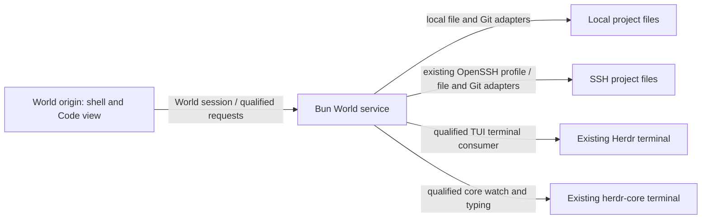

## Context

See [proposal](proposal.md) and [research](../../../docs/design/code-view/research.md).
World is a Bun service and same-origin React app. `workspaceResource.ts` already
qualifies Inspector resources; connection file/Git services serve local and SSH
checkouts, including agent-linked worktrees. Herdr TUI and herdr-core have distinct
terminal transports and input rules. An aggregate node is an observation, not
authorization. The current router does not implement `/code`.

## Goals / Non-Goals

**Goals:** a native Code projection over existing World entities; explicit project
and checkout identity; code, changes and agents together; viable phone navigation;
bounded reads and qualified terminals without another authentication boundary.

**Non-goals:** implementing this proposal in #981, changing runtimes, becoming a
full VS Code distribution, extensions, LSP/debuggers/tasks, launching a shell on
folder open, arbitrary filesystem write access, Git mutation or PR merge.
Live file saving is deferred; the mock's memory-only edits explore that later decision.

## Decisions

### Placement and trust

Recommend a lazy-loaded CodeMirror-based view in the existing React shell. It
shares the existing World navigation, Needs you, Hosts, annotation state and
login. Editor models live in browser memory; files remain on their owning host.
No project code, tasks, workspace hooks, extensions or HTML previews execute on open.
Render untrusted source/terminal/PR metadata as text using existing safe viewers.
No CDN or remotely supplied editor workers. Phone starts with one visible panel.

Monaco would need a separately maintained phone editor and worker/CSP deployment;
a full workbench would add per-host services and extension trust on World's origin.
An iframe or URL prefix on the same origin does not isolate cookie or RPC authority.
Those alternatives require revising the architecture, not substituting a widget.

The browser opens only World's HTTP/WebSocket origin. The service owns SSH and
runtime transports. It never connects the browser to a remote World bridge or IDE.
Use current World session authentication, request/upgrade admission and Origin
checks; no new login, bearer token in a URL, SSH secret or per-project password.
Logout/session expiry aborts consumers and clears in-memory content. No file/terminal
content is persisted in localStorage, service-worker caches, URLs or new databases.
Remember only nonsecret qualified layout/selection metadata through existing policy.
World remains trusted-single-user, not a new multi-user authorization system.

### Selection and resources

The service resolves **Open in Code** to an admitted project descriptor. Proposed
descriptor fields (names illustrative, not current RPCs):

| Field | Meaning |
| --- | --- |
| `connectionId`, `runtimeKind`, `runtimeGeneration` | Immutable connection and current runtime instance; never a display host/name lookup. |
| `workspaceId`, `workspaceGeneration` | Current room context and its resource admission epoch. |
| `projectRootId`, `checkoutRevision` | Opaque service-issued root binding, current root/checkout identity and validation revision. |
| `agentSessionRef` (optional) | Verified agent/session when selecting an agent's linked worktree; no fallback to its launch directory. |
| `capabilities`, `limits` | Current readable text/diff/terminal support and existing provider byte/result/time limits; `write` absent initially. |

These fields distinguish runtime generation, browser resource epoch, file revision
and agent occurrence. They are not interchangeable counters. Bind a root to the
connection and room/agent session that admitted it; re-resolve before opening files
or diffs. Do not grant broader capabilities than current Files/Changes paths.
Missing cwd/repo, ambiguous project candidates or a moved/deleted checkout produces
an explicit choice/unavailable state, not a guessed directory or filesystem scan.

Reuse existing connection-scoped `file.*` and `git.*` read paths behind project
admission; add a thin Code resource descriptor only if existing Inspector admission
cannot carry root identity. Enforce canonical relative paths and root confinement,
including traversal and symlink rejection for the default project scope. No implicit
filesystem-scope promotion. A future explicit external-file picker would need its
own policy and is not in this slice. Recheck generation/session and root at dispatch
and before publishing replies; retired replies cannot replace the new selection.

Local adapters run as the World service user; SSH uses the saved OpenSSH profile
and existing remote file/Git mechanisms. No new remote daemon or runtime API.
Windows and Unix use provider capability/limit reporting: show supported existing
reads/reviews, explain unsupported operations, and never imply Unix helpers work on
Windows. If a native or remote provider cannot validate the root, refuse that
project operation. No fallback to another host or checkout.

### Terminal ownership

Code composes the current exclusive World terminal consumer for a qualified TUI
terminal or the current core watch/composer for a qualified core address. The
terminal identity includes connection, runtime generation and verified current
terminal/agent occurrence. Core watch output is a screen model, not a promised raw
PTY stream; retain its typing/resize rules. The visible, focused terminal alone can
receive keys. Editor focus, diff focus and phone text fields never forward keys.

Select a tab in observe mode; make input intent explicit using runtime-specific
admission/lease semantics. Reuse the existing owner-transfer path if an Inspector
or Spaces already owns that target; do not mount two input owners. Changing agent,
connection, generation, hidden panel or view releases control and pending unsent
keys. A page hide detaches/suspends visible consumers according to current rules.
Close detaches and never kills a process. Opening Code never starts `herdr`, `hc`
or another shell. Shell launch and agent lifecycle remain separate World actions.

### Changes, PRs and refresh

File tree and Git reads are lazy, bounded and scoped to the selected root. Subscribe
to existing invalidations where available; otherwise refresh explicitly/on focus,
without an unbounded host scan or an always-active watcher per project. Only visible
terminal panes hold visible-consumer demand. Cancel old requests on selection loss;
coalesce updates and respect existing service/connection budgets.

Working-tree diffs and PR cards use current connection/repository/worktree evidence,
with branch, observation freshness and missing authorization stated. An agent's
terminal does not prove authorship of every changed line. Never infer PR association
from a coincident branch name across repositories/hosts. PR review opens a qualified
comparison; external navigation accepts only the existing validated provider URL.
No commit/push/approve/merge operations or new GitHub credentials.

### Editing decision and concurrency limit

The proposed initial live view is **read-only**. The mock allows local example
edits, Save example and conflict comparison to make a later editing decision
concrete; these are not implemented save semantics or an initial API promise.

If the owner selects editing, revise this coherent change before applying that
scope. A proposed future save would carry the admitted root, relative path, base
content hash, current generation/session and a request ID. World can serialize its
own writes, reject a detected stale base, bound file type/size, revalidate the root,
and use a same-directory atomic replacement. A lost reply must show outcome unknown
and require a fresh comparison before retry; no offline queue or automatic replay.

**Atomic replacement prevents torn files, not lost updates from arbitrary external
writers.** Compare-then-rename has a race when an agent/editor writes outside World.
Neither a World mutex nor a Git index lock makes those processes cooperate. Do not
claim universal compare-and-swap from the current file APIs. Safe editing needs
either a proven cooperating/versioned writer protocol or an owner-accepted,
explicitly described optimistic-write risk. Cross-platform/SSH durability, symlink
replacement, permissions and reply-loss behavior require provider evidence before
any write capability is enabled. No change to Herdr/herdr-core is proposed to solve it.

## Risks / Trade-offs

- Fewer IDE features than VS Code → state the boundary; reconsider a full
  workbench only if extension/debugging compatibility is a product requirement.
- Existing preview component is not an editing product → reuse packages and
  styles without treating preview code as a ready project/editor service.
- Many projects could multiply reads/terminal streams → lazy admission, existing
  budgets, current resource owners and no hidden consumers.
- Phone layout is not phone editor validation → test actual iOS Safari/Android
  IME, virtual keyboard, selection and screen readers in the implementation slice.
- Moving checkout or reused terminal identities → revoke authority, retain only
  clearly stale content, and require exact revalidation or an explicit new target.

## Verification and delivery boundary

This PR changes no production contract owner or adapter in `verification/coverage.json`.
The fixture's DOM interaction tests and local rendered layout checks are appropriate
alternative evidence for an isolated synthetic design; a Quint model of its UI would
not verify a live provider. Do not promote any production coverage based on this mock.

After owner selection, derive invariants from the new scenarios before implementation.
Map qualified lifecycle/admission to Q01, Q16, Q19, Q20, Q23, Q31, Q33, Q40, Q43
and core Q52/Q53 as applicable, retaining mandatory consumers. Evaluate maintained
Quint models for generation, ordering and ownership; add production replay adapters
and negative controls for new transitions, or justify bounded exhaustive/browser
alternatives. Run full required verification for changed owners/adapters, never just
focused cases. Test SSH/platform filesystem behavior separately from model claims.

Stage future work behind the agreed view/capability boundary, update FEATURES and
knowledge-map guidance, and review compatibility before enabling `/code`. Rollback
removes that view without ending agents or changing files. No data migration is
needed for the initial read-only surface. Do not archive/synchronize this proposal
until a separately authorized implementation is delivered and accepted.
