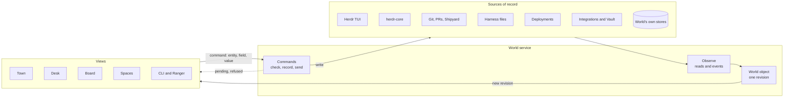

## Context

World is meant to be one object. It is derived from the sources of record and given
to the views to display. A change made in any view goes through World to its source
of record, and a change at a source reaches every view through World.

Today the service reads the sources and returns raw per-host topology plus World's own
stores (`world.snapshot`). The browser then builds the World object
(`web/src/world/runtimeStore.ts`, `web/src/world/worldObject.ts`), and each view adds
its own rules on top. The CLI, Apartments and notifications run on the service, so
they derive the same facts again. Spaces keeps a second copy of the topology. Many
writes go straight to the runtime. [audit.md](audit.md) lists every break found, by
fact.

This design fixes the shape once, so later work moves facts onto it one at a time.

## The rule in one picture

Solid arrows are the only way facts move. A command never changes the World object
by itself: the object changes when World observes the source (for World's own
stores, when the store commits).

## 1. Sources of record

[sources.md](sources.md) lists every source, the facts it owns, how World learns them
and how changes go back. In short: the two runtimes own topology, names, order and
agent status; git and forges own branches, changes and PRs; harness files own
conversations, settings, skills and usage; deployments own instances and releases;
integrations own their rows and secrets; World's own stores own everything World
records (colours, pins, groups, interest, placement, profiles, Town Master, asks,
Bin, agent records).

Each fact has exactly one owner. Where a fact has a World part and a runtime part
(an agent's name in the #1315 agent record and the runtime's tab name), the
World record is the source of record and World writes the runtime value as a mirror.
Profile tokens and Town Master tokens in Herdr pane metadata are mirrors already.

## 2. Where World is derived: on the service

The World object is derived once, on the service. The browser keeps a copy and adds
only presentation.

Why the service:

- The CLI, Ranger, notifications, chimes, web push and Apartments run on the service
  and need the same facts as the views. Today they derive them again, and they
  disagree (for example, Apartments skips the colour hide rule; CLI `ls` shows raw
  status).
- Several browsers, and the phone, must agree. One derivation gives one answer.
- Commands are checked against World's current value, and that check needs one
  place that holds it.
- The service already owns the sources, the observation fences and the stores.

What moves: the pure derivation code in `web/src/world/worldObject.ts`, the grouping
in `web/src/worldHosts.ts`, the colour and look resolver of #1315, relations,
interest, status, attention and counts. They move into `shared/` or `server/src/world/`
and run on the service. The browser stops running them once its views read the
published fields.

The cost is payload: the service sends derived facts, not raw rows. The object stays
bounded by the existing aggregate-observation rules (bounded hosts, stale hosts
non-actionable). Deltas are added only if measured payloads need them.

## 3. How views receive it

- `world.snapshot` stays the one read. Each migration step adds derived fields to it
  and removes raw fields no view needs any more. The result carries one World
  revision.
- When World applies an observation or a commit that changes a fact, it raises the
  revision and tells connected browsers (`world.changed` with the revision). The
  browser fetches, and adopts the result only if its revision is newer than the one it
  holds. Late or out-of-order replies are dropped.
- Each browser holds one World replica. Every view in that browser reads the replica
  through selectors; no view keeps its own copy, calls runtime list verbs, or stores a
  World fact in localStorage. Spaces' own refresh (`web/src/store/refresh.ts`) goes
  away.
- The CLI and Ranger read the same object on the service.
- Presentation stays in the browser: camera, zoom, scroll, selection, open windows,
  drafts, per-view themes. The test is: if another view, browser or the CLI must
  agree on it, it is a fact and lives in World.

## 4. The write path

A change in any view:

1. **Command.** The view calls a World command addressed by entity ID (agent, place,
   room, tab: the IDs of #1315), never by a view key. It sends the field, the new
   value, the value it currently shows (the expected value) and a command ID.
2. **Check.** World refuses at once if the entity is unknown, its host is offline or
   stale, the runtime generation changed, or the value is not allowed. Otherwise it
   records the command (who, entity, field, before, requested) and accepts it.
3. **Send.** For a World-owned fact, World commits it to its store. For a runtime
   fact, World sends it on the entity's own connection ID and runtime generation;
   never another connection.
4. **Observe.** A commit to World's store is its own observation: the revision rises
   at once. For a runtime fact, the runtime's acknowledgement does not change World's
   value. It moves the host's epoch forward and starts a fresh read; World takes the
   value from the first read that started after the acknowledgement.
5. **Publish.** The new revision reaches every view in every browser, and the CLI.

The command states reuse the existing `command_evidence` stages
([verb guide](../../../docs/world-verbs.md#result-evidence)):

| State | Meaning | What the views show |
|---|---|---|
| `accepted` | Checked and recorded | The asking browser shows the requested value, marked pending |
| `stored` | World-owned fact committed | The new value, in every view |
| `sent` | Runtime acknowledged on the named connection and generation | Still pending in the asking browser; the old value elsewhere |
| `observed` | A read that started after the acknowledgement was applied | Whatever that read found, in every view, once each browser has the revision that carries it |
| `refused` | Checked and refused; nothing was sent | World's value at once, with the reason where the user acted |
| `failed` | The source reported an error | World's value at once, with the reason |
| `uncertain` | The connection was lost before an acknowledgement | World's value, marked stale; settled by the first read after reconnection |

**Between write and observation.** The pending value lives in the browser's World
replica, not in a view, so Town, Board, Desk and Spaces in that browser all show the
same pending value. It is drawn as the new value with a pending mark. It is replaced
when the command reaches `refused`, `failed` or `uncertain`, or when the browser's
replica reaches the World revision that carries the `stored` or `observed` outcome.
The outcome and the value travel together: World records the command's outcome with
the revision that carries the value it observed, and the browser learns the outcome
only by adopting that revision (or a later one). So a requested value that World now
holds never flashes back to the old value while the new revision is on its way.
Other browsers and the CLI show World's value until the observation lands; World also
lists commands in progress so they can mark the entity as changing.

**Fences.** World applies a read only if it started after the newest read already
applied for that host and in the host's current epoch. The epoch moves forward on
every command result, every source event and every reconnection. So a slow read that
began before a rename can never put the old name back, and a confirmed change is never
undone by a late observation. The existing per-generation rule for late results
(`server/src/world/snapshot.ts`) stays; the epoch is the finer fence inside a
generation.

**Facts with two homes.** When a World record has a runtime mirror (an agent's name
and its tab name; a profile and its pane token), World commits the record first, then
writes the mirror. A mirror that fails to write leaves the record and is retried on the
next observation. A change made directly in the runtime (a rename in the Herdr TUI) is
observed and updates the record, as #1315 already specifies.

**Multi-step changes are jobs.** A change that needs several source steps (moving an
agent, creating a room and launching into it) is recorded as a durable job in the
existing outbox before the first step. Each step is observed before the next one.
The browser follows the job's state in the World object, never an RPC reply, so a
reload or a service restart loses nothing. This is the lesson of the #1184
postmortem.

**Reads never write.** `world.snapshot` today prunes appearance rows, records spawn
claims and copies legacy colours (`server/src/rpc/world.ts`). These move to the
command and observation stages: spawn claims are recorded by the launch command, hide
rules are derivation, and legacy copies are one-off migrations (#1315 task 7).

## 5. Refusals, failures and conflicts

- A refused or failed command never shows its value after the reply; the views fall
  back to World's value at once and the reason appears where the user acted.
- Two views changing one fact at once: both commands go to the source; the value the
  source ends with is the one every view shows. There is no merge in the browser.
- The source changed after the command (someone renamed the tab in the TUI): the
  source wins. The command still ends as `observed`; the views show the source's
  value.
- The expected value no longer matches World's value when the command arrives: World
  refuses with "changed since you looked" for facts where a silent overwrite would
  lose someone's change (names, placement, pins); it accepts for choices that only
  set a value (colour, interest) and records both in history.

## 6. Offline hosts

- A host that stops answering is stale. Its part of the object stays, marked stale
  and non-actionable, as today.
- Commands on its runtime facts are refused at once ("host offline"). They are not
  queued: a queued rename replayed hours later would surprise the user.
- Commands on World-owned facts about its entities (colour, pin, group, interest,
  placement) are accepted, because World is their source. Mirrors are written when the
  host is back.
- A command that was sent but not acknowledged when the host went away becomes
  `uncertain`. On reconnection World reads before anything counts as settled; the
  read decides what the views show.
- When the browser loses the service, it shows its replica as stale and disables
  commands.

## 7. History and undo

- Every accepted command is a history entry: who (view, CLI, Ranger, agent), when,
  entity, field, before, after and final state. The entries live in the existing
  `ledger_changes` table that CLI changes use today (`server/src/world/world-ledger.ts`),
  so no new store. Its current automatic trim to 2000 entries conflicts with the
  single-model rule that history size is the user's decision; the history step
  replaces the trim with that rule.
- `herdr-world history` and a History panel read the same entries, so a change made in
  Town shows in the CLI and a change made by an agent shows in Town.
- Undo is a new command that sets the before value with the after value as its
  expected value. If the fact changed since, undo is refused: "undo the later change
  first", as the CLI does today.
- Undo covers World-owned facts and reversible runtime facts (name, order,
  placement). Destructive runtime changes (close, kill) show in history without undo;
  the Bin is their safety net. Creation is undone by closing, through the Bin.

## 8. Fit with in-flight work

| Work | Decision | Why |
|---|---|---|
| #1309 / #1315 agent record (`world-agent-identity`) | **Keep, build on it.** Its agent and place records are the entity IDs commands address. **Change one thing:** task 8.1's shared colour and look resolver runs on the service and publishes the resolved colour; the browser does not run it. Task 8.2 (`agent.set`, `agent.place`) follows this write path. | The record is the identity this design needs; running its resolver in every view would repeat today's break |
| Single-model plan (#1251, `world-single-model`) | **Keep** storage steps 2.1–2.3 and 2.5. **Change** step 2.4 ("one owned-model stream"): this design is its detailed shape, and [tasks.md](tasks.md) is its migration | Same goal; this design adds the write path and the view rules that 2.4 left open |
| #1300, #1312 server feature extraction | **Keep.** World commands and derived facts are declared in feature folders | Neutral moves; they make each fact's owner easier to find |
| #1240 freeze the hubs | **Keep, and extend** the freeze: the list of runtime-tier write verbs the browser may call may only shrink | Stops new writes around World while the migration runs |
| #1243 CLI commands and Town panels from features | **Keep, with a change:** CLI commands and panels read the World object, and features add facts to the object, never to a view | Otherwise each feature reintroduces its own derivation |
| Browser World builder (`web/src/world/worldObject.ts`, `runtimeStore.ts`) | **Stop growing.** No new derivation in the browser; each step removes one | It is the part being replaced |

## 9. Migration

[tasks.md](tasks.md) lists the steps. Each is one PR of about 300 lines, leaves
`main` working, and moves at least one fact fully onto the World path in every view
and the CLI: derived on the service, read from the replica, written through a World
command, with history. Grouping and colour go first because they are the most visible
disagreements and already have shared homes. Each step deletes the old view code it
replaces in the same PR, and adds the fact to a cross-view test (one snapshot; Town,
Desk, Board, Spaces and the CLI show the same value), so it cannot drift back.

## 10. Quint assessment

The write path is ordering and ownership, so it needs a model.
[write-path.qnt](write-path.qnt) models one fact, its source, World and two views,
with late reads, late acknowledgements, direct source changes, refusals and the host
going offline and back. It checks:

- World only holds values the source really held, and never goes back in time.
- Views only hold values World published, and never go back in time.
- Settling a command never makes a view show anything but World's current value: the
  pending value stays until the view adopts the revision that carries the outcome.
- A confirmed command is never undone by a late observation.
- Nothing is sent to an offline source.
- Once everything is delivered and read, World and every view show the source's
  value.

Commands (`Q=tools/quint/node_modules/@informalsystems/quint/dist/src/cli.js`, after
`bun run verification:setup`):

- `node $Q test write-path.qnt`: 6 scenarios pass (late read discarded, source change
  after a command wins, refusal restores, offline, observed command holds until its
  revision is adopted, two views converge).
- `node $Q run write-path.qnt --invariant safety --max-samples 200000 --max-steps 30 --seed 7 --backend=rust`:
  no violation.
- Control: with `FENCED = false` (World applies any late read, takes an
  acknowledgement as the value, views take any push) the same run finds a violation
  and the late-read scenario fails. A second control, settling the command without
  naming its revision (`crev` 0 in `applyRead`), fails `noFlashBack` and the
  observed-holds scenario: the asking view shows the old value after World took the
  new one.

The model stays design-stage in this folder, like `agent-identity.qnt`. The step that
adds the command records and epoch fence (tasks.md step 4) moves it into `quint/`
with an adapter over the real code, a coverage entry and the full verification gate.

## Decisions

- World is derived on the service; browsers hold a replica plus presentation.
- `world.snapshot` stays the read; it changes shape step by step.
- Acknowledgement is not observation, for runtime facts. For World-owned facts, the
  commit is the observation.
- Offline: runtime commands refused, not queued; World-owned facts still editable.
- Pending values live in the browser's replica, shared by its views.
- History uses `ledger_changes`; no new table.

## Risks

- Payload and latency: derived objects for many hosts may be larger than raw rows.
  Measure in step 1; add deltas only if needed.
- During migration some facts are on the new path and others are not. The
  cross-view test and the #1240 freeze keep the boundary from moving backwards.
- Pending marks can feel slow on high-latency SSH hosts. The pending value shows at
  once; only the mark waits for the observation.
