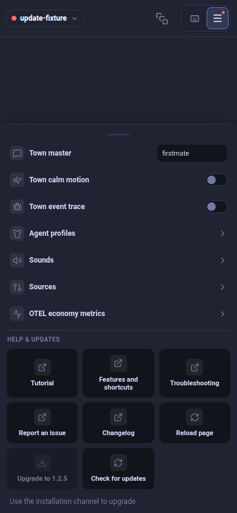

# World update notification review-repair evidence

Source: `0cb36e9b65b694d074f0bd08dfecbea4d180c052`. Real App, ConfigMenu and UpdateToast with synthetic release/install replies and no live Herdr session. The maintained Chromium/Linux fixture passes at all five reference sizes. It exercises an actual IndexedDB read/write interleaving and two independent same-origin browsing contexts with exactly one notification winner, plus held-response unit regressions, explicit manual feedback, disabled Upgrade with a reachable recheck and visible channel guidance. Captures follow normal menu animation completion and scrolling, with no CSS override.

| Context | CSS viewport | Dismissed update | Unsupported channel |
| --- | --- | --- | --- |
| Phone | 390 × 844 | [Upgrade and dot](390x844.png) | [Visible reason and recheck](blocked-390x844.png) |
| Mac laptop size | 1512 × 982 | [Upgrade and dot](1512x982.png) | [Visible reason and recheck](blocked-1512x982.png) |
| Half-width Linux | 1280 × 1440 | [Upgrade and dot](1280x1440.png) | [Visible reason and recheck](blocked-1280x1440.png) |
| Wide Linux | 2560 × 1440 | [Upgrade and dot](2560x1440.png) | [Visible reason and recheck](blocked-2560x1440.png) |
| Portrait | 1440 × 2560 | [Upgrade and dot](1440x2560.png) | [Visible reason and recheck](blocked-1440x2560.png) |

The five maintained browser cases also check the actual manual menu action after reload-like state loss with automatic checks disabled, no repeated release toast, the explicit install POST/header, failed-install retry, success clearing and a later release. The blocked-channel menu action then fetches a current response with polling disabled and clears the offer. Store tests hold both available and error replies across a successful installation, then prove a genuinely later check remains admitted. Final focused unit receipt: 128 pass, 486 assertions.

These are DOM-driven Chromium/Linux interactions and synthetic metadata, not native Mac/Android, real installation/restart, remote SSH or cross-device notification proof. Existing local markers are honored. Persistent claims use IndexedDB transactions within this browser profile/origin; unavailable persistent storage degrades to best-effort legacy markers and page-lifetime suppression, without a cross-window guarantee. A slow persistent claim fails closed. Separate origins/profiles remain independent.

