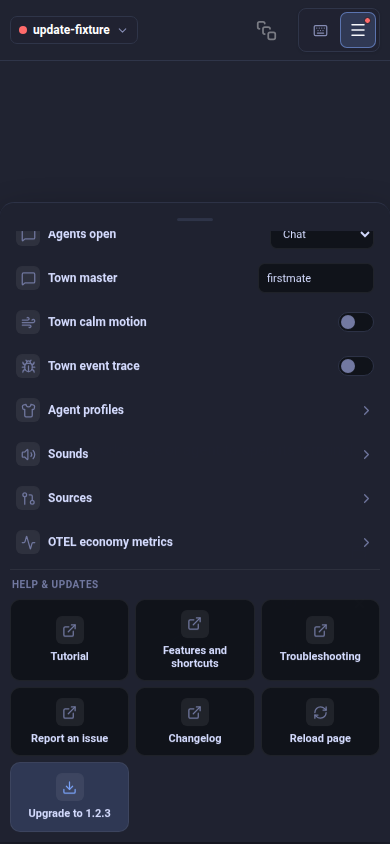

# World update notification evidence

Source: `e52d741ecf892333698e2f2853a81ba6bacff864`. Production App, ConfigMenu and UpdateToast with synthetic update replies and no live Herdr session. All five maintained Chromium/Linux cases pass. The notification has been dismissed in these captures: the red Menu dot and Upgrade to 1.2.3 remain. The menu content is scrolled to the update entry with its normal scroll behavior; no CSS override or forced layout is used.

| Context | CSS viewport | Capture |
| --- | --- | --- |
| Phone | 390 × 844 | [Menu and Upgrade](390x844.png) |
| Mac laptop size | 1512 × 982 | [Menu and Upgrade](1512x982.png) |
| Half-width Linux | 1280 × 1440 | [Menu and Upgrade](1280x1440.png) |
| Wide Linux | 2560 × 1440 | [Menu and Upgrade](2560x1440.png) |
| Portrait | 1440 × 2560 | [Menu and Upgrade](1440x2560.png) |

The maintained browser fixture checks first notification, dismissal, repeated manual checking without another notification, accessible persistent attention and a versioned Upgrade action, failed-install retry, success clearing, a later release notification and unsupported installation-channel refusal. Install POST and its explicit header are asserted against a fake endpoint. Unit/store tests separately cover storage history across fresh instances, page-state reinitialization and storage denial. These are DOM-driven browser interactions with synthetic metadata, not native Mac/Android, real update installation, service restart or cross-device history proof. Browser storage persistence is scoped to profile and World origin; restricted storage only deduplicates for the page lifetime.

