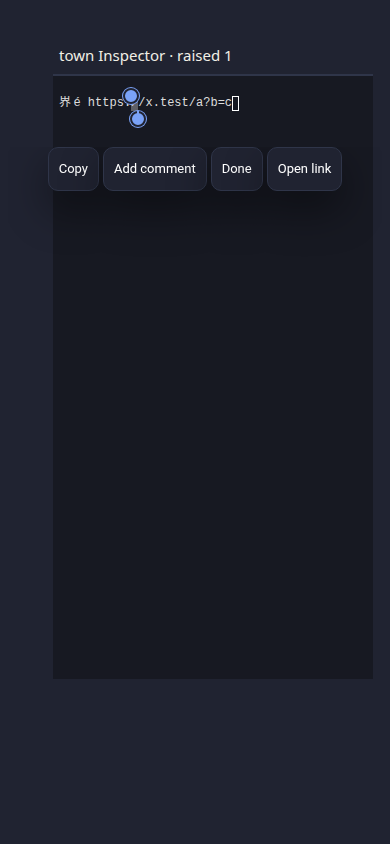
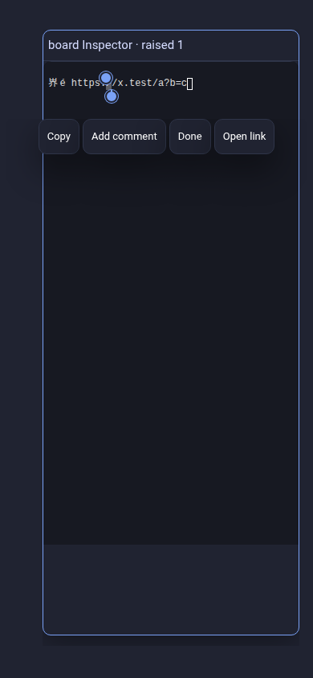

# Inspector terminal-link evidence

Product source: `ede372b8837d9213bd25b41bd96e65e9126337a1`. These are synthetic managed Inspectors using production WindowFrame, WorldTerminalPortalList and TerminalView, with real xterm and trusted Chrome mouse/touch input. The minimal frame uses the Town skin flag or Board shell; it is not a full canvas scene or live Herdr session. The heading and window-raise counter belong to the fixture. No real host data is used.

| Context | CSS viewport | Synthetic managed Inspector |
| --- | --- | --- |
| Phone | 390 × 844 | [Town: long-press Open link](town-390x844.png) |
| Mac laptop size | 1512 × 982 | [Town: modifier-click target](town-1512x982.png) |
| Half-width Linux | 1280 × 1440 | [Town: modifier-click target](town-1280x1440.png) |
| Wide Linux | 2560 × 1440 | [Board: modifier-click target](board-2560x1440.png) |
| Portrait | 1440 × 2560 | [Board: modifier-click target](board-1440x2560.png) |
| Additional phone | 390 × 844 | [Board: long-press Open link](board-390x844.png) |

The maintained browser cases compare Spaces with managed Town and Board portals. They cover unchanged URLs beside a changing hard status row, wrapped and native OSC 8 links, first-click activation across selection/window updates, URI and stale-frame refusal, phone link/file menus with Composer open, and no terminal input from link gestures. Browser opening is intercepted to assert the requested destination and trusted activation; no external website navigation is claimed. All eleven cases pass. The 320px smoke case uses a short complete URL so it does not bypass intentional clipped-link rejection.

Captures use Chromium/Linux at device scale factor 1 for these six images. Mac and phone names describe viewport contexts, not native-device validation. See receipt.json for exact dimensions.

