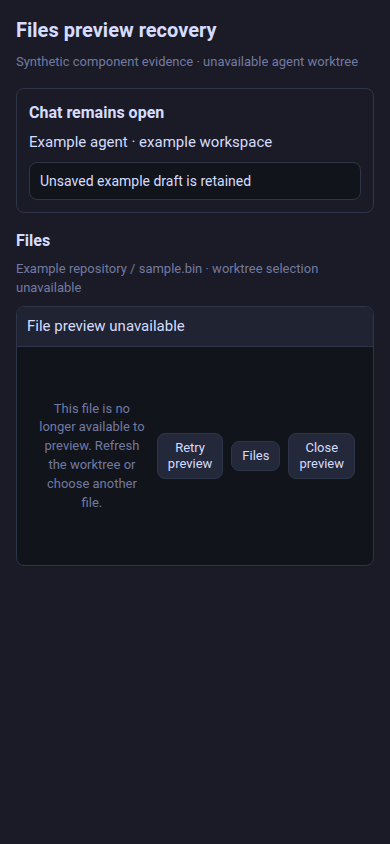

# File preview recovery — synthetic evidence

Source: `24bf581c9a107b26101ab7121afd7ae800373fb9` (PR #413).

These captures render the production FilePreviewContent and its recovery boundary with production tokens/base/preview CSS, inside a minimal synthetic Files/Chat frame. The client deliberately has no current agent-worktree selection while retaining an old binary file preview. This triggers the actual strict URL-construction error and renders the boundary’s real unavailable notice, Retry preview, Files/back and Close preview actions. The surrounding example Chat draft remains present. The frame is not a full live Inspector or real account/session.

| Context | CSS viewport | Capture |
| --- | --- | --- |
| Phone | 390 × 844 | [Recovery notice and controls](phone-390x844.png) |
| Mac laptop size | 1512 × 982 | [Recovery notice and controls](mac-laptop-1512x982.png) |
| Half-width Linux | 1280 × 1440 | [Recovery notice and controls](half-linux-1280x1440.png) |
| Wide Linux | 2560 × 1440 | [Recovery notice and controls](wide-linux-2560x1440.png) |
| Portrait | 1440 × 2560 | [Recovery notice and controls](portrait-1440x2560.png) |

At each size the capture run asserts no horizontal document overflow, all three controls within the viewport and hit-testable, retry while stale remains contained, back/close invoke their callbacks, and explicit retry after a synthetic current binding restores the preview without losing the Chat draft. See receipt.json for results.

Chromium on Linux, device scale factor 1, CSS viewport emulation. These are not native Mac/mobile or live Herdr/worktree/SSH checks. No production listener or account is used or changed.

