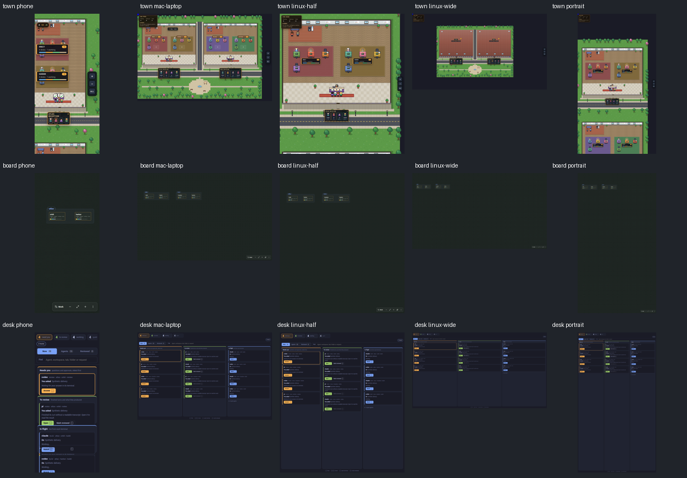

# Revision-qualified evidence capture #530

Product source: `f7e272800651ad5349c479f5c730f3b8d5aa9fb2`. Base: `75ac18f499014225c7c6b980268e355b2b6d1629`.

The production TownCanvas, BoardView and DeskBoard render two synthetic hosts, four rooms and sixteen desks, without a World/Herdr service. Every image uses the revision helper at DPR 1. Five sizes cover Phone 390×844, Mac laptop 1512×982, half-width Linux 1280×1440, wide Linux 2560×1440 and portrait 1440×2560.

| Viewport | Town | Board | Desk |
| --- | --- | --- | --- |
| phone | [Town](town-phone.png) | [Board](board-phone.png) | [Desk](desk-phone.png) |
| mac-laptop | [Town](town-mac-laptop.png) | [Board](board-mac-laptop.png) | [Desk](desk-mac-laptop.png) |
| linux-half | [Town](town-linux-half.png) | [Board](board-linux-half.png) | [Desk](desk-linux-half.png) |
| linux-wide | [Town](town-linux-wide.png) | [Board](board-linux-wide.png) | [Desk](desk-linux-wide.png) |
| portrait | [Town](town-portrait.png) | [Board](board-portrait.png) | [Desk](desk-portrait.png) |

[town.json](town.json), [board.json](board.json) and [desk.json](desk.json) record exact dimensions, current owner/revision and sampled non-background fractions. [manifest.json](manifest.json) records original PNG hashes.

The controlled slow image and font are held until capture is pending with no marker or screenshot. Releasing both produces current content. Tests also reject a never-ready image without creating any artifact, missing expected content, predominantly blank output and a view replacement during screenshot capture. Hidden retained Town cannot authorize a Board/Desk capture. Empty Board/Desk views remain valid. See [controls.json](controls.json).

All captures use a disposable dynamic-CDP Chrome through the shared browser queue. The recorded host load average is observation, not a test threshold or proof of arbitrary host load. The held resources provide reproducible slow-machine evidence without saturating owner resources. Animation remains enabled. Visual inspection confirms Town floors, buildings and desks, populated Board cards and Desk lanes.

This is Linux Chromium synthetic component-tree evidence. Native macOS/phone devices, live Herdr behavior, independent review and required exact-head CI remain separate conditions. No production listener, owner session or profiler worktree was used.
