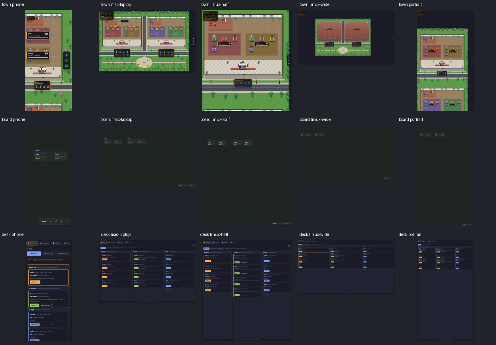

# PR #613 round 1 repair evidence

Product source: `ae4293db115333e45529b9bab50522118d7bf60e`. Synthetic production TownCanvas, BoardView and DeskBoard; Linux Chromium, DPR 1, no World or Herdr service.

The original fifteen-image gallery remains in its immutable pre-review commit. This gallery captures the repaired source at all five owner sizes.

| Viewport | Town | Board | Desk |
| --- | --- | --- | --- |
| phone | [image](town-phone.png) | [image](board-phone.png) | [image](desk-phone.png) |
| mac-laptop | [image](town-mac-laptop.png) | [image](board-mac-laptop.png) | [image](desk-mac-laptop.png) |
| linux-half | [image](town-linux-half.png) | [image](board-linux-half.png) | [image](desk-linux-half.png) |
| linux-wide | [image](town-linux-wide.png) | [image](board-linux-wide.png) | [image](desk-linux-wide.png) |
| portrait | [image](town-portrait.png) | [image](board-portrait.png) | [image](desk-portrait.png) |

[Receipts and hashes](manifest.json), [Town](town.json), [Board](board.json), [Desk](desk.json), [controlled schedules](controls.json).

The real browser first times out on a never-returning image and leaves no artifact. A second capture starts on that same mounted Town, then removes the image and commits a current scene. The second capture and a subsequent capture succeed with the same mount owner, without resolving the obsolete image response. The synthetic server releases that response only during teardown.

Deterministic resource tests also abandon unresolved font/image loads, verify listener cleanup and stale decode rejection, and bound revision bursts to one active resource check. The migrated Board writer has a missing-card negative control that creates no PNG. Populated Board, handoff and answer-gallery consumers now supply content expectations. Sanity samples the expected content bounds at the unchanged 2% threshold, including sparse valid component scenes; handoff captures explicitly check portalled Inspector controls. Receipts record sample rectangles. Empty Board/Desk remains valid without a content expectation.

Images show complete Town buildings/floors/desks, populated Board cards and Desk lanes. Animation stays enabled. Controlled asset delay is reproducible evidence, and recorded shared-host load is context rather than a threshold or arbitrary-load proof. Native macOS/phone, live Herdr, independent review and fresh exact-head required CI remain separate conditions.
